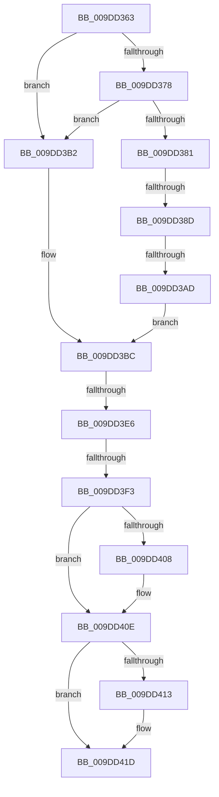

# sub_009DD363

- RVA: `0x009DD363`–`0x009DD42F` (길이 `204` bytes)
- VA: `0x00000001409DD363`
- 실행 섹션: `PAGE`
- PDB 이름 있음: `아니요`; PDB Function 태그: `아니요`
- unwind 정보 RVA: `0x000A38C0`
- 디코드: `54`개 명령, `204/204` bytes 표시
- 미해석 바이트: `0` (있으면 어셈블리에 `.byte`로 보존)

> 이 문서는 커널 이미지의 기계어와 PDB 기호를 분석해 생성했습니다. 4번과 5번은 함수 원형과 자료형을 바이너리 사용 방식에서 추정한 C 해석이며 원본 소스 복구 결과는 아닙니다.

## 1. Dependencies

- 직접 호출 지점: **4**; 고유 호출 대상: **4**
- 직접 호출자로 확인된 함수: **0**
- RIP 상대 이미지 참조: **0**

### Outgoing calls
- `0x009DD39C` → [ExAllocatePool2](../../poolcode/B8/ExAllocatePool2_function_00B820F0.md) (function, `0x00B820F0`)
- `0x009DD3DB` → [ZwQueryValueKey](../../text/6A/ZwQueryValueKey_function_006AD3B0.md) (function, `0x006AD3B0`)
- `0x009DD3FE` → [memcpy](../../text/6C/memcpy_function_006C6840.md) (function, `0x006C6840`)
- `0x009DD418` → [ExFreePoolWithTag](../../poolcode/B8/ExFreePoolWithTag_function_00B82870.md) (function, `0x00B82870`)

### Direct callers
- 이 함수 시작 RVA로 연결되는 직접 call은 확인되지 않았습니다. 간접 호출은 완전히 역산할 수 없습니다.

### Static image references
- 디코드된 RIP-relative 메모리 참조가 없습니다.

## 2. Other-region calls and transfers

- 다른 실행 섹션으로 향하는 call: **4**
  - `0x009DD39C` → [ExAllocatePool2](../../poolcode/B8/ExAllocatePool2_function_00B820F0.md) (`PAGE` → `POOLCODE`)
  - `0x009DD3DB` → [ZwQueryValueKey](../../text/6A/ZwQueryValueKey_function_006AD3B0.md) (`PAGE` → `.text`)
  - `0x009DD3FE` → [memcpy](../../text/6C/memcpy_function_006C6840.md) (`PAGE` → `.text`)
  - `0x009DD418` → [ExFreePoolWithTag](../../poolcode/B8/ExFreePoolWithTag_function_00B82870.md) (`PAGE` → `POOLCODE`)
- call이 아닌 외부 분기/꼬리 이동: **4**
  - `0x009DD387` → [sub_009DD450](Unknown_function_009DD450.md) (`tail-transfer`)
  - `0x009DD3A7` → [sub_009DD450 + 0x17](Unknown_function_009DD450.md) (`tail-transfer`)
  - `0x009DD3E4` → [sub_009DD450 + 0x7](Unknown_function_009DD450.md) (`tail-transfer`)
  - `0x009DD3F1` → [sub_009DD450 + 0x10](Unknown_function_009DD450.md) (`tail-transfer`)

## 3. Assembly (complete function range)

```asm
009DD363  48 89 9C 24 E8 00 00 00         mov qword ptr [rsp + 0xe8], rbx
009DD36B  48 89 AC 24 E0 00 00 00         mov qword ptr [rsp + 0xe0], rbp
009DD373  4D 85 FF                        test r15, r15
009DD376  74 3A                           je 0x1409dd3b2
009DD378  8B 06                           mov eax, dword ptr [rsi]
009DD37A  3D 80 00 00 00                  cmp eax, 0x80
009DD37F  76 31                           jbe 0x1409dd3b2
009DD381  83 C0 0C                        add eax, 0xc
009DD384  83 F8 0C                        cmp eax, 0xc
009DD387  0F 82 C3 00 00 00               jb 0x1409dd450
009DD38D  8B D0                           mov edx, eax
009DD38F  B9 00 01 00 00                  mov ecx, 0x100
009DD394  41 B8 52 45 47 4C               mov r8d, 0x4c474552
009DD39A  8B E8                           mov ebp, eax
009DD39C  E8 4F 4D 1A 00                  call 0x140b820f0
009DD3A1  48 8B F8                        mov rdi, rax
009DD3A4  48 85 C0                        test rax, rax
009DD3A7  0F 84 BA 00 00 00               je 0x1409dd467
009DD3AD  48 8B D8                        mov rbx, rax
009DD3B0  EB 0A                           jmp 0x1409dd3bc
009DD3B2  48 8D 5C 24 48                  lea rbx, [rsp + 0x48]
009DD3B7  BD 8C 00 00 00                  mov ebp, 0x8c
009DD3BC  48 8D 44 24 30                  lea rax, [rsp + 0x30]
009DD3C1  4C 8B CB                        mov r9, rbx
009DD3C4  48 89 44 24 28                  mov qword ptr [rsp + 0x28], rax
009DD3C9  48 8D 54 24 38                  lea rdx, [rsp + 0x38]
009DD3CE  41 B8 02 00 00 00               mov r8d, 2
009DD3D4  89 6C 24 20                     mov dword ptr [rsp + 0x20], ebp
009DD3D8  49 8B CC                        mov rcx, r12
009DD3DB  E8 D0 FF CC FF                  call 0x1406ad3b0
009DD3E0  8B E8                           mov ebp, eax
009DD3E2  85 C0                           test eax, eax
009DD3E4  75 71                           jne 0x1409dd457
009DD3E6  44 8B 06                        mov r8d, dword ptr [rsi]
009DD3E9  8B 53 08                        mov edx, dword ptr [rbx + 8]
009DD3EC  89 16                           mov dword ptr [rsi], edx
009DD3EE  44 3B C2                        cmp r8d, edx
009DD3F1  72 6D                           jb 0x1409dd460
009DD3F3  44 8B 43 08                     mov r8d, dword ptr [rbx + 8]
009DD3F7  48 8D 53 0C                     lea rdx, [rbx + 0xc]
009DD3FB  49 8B CF                        mov rcx, r15
009DD3FE  E8 3D 94 CE FF                  call 0x1406c6840
009DD403  4D 85 F6                        test r14, r14
009DD406  74 06                           je 0x1409dd40e
009DD408  8B 43 04                        mov eax, dword ptr [rbx + 4]
009DD40B  41 89 06                        mov dword ptr [r14], eax
009DD40E  48 85 FF                        test rdi, rdi
009DD411  74 0A                           je 0x1409dd41d
009DD413  33 D2                           xor edx, edx
009DD415  48 8B CF                        mov rcx, rdi
009DD418  E8 53 54 1A 00                  call 0x140b82870
009DD41D  8B C5                           mov eax, ebp
009DD41F  48 8B 9C 24 E8 00 00 00         mov rbx, qword ptr [rsp + 0xe8]
009DD427  48 8B AC 24 E0 00 00 00         mov rbp, qword ptr [rsp + 0xe0]
```

## 4. C-style interpretation (structured pseudocode)

```c
__int64 __fastcall sub_009DD363(__int64 a1, __int64 a2, __int64 a3, __int64 a4, __int64 a5, __int64 a6, __int64 a7, __int64 a8, __int64 a9, __int64 a10, __int64 a11, __int64 a12, __int64 a13, __int64 a14, __int64 a15, __int64 a16, __int64 a17, __int64 a18, __int64 a19, __int64 a20, __int64 a21, __int64 a22, __int64 a23, __int64 a24, __int64 a25, __int64 a26, __int64 a27, __int64 a28, __int64 a29)
{
    __int64 result;
    unsigned int v_stack_p20;
    unsigned __int64 v_stack_p28;
    unsigned __int64 v_stack_pE0;
    unsigned __int64 v_stack_pE8;

    v_stack_pE8 = v_rbx;
    v_stack_pE0 = v_rbp;
    if (v_r15 == 0) goto loc_009DD3B2;
    if (((unsigned int)((unsigned int)(*(unsigned int *)(v_rsi)))) <= 128) goto loc_009DD3B2;
    result = (unsigned int)(((unsigned int)(*(unsigned int *)(v_rsi))) + (12));
    result = ExAllocatePool2(256, (unsigned int)((unsigned int)(result)), (unsigned int)(0x4C474552ULL), a4);
    goto loc_009DD3BC;
loc_009DD3B2:
loc_009DD3BC:
    v_stack_p28 = a6;
    v_stack_p20 = 140;
    result = ZwQueryValueKey(v_r12, a7, 2, a9);
    *(unsigned int *)(v_rsi) = (unsigned int)((unsigned int)(*(unsigned int *)(a9 + 8)));
    result = memcpy(v_r15, a9 + 12, (unsigned int)(*(unsigned int *)(a9 + 8)), a9);
    if (v_r14 != 0) {
        result = *(unsigned int *)(a9 + 4);
        *(unsigned int *)(v_r14) = (unsigned int)(result);
    }
    if (result != 0) {
        a2 = 0;
        a1 = result;
        result = ExFreePoolWithTag(a1, a2, (unsigned int)(*(unsigned int *)(a9 + 8)), a9);
    }
    return (unsigned int)((unsigned int)((unsigned int)((unsigned int)(result))));
}
```

## 5. (Beta) C Style

```c
int64_t sub_009DD363(int64_t Arg1, int64_t Arg2, int64_t Arg3, int64_t Arg4, uint64_t Arg5, int64_t Arg6, int64_t Arg7, uint64_t Arg8, int64_t Arg9, uint64_t Arg10, uint64_t Arg11, uint64_t Arg12, uint64_t Arg13, uint64_t Arg14, uint64_t Arg15, uint64_t Arg16, uint64_t Arg17, uint64_t Arg18, uint64_t Arg19, uint64_t Arg20, uint64_t Arg21, uint64_t Arg22, uint64_t Arg23, uint64_t Arg24, uint64_t Arg25, uint64_t Arg26, uint64_t Arg27, int64_t Arg28, int64_t Arg29)
{
    int64_t result;
    uint32_t v_stack_p20;
    uint64_t v_stack_p28;
    uint64_t v_stack_pE0;
    uint64_t v_stack_pE8;

    v_stack_pE8 = local_rbx;
    v_stack_pE0 = local_rbp;
    if (local_r15 == 0) goto loc_009DD3B2;
    if (((uint32_t)((uint32_t)(*(uint32_t *)(local_rsi)))) <= 128) goto loc_009DD3B2;
    result = (uint32_t)(((uint32_t)(*(uint32_t *)(local_rsi))) + (12));
    result = ExAllocatePool2(256, (uint32_t)((uint32_t)(result)), (uint32_t)(0x4C474552ULL), Arg4);
    goto loc_009DD3BC;
loc_009DD3B2:
loc_009DD3BC:
    v_stack_p28 = Arg6;
    v_stack_p20 = 140;
    result = ZwQueryValueKey(local_r12, Arg7, 2, Arg9);
    *(uint32_t *)(local_rsi) = (uint32_t)((uint32_t)(*(uint32_t *)(Arg9 + 0x8)));
    result = memcpy(local_r15, Arg9 + 12, (uint32_t)(*(uint32_t *)(Arg9 + 0x8)), Arg9);
    if (local_r14 != 0) {
        result = *(uint32_t *)(Arg9 + 0x4);
        *(uint32_t *)(local_r14) = (uint32_t)(result);
    }
    if (result != 0) {
        Arg2 = 0;
        Arg1 = result;
        result = ExFreePoolWithTag(Arg1, Arg2, (uint32_t)(*(uint32_t *)(Arg9 + 0x8)), Arg9);
    }
    return (uint32_t)((uint32_t)((uint32_t)((uint32_t)(result))));
}
```

## 6. Execution-region graph

[열기: 2D/3D 그래프와 함수 탐색 컨트롤 패널](../../../control-panel.html?section=page&rva=0x009DD363&view=graph)

- 2D 그래프는 위에서 아래로 흐르고, 3D 그래프는 빈 공간을 드래그해 회전합니다. Shift+드래그는 이동, 휠은 확대·축소, 함수 노드 선택은 대상 보고서 이동입니다.

### Static fallback


