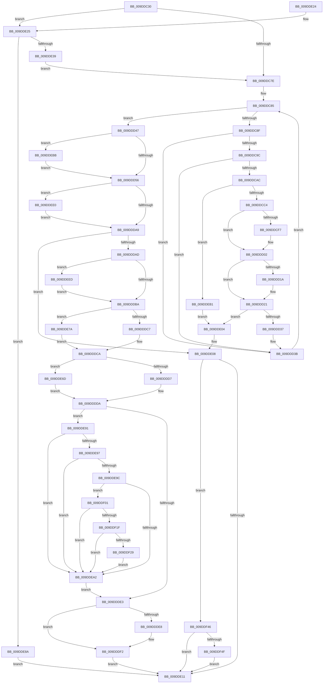

# WmipAddDataSource

- RVA: `0x009DDC30`–`0x009DDF67` (길이 `823` bytes)
- VA: `0x00000001409DDC30`
- 실행 섹션: `PAGE`
- PDB 이름 있음: `예`; PDB Function 태그: `아니요`
- unwind 정보 RVA: `0x000A3980`
- 디코드: `219`개 명령, `823/823` bytes 표시
- 미해석 바이트: `0` (있으면 어셈블리에 `.byte`로 보존)

> 이 문서는 커널 이미지의 기계어와 PDB 기호를 분석해 생성했습니다. 4번과 5번은 함수 원형과 자료형을 바이너리 사용 방식에서 추정한 C 해석이며 원본 소스 복구 결과는 아닙니다.

## 1. Dependencies

- 직접 호출 지점: **16**; 고유 호출 대상: **13**
- 직접 호출자로 확인된 함수: **2**
- RIP 상대 이미지 참조: **6**

### Outgoing calls
- `0x009DDCB3` → [WmipAllocEntry](WmipAllocEntry_function_009DDF70.md) (function, `0x009DDF70`)
- `0x009DDCE4` → [WmipBuildInstanceSet](WmipBuildInstanceSet_function_009DDFC4.md) (function, `0x009DDFC4`)
- `0x009DDD79` → [KeWaitForSingleObject](../../text/20/KeWaitForSingleObject_function_0020E6B0.md) (function, `0x0020E6B0`)
- `0x009DDD8B` → [WmipLinkDataSourceToList](WmipLinkDataSourceToList_function_009DF4D4.md) (function, `0x009DF4D4`)
- `0x009DDD9B` → [KeReleaseMutex](../../text/39/KeReleaseMutex_function_00396810.md) (function, `0x00396810`)
- `0x009DDDED` → [ExFreePoolWithTag](../../poolcode/B8/ExFreePoolWithTag_function_00B82870.md) (function, `0x00B82870`)
- `0x009DDDFA` → [WmipGenerateRegistrationNotification](WmipGenerateRegistrationNotification_function_009DF60C.md) (function, `0x009DF60C`)
- `0x009DDE2C` → [WmipAllocEntry](WmipAllocEntry_function_009DDF70.md) (function, `0x009DDF70`)
- `0x009DDE6D` → [WmipCountedToSz](../9E/WmipCountedToSz_function_009E2318.md) (function, `0x009E2318`)
- `0x009DDE7D` → [WmipCountedToSz](../9E/WmipCountedToSz_function_009E2318.md) (function, `0x009E2318`)
- `0x009DDEA7` → [ExFreePoolWithTag](../../poolcode/B8/ExFreePoolWithTag_function_00B82870.md) (function, `0x00B82870`)
- `0x009DDEE3` → [WmipProcessSynchronousEtw](../AC/WmipProcessSynchronousEtw_function_00ACE5FC.md) (function, `0x00ACE5FC`)
- `0x009DDEF7` → [WmipGenerateBinaryMofNotification](../7B/WmipGenerateBinaryMofNotification_function_007B4348.md) (function, `0x007B4348`)
- `0x009DDF16` → [WmipAddMofResource](../7B/WmipAddMofResource_function_007B4188.md) (function, `0x007B4188`)
- `0x009DDF3C` → [WmipGenerateMofResourceNotification](../AC/WmipGenerateMofResourceNotification_function_00AC83F4.md) (function, `0x00AC83F4`)
- `0x009DDF5D` → [WmipUnreferenceEntry](../9E/WmipUnreferenceEntry_function_009E0CC8.md) (function, `0x009E0CC8`)

### Direct callers
- [WmipProcessWmiRegInfo](WmipProcessWmiRegInfo_function_009DDB14.md) at `0x009DDBAF`
- [WmipInitializeDataStructs](../../init/C4/WmipInitializeDataStructs_function_00C4D6BC.md) at `0x00C4D7CC`

### Static image references
- `0x009DDCAC` → RVA `0x00E03608` (`.data`; read)
- `0x009DDCEE` → RVA `0x00B4AF40` (`WmipBinaryMofGuid`; read)
- `0x009DDCFB` → RVA `0x00B4AF48` (`PAGE`; read)
- `0x009DDD58` → RVA `0x00EFFA60` (`.data`; read)
- `0x009DDE25` → RVA `0x00E03648` (`.data`; read)
- `0x009DDEED` → RVA `0x00B4AFE8` (`GUID_MOF_RESOURCE_ADDED_NOTIFICATION`; read)

## 2. Other-region calls and transfers

- 다른 실행 섹션으로 향하는 call: **4**
  - `0x009DDD79` → [KeWaitForSingleObject](../../text/20/KeWaitForSingleObject_function_0020E6B0.md) (`PAGE` → `.text`)
  - `0x009DDD9B` → [KeReleaseMutex](../../text/39/KeReleaseMutex_function_00396810.md) (`PAGE` → `.text`)
  - `0x009DDDED` → [ExFreePoolWithTag](../../poolcode/B8/ExFreePoolWithTag_function_00B82870.md) (`PAGE` → `POOLCODE`)
  - `0x009DDEA7` → [ExFreePoolWithTag](../../poolcode/B8/ExFreePoolWithTag_function_00B82870.md) (`PAGE` → `POOLCODE`)
- 별도 외부 분기/꼬리 이동을 확인하지 못했습니다.

## 3. Assembly (complete function range)

```asm
009DDC30  4C 89 4C 24 20                  mov qword ptr [rsp + 0x20], r9
009DDC35  44 89 44 24 18                  mov dword ptr [rsp + 0x18], r8d
009DDC3A  48 89 54 24 10                  mov qword ptr [rsp + 0x10], rdx
009DDC3F  55                              push rbp
009DDC40  53                              push rbx
009DDC41  56                              push rsi
009DDC42  57                              push rdi
009DDC43  41 54                           push r12
009DDC45  41 55                           push r13
009DDC47  41 56                           push r14
009DDC49  41 57                           push r15
009DDC4B  48 8B EC                        mov rbp, rsp
009DDC4E  48 83 EC 68                     sub rsp, 0x68
009DDC52  48 8B 59 20                     mov rbx, qword ptr [rcx + 0x20]
009DDC56  45 33 FF                        xor r15d, r15d
009DDC59  45 32 F6                        xor r14b, r14b
009DDC5C  44 88 7D C8                     mov byte ptr [rbp - 0x38], r15b
009DDC60  44 88 75 48                     mov byte ptr [rbp + 0x48], r14b
009DDC64  0F 57 C0                        xorps xmm0, xmm0
009DDC67  48 8B FA                        mov rdi, rdx
009DDC6A  4C 8B E9                        mov r13, rcx
009DDC6D  0F 11 45 D0                     movups xmmword ptr [rbp - 0x30], xmm0
009DDC71  0F 11 45 E0                     movups xmmword ptr [rbp - 0x20], xmm0
009DDC75  48 85 DB                        test rbx, rbx
009DDC78  0F 84 A7 01 00 00               je 0x1409dde25
009DDC7E  48 8D 77 18                     lea rsi, [rdi + 0x18]
009DDC82  45 33 E4                        xor r12d, r12d
009DDC85  44 3B 67 10                     cmp r12d, dword ptr [rdi + 0x10]
009DDC89  0F 83 B8 00 00 00               jae 0x1409ddd47
009DDC8F  8B 46 10                        mov eax, dword ptr [rsi + 0x10]
009DDC92  0F BA E0 10                     bt eax, 0x10
009DDC96  0F 82 9F 00 00 00               jb 0x1409ddd3b
009DDC9C  25 00 10 08 00                  and eax, 0x81000
009DDCA1  3D 00 00 08 00                  cmp eax, 0x80000
009DDCA6  0F 84 8F 00 00 00               je 0x1409ddd3b
009DDCAC  48 8D 0D 55 59 42 00            lea rcx, [rip + 0x425955]
009DDCB3  E8 B8 02 00 00                  call 0x1409ddf70
009DDCB8  4C 8B F0                        mov r14, rax
009DDCBB  48 85 C0                        test rax, rax
009DDCBE  0F 84 ED 01 00 00               je 0x1409ddeb1
009DDCC4  83 48 10 08                     or dword ptr [rax + 0x10], 8
009DDCC8  4D 8B CE                        mov r9, r14
009DDCCB  44 8B 45 58                     mov r8d, dword ptr [rbp + 0x58]
009DDCCF  48 8B D7                        mov rdx, rdi
009DDCD2  48 89 70 38                     mov qword ptr [rax + 0x38], rsi
009DDCD6  48 8B CE                        mov rcx, rsi
009DDCD9  48 89 58 40                     mov qword ptr [rax + 0x40], rbx
009DDCDD  8B 43 38                        mov eax, dword ptr [rbx + 0x38]
009DDCE0  89 44 24 20                     mov dword ptr [rsp + 0x20], eax
009DDCE4  E8 DB 02 00 00                  call 0x1409ddfc4
009DDCE9  8B F8                           mov edi, eax
009DDCEB  48 8B 06                        mov rax, qword ptr [rsi]
009DDCEE  48 2B 05 4B D2 16 00            sub rax, qword ptr [rip + 0x16d24b]
009DDCF5  75 0B                           jne 0x1409ddd02
009DDCF7  48 8B 46 08                     mov rax, qword ptr [rsi + 8]
009DDCFB  48 2B 05 46 D2 16 00            sub rax, qword ptr [rip + 0x16d246]
009DDD02  48 85 C0                        test rax, rax
009DDD05  48 8D 43 28                     lea rax, [rbx + 0x28]
009DDD09  48 8B 08                        mov rcx, qword ptr [rax]
009DDD0C  4D 0F 44 FE                     cmove r15, r14
009DDD10  49 83 C6 28                     add r14, 0x28
009DDD14  48 39 41 08                     cmp qword ptr [rcx + 8], rax
009DDD18  74 07                           je 0x1409ddd21
009DDD1A  B9 03 00 00 00                  mov ecx, 3
009DDD1F  CD 29                           int 0x29
009DDD21  49 89 0E                        mov qword ptr [r14], rcx
009DDD24  49 89 46 08                     mov qword ptr [r14 + 8], rax
009DDD28  4C 89 71 08                     mov qword ptr [rcx + 8], r14
009DDD2C  4C 89 30                        mov qword ptr [rax], r14
009DDD2F  85 FF                           test edi, edi
009DDD31  0F 88 CD 00 00 00               js 0x1409dde04
009DDD37  48 8B 7D 50                     mov rdi, qword ptr [rbp + 0x50]
009DDD3B  41 FF C4                        inc r12d
009DDD3E  48 83 C6 20                     add rsi, 0x20
009DDD42  E9 3E FF FF FF                  jmp 0x1409ddc85
009DDD47  41 8B 45 30                     mov eax, dword ptr [r13 + 0x30]
009DDD4B  25 00 00 00 40                  and eax, 0x40000000
009DDD50  0F 85 65 01 00 00               jne 0x1409ddebb
009DDD56  F7 D8                           neg eax
009DDD58  48 8D 0D 01 1D 52 00            lea rcx, [rip + 0x521d01]
009DDD5F  48 8D 45 D0                     lea rax, [rbp - 0x30]
009DDD63  48 1B F6                        sbb rsi, rsi
009DDD66  45 33 E4                        xor r12d, r12d
009DDD69  45 33 C9                        xor r9d, r9d
009DDD6C  4C 89 64 24 20                  mov qword ptr [rsp + 0x20], r12
009DDD71  45 33 C0                        xor r8d, r8d
009DDD74  33 D2                           xor edx, edx
009DDD76  48 23 F0                        and rsi, rax
009DDD79  E8 32 09 83 FF                  call 0x14020e6b0
009DDD7E  44 8A 75 48                     mov r14b, byte ptr [rbp + 0x48]
009DDD82  4C 8B C6                        mov r8, rsi
009DDD85  41 8A D6                        mov dl, r14b
009DDD88  48 8B CB                        mov rcx, rbx
009DDD8B  E8 44 17 00 00                  call 0x1409df4d4
009DDD90  33 D2                           xor edx, edx
009DDD92  48 8D 0D C7 1C 52 00            lea rcx, [rip + 0x521cc7]
009DDD99  8B F8                           mov edi, eax
009DDD9B  E8 70 8A 9B FF                  call 0x140396810
009DDDA0  48 85 F6                        test rsi, rsi
009DDDA3  0F 85 37 01 00 00               jne 0x1409ddee0
009DDDA9  85 FF                           test edi, edi
009DDDAB  78 5B                           js 0x1409dde08
009DDDAD  49 89 5D 20                     mov qword ptr [r13 + 0x20], rbx
009DDDB1  4D 85 FF                        test r15, r15
009DDDB4  0F 85 33 01 00 00               jne 0x1409ddeed
009DDDBA  48 8B 45 60                     mov rax, qword ptr [rbp + 0x60]
009DDDBE  48 85 C0                        test rax, rax
009DDDC1  0F 85 B3 00 00 00               jne 0x1409dde7a
009DDDC7  49 8B F4                        mov rsi, r12
009DDDCA  48 8B 4D 68                     mov rcx, qword ptr [rbp + 0x68]
009DDDCE  48 85 C9                        test rcx, rcx
009DDDD1  0F 85 96 00 00 00               jne 0x1409dde6d
009DDDD7  49 8B FC                        mov rdi, r12
009DDDDA  48 85 F6                        test rsi, rsi
009DDDDD  0F 85 AE 00 00 00               jne 0x1409dde91
009DDDE3  48 85 FF                        test rdi, rdi
009DDDE6  74 0A                           je 0x1409dddf2
009DDDE8  33 D2                           xor edx, edx
009DDDEA  48 8B CF                        mov rcx, rdi
009DDDED  E8 7E 4A 1A 00                  call 0x140b82870
009DDDF2  BA 01 00 00 00                  mov edx, 1
009DDDF7  48 8B CB                        mov rcx, rbx
009DDDFA  E8 0D 18 00 00                  call 0x1409df60c
009DDDFF  41 8B FC                        mov edi, r12d
009DDE02  EB 0D                           jmp 0x1409dde11
009DDE04  44 8A 75 48                     mov r14b, byte ptr [rbp + 0x48]
009DDE08  48 85 DB                        test rbx, rbx
009DDE0B  0F 85 35 01 00 00               jne 0x1409ddf46
009DDE11  8B C7                           mov eax, edi
009DDE13  48 83 C4 68                     add rsp, 0x68
009DDE17  41 5F                           pop r15
009DDE19  41 5E                           pop r14
009DDE1B  41 5D                           pop r13
009DDE1D  41 5C                           pop r12
009DDE1F  5F                              pop rdi
009DDE20  5E                              pop rsi
009DDE21  5B                              pop rbx
009DDE22  5D                              pop rbp
009DDE23  C3                              ret
009DDE24  CC                              int3
009DDE25  48 8D 0D 1C 58 42 00            lea rcx, [rip + 0x42581c]
009DDE2C  E8 3F 01 00 00                  call 0x1409ddf70
009DDE31  48 8B D8                        mov rbx, rax
009DDE34  48 85 C0                        test rax, rax
009DDE37  74 51                           je 0x1409dde8a
009DDE39  48 83 C0 28                     add rax, 0x28
009DDE3D  C6 45 48 01                     mov byte ptr [rbp + 0x48], 1
009DDE41  0F 57 C0                        xorps xmm0, xmm0
009DDE44  48 89 40 08                     mov qword ptr [rax + 8], rax
009DDE48  48 89 00                        mov qword ptr [rax], rax
009DDE4B  48 8D 43 50                     lea rax, [rbx + 0x50]
009DDE4F  48 89 43 48                     mov qword ptr [rbx + 0x48], rax
009DDE53  C7 43 40 04 00 00 00            mov dword ptr [rbx + 0x40], 4
009DDE5A  0F 11 00                        movups xmmword ptr [rax], xmm0
009DDE5D  0F 11 40 10                     movups xmmword ptr [rax + 0x10], xmm0
009DDE61  41 8B 45 38                     mov eax, dword ptr [r13 + 0x38]
009DDE65  89 43 38                        mov dword ptr [rbx + 0x38], eax
009DDE68  E9 11 FE FF FF                  jmp 0x1409ddc7e
009DDE6D  E8 A6 44 00 00                  call 0x1409e2318
009DDE72  48 8B F8                        mov rdi, rax
009DDE75  E9 60 FF FF FF                  jmp 0x1409dddda
009DDE7A  48 8B C8                        mov rcx, rax
009DDE7D  E8 96 44 00 00                  call 0x1409e2318
009DDE82  48 8B F0                        mov rsi, rax
009DDE85  E9 40 FF FF FF                  jmp 0x1409dddca
009DDE8A  BF 9A 00 00 C0                  mov edi, 0xc000009a
009DDE8F  EB 80                           jmp 0x1409dde11
009DDE91  66 44 39 26                     cmp word ptr [rsi], r12w
009DDE95  74 0B                           je 0x1409ddea2
009DDE97  48 85 FF                        test rdi, rdi
009DDE9A  74 06                           je 0x1409ddea2
009DDE9C  66 44 39 27                     cmp word ptr [rdi], r12w
009DDEA0  75 5F                           jne 0x1409ddf01
009DDEA2  33 D2                           xor edx, edx
009DDEA4  48 8B CE                        mov rcx, rsi
009DDEA7  E8 C4 49 1A 00                  call 0x140b82870
009DDEAC  E9 32 FF FF FF                  jmp 0x1409ddde3
009DDEB1  BF 9A 00 00 C0                  mov edi, 0xc000009a
009DDEB6  E9 49 FF FF FF                  jmp 0x1409dde04
009DDEBB  48 8D 4D D0                     lea rcx, [rbp - 0x30]
009DDEBF  48 89 4D D8                     mov qword ptr [rbp - 0x28], rcx
009DDEC3  48 8D 4D D0                     lea rcx, [rbp - 0x30]
009DDEC7  48 89 4D D0                     mov qword ptr [rbp - 0x30], rcx
009DDECB  48 8D 4D E0                     lea rcx, [rbp - 0x20]
009DDECF  48 89 4D E8                     mov qword ptr [rbp - 0x18], rcx
009DDED3  48 8D 4D E0                     lea rcx, [rbp - 0x20]
009DDED7  48 89 4D E0                     mov qword ptr [rbp - 0x20], rcx
009DDEDB  E9 76 FE FF FF                  jmp 0x1409ddd56
009DDEE0  48 8B CE                        mov rcx, rsi
009DDEE3  E8 14 07 0F 00                  call 0x140ace5fc
009DDEE8  E9 BC FE FF FF                  jmp 0x1409ddda9
009DDEED  48 8D 15 F4 D0 16 00            lea rdx, [rip + 0x16d0f4]
009DDEF4  49 8B CF                        mov rcx, r15
009DDEF7  E8 4C 64 DD FF                  call 0x1407b4348
009DDEFC  E9 B9 FE FF FF                  jmp 0x1409dddba
009DDF01  48 8D 45 C8                     lea rax, [rbp - 0x38]
009DDF05  4C 8B CF                        mov r9, rdi
009DDF08  45 33 C0                        xor r8d, r8d
009DDF0B  48 89 44 24 20                  mov qword ptr [rsp + 0x20], rax
009DDF10  48 8B D6                        mov rdx, rsi
009DDF13  48 8B CB                        mov rcx, rbx
009DDF16  E8 6D 62 DD FF                  call 0x1407b4188
009DDF1B  85 C0                           test eax, eax
009DDF1D  78 83                           js 0x1409ddea2
009DDF1F  44 38 65 C8                     cmp byte ptr [rbp - 0x38], r12b
009DDF23  0F 84 79 FF FF FF               je 0x1409ddea2
009DDF29  41 B9 01 00 00 00               mov r9d, 1
009DDF2F  4C 8D 05 B2 D0 16 00            lea r8, [rip + 0x16d0b2]
009DDF36  48 8B D7                        mov rdx, rdi
009DDF39  48 8B CE                        mov rcx, rsi
009DDF3C  E8 B3 A4 0E 00                  call 0x140ac83f4
009DDF41  E9 5C FF FF FF                  jmp 0x1409ddea2
009DDF46  45 84 F6                        test r14b, r14b
009DDF49  0F 84 C2 FE FF FF               je 0x1409dde11
009DDF4F  83 4B 10 01                     or dword ptr [rbx + 0x10], 1
009DDF53  48 8D 0D EE 56 42 00            lea rcx, [rip + 0x4256ee]
009DDF5A  48 8B D3                        mov rdx, rbx
009DDF5D  E8 66 2D 00 00                  call 0x1409e0cc8
009DDF62  E9 AA FE FF FF                  jmp 0x1409dde11
```

## 4. C-style interpretation (structured pseudocode)

```c
__int64 __fastcall WmipAddDataSource(__int64 a1, __int64 a2, int a3, __int64 a4, __int64 a5)
{
    __int64 result;
    __int64 v_r12;
    __int64 v_r14;
    __int64 v_r15;
    __int64 v_rsi;
    __int64 v_rsp;
    unsigned __int64 v_stack_m58;
    unsigned __int64 v_stack_m60;
    unsigned __int64 v_stack_m68;
    unsigned __int64 v_stack_m70;
    unsigned __int8 v_stack_m78;
    unsigned int v_stack_m88;
    unsigned __int64 v_stack_p10;
    unsigned int v_stack_p18;
    unsigned __int64 v_stack_p20;
    unsigned __int8 v_stack_p8;

    v_stack_p20 = a4;
    v_stack_p18 = a3;
    v_stack_p10 = a2;
    v_rsp = (v_rsp) - (104);
    v_r15 = 0;
    v_r14 = 0;
    v_stack_m78 = 0;
    v_stack_p8 = 0;
    v_stack_m70 = v_xmm0;
    v_stack_m60 = v_xmm0;
    if (*(unsigned __int64 *)(a1 + 32) == 0) goto loc_009DDE25;
loc_009DDC7E:
    v_r12 = 0;
loc_009DDC85:
    if (0 >= (*(unsigned int *)(a2 + 16))) goto loc_009DDD47;
    if (0 < (*(unsigned int *)(a2 + 16))) goto loc_009DDD3B;
    result = (unsigned int)(((unsigned int)(*(unsigned int *)(a2 + 24 + 16))) & (0x81000ULL));
    if (((unsigned int)(result)) == 0x80000ULL) goto loc_009DDD3B;
    result = WmipAllocEntry(v_rip + 4348245, a2, a3, a4);
    if (result == 0) goto loc_009DDEB1;
    *(unsigned __int64 *)(result + 56) = a2 + 24;
    *(unsigned __int64 *)(result + 64) = *(unsigned __int64 *)(a1 + 32);
    v_stack_m88 = (unsigned int)((unsigned int)(*(unsigned int *)(*(unsigned __int64 *)(a1 + 32) + 56)));
    result = WmipBuildInstanceSet(a2 + 24, a2, (unsigned int)(v_stack_p18), result);
    result = (*(unsigned __int64 *)(a2 + 24)) - (*(unsigned __int64 *)(v_rip + 1495627));
    if (!(condition_is_not_equal)) {
        result = *(unsigned __int64 *)(a2 + 24 + 8);
        result = (result) - (*(unsigned __int64 *)(v_rip + 1495622));
    }
    if (result == 0) { v_r15 = result; }
    v_r14 = (result) + (40);
    if ((*(unsigned __int64 *)(*(unsigned __int64 *)(*(unsigned __int64 *)(a1 + 32) + 40) + 8)) != (*(unsigned __int64 *)(a1 + 32) + 40)) {
        a1 = 3;
    }
    *(unsigned __int64 *)(v_r14) = a1;
    *(unsigned __int64 *)(v_r14 + 8) = *(unsigned __int64 *)(a1 + 32) + 40;
    *(unsigned __int64 *)(a1 + 8) = v_r14;
    *(unsigned __int64 *)(*(unsigned __int64 *)(a1 + 32) + 40) = v_r14;
    if (sign_flag) goto loc_009DDE04;
loc_009DDD3B:
    v_r12 = (unsigned int)((v_r12) + 1);
    v_rsi = (a2 + 24) + (32);
    goto loc_009DDC85;
loc_009DDD47:
    result = (unsigned int)(((unsigned int)(*(unsigned int *)(a1 + 48))) & (0x40000000ULL));
    if (condition_is_not_equal) goto loc_009DDEBB;
loc_009DDD56:
    result = (unsigned int)(-(result));
    v_r12 = 0;
    a4 = 0;
    v_stack_m88 = 0;
    a3 = 0;
    a2 = 0;
    v_rsi = (v_rsi) & (v_stack_m70);
    result = KeWaitForSingleObject(v_rip + 5381377, a2, a3, a4);
    result = WmipLinkDataSourceToList(*(unsigned __int64 *)(a1 + 32), (unsigned __int8)(v_stack_p8), v_rsi, a4);
    a2 = 0;
    result = KeReleaseMutex(v_rip + 5381319, a2, v_rsi, a4);
    if (v_rsi != 0) goto loc_009DDEE0;
loc_009DDDA9:
    if (sign_flag) goto loc_009DDE08;
    *(unsigned __int64 *)(a1 + 32) = *(unsigned __int64 *)(a1 + 32);
    if (v_r15 != 0) goto loc_009DDEED;
loc_009DDDBA:
    if (v_stack_p20 != 0) goto loc_009DDE7A;
loc_009DDDCA:
    if (a5 != 0) goto loc_009DDE6D;
loc_009DDDDA:
    if (0 != 0) goto loc_009DDE91;
loc_009DDDE3:
    result = v_stack_p20;
    if (0 != 0) {
        a2 = 0;
        a1 = 0;
        result = ExFreePoolWithTag(a1, a2, v_rsi, a4);
    }
    result = WmipGenerateRegistrationNotification(*(unsigned __int64 *)(a1 + 32), 1, v_rsi, a4);
    goto loc_009DDE11;
loc_009DDE04:
loc_009DDE08:
    if (*(unsigned __int64 *)(a1 + 32) != 0) goto loc_009DDF46;
loc_009DDE11:
    v_rsp = (v_rsp) + (104);
    return 0;
loc_009DDE25:
    result = WmipAllocEntry(v_rip + 4347932, 1, v_rsi, a4);
    if (result == 0) goto loc_009DDE8A;
    result = (result) + (40);
    v_stack_p8 = 1;
    *(unsigned __int64 *)(result + 8) = result;
    *(unsigned __int64 *)(result) = result;
    *(unsigned __int64 *)(result + 72) = result + 80;
    *(unsigned int *)(result + 64) = 4;
    *(unsigned __int64 *)(result + 80) = v_xmm0;
    *(unsigned __int64 *)(result + 80 + 16) = v_xmm0;
    *(unsigned int *)(result + 56) = (unsigned int)((unsigned int)(*(unsigned int *)(a1 + 56)));
    goto loc_009DDC7E;
loc_009DDE6D:
    result = WmipCountedToSz(v_rip + 4347932, 1, v_rsi, a4);
    goto loc_009DDDDA;
loc_009DDE7A:
    result = WmipCountedToSz(result, 1, v_rsi, a4);
    goto loc_009DDDCA;
loc_009DDE8A:
    goto loc_009DDE11;
loc_009DDE91:
    if ((*(unsigned __int16 *)(result)) == 0) goto loc_009DDEA2;
    if ((unsigned int)(0xC000009AULL) == 0) goto loc_009DDEA2;
    if ((*(unsigned __int16 *)((unsigned int)(0xC000009AULL))) != 0) goto loc_009DDF01;
loc_009DDEA2:
    a2 = 0;
    result = ExFreePoolWithTag(result, a2, v_rsi, a4);
    goto loc_009DDDE3;
loc_009DDEB1:
    goto loc_009DDE04;
loc_009DDEBB:
    v_stack_m68 = v_stack_m70;
    v_stack_m70 = v_stack_m70;
    v_stack_m58 = v_stack_m60;
    v_stack_m60 = v_stack_m60;
    goto loc_009DDD56;
loc_009DDEE0:
    result = WmipProcessSynchronousEtw(result, a2, v_rsi, a4);
    goto loc_009DDDA9;
loc_009DDEED:
    result = WmipGenerateBinaryMofNotification(v_r15, v_rip + 1495284, v_rsi, a4);
    goto loc_009DDDBA;
loc_009DDF01:
    a3 = 0;
    v_stack_p20 = v_stack_m78;
    result = WmipAddMofResource(result, result, a3, (unsigned int)(0xC000009AULL));
    if (sign_flag) goto loc_009DDEA2;
    if (v_stack_m78 == 0) goto loc_009DDEA2;
    result = WmipGenerateMofResourceNotification(result, (unsigned int)(0xC000009AULL), v_rip + 1495218, 1);
    goto loc_009DDEA2;
loc_009DDF46:
    if ((unsigned __int8)(v_stack_p8) == 0) goto loc_009DDE11;
    result = WmipUnreferenceEntry(v_rip + 4347630, result, v_rip + 1495218, 1);
    goto loc_009DDE11;
}
```

## 5. (Beta) C Style

```c
int64_t WmipAddDataSource(void *Arg1, void *Arg2, int32_t Arg3, int64_t Arg4, int64_t Arg5)
{
    uint8_t *arg1 = (uint8_t *)Arg1;
    uint8_t *arg2 = (uint8_t *)Arg2;

    int64_t result;
    int64_t local_r12;
    int64_t local_r14;
    int64_t local_r15;
    int64_t local_rsi;
    int64_t local_rsp;
    uint64_t v_stack_m58;
    uint64_t v_stack_m60;
    uint64_t v_stack_m68;
    uint64_t v_stack_m70;
    uint8_t v_stack_m78;
    uint32_t v_stack_m88;
    uint64_t v_stack_p10;
    uint32_t v_stack_p18;
    uint64_t v_stack_p20;
    uint8_t v_stack_p8;

    v_stack_p20 = Arg4;
    v_stack_p18 = Arg3;
    v_stack_p10 = Arg2;
    local_rsp = (local_rsp) - (104);
    local_r15 = 0;
    local_r14 = 0;
    v_stack_m78 = 0;
    v_stack_p8 = 0;
    v_stack_m70 = v_xmm0;
    v_stack_m60 = v_xmm0;
    if (*(uint64_t *)(arg1 + 0x20) == 0) goto loc_009DDE25;
loc_009DDC7E:
    local_r12 = 0;
loc_009DDC85:
    if (0 >= (*(uint32_t *)(arg2 + 0x10))) goto loc_009DDD47;
    if (0 < (*(uint32_t *)(arg2 + 0x10))) goto loc_009DDD3B;
    result = (uint32_t)(((uint32_t)(*(uint32_t *)(arg2 + 0x18 + 0x10))) & (0x81000ULL));
    if (((uint32_t)(result)) == 0x80000ULL) goto loc_009DDD3B;
    result = WmipAllocEntry(v_rip + 4348245, Arg2, Arg3, Arg4);
    if (result == 0) goto loc_009DDEB1;
    *(void **)(result + 0x38) = Arg2 + 24;
    *(uint64_t *)(result + 0x40) = *(uint64_t *)(arg1 + 0x20);
    v_stack_m88 = (uint32_t)((uint32_t)(*(uint32_t *)(*(uint64_t *)(arg1 + 0x20) + 0x38)));
    result = WmipBuildInstanceSet(Arg2 + 24, Arg2, (uint32_t)(v_stack_p18), result);
    result = (*(uint64_t *)(arg2 + 0x18)) - (*(uint64_t *)(v_rip + 0x16D24B));
    if (!(condition_is_not_equal)) {
        result = *(uint64_t *)(arg2 + 0x18 + 0x8);
        result = (result) - (*(uint64_t *)(v_rip + 0x16D246));
    }
    if (result == 0) { local_r15 = result; }
    local_r14 = (result) + (40);
    if ((*(uint64_t *)(*(uint64_t *)(*(uint64_t *)(arg1 + 0x20) + 0x28) + 0x8)) != (*(uint64_t *)(arg1 + 0x20) + 40)) {
        Arg1 = 3;
    }
    *(void **)(local_r14) = Arg1;
    *(uint64_t *)(local_r14 + 0x8) = *(uint64_t *)(arg1 + 0x20) + 40;
    *(uint64_t *)(arg1 + 0x8) = local_r14;
    *(uint64_t *)(*(uint64_t *)(arg1 + 0x20) + 0x28) = local_r14;
    if (sign_flag) goto loc_009DDE04;
loc_009DDD3B:
    local_r12 = (uint32_t)((local_r12) + 1);
    local_rsi = (Arg2 + 24) + (32);
    goto loc_009DDC85;
loc_009DDD47:
    result = (uint32_t)(((uint32_t)(*(uint32_t *)(arg1 + 0x30))) & (0x40000000ULL));
    if (condition_is_not_equal) goto loc_009DDEBB;
loc_009DDD56:
    result = (uint32_t)(-(result));
    local_r12 = 0;
    Arg4 = 0;
    v_stack_m88 = 0;
    Arg3 = 0;
    Arg2 = 0;
    local_rsi = (local_rsi) & (v_stack_m70);
    result = KeWaitForSingleObject(v_rip + 5381377, Arg2, Arg3, Arg4);
    result = WmipLinkDataSourceToList(*(uint64_t *)(arg1 + 0x20), (uint8_t)(v_stack_p8), local_rsi, Arg4);
    Arg2 = 0;
    result = KeReleaseMutex(v_rip + 5381319, Arg2, local_rsi, Arg4);
    if (local_rsi != 0) goto loc_009DDEE0;
loc_009DDDA9:
    if (sign_flag) goto loc_009DDE08;
    *(uint64_t *)(arg1 + 0x20) = *(uint64_t *)(arg1 + 0x20);
    if (local_r15 != 0) goto loc_009DDEED;
loc_009DDDBA:
    if (v_stack_p20 != 0) goto loc_009DDE7A;
loc_009DDDCA:
    if (Arg5 != 0) goto loc_009DDE6D;
loc_009DDDDA:
    if (0 != 0) goto loc_009DDE91;
loc_009DDDE3:
    result = v_stack_p20;
    if (0 != 0) {
        Arg2 = 0;
        Arg1 = 0;
        result = ExFreePoolWithTag(Arg1, Arg2, local_rsi, Arg4);
    }
    result = WmipGenerateRegistrationNotification(*(uint64_t *)(arg1 + 0x20), 1, local_rsi, Arg4);
    goto loc_009DDE11;
loc_009DDE04:
loc_009DDE08:
    if (*(uint64_t *)(arg1 + 0x20) != 0) goto loc_009DDF46;
loc_009DDE11:
    local_rsp = (local_rsp) + (104);
    return 0;
loc_009DDE25:
    result = WmipAllocEntry(v_rip + 4347932, 1, local_rsi, Arg4);
    if (result == 0) goto loc_009DDE8A;
    result = (result) + (40);
    v_stack_p8 = 1;
    *(uint64_t *)(result + 0x8) = result;
    *(uint64_t *)(result) = result;
    *(uint64_t *)(result + 0x48) = result + 80;
    *(uint32_t *)(result + 0x40) = 4;
    *(uint64_t *)(result + 0x50) = v_xmm0;
    *(uint64_t *)(result + 0x50 + 0x10) = v_xmm0;
    *(uint32_t *)(result + 0x38) = (uint32_t)((uint32_t)(*(uint32_t *)(arg1 + 0x38)));
    goto loc_009DDC7E;
loc_009DDE6D:
    result = WmipCountedToSz(v_rip + 4347932, 1, local_rsi, Arg4);
    goto loc_009DDDDA;
loc_009DDE7A:
    result = WmipCountedToSz(result, 1, local_rsi, Arg4);
    goto loc_009DDDCA;
loc_009DDE8A:
    goto loc_009DDE11;
loc_009DDE91:
    if ((*(uint16_t *)(result)) == 0) goto loc_009DDEA2;
    if ((uint32_t)(0xC000009AULL) == 0) goto loc_009DDEA2;
    if ((*(uint16_t *)((uint32_t)(0xC000009AULL))) != 0) goto loc_009DDF01;
loc_009DDEA2:
    Arg2 = 0;
    result = ExFreePoolWithTag(result, Arg2, local_rsi, Arg4);
    goto loc_009DDDE3;
loc_009DDEB1:
    goto loc_009DDE04;
loc_009DDEBB:
    v_stack_m68 = v_stack_m70;
    v_stack_m70 = v_stack_m70;
    v_stack_m58 = v_stack_m60;
    v_stack_m60 = v_stack_m60;
    goto loc_009DDD56;
loc_009DDEE0:
    result = WmipProcessSynchronousEtw(result, Arg2, local_rsi, Arg4);
    goto loc_009DDDA9;
loc_009DDEED:
    result = WmipGenerateBinaryMofNotification(local_r15, v_rip + 1495284, local_rsi, Arg4);
    goto loc_009DDDBA;
loc_009DDF01:
    Arg3 = 0;
    v_stack_p20 = v_stack_m78;
    result = WmipAddMofResource(result, result, Arg3, (uint32_t)(0xC000009AULL));
    if (sign_flag) goto loc_009DDEA2;
    if (v_stack_m78 == 0) goto loc_009DDEA2;
    result = WmipGenerateMofResourceNotification(result, (uint32_t)(0xC000009AULL), v_rip + 1495218, 1);
    goto loc_009DDEA2;
loc_009DDF46:
    if ((uint8_t)(v_stack_p8) == 0) goto loc_009DDE11;
    result = WmipUnreferenceEntry(v_rip + 4347630, result, v_rip + 1495218, 1);
    goto loc_009DDE11;
}
```

### 관측된 메모리 오프셋

구조체 형식이 확인되지 않은 접근은 인자 기준의 오프셋으로만 기록했습니다.

| 기준 인자 | 오프셋 표현 | 폭 (bit) | 접근 |
|---|---:|---:|---|
| `Arg1` | `+ 0x20` | `64` | `R` |
| `Arg1` | `+ 0x20` | `64` | `W` |
| `Arg1` | `+ 0x30` | `32` | `R` |
| `Arg1` | `+ 0x38` | `32` | `R` |
| `Arg2` | `+ 0x0` | `64` | `R` |
| `Arg2` | `+ 0x8` | `64` | `R` |
| `Arg2` | `+ 0x10` | `32` | `R` |
| `Arg2` | `+ 0x18` | `64` | `R` |

## 6. Execution-region graph

[열기: 2D/3D 그래프와 함수 탐색 컨트롤 패널](../../../control-panel.html?section=page&rva=0x009DDC30&view=graph)

- 2D 그래프는 위에서 아래로 흐르고, 3D 그래프는 빈 공간을 드래그해 회전합니다. Shift+드래그는 이동, 휠은 확대·축소, 함수 노드 선택은 대상 보고서 이동입니다.

### Static fallback


