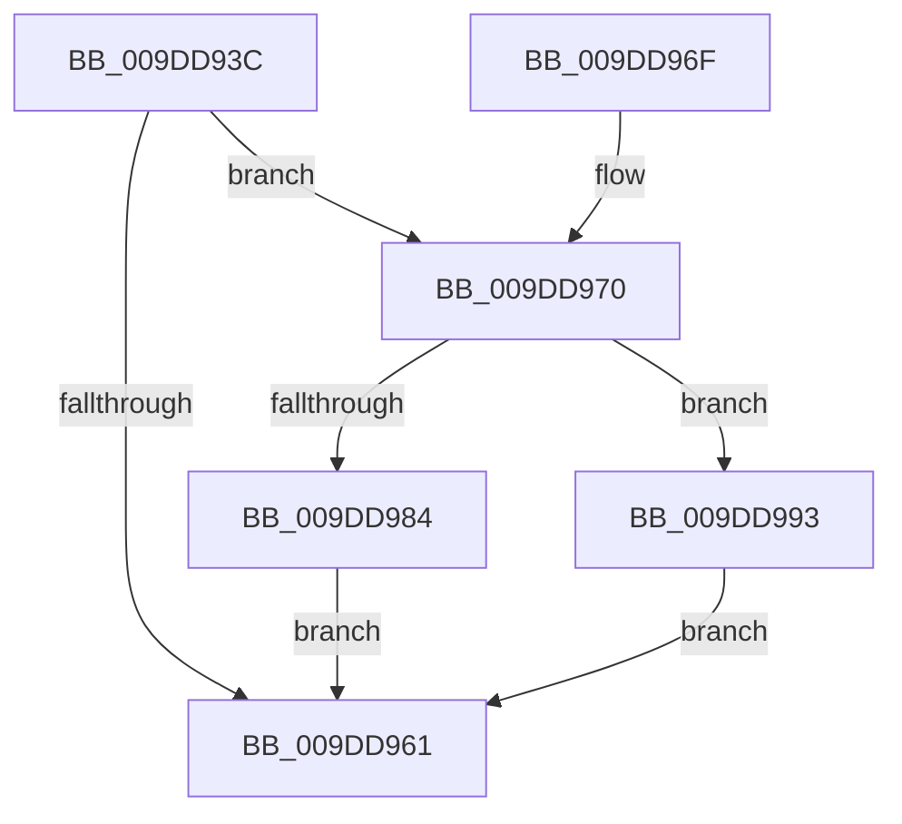

# WmipAllocGuidEntry

- RVA: `0x009DD93C`–`0x009DD9D5` (길이 `153` bytes)
- VA: `0x00000001409DD93C`
- 실행 섹션: `PAGE`
- PDB 이름 있음: `예`; PDB Function 태그: `아니요`
- unwind 정보 RVA: `0x000A3934`
- 디코드: `42`개 명령, `153/153` bytes 표시
- 미해석 바이트: `0` (있으면 어셈블리에 `.byte`로 보존)

> 이 문서는 커널 이미지의 기계어와 PDB 기호를 분석해 생성했습니다. 4번과 5번은 함수 원형과 자료형을 바이너리 사용 방식에서 추정한 C 해석이며 원본 소스 복구 결과는 아닙니다.

## 1. Dependencies

- 직접 호출 지점: **3**; 고유 호출 대상: **3**
- 직접 호출자로 확인된 함수: **2**
- RIP 상대 이미지 참조: **2**

### Outgoing calls
- `0x009DD954` → [ExAllocatePool2](../../poolcode/B8/ExAllocatePool2_function_00B820F0.md) (function, `0x00B820F0`)
- `0x009DD977` → [WmipAllocEntry](WmipAllocEntry_function_009DDF70.md) (function, `0x009DDF70`)
- `0x009DD98C` → [ExFreePoolWithTag](../../poolcode/B8/ExFreePoolWithTag_function_00B82870.md) (function, `0x00B82870`)

### Direct callers
- [WmipLinkDataSourceToList](WmipLinkDataSourceToList_function_009DF4D4.md) at `0x009DF58F`
- [WmipOpenBlock](../9E/WmipOpenBlock_function_009E00D0.md) at `0x009E0259`

### Static image references
- `0x009DD970` → RVA `0x00E03628` (`.data`; read)
- `0x009DD9BB` → RVA `0x009E3290` (`WmipLegacyEtwWorker`; read)

## 2. Other-region calls and transfers

- 다른 실행 섹션으로 향하는 call: **2**
  - `0x009DD954` → [ExAllocatePool2](../../poolcode/B8/ExAllocatePool2_function_00B820F0.md) (`PAGE` → `POOLCODE`)
  - `0x009DD98C` → [ExFreePoolWithTag](../../poolcode/B8/ExFreePoolWithTag_function_00B82870.md) (`PAGE` → `POOLCODE`)
- 별도 외부 분기/꼬리 이동을 확인하지 못했습니다.

## 3. Assembly (complete function range)

```asm
009DD93C  48 89 5C 24 08                  mov qword ptr [rsp + 8], rbx
009DD941  57                              push rdi
009DD942  48 83 EC 20                     sub rsp, 0x20
009DD946  33 DB                           xor ebx, ebx
009DD948  41 B8 57 6D 69 70               mov r8d, 0x70696d57
009DD94E  8D 53 38                        lea edx, [rbx + 0x38]
009DD951  8D 4B 40                        lea ecx, [rbx + 0x40]
009DD954  E8 97 47 1A 00                  call 0x140b820f0
009DD959  48 8B F8                        mov rdi, rax
009DD95C  48 85 C0                        test rax, rax
009DD95F  75 0F                           jne 0x1409dd970
009DD961  48 8B C3                        mov rax, rbx
009DD964  48 8B 5C 24 30                  mov rbx, qword ptr [rsp + 0x30]
009DD969  48 83 C4 20                     add rsp, 0x20
009DD96D  5F                              pop rdi
009DD96E  C3                              ret
009DD96F  CC                              int3
009DD970  48 8D 0D B1 5C 42 00            lea rcx, [rip + 0x425cb1]
009DD977  E8 F4 05 00 00                  call 0x1409ddf70
009DD97C  48 8B D8                        mov rbx, rax
009DD97F  48 85 C0                        test rax, rax
009DD982  75 0F                           jne 0x1409dd993
009DD984  BA 57 6D 69 70                  mov edx, 0x70696d57
009DD989  48 8B CF                        mov rcx, rdi
009DD98C  E8 DF 4E 1A 00                  call 0x140b82870
009DD991  EB CE                           jmp 0x1409dd961
009DD993  48 89 78 60                     mov qword ptr [rax + 0x60], rdi
009DD997  48 8D 48 38                     lea rcx, [rax + 0x38]
009DD99B  48 89 49 08                     mov qword ptr [rcx + 8], rcx
009DD99F  48 89 09                        mov qword ptr [rcx], rcx
009DD9A2  48 8D 48 28                     lea rcx, [rax + 0x28]
009DD9A6  48 89 49 08                     mov qword ptr [rcx + 8], rcx
009DD9AA  48 89 09                        mov qword ptr [rcx], rcx
009DD9AD  48 8D 88 88 00 00 00            lea rcx, [rax + 0x88]
009DD9B4  48 89 49 08                     mov qword ptr [rcx + 8], rcx
009DD9B8  48 89 09                        mov qword ptr [rcx], rcx
009DD9BB  48 8D 0D CE 58 00 00            lea rcx, [rip + 0x58ce]
009DD9C2  48 8B 40 60                     mov rax, qword ptr [rax + 0x60]
009DD9C6  48 83 60 18 00                  and qword ptr [rax + 0x18], 0
009DD9CB  48 89 48 28                     mov qword ptr [rax + 0x28], rcx
009DD9CF  48 89 58 30                     mov qword ptr [rax + 0x30], rbx
009DD9D3  EB 8C                           jmp 0x1409dd961
```

## 4. C-style interpretation (structured pseudocode)

```c
__int64 __fastcall WmipAllocGuidEntry(void)
{
    __int64 result;
    __int64 v_rbx;
    __int64 v_rsp;
    unsigned __int64 v_stack_p8;

    v_stack_p8 = v_rbx;
    v_rsp = (v_rsp) - (32);
    v_rbx = 0;
    result = ExAllocatePool2(v_rbx + 64, v_rbx + 56, (unsigned int)(0x70696D57ULL), a4);
    if (result != 0) goto loc_009DD970;
loc_009DD961:
    v_rsp = (v_rsp) + (32);
    return 0;
loc_009DD970:
    result = WmipAllocEntry(v_rip + 4349105, v_rbx + 56, (unsigned int)(0x70696D57ULL), a4);
    if (result != 0) goto loc_009DD993;
    result = ExFreePoolWithTag(result, (unsigned int)(0x70696D57ULL), (unsigned int)(0x70696D57ULL), a4);
    goto loc_009DD961;
loc_009DD993:
    *(unsigned __int64 *)(result + 96) = result;
    *(unsigned __int64 *)(result + 56 + 8) = result + 56;
    *(unsigned __int64 *)(result + 56) = result + 56;
    *(unsigned __int64 *)(result + 40 + 8) = result + 40;
    *(unsigned __int64 *)(result + 40) = result + 40;
    *(unsigned __int64 *)(result + 136 + 8) = result + 136;
    *(unsigned __int64 *)(result + 136) = result + 136;
    *(unsigned __int64 *)(*(unsigned __int64 *)(result + 96) + 40) = v_rip + 22734;
    *(unsigned __int64 *)(*(unsigned __int64 *)(result + 96) + 48) = result;
    goto loc_009DD961;
}
```

## 5. (Beta) C Style

```c
void WmipAllocGuidEntry(void)
{
    int64_t result;
    int64_t local_rbx;
    int64_t local_rsp;
    uint64_t v_stack_p8;

    v_stack_p8 = local_rbx;
    local_rsp = (local_rsp) - (32);
    local_rbx = 0;
    result = ExAllocatePool2(local_rbx + 64, local_rbx + 56, (uint32_t)(0x70696D57ULL), a4);
    if (result != 0) goto loc_009DD970;
loc_009DD961:
    local_rsp = (local_rsp) + (32);
    return 0;
loc_009DD970:
    result = WmipAllocEntry(v_rip + 4349105, local_rbx + 56, (uint32_t)(0x70696D57ULL), a4);
    if (result != 0) goto loc_009DD993;
    result = ExFreePoolWithTag(result, (uint32_t)(0x70696D57ULL), (uint32_t)(0x70696D57ULL), a4);
    goto loc_009DD961;
loc_009DD993:
    *(uint64_t *)(result + 0x60) = result;
    *(uint64_t *)(result + 0x38 + 0x8) = result + 56;
    *(uint64_t *)(result + 0x38) = result + 56;
    *(uint64_t *)(result + 0x28 + 0x8) = result + 40;
    *(uint64_t *)(result + 0x28) = result + 40;
    *(uint64_t *)(result + 0x88 + 0x8) = result + 136;
    *(uint64_t *)(result + 0x88) = result + 136;
    *(uint64_t *)(*(uint64_t *)(result + 0x60) + 0x28) = v_rip + 22734;
    *(uint64_t *)(*(uint64_t *)(result + 0x60) + 0x30) = result;
    goto loc_009DD961;
}
```

## 6. Execution-region graph

[열기: 2D/3D 그래프와 함수 탐색 컨트롤 패널](../../../control-panel.html?section=page&rva=0x009DD93C&view=graph)

- 2D 그래프는 위에서 아래로 흐르고, 3D 그래프는 빈 공간을 드래그해 회전합니다. Shift+드래그는 이동, 휠은 확대·축소, 함수 노드 선택은 대상 보고서 이동입니다.

### Static fallback


