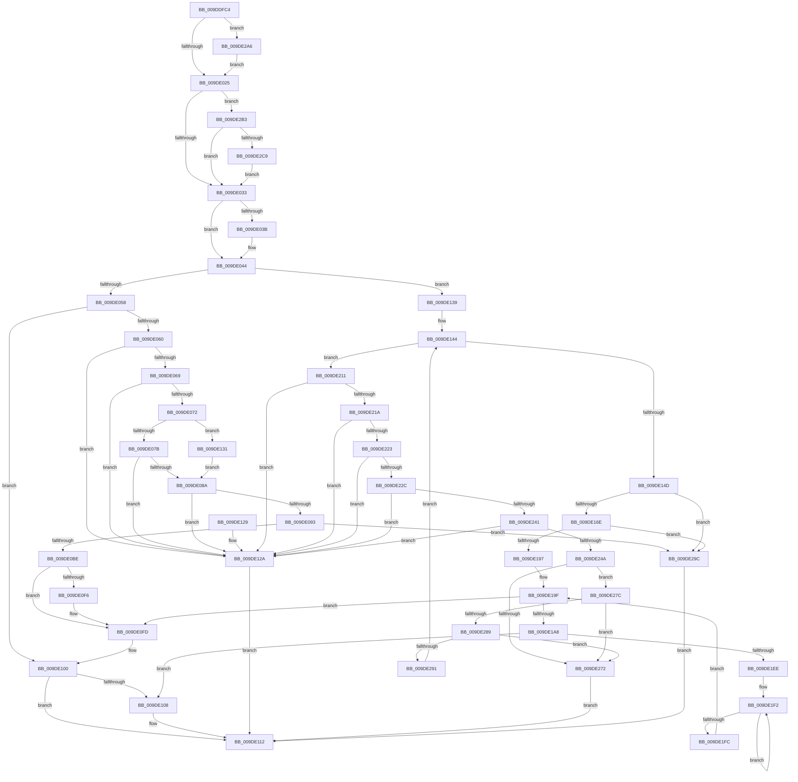

# WmipBuildInstanceSet

- RVA: `0x009DDFC4`–`0x009DE2D5` (길이 `785` bytes)
- VA: `0x00000001409DDFC4`
- 실행 섹션: `PAGE`
- PDB 이름 있음: `예`; PDB Function 태그: `아니요`
- unwind 정보 RVA: `0x000A399C`
- 디코드: `213`개 명령, `785/785` bytes 표시
- 미해석 바이트: `0` (있으면 어셈블리에 `.byte`로 보존)

> 이 문서는 커널 이미지의 기계어와 PDB 기호를 분석해 생성했습니다. 4번과 5번은 함수 원형과 자료형을 바이너리 사용 방식에서 추정한 C 해석이며 원본 소스 복구 결과는 아닙니다.

## 1. Dependencies

- 직접 호출 지점: **8**; 고유 호출 대상: **5**
- 직접 호출자로 확인된 함수: **3**
- RIP 상대 이미지 참조: **0**

### Outgoing calls
- `0x009DE0AD` → [ExAllocatePool2](../../poolcode/B8/ExAllocatePool2_function_00B820F0.md) (function, `0x00B820F0`)
- `0x009DE0CD` → [RtlStringCchCopyNW](../../text/47/RtlStringCchCopyNW_function_0047169C.md) (function, `0x0047169C`)
- `0x009DE0D9` → [WmipDetermineInstanceBaseIndex](../9E/WmipDetermineInstanceBaseIndex_function_009E2740.md) (function, `0x009E2740`)
- `0x009DE10D` → [ExFreePoolWithTag](../../poolcode/B8/ExFreePoolWithTag_function_00B82870.md) (function, `0x00B82870`)
- `0x009DE15D` → [ExAllocatePool2](../../poolcode/B8/ExAllocatePool2_function_00B820F0.md) (function, `0x00B820F0`)
- `0x009DE186` → [ExAllocatePool2](../../poolcode/B8/ExAllocatePool2_function_00B820F0.md) (function, `0x00B820F0`)
- `0x009DE1CA` → [RtlStringCchCopyNW](../../text/47/RtlStringCchCopyNW_function_0047169C.md) (function, `0x0047169C`)
- `0x009DE1DD` → [WmipMangleInstanceName](WmipMangleInstanceName_function_009DE2DC.md) (function, `0x009DE2DC`)

### Direct callers
- [WmipUpdateAddGuid](../7B/WmipUpdateAddGuid_function_007B46C0.md) at `0x007B4742`
- [WmipUpdateModifyGuid](../7B/WmipUpdateModifyGuid_function_007B4798.md) at `0x007B483E`
- [WmipUpdateModifyGuid](../7B/WmipUpdateModifyGuid_function_007B4798.md) at `0x007B48D7`
- [WmipAddDataSource](WmipAddDataSource_function_009DDC30.md) at `0x009DDCE4`

### Static image references
- 디코드된 RIP-relative 메모리 참조가 없습니다.

## 2. Other-region calls and transfers

- 다른 실행 섹션으로 향하는 call: **6**
  - `0x009DE0AD` → [ExAllocatePool2](../../poolcode/B8/ExAllocatePool2_function_00B820F0.md) (`PAGE` → `POOLCODE`)
  - `0x009DE0CD` → [RtlStringCchCopyNW](../../text/47/RtlStringCchCopyNW_function_0047169C.md) (`PAGE` → `.text`)
  - `0x009DE10D` → [ExFreePoolWithTag](../../poolcode/B8/ExFreePoolWithTag_function_00B82870.md) (`PAGE` → `POOLCODE`)
  - `0x009DE15D` → [ExAllocatePool2](../../poolcode/B8/ExAllocatePool2_function_00B820F0.md) (`PAGE` → `POOLCODE`)
  - `0x009DE186` → [ExAllocatePool2](../../poolcode/B8/ExAllocatePool2_function_00B820F0.md) (`PAGE` → `POOLCODE`)
  - `0x009DE1CA` → [RtlStringCchCopyNW](../../text/47/RtlStringCchCopyNW_function_0047169C.md) (`PAGE` → `.text`)
- 별도 외부 분기/꼬리 이동을 확인하지 못했습니다.

## 3. Assembly (complete function range)

```asm
009DDFC4  48 89 5C 24 18                  mov qword ptr [rsp + 0x18], rbx
009DDFC9  55                              push rbp
009DDFCA  56                              push rsi
009DDFCB  57                              push rdi
009DDFCC  41 54                           push r12
009DDFCE  41 55                           push r13
009DDFD0  41 56                           push r14
009DDFD2  41 57                           push r15
009DDFD4  48 83 EC 20                     sub rsp, 0x20
009DDFD8  44 8B 61 14                     mov r12d, dword ptr [rcx + 0x14]
009DDFDC  45 33 F6                        xor r14d, r14d
009DDFDF  45 8B 51 10                     mov r10d, dword ptr [r9 + 0x10]
009DDFE3  49 8B D9                        mov rbx, r9
009DDFE6  8B 84 24 80 00 00 00            mov eax, dword ptr [rsp + 0x80]
009DDFED  41 81 E2 F8 7F FD FF            and r10d, 0xfffd7ff8
009DDFF4  45 89 61 48                     mov dword ptr [r9 + 0x48], r12d
009DDFF8  45 8B D8                        mov r11d, r8d
009DDFFB  45 8D 7E 01                     lea r15d, [r14 + 1]
009DDFFF  41 89 41 50                     mov dword ptr [r9 + 0x50], eax
009DE003  45 89 71 4C                     mov dword ptr [r9 + 0x4c], r14d
009DE007  48 8B EA                        mov rbp, rdx
009DE00A  45 89 51 10                     mov dword ptr [r9 + 0x10], r10d
009DE00E  4C 8B E9                        mov r13, rcx
009DE011  8B 41 10                        mov eax, dword ptr [rcx + 0x10]
009DE014  41 8B FE                        mov edi, r14d
009DE017  44 89 64 24 60                  mov dword ptr [rsp + 0x60], r12d
009DE01C  41 84 C7                        test r15b, al
009DE01F  0F 85 81 02 00 00               jne 0x1409de2a6
009DE025  BA 00 00 08 00                  mov edx, 0x80000
009DE02A  85 51 10                        test dword ptr [rcx + 0x10], edx
009DE02D  0F 85 80 02 00 00               jne 0x1409de2b3
009DE033  41 8B 45 10                     mov eax, dword ptr [r13 + 0x10]
009DE037  A8 40                           test al, 0x40
009DE039  74 09                           je 0x1409de044
009DE03B  41 0F BA EA 0F                  bts r10d, 0xf
009DE040  45 89 51 10                     mov dword ptr [r9 + 0x10], r10d
009DE044  45 8B 45 18                     mov r8d, dword ptr [r13 + 0x18]
009DE048  41 8B 45 10                     mov eax, dword ptr [r13 + 0x10]
009DE04C  49 8D 34 28                     lea rsi, [r8 + rbp]
009DE050  A8 04                           test al, 4
009DE052  0F 85 E1 00 00 00               jne 0x1409de139
009DE058  A8 08                           test al, 8
009DE05A  0F 84 A0 00 00 00               je 0x1409de100
009DE060  45 3B C3                        cmp r8d, r11d
009DE063  0F 87 C1 00 00 00               ja 0x1409de12a
009DE069  45 84 C7                        test r15b, r8b
009DE06C  0F 85 B8 00 00 00               jne 0x1409de12a
009DE072  45 85 C0                        test r8d, r8d
009DE075  0F 84 B6 00 00 00               je 0x1409de131
009DE07B  0F B7 06                        movzx eax, word ptr [rsi]
009DE07E  41 03 C0                        add eax, r8d
009DE081  41 3B C3                        cmp eax, r11d
009DE084  0F 87 A0 00 00 00               ja 0x1409de12a
009DE08A  48 85 F6                        test rsi, rsi
009DE08D  0F 84 97 00 00 00               je 0x1409de12a
009DE093  44 0F B7 36                     movzx r14d, word ptr [rsi]
009DE097  B9 00 01 00 00                  mov ecx, 0x100
009DE09C  49 D1 EE                        shr r14, 1
009DE09F  41 B8 57 6D 69 70               mov r8d, 0x70696d57
009DE0A5  4A 8D 14 75 06 00 00 00         lea rdx, [r14*2 + 6]
009DE0AD  E8 3E 40 1A 00                  call 0x140b820f0
009DE0B2  4C 8B F8                        mov r15, rax
009DE0B5  48 85 C0                        test rax, rax
009DE0B8  0F 84 DE 01 00 00               je 0x1409de29c
009DE0BE  4C 8D 46 02                     lea r8, [rsi + 2]
009DE0C2  4D 8B CE                        mov r9, r14
009DE0C5  49 8D 56 01                     lea rdx, [r14 + 1]
009DE0C9  48 8D 48 04                     lea rcx, [rax + 4]
009DE0CD  E8 CA 35 A9 FF                  call 0x14047169c
009DE0D2  49 8D 57 04                     lea rdx, [r15 + 4]
009DE0D6  49 8B CD                        mov rcx, r13
009DE0D9  E8 62 46 00 00                  call 0x1409e2740
009DE0DE  41 89 07                        mov dword ptr [r15], eax
009DE0E1  8B 4B 10                        mov ecx, dword ptr [rbx + 0x10]
009DE0E4  83 C9 01                        or ecx, 1
009DE0E7  4C 89 7B 58                     mov qword ptr [rbx + 0x58], r15
009DE0EB  89 4B 10                        mov dword ptr [rbx + 0x10], ecx
009DE0EE  41 8B 45 10                     mov eax, dword ptr [r13 + 0x10]
009DE0F2  A8 20                           test al, 0x20
009DE0F4  74 07                           je 0x1409de0fd
009DE0F6  0F BA E9 11                     bts ecx, 0x11
009DE0FA  89 4B 10                        mov dword ptr [rbx + 0x10], ecx
009DE0FD  45 33 F6                        xor r14d, r14d
009DE100  41 8B DE                        mov ebx, r14d
009DE103  48 85 FF                        test rdi, rdi
009DE106  74 0A                           je 0x1409de112
009DE108  33 D2                           xor edx, edx
009DE10A  48 8B CF                        mov rcx, rdi
009DE10D  E8 5E 47 1A 00                  call 0x140b82870
009DE112  8B C3                           mov eax, ebx
009DE114  48 8B 5C 24 70                  mov rbx, qword ptr [rsp + 0x70]
009DE119  48 83 C4 20                     add rsp, 0x20
009DE11D  41 5F                           pop r15
009DE11F  41 5E                           pop r14
009DE121  41 5D                           pop r13
009DE123  41 5C                           pop r12
009DE125  5F                              pop rdi
009DE126  5E                              pop rsi
009DE127  5D                              pop rbp
009DE128  C3                              ret
009DE129  CC                              int3
009DE12A  BB 0D 00 00 C0                  mov ebx, 0xc000000d
009DE12F  EB E1                           jmp 0x1409de112
009DE131  49 8B F6                        mov rsi, r14
009DE134  E9 51 FF FF FF                  jmp 0x1409de08a
009DE139  4D 8B D7                        mov r10, r15
009DE13C  4C 89 74 24 68                  mov qword ptr [rsp + 0x68], r14
009DE141  45 8B CE                        mov r9d, r14d
009DE144  45 3B CC                        cmp r9d, r12d
009DE147  0F 82 C4 00 00 00               jb 0x1409de211
009DE14D  BD 00 01 00 00                  mov ebp, 0x100
009DE152  41 B8 57 6D 69 70               mov r8d, 0x70696d57
009DE158  8B CD                           mov ecx, ebp
009DE15A  49 8B D2                        mov rdx, r10
009DE15D  E8 8E 3F 1A 00                  call 0x140b820f0
009DE162  4C 8B F8                        mov r15, rax
009DE165  48 85 C0                        test rax, rax
009DE168  0F 84 2E 01 00 00               je 0x1409de29c
009DE16E  83 4B 10 02                     or dword ptr [rbx + 0x10], 2
009DE172  48 8D 14 7D 02 00 00 00         lea rdx, [rdi*2 + 2]
009DE17A  41 B8 57 6D 69 70               mov r8d, 0x70696d57
009DE180  48 89 43 58                     mov qword ptr [rbx + 0x58], rax
009DE184  8B CD                           mov ecx, ebp
009DE186  E8 65 3F 1A 00                  call 0x140b820f0
009DE18B  48 8B F8                        mov rdi, rax
009DE18E  48 85 C0                        test rax, rax
009DE191  0F 84 05 01 00 00               je 0x1409de29c
009DE197  33 C9                           xor ecx, ecx
009DE199  4F 8D 34 E7                     lea r14, [r15 + r12*8]
009DE19D  8B E9                           mov ebp, ecx
009DE19F  41 3B EC                        cmp ebp, r12d
009DE1A2  0F 83 55 FF FF FF               jae 0x1409de0fd
009DE1A8  48 8B 54 24 68                  mov rdx, qword ptr [rsp + 0x68]
009DE1AD  48 8B CF                        mov rcx, rdi
009DE1B0  8B C5                           mov eax, ebp
009DE1B2  48 FF C2                        inc rdx
009DE1B5  4D 89 34 C7                     mov qword ptr [r15 + rax*8], r14
009DE1B9  44 0F B7 26                     movzx r12d, word ptr [rsi]
009DE1BD  48 83 C6 02                     add rsi, 2
009DE1C1  49 D1 EC                        shr r12, 1
009DE1C4  4C 8B C6                        mov r8, rsi
009DE1C7  4D 8B CC                        mov r9, r12
009DE1CA  E8 CD 34 A9 FF                  call 0x14047169c
009DE1CF  4D 8D 44 24 07                  lea r8, [r12 + 7]
009DE1D4  4D 8B CE                        mov r9, r14
009DE1D7  48 8B D7                        mov rdx, rdi
009DE1DA  49 8B CD                        mov rcx, r13
009DE1DD  E8 FA 00 00 00                  call 0x1409de2dc
009DE1E2  33 C9                           xor ecx, ecx
009DE1E4  8B D8                           mov ebx, eax
009DE1E6  85 C0                           test eax, eax
009DE1E8  0F 88 1A FF FF FF               js 0x1409de108
009DE1EE  48 83 C8 FF                     or rax, 0xffffffffffffffff
009DE1F2  48 FF C0                        inc rax
009DE1F5  66 41 39 0C 46                  cmp word ptr [r14 + rax*2], cx
009DE1FA  75 F6                           jne 0x1409de1f2
009DE1FC  4D 8D 34 46                     lea r14, [r14 + rax*2]
009DE200  49 83 C6 02                     add r14, 2
009DE204  4A 8D 34 66                     lea rsi, [rsi + r12*2]
009DE208  44 8B 64 24 60                  mov r12d, dword ptr [rsp + 0x60]
009DE20D  FF C5                           inc ebp
009DE20F  EB 8E                           jmp 0x1409de19f
009DE211  45 3B C3                        cmp r8d, r11d
009DE214  0F 87 10 FF FF FF               ja 0x1409de12a
009DE21A  45 84 C7                        test r15b, r8b
009DE21D  0F 85 07 FF FF FF               jne 0x1409de12a
009DE223  45 85 C0                        test r8d, r8d
009DE226  0F 84 FE FE FF FF               je 0x1409de12a
009DE22C  41 8B C8                        mov ecx, r8d
009DE22F  48 03 CD                        add rcx, rbp
009DE232  0F B7 01                        movzx eax, word ptr [rcx]
009DE235  41 03 C0                        add eax, r8d
009DE238  41 3B C3                        cmp eax, r11d
009DE23B  0F 87 E9 FE FF FF               ja 0x1409de12a
009DE241  48 85 C9                        test rcx, rcx
009DE244  0F 84 E0 FE FF FF               je 0x1409de12a
009DE24A  0F B7 09                        movzx ecx, word ptr [rcx]
009DE24D  48 D1 E9                        shr rcx, 1
009DE250  48 3B CF                        cmp rcx, rdi
009DE253  48 8B C1                        mov rax, rcx
009DE256  48 0F 46 C7                     cmovbe rax, rdi
009DE25A  4D 8D 14 4A                     lea r10, [r10 + rcx*2]
009DE25E  48 89 44 24 68                  mov qword ptr [rsp + 0x68], rax
009DE263  49 83 C2 16                     add r10, 0x16
009DE267  48 8B F8                        mov rdi, rax
009DE26A  48 FF C1                        inc rcx
009DE26D  49 3B CF                        cmp rcx, r15
009DE270  73 0A                           jae 0x1409de27c
009DE272  BB 95 00 00 C0                  mov ebx, 0xc0000095
009DE277  E9 96 FE FF FF                  jmp 0x1409de112
009DE27C  B8 02 00 00 00                  mov eax, 2
009DE281  48 F7 E1                        mul rcx
009DE284  48 85 D2                        test rdx, rdx
009DE287  75 E9                           jne 0x1409de272
009DE289  49 03 C0                        add rax, r8
009DE28C  49 3B C0                        cmp rax, r8
009DE28F  72 E1                           jb 0x1409de272
009DE291  4C 8B C0                        mov r8, rax
009DE294  45 03 CF                        add r9d, r15d
009DE297  E9 A8 FE FF FF                  jmp 0x1409de144
009DE29C  BB 9A 00 00 C0                  mov ebx, 0xc000009a
009DE2A1  E9 6C FE FF FF                  jmp 0x1409de112
009DE2A6  41 83 CA 04                     or r10d, 4
009DE2AA  45 89 51 10                     mov dword ptr [r9 + 0x10], r10d
009DE2AE  E9 72 FD FF FF                  jmp 0x1409de025
009DE2B3  B9 00 10 00 00                  mov ecx, 0x1000
009DE2B8  44 0B D1                        or r10d, ecx
009DE2BB  45 89 51 10                     mov dword ptr [r9 + 0x10], r10d
009DE2BF  41 85 4D 10                     test dword ptr [r13 + 0x10], ecx
009DE2C3  0F 84 6A FD FF FF               je 0x1409de033
009DE2C9  44 0B D2                        or r10d, edx
009DE2CC  45 89 51 10                     mov dword ptr [r9 + 0x10], r10d
009DE2D0  E9 5E FD FF FF                  jmp 0x1409de033
```

## 4. C-style interpretation (structured pseudocode)

```c
__int64 __fastcall WmipBuildInstanceSet(__int64 a1, __int64 a2, int a3, __int64 a4, unsigned int a5)
{
    __int64 result;
    __int64 v_r10;
    __int64 v_r12;
    __int64 v_r14;
    __int64 v_rbp;
    __int64 v_rsi;
    __int64 v_rsp;
    unsigned __int64 v_stack_p18;
    unsigned int v_stack_p60;
    unsigned __int64 v_stack_p68;
    unsigned int v_stack_p8;

    v_stack_p18 = v_rbx;
    v_rsp = (v_rsp) - (32);
    v_r14 = 0;
    v_r10 = (unsigned int)(((unsigned int)(*(unsigned int *)(a4 + 16))) & (0xFFFD7FF8ULL));
    *(unsigned int *)(a4 + 72) = (unsigned int)((unsigned int)(*(unsigned int *)(a1 + 20)));
    *(unsigned int *)(a4 + 80) = (unsigned int)((unsigned int)(a5));
    *(unsigned int *)(a4 + 76) = 0;
    *(unsigned int *)(a4 + 16) = (unsigned int)(v_r10);
    v_stack_p8 = (unsigned int)((unsigned int)(*(unsigned int *)(a1 + 20)));
    if ((((unsigned __int8)(v_r14 + 1)) & ((unsigned __int8)((unsigned int)(*(unsigned int *)(a1 + 16))))) != 0) goto loc_009DE2A6;
loc_009DE025:
    if (((*(unsigned int *)(a1 + 16)) & ((unsigned int)((unsigned int)(0x80000ULL)))) != 0) goto loc_009DE2B3;
loc_009DE033:
    if ((((unsigned __int8)((unsigned int)(*(unsigned int *)(a1 + 16)))) & (64)) != 0) {
        *(unsigned int *)(a4 + 16) = (unsigned int)(v_r10);
    }
    if ((((unsigned __int8)((unsigned int)(*(unsigned int *)(a1 + 16)))) & (4)) != 0) goto loc_009DE139;
    if ((((unsigned __int8)((unsigned int)(*(unsigned int *)(a1 + 16)))) & (8)) == 0) goto loc_009DE100;
    if (((unsigned int)((unsigned int)(*(unsigned int *)(a1 + 24)))) > ((unsigned int)((unsigned int)(a3)))) goto loc_009DE12A;
    if ((((unsigned __int8)(v_r14 + 1)) & ((unsigned __int8)((unsigned int)(*(unsigned int *)(a1 + 24))))) != 0) goto loc_009DE12A;
    if ((unsigned int)((unsigned int)(*(unsigned int *)(a1 + 24))) == 0) goto loc_009DE131;
    result = (unsigned int)((*(unsigned __int16 *)((unsigned int)(*(unsigned int *)(a1 + 24)) + a2 * 1)) + ((unsigned int)((unsigned int)(*(unsigned int *)(a1 + 24)))));
    if (((unsigned int)(result)) > ((unsigned int)((unsigned int)(a3)))) goto loc_009DE12A;
loc_009DE08A:
    if ((unsigned int)(*(unsigned int *)(a1 + 24)) + a2 * 1 == 0) goto loc_009DE12A;
    v_r14 = (*(unsigned __int16 *)((unsigned int)(*(unsigned int *)(a1 + 24)) + a2 * 1)) >> (1);
    result = ExAllocatePool2(256, v_r14 * 2 + 6, (unsigned int)(0x70696D57ULL), a4);
    if (result == 0) goto loc_009DE29C;
    result = RtlStringCchCopyNW(result + 4, v_r14 + 1, (unsigned int)(*(unsigned int *)(a1 + 24)) + a2 * 1 + 2, v_r14);
    result = WmipDetermineInstanceBaseIndex(a1, result + 4, (unsigned int)(*(unsigned int *)(a1 + 24)) + a2 * 1 + 2, v_r14);
    *(unsigned int *)(result) = (unsigned int)(result);
    a1 = (unsigned int)(((unsigned int)(*(unsigned int *)(a4 + 16))) | (1));
    *(unsigned __int64 *)(a4 + 88) = result;
    *(unsigned int *)(a4 + 16) = (unsigned int)(a1);
    if ((((unsigned __int8)((unsigned int)(*(unsigned int *)(a1 + 16)))) & (32)) != 0) {
        *(unsigned int *)(a4 + 16) = (unsigned int)(a1);
    }
    v_r14 = 0;
loc_009DE100:
    result = (unsigned int)(*(unsigned int *)(a1 + 16));
    if (0 != 0) {
        a2 = 0;
        a1 = 0;
        result = ExFreePoolWithTag(a1, a2, (unsigned int)(*(unsigned int *)(a1 + 24)) + a2 * 1 + 2, v_r14);
    }
    v_rsp = (v_rsp) + (32);
    return 0;
loc_009DE12A:
    goto loc_009DE112;
loc_009DE131:
    goto loc_009DE08A;
loc_009DE139:
    v_stack_p68 = 0;
loc_009DE144:
    if (0 < ((unsigned int)((unsigned int)(*(unsigned int *)(a1 + 20))))) goto loc_009DE211;
    result = ExAllocatePool2(256, result, (unsigned int)(0x70696D57ULL), 0);
    if (result == 0) goto loc_009DE29C;
    *(unsigned __int64 *)((unsigned int)(0xC000000DULL) + 88) = result;
    result = ExAllocatePool2(256, 0 * 2 + 2, (unsigned int)(0x70696D57ULL), 0);
    if (result == 0) goto loc_009DE29C;
    a1 = 0;
loc_009DE19F:
    if (0 >= ((unsigned int)((unsigned int)(*(unsigned int *)(a1 + 20))))) goto loc_009DE0FD;
    a2 = (v_stack_p68) + 1;
    *(unsigned __int64 *)(result + 0 * 8) = result + (unsigned int)(*(unsigned int *)(a1 + 20)) * 8;
    v_rsi = (0) + (2);
    v_r12 = (*(unsigned __int16 *)(0)) >> (1);
    result = RtlStringCchCopyNW(result, a2, v_rsi, v_r12);
    result = WmipMangleInstanceName(0, result, v_r12 + 7, result + (unsigned int)(*(unsigned int *)(a1 + 20)) * 8);
    a1 = 0;
    if (sign_flag) goto loc_009DE108;
    result = (result) | (-1);
loc_009DE1F2:
    result = (result) + 1;
    if ((*(unsigned __int16 *)(result + (unsigned int)(*(unsigned int *)(a1 + 20)) * 8 + result * 2)) != 0) goto loc_009DE1F2;
    v_r14 = (result + (unsigned int)(*(unsigned int *)(a1 + 20)) * 8 + result * 2) + (2);
    v_rbp = (unsigned int)((0) + 1);
    goto loc_009DE19F;
loc_009DE211:
    if (((unsigned int)(v_r12 + 7)) > ((unsigned int)((unsigned int)(a3)))) goto loc_009DE12A;
    if ((((unsigned __int8)(result)) & ((unsigned __int8)(v_r12 + 7))) != 0) goto loc_009DE12A;
    if ((unsigned int)(v_r12 + 7) == 0) goto loc_009DE12A;
    a1 = ((unsigned int)((unsigned int)(v_r12 + 7))) + (v_rbp);
    result = (unsigned int)((*(unsigned __int16 *)(a1)) + ((unsigned int)(v_r12 + 7)));
    if (((unsigned int)(result)) > ((unsigned int)((unsigned int)(a3)))) goto loc_009DE12A;
    if (a1 == 0) goto loc_009DE12A;
    a1 = (*(unsigned __int16 *)(a1)) >> (1);
    if (a1 <= result) { a1 = result; }
    v_stack_p68 = a1;
    v_r10 = (result + a1 * 2) + (22);
    a1 = (a1) + 1;
    if (a1 >= result) goto loc_009DE27C;
loc_009DE272:
    goto loc_009DE112;
loc_009DE27C:
    if (result != 0) goto loc_009DE272;
    result = (2) + (v_r12 + 7);
    if (result < (v_r12 + 7)) goto loc_009DE272;
    a4 = (unsigned int)((result + (unsigned int)(*(unsigned int *)(a1 + 20)) * 8) + ((unsigned int)(result)));
    goto loc_009DE144;
loc_009DE29C:
    goto loc_009DE112;
loc_009DE2A6:
    v_r10 = (unsigned int)((v_r10) | (4));
    *(unsigned int *)(a4 + 16) = (unsigned int)(v_r10);
    goto loc_009DE025;
loc_009DE2B3:
    v_r10 = (unsigned int)((v_r10) | ((unsigned int)((unsigned int)(0x1000ULL))));
    *(unsigned int *)(a4 + 16) = (unsigned int)(v_r10);
    if (((*(unsigned int *)(a1 + 16)) & ((unsigned int)((unsigned int)(0x1000ULL)))) == 0) goto loc_009DE033;
    v_r10 = (unsigned int)((v_r10) | ((unsigned int)(result)));
    *(unsigned int *)(a4 + 16) = (unsigned int)(v_r10);
    goto loc_009DE033;
}
```

## 5. (Beta) C Style

```c
int64_t WmipBuildInstanceSet(void *Arg1, int64_t Arg2, int32_t Arg3, void *Arg4, uint32_t Arg5)
{
    uint8_t *arg1 = (uint8_t *)Arg1;
    uint8_t *arg4 = (uint8_t *)Arg4;

    int64_t result;
    int64_t local_r10;
    int64_t local_r12;
    int64_t local_r14;
    int64_t local_rbp;
    int64_t local_rsi;
    int64_t local_rsp;
    uint64_t v_stack_p18;
    uint32_t v_stack_p60;
    uint64_t v_stack_p68;
    uint32_t v_stack_p8;

    v_stack_p18 = local_rbx;
    local_rsp = (local_rsp) - (32);
    local_r14 = 0;
    local_r10 = (uint32_t)(((uint32_t)(*(uint32_t *)(arg4 + 0x10))) & (0xFFFD7FF8ULL));
    *(uint32_t *)(arg4 + 0x48) = (uint32_t)((uint32_t)(*(uint32_t *)(arg1 + 0x14)));
    *(uint32_t *)(arg4 + 0x50) = (uint32_t)((uint32_t)(Arg5));
    *(uint32_t *)(arg4 + 0x4C) = 0;
    *(uint32_t *)(arg4 + 0x10) = (uint32_t)(local_r10);
    v_stack_p8 = (uint32_t)((uint32_t)(*(uint32_t *)(arg1 + 0x14)));
    if ((((uint8_t)(local_r14 + 1)) & ((uint8_t)((uint32_t)(*(uint32_t *)(arg1 + 0x10))))) != 0) goto loc_009DE2A6;
loc_009DE025:
    if (((*(uint32_t *)(arg1 + 0x10)) & ((uint32_t)((uint32_t)(0x80000ULL)))) != 0) goto loc_009DE2B3;
loc_009DE033:
    if ((((uint8_t)((uint32_t)(*(uint32_t *)(arg1 + 0x10)))) & (64)) != 0) {
        *(uint32_t *)(arg4 + 0x10) = (uint32_t)(local_r10);
    }
    if ((((uint8_t)((uint32_t)(*(uint32_t *)(arg1 + 0x10)))) & (4)) != 0) goto loc_009DE139;
    if ((((uint8_t)((uint32_t)(*(uint32_t *)(arg1 + 0x10)))) & (8)) == 0) goto loc_009DE100;
    if (((uint32_t)((uint32_t)(*(uint32_t *)(arg1 + 0x18)))) > ((uint32_t)((uint32_t)(Arg3)))) goto loc_009DE12A;
    if ((((uint8_t)(local_r14 + 1)) & ((uint8_t)((uint32_t)(*(uint32_t *)(arg1 + 0x18))))) != 0) goto loc_009DE12A;
    if ((uint32_t)((uint32_t)(*(uint32_t *)(arg1 + 0x18))) == 0) goto loc_009DE131;
    result = (uint32_t)((*(uint16_t *)((uint32_t)(*(uint32_t *)(arg1 + 0x18)) + Arg2 * 1)) + ((uint32_t)((uint32_t)(*(uint32_t *)(arg1 + 0x18)))));
    if (((uint32_t)(result)) > ((uint32_t)((uint32_t)(Arg3)))) goto loc_009DE12A;
loc_009DE08A:
    if ((uint32_t)(*(uint32_t *)(arg1 + 0x18)) + Arg2 * 1 == 0) goto loc_009DE12A;
    local_r14 = (*(uint16_t *)((uint32_t)(*(uint32_t *)(arg1 + 0x18)) + Arg2 * 1)) >> (1);
    result = ExAllocatePool2(256, local_r14 * 2 + 6, (uint32_t)(0x70696D57ULL), Arg4);
    if (result == 0) goto loc_009DE29C;
    result = RtlStringCchCopyNW(result + 4, local_r14 + 1, (uint32_t)(*(uint32_t *)(arg1 + 0x18)) + Arg2 * 1 + 2, local_r14);
    result = WmipDetermineInstanceBaseIndex(Arg1, result + 4, (uint32_t)(*(uint32_t *)(arg1 + 0x18)) + Arg2 * 1 + 2, local_r14);
    *(uint32_t *)(result) = (uint32_t)(result);
    Arg1 = (uint32_t)(((uint32_t)(*(uint32_t *)(arg4 + 0x10))) | (1));
    *(uint64_t *)(arg4 + 0x58) = result;
    *(uint32_t *)(arg4 + 0x10) = (uint32_t)(Arg1);
    if ((((uint8_t)((uint32_t)(*(uint32_t *)(arg1 + 0x10)))) & (32)) != 0) {
        *(uint32_t *)(arg4 + 0x10) = (uint32_t)(Arg1);
    }
    local_r14 = 0;
loc_009DE100:
    result = (uint32_t)(*(uint32_t *)(arg1 + 0x10));
    if (0 != 0) {
        Arg2 = 0;
        Arg1 = 0;
        result = ExFreePoolWithTag(Arg1, Arg2, (uint32_t)(*(uint32_t *)(arg1 + 0x18)) + Arg2 * 1 + 2, local_r14);
    }
    local_rsp = (local_rsp) + (32);
    return 0;
loc_009DE12A:
    goto loc_009DE112;
loc_009DE131:
    goto loc_009DE08A;
loc_009DE139:
    v_stack_p68 = 0;
loc_009DE144:
    if (0 < ((uint32_t)((uint32_t)(*(uint32_t *)(arg1 + 0x14))))) goto loc_009DE211;
    result = ExAllocatePool2(256, result, (uint32_t)(0x70696D57ULL), 0);
    if (result == 0) goto loc_009DE29C;
    *(uint64_t *)((uint32_t)(0xC000000DULL) + 0x58) = result;
    result = ExAllocatePool2(256, 0 * 2 + 2, (uint32_t)(0x70696D57ULL), 0);
    if (result == 0) goto loc_009DE29C;
    Arg1 = 0;
loc_009DE19F:
    if (0 >= ((uint32_t)((uint32_t)(*(uint32_t *)(arg1 + 0x14))))) goto loc_009DE0FD;
    Arg2 = (v_stack_p68) + 1;
    *(uint64_t *)(result + 0x0 * 8) = result + (uint32_t)(*(uint32_t *)(arg1 + 0x14)) * 8;
    local_rsi = (0) + (2);
    local_r12 = (*(uint16_t *)(0)) >> (1);
    result = RtlStringCchCopyNW(result, Arg2, local_rsi, local_r12);
    result = WmipMangleInstanceName(0, result, local_r12 + 7, result + (uint32_t)(*(uint32_t *)(arg1 + 0x14)) * 8);
    Arg1 = 0;
    if (sign_flag) goto loc_009DE108;
    result = (result) | (-1);
loc_009DE1F2:
    result = (result) + 1;
    if ((*(uint16_t *)(result + (uint32_t)(*(uint32_t *)(arg1 + 0x14)) * 8 + result * 2)) != 0) goto loc_009DE1F2;
    local_r14 = (result + (uint32_t)(*(uint32_t *)(arg1 + 0x14)) * 8 + result * 2) + (2);
    local_rbp = (uint32_t)((0) + 1);
    goto loc_009DE19F;
loc_009DE211:
    if (((uint32_t)(local_r12 + 7)) > ((uint32_t)((uint32_t)(Arg3)))) goto loc_009DE12A;
    if ((((uint8_t)(result)) & ((uint8_t)(local_r12 + 7))) != 0) goto loc_009DE12A;
    if ((uint32_t)(local_r12 + 7) == 0) goto loc_009DE12A;
    Arg1 = ((uint32_t)((uint32_t)(local_r12 + 7))) + (local_rbp);
    result = (uint32_t)((*(uint16_t *)(arg1)) + ((uint32_t)(local_r12 + 7)));
    if (((uint32_t)(result)) > ((uint32_t)((uint32_t)(Arg3)))) goto loc_009DE12A;
    if (Arg1 == NULL) goto loc_009DE12A;
    Arg1 = (*(uint16_t *)(arg1)) >> (1);
    if (Arg1 <= result) { Arg1 = result; }
    v_stack_p68 = Arg1;
    local_r10 = (result + Arg1 * 2) + (22);
    Arg1 = (Arg1) + 1;
    if (Arg1 >= result) goto loc_009DE27C;
loc_009DE272:
    goto loc_009DE112;
loc_009DE27C:
    if (result != 0) goto loc_009DE272;
    result = (2) + (local_r12 + 7);
    if (result < (local_r12 + 7)) goto loc_009DE272;
    Arg4 = (uint32_t)((result + (uint32_t)(*(uint32_t *)(arg1 + 0x14)) * 8) + ((uint32_t)(result)));
    goto loc_009DE144;
loc_009DE29C:
    goto loc_009DE112;
loc_009DE2A6:
    local_r10 = (uint32_t)((local_r10) | (4));
    *(uint32_t *)(arg4 + 0x10) = (uint32_t)(local_r10);
    goto loc_009DE025;
loc_009DE2B3:
    local_r10 = (uint32_t)((local_r10) | ((uint32_t)((uint32_t)(0x1000ULL))));
    *(uint32_t *)(arg4 + 0x10) = (uint32_t)(local_r10);
    if (((*(uint32_t *)(arg1 + 0x10)) & ((uint32_t)((uint32_t)(0x1000ULL)))) == 0) goto loc_009DE033;
    local_r10 = (uint32_t)((local_r10) | ((uint32_t)(result)));
    *(uint32_t *)(arg4 + 0x10) = (uint32_t)(local_r10);
    goto loc_009DE033;
}
```

### 관측된 메모리 오프셋

구조체 형식이 확인되지 않은 접근은 인자 기준의 오프셋으로만 기록했습니다.

| 기준 인자 | 오프셋 표현 | 폭 (bit) | 접근 |
|---|---:|---:|---|
| `Arg1` | `+ 0x10` | `32` | `R` |
| `Arg1` | `+ 0x14` | `32` | `R` |
| `Arg1` | `+ 0x18` | `32` | `R` |
| `Arg4` | `+ 0x10` | `32` | `R` |
| `Arg4` | `+ 0x10` | `32` | `R/W` |
| `Arg4` | `+ 0x10` | `32` | `W` |
| `Arg4` | `+ 0x48` | `32` | `W` |
| `Arg4` | `+ 0x4C` | `32` | `W` |
| `Arg4` | `+ 0x50` | `32` | `W` |
| `Arg4` | `+ 0x58` | `64` | `W` |

## 6. Execution-region graph

[열기: 2D/3D 그래프와 함수 탐색 컨트롤 패널](../../../control-panel.html?section=page&rva=0x009DDFC4&view=graph)

- 2D 그래프는 위에서 아래로 흐르고, 3D 그래프는 빈 공간을 드래그해 회전합니다. Shift+드래그는 이동, 휠은 확대·축소, 함수 노드 선택은 대상 보고서 이동입니다.

### Static fallback


