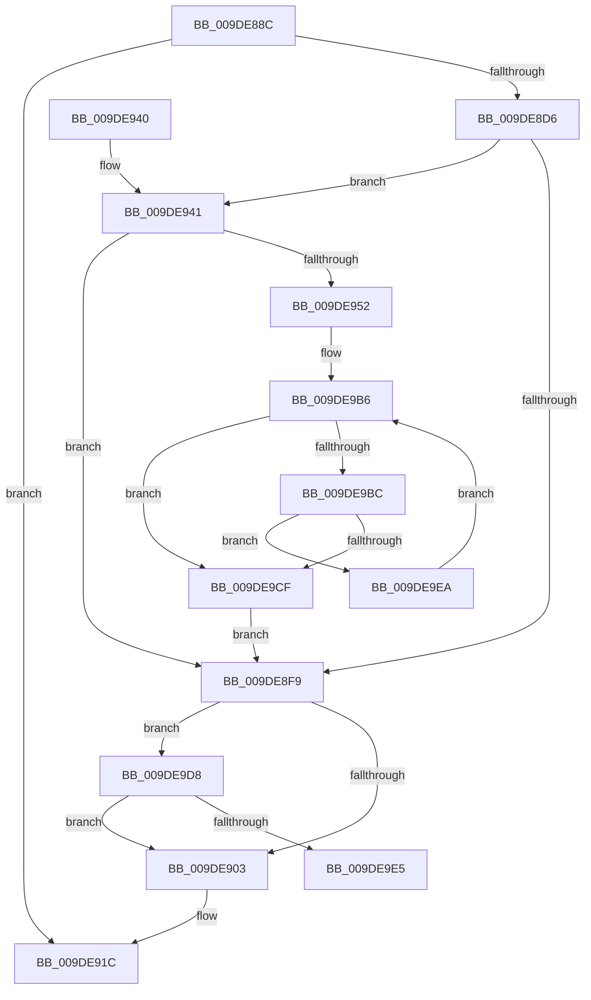

# WmipDisableCollectionForRemovedGuid

- RVA: `0x009DE88C`–`0x009DE9F9` (길이 `365` bytes)
- VA: `0x00000001409DE88C`
- 실행 섹션: `PAGE`
- PDB 이름 있음: `예`; PDB Function 태그: `예`
- unwind 정보 RVA: `0x000A3A2C`
- 디코드: `98`개 명령, `365/365` bytes 표시
- 미해석 바이트: `0` (있으면 어셈블리에 `.byte`로 보존)

> 이 문서는 커널 이미지의 기계어와 PDB 기호를 분석해 생성했습니다. 4번과 5번은 함수 원형과 자료형을 바이너리 사용 방식에서 추정한 C 해석이며 원본 소스 복구 결과는 아닙니다.

## 1. Dependencies

- 직접 호출 지점: **10**; 고유 호출 대상: **7**
- 직접 호출자로 확인된 함수: **2**
- RIP 상대 이미지 참조: **3**

### Outgoing calls
- `0x009DE8C9` → [WmipFindGEByGuid](../9E/WmipFindGEByGuid_function_009E03A4.md) (function, `0x009E03A4`)
- `0x009DE8EE` → [KeWaitForSingleObject](../../text/20/KeWaitForSingleObject_function_0020E6B0.md) (function, `0x0020E6B0`)
- `0x009DE90D` → [WmipUnreferenceEntry](../9E/WmipUnreferenceEntry_function_009E0CC8.md) (function, `0x009E0CC8`)
- `0x009DE917` → [KeReleaseMutex](../../text/39/KeReleaseMutex_function_00396810.md) (function, `0x00396810`)
- `0x009DE923` → [_security_check_cookie](../../text/6A/_security_check_cookie_function_006AC640.md) (function, `0x006AC640`)
- `0x009DE962` → [KeReleaseMutex](../../text/39/KeReleaseMutex_function_00396810.md) (function, `0x00396810`)
- `0x009DE99B` → [WmipSendWmiIrp](../9E/WmipSendWmiIrp_function_009E0484.md) (function, `0x009E0484`)
- `0x009DE9B1` → [KeWaitForSingleObject](../../text/20/KeWaitForSingleObject_function_0020E6B0.md) (function, `0x0020E6B0`)
- `0x009DE9C4` → [WmipSendEnableDisableRequest](../9E/WmipSendEnableDisableRequest_function_009E3800.md) (function, `0x009E3800`)
- `0x009DE9F2` → [WmipSendEnableDisableRequest](../9E/WmipSendEnableDisableRequest_function_009E3800.md) (function, `0x009E3800`)

### Direct callers
- [WmipUpdateDataSource](WmipUpdateDataSource_function_009DD474.md) at `0x009DD632`
- [WmipGenerateRegistrationNotification](WmipGenerateRegistrationNotification_function_009DF60C.md) at `0x009DF6E6`

### Static image references
- `0x009DE8A4` → RVA `0x00E0A740` (`.data`; read)
- `0x009DE8DC` → RVA `0x00EFFA60` (`.data`; read)
- `0x009DE906` → RVA `0x00E03628` (`.data`; read)

## 2. Other-region calls and transfers

- 다른 실행 섹션으로 향하는 call: **5**
  - `0x009DE8EE` → [KeWaitForSingleObject](../../text/20/KeWaitForSingleObject_function_0020E6B0.md) (`PAGE` → `.text`)
  - `0x009DE917` → [KeReleaseMutex](../../text/39/KeReleaseMutex_function_00396810.md) (`PAGE` → `.text`)
  - `0x009DE923` → [_security_check_cookie](../../text/6A/_security_check_cookie_function_006AC640.md) (`PAGE` → `.text`)
  - `0x009DE962` → [KeReleaseMutex](../../text/39/KeReleaseMutex_function_00396810.md) (`PAGE` → `.text`)
  - `0x009DE9B1` → [KeWaitForSingleObject](../../text/20/KeWaitForSingleObject_function_0020E6B0.md) (`PAGE` → `.text`)
- call이 아닌 외부 분기/꼬리 이동: **1**
  - `0x009DE9E5` → [sub_00B2FD86](../B2/Unknown_function_00B2FD86.md) (`tail-transfer`)

## 3. Assembly (complete function range)

```asm
009DE88C  48 89 5C 24 18                  mov qword ptr [rsp + 0x18], rbx
009DE891  48 89 74 24 20                  mov qword ptr [rsp + 0x20], rsi
009DE896  55                              push rbp
009DE897  57                              push rdi
009DE898  41 57                           push r15
009DE89A  48 8B EC                        mov rbp, rsp
009DE89D  48 81 EC 80 00 00 00            sub rsp, 0x80
009DE8A4  48 8B 05 95 BE 42 00            mov rax, qword ptr [rip + 0x42be95]
009DE8AB  48 33 C4                        xor rax, rsp
009DE8AE  48 89 45 F0                     mov qword ptr [rbp - 0x10], rax
009DE8B2  0F 57 C0                        xorps xmm0, xmm0
009DE8B5  48 8B FA                        mov rdi, rdx
009DE8B8  33 D2                           xor edx, edx
009DE8BA  48 8B F1                        mov rsi, rcx
009DE8BD  0F 11 45 C0                     movups xmmword ptr [rbp - 0x40], xmm0
009DE8C1  0F 11 45 D0                     movups xmmword ptr [rbp - 0x30], xmm0
009DE8C5  0F 11 45 E0                     movups xmmword ptr [rbp - 0x20], xmm0
009DE8C9  E8 D6 1A 00 00                  call 0x1409e03a4
009DE8CE  48 8B D8                        mov rbx, rax
009DE8D1  48 85 C0                        test rax, rax
009DE8D4  74 46                           je 0x1409de91c
009DE8D6  48 83 64 24 20 00               and qword ptr [rsp + 0x20], 0
009DE8DC  4C 8D 3D 7D 11 52 00            lea r15, [rip + 0x52117d]
009DE8E3  49 8B CF                        mov rcx, r15
009DE8E6  45 33 C9                        xor r9d, r9d
009DE8E9  45 33 C0                        xor r8d, r8d
009DE8EC  33 D2                           xor edx, edx
009DE8EE  E8 BD FD 82 FF                  call 0x14020e6b0
009DE8F3  83 7B 58 00                     cmp dword ptr [rbx + 0x58], 0
009DE8F7  77 48                           ja 0x1409de941
009DE8F9  83 7B 5C 00                     cmp dword ptr [rbx + 0x5c], 0
009DE8FD  0F 87 D5 00 00 00               ja 0x1409de9d8
009DE903  48 8B D3                        mov rdx, rbx
009DE906  48 8D 0D 1B 4D 42 00            lea rcx, [rip + 0x424d1b]
009DE90D  E8 B6 23 00 00                  call 0x1409e0cc8
009DE912  33 D2                           xor edx, edx
009DE914  49 8B CF                        mov rcx, r15
009DE917  E8 F4 7E 9B FF                  call 0x140396810
009DE91C  48 8B 4D F0                     mov rcx, qword ptr [rbp - 0x10]
009DE920  48 33 CC                        xor rcx, rsp
009DE923  E8 18 DD CC FF                  call 0x1406ac640
009DE928  4C 8D 9C 24 80 00 00 00         lea r11, [rsp + 0x80]
009DE930  49 8B 5B 30                     mov rbx, qword ptr [r11 + 0x30]
009DE934  49 8B 73 38                     mov rsi, qword ptr [r11 + 0x38]
009DE938  49 8B E3                        mov rsp, r11
009DE93B  41 5F                           pop r15
009DE93D  5F                              pop rdi
009DE93E  5D                              pop rbp
009DE93F  C3                              ret
009DE940  CC                              int3
009DE941  8B 4F 10                        mov ecx, dword ptr [rdi + 0x10]
009DE944  8B C1                           mov eax, ecx
009DE946  25 00 20 08 00                  and eax, 0x82000
009DE94B  3D 00 20 00 00                  cmp eax, 0x2000
009DE950  75 A7                           jne 0x1409de8f9
009DE952  0F BA F1 0D                     btr ecx, 0xd
009DE956  33 D2                           xor edx, edx
009DE958  89 4F 10                        mov dword ptr [rdi + 0x10], ecx
009DE95B  49 8B CF                        mov rcx, r15
009DE95E  83 4B 10 02                     or dword ptr [rbx + 0x10], 2
009DE962  E8 A9 7E 9B FF                  call 0x140396810
009DE967  0F 10 06                        movups xmm0, xmmword ptr [rsi]
009DE96A  48 8B 57 40                     mov rdx, qword ptr [rdi + 0x40]
009DE96E  48 8D 45 B0                     lea rax, [rbp - 0x50]
009DE972  48 89 44 24 28                  mov qword ptr [rsp + 0x28], rax
009DE977  4C 8D 45 D8                     lea r8, [rbp - 0x28]
009DE97B  F3 0F 7F 45 D8                  movdqu xmmword ptr [rbp - 0x28], xmm0
009DE980  C7 45 C0 30 00 00 00            mov dword ptr [rbp - 0x40], 0x30
009DE987  48 8D 45 C0                     lea rax, [rbp - 0x40]
009DE98B  8B 52 38                        mov edx, dword ptr [rdx + 0x38]
009DE98E  41 B9 30 00 00 00               mov r9d, 0x30
009DE994  B1 05                           mov cl, 5
009DE996  48 89 44 24 20                  mov qword ptr [rsp + 0x20], rax
009DE99B  E8 E4 1A 00 00                  call 0x1409e0484
009DE9A0  48 83 64 24 20 00               and qword ptr [rsp + 0x20], 0
009DE9A6  45 33 C9                        xor r9d, r9d
009DE9A9  45 33 C0                        xor r8d, r8d
009DE9AC  33 D2                           xor edx, edx
009DE9AE  49 8B CF                        mov rcx, r15
009DE9B1  E8 FA FC 82 FF                  call 0x14020e6b0
009DE9B6  83 7B 58 00                     cmp dword ptr [rbx + 0x58], 0
009DE9BA  75 13                           jne 0x1409de9cf
009DE9BC  41 B0 01                        mov r8b, 1
009DE9BF  48 8B D3                        mov rdx, rbx
009DE9C2  B1 05                           mov cl, 5
009DE9C4  E8 37 4E 00 00                  call 0x1409e3800
009DE9C9  83 7B 58 00                     cmp dword ptr [rbx + 0x58], 0
009DE9CD  75 1B                           jne 0x1409de9ea
009DE9CF  83 63 10 FD                     and dword ptr [rbx + 0x10], 0xfffffffd
009DE9D3  E9 21 FF FF FF                  jmp 0x1409de8f9
009DE9D8  F7 47 10 00 40 00 00            test dword ptr [rdi + 0x10], 0x4000
009DE9DF  0F 84 1E FF FF FF               je 0x1409de903
009DE9E5  E9 9C 13 15 00                  jmp 0x140b2fd86
009DE9EA  41 B0 01                        mov r8b, 1
009DE9ED  48 8B D3                        mov rdx, rbx
009DE9F0  B1 04                           mov cl, 4
009DE9F2  E8 09 4E 00 00                  call 0x1409e3800
009DE9F7  EB BD                           jmp 0x1409de9b6
```

## 4. C-style interpretation (structured pseudocode)

```c
__int64 __fastcall WmipDisableCollectionForRemovedGuid(__int64 a1, __int64 a2, int a3, int a4)
{
    __int64 result;
    __int64 v_rsp;
    unsigned __int64 v_stack_m18;
    unsigned __int64 v_stack_m28;
    unsigned __int64 v_stack_m38;
    unsigned __int64 v_stack_m40;
    unsigned __int64 v_stack_m48;
    unsigned __int64 v_stack_m58;
    unsigned __int64 v_stack_m60;
    unsigned __int64 v_stack_m68;
    unsigned __int64 v_stack_m78;
    unsigned __int64 v_stack_p18;
    unsigned __int64 v_stack_p20;

    v_stack_p18 = v_rbx;
    v_stack_p20 = v_rsi;
    v_rsp = (v_rsp) - (128);
    result = (*(unsigned __int64 *)(v_rip + 4374165)) ^ (v_rsp);
    v_stack_m28 = result;
    a2 = 0;
    v_stack_m58 = v_xmm0;
    v_stack_m48 = v_xmm0;
    v_stack_m38 = v_xmm0;
    result = WmipFindGEByGuid(a1, a2, a3, a4);
    if (result == 0) goto loc_009DE91C;
    a4 = 0;
    a3 = 0;
    a2 = 0;
    result = KeWaitForSingleObject(v_rip + 5378429, a2, a3, a4);
    if ((*(unsigned int *)(result + 88)) > 0) goto loc_009DE941;
loc_009DE8F9:
    if ((*(unsigned int *)(result + 92)) > 0) goto loc_009DE9D8;
loc_009DE903:
    result = WmipUnreferenceEntry(v_rip + 4345115, result, a3, a4);
    a2 = 0;
    result = KeReleaseMutex(v_rip + 5378429, a2, a3, a4);
loc_009DE91C:
    a1 = (v_stack_m28) ^ (v_rsp);
    result = _security_check_cookie(a1, a2, a3, a4);
    return result;
loc_009DE941:
    result = (unsigned int)(((unsigned int)((unsigned int)((unsigned int)(*(unsigned int *)(a2 + 16))))) & (0x82000ULL));
    if (((unsigned int)(result)) != 0x2000ULL) goto loc_009DE8F9;
    a2 = 0;
    *(unsigned int *)(a2 + 16) = (unsigned int)((unsigned int)(*(unsigned int *)(a2 + 16)));
    result = KeReleaseMutex(v_rip + 5378429, a2, a3, a4);
    v_stack_m58 = v_stack_m68;
    v_stack_m40 = v_xmm0;
    v_stack_m58 = 48;
    v_stack_m60 = v_stack_m58;
    result = WmipSendWmiIrp(5, (unsigned int)(*(unsigned int *)(*(unsigned __int64 *)(a2 + 64) + 56)), v_stack_m40, 48);
    a4 = 0;
    a3 = 0;
    a2 = 0;
    result = KeWaitForSingleObject(v_rip + 5378429, a2, a3, a4);
loc_009DE9B6:
    if ((*(unsigned int *)(*(unsigned __int64 *)(v_stack_m18 + 48) + 88)) != 0) goto loc_009DE9CF;
    result = WmipSendEnableDisableRequest(5, *(unsigned __int64 *)(v_stack_m18 + 48), 1, a4);
    if ((*(unsigned int *)(*(unsigned __int64 *)(v_stack_m18 + 48) + 88)) != 0) goto loc_009DE9EA;
loc_009DE9CF:
    goto loc_009DE8F9;
loc_009DE9D8:
    if (((*(unsigned int *)(a2 + 16)) & (0x4000ULL)) == 0) goto loc_009DE903;
loc_009DE9EA:
    result = WmipSendEnableDisableRequest(4, *(unsigned __int64 *)(v_stack_m18 + 48), 1, a4);
    goto loc_009DE9B6;
}
```

## 5. (Beta) C Style

```c
int64_t WmipDisableCollectionForRemovedGuid(void *Arg1, void *Arg2, int32_t Arg3, int32_t Arg4)
{
    uint8_t *arg1 = (uint8_t *)Arg1;
    uint8_t *arg2 = (uint8_t *)Arg2;

    int64_t result;
    int64_t local_rsp;
    uint64_t v_stack_m18;
    uint64_t v_stack_m28;
    uint64_t v_stack_m38;
    uint64_t v_stack_m40;
    uint64_t v_stack_m48;
    uint64_t v_stack_m58;
    uint64_t v_stack_m60;
    uint64_t v_stack_m68;
    uint64_t v_stack_m78;
    uint64_t v_stack_p18;
    uint64_t v_stack_p20;

    v_stack_p18 = local_rbx;
    v_stack_p20 = local_rsi;
    local_rsp = (local_rsp) - (128);
    result = (*(uint64_t *)(v_rip + 0x42BE95)) ^ (local_rsp);
    v_stack_m28 = result;
    Arg2 = 0;
    v_stack_m58 = v_xmm0;
    v_stack_m48 = v_xmm0;
    v_stack_m38 = v_xmm0;
    result = WmipFindGEByGuid(Arg1, Arg2, Arg3, Arg4);
    if (result == 0) goto loc_009DE91C;
    Arg4 = 0;
    Arg3 = 0;
    Arg2 = 0;
    result = KeWaitForSingleObject(v_rip + 5378429, Arg2, Arg3, Arg4);
    if ((*(uint32_t *)(result + 0x58)) > 0) goto loc_009DE941;
loc_009DE8F9:
    if ((*(uint32_t *)(result + 0x5C)) > 0) goto loc_009DE9D8;
loc_009DE903:
    result = WmipUnreferenceEntry(v_rip + 4345115, result, Arg3, Arg4);
    Arg2 = 0;
    result = KeReleaseMutex(v_rip + 5378429, Arg2, Arg3, Arg4);
loc_009DE91C:
    Arg1 = (v_stack_m28) ^ (local_rsp);
    result = _security_check_cookie(Arg1, Arg2, Arg3, Arg4);
    return result;
loc_009DE941:
    result = (uint32_t)(((uint32_t)((uint32_t)((uint32_t)(*(uint32_t *)(arg2 + 0x10))))) & (0x82000ULL));
    if (((uint32_t)(result)) != 0x2000ULL) goto loc_009DE8F9;
    Arg2 = 0;
    *(uint32_t *)(arg2 + 0x10) = (uint32_t)((uint32_t)(*(uint32_t *)(arg2 + 0x10)));
    result = KeReleaseMutex(v_rip + 5378429, Arg2, Arg3, Arg4);
    v_stack_m58 = v_stack_m68;
    v_stack_m40 = v_xmm0;
    v_stack_m58 = 48;
    v_stack_m60 = v_stack_m58;
    result = WmipSendWmiIrp(5, (uint32_t)(*(uint32_t *)(*(uint64_t *)(arg2 + 0x40) + 0x38)), v_stack_m40, 48);
    Arg4 = 0;
    Arg3 = 0;
    Arg2 = 0;
    result = KeWaitForSingleObject(v_rip + 5378429, Arg2, Arg3, Arg4);
loc_009DE9B6:
    if ((*(uint32_t *)(*(uint64_t *)(v_stack_m18 + 0x30) + 0x58)) != 0) goto loc_009DE9CF;
    result = WmipSendEnableDisableRequest(5, *(uint64_t *)(v_stack_m18 + 0x30), 1, Arg4);
    if ((*(uint32_t *)(*(uint64_t *)(v_stack_m18 + 0x30) + 0x58)) != 0) goto loc_009DE9EA;
loc_009DE9CF:
    goto loc_009DE8F9;
loc_009DE9D8:
    if (((*(uint32_t *)(arg2 + 0x10)) & (0x4000ULL)) == 0) goto loc_009DE903;
loc_009DE9EA:
    result = WmipSendEnableDisableRequest(4, *(uint64_t *)(v_stack_m18 + 0x30), 1, Arg4);
    goto loc_009DE9B6;
}
```

### 관측된 메모리 오프셋

구조체 형식이 확인되지 않은 접근은 인자 기준의 오프셋으로만 기록했습니다.

| 기준 인자 | 오프셋 표현 | 폭 (bit) | 접근 |
|---|---:|---:|---|
| `Arg1` | `+ 0x0` | `128` | `R` |
| `Arg2` | `+ 0x10` | `32` | `R` |
| `Arg2` | `+ 0x10` | `32` | `W` |
| `Arg2` | `+ 0x40` | `64` | `R` |

## 6. Execution-region graph

[열기: 2D/3D 그래프와 함수 탐색 컨트롤 패널](../../../control-panel.html?section=page&rva=0x009DE88C&view=graph)

- 2D 그래프는 위에서 아래로 흐르고, 3D 그래프는 빈 공간을 드래그해 회전합니다. Shift+드래그는 이동, 휠은 확대·축소, 함수 노드 선택은 대상 보고서 이동입니다.

### Static fallback


