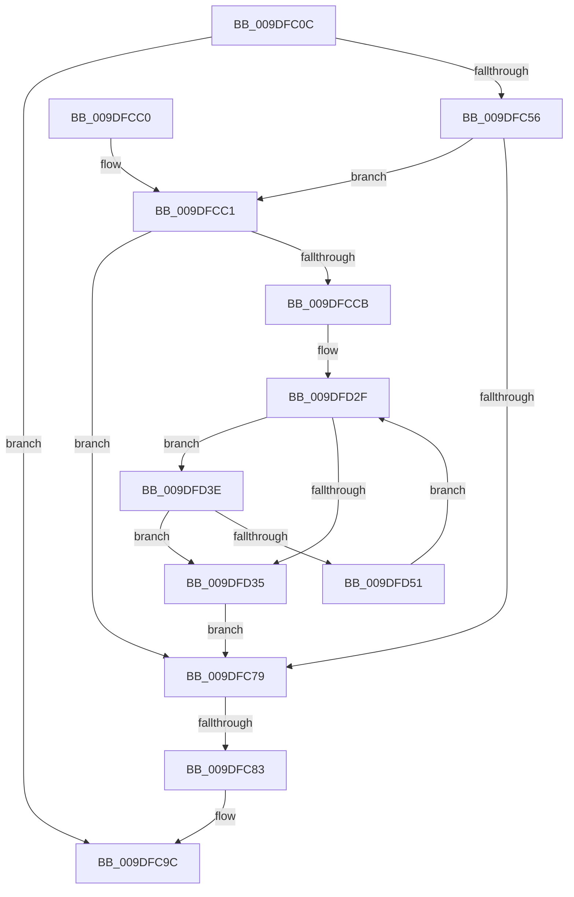

# WmipEnableCollectionForNewGuid

- RVA: `0x009DFC0C`–`0x009DFD60` (길이 `340` bytes)
- VA: `0x00000001409DFC0C`
- 실행 섹션: `PAGE`
- PDB 이름 있음: `예`; PDB Function 태그: `예`
- unwind 정보 RVA: `0x000A3B80`
- 디코드: `93`개 명령, `340/340` bytes 표시
- 미해석 바이트: `0` (있으면 어셈블리에 `.byte`로 보존)

> 이 문서는 커널 이미지의 기계어와 PDB 기호를 분석해 생성했습니다. 4번과 5번은 함수 원형과 자료형을 바이너리 사용 방식에서 추정한 C 해석이며 원본 소스 복구 결과는 아닙니다.

## 1. Dependencies

- 직접 호출 지점: **10**; 고유 호출 대상: **7**
- 직접 호출자로 확인된 함수: **2**
- RIP 상대 이미지 참조: **3**

### Outgoing calls
- `0x009DFC49` → [WmipFindGEByGuid](../9E/WmipFindGEByGuid_function_009E03A4.md) (function, `0x009E03A4`)
- `0x009DFC6E` → [KeWaitForSingleObject](../../text/20/KeWaitForSingleObject_function_0020E6B0.md) (function, `0x0020E6B0`)
- `0x009DFC8D` → [WmipUnreferenceEntry](../9E/WmipUnreferenceEntry_function_009E0CC8.md) (function, `0x009E0CC8`)
- `0x009DFC97` → [KeReleaseMutex](../../text/39/KeReleaseMutex_function_00396810.md) (function, `0x00396810`)
- `0x009DFCA3` → [_security_check_cookie](../../text/6A/_security_check_cookie_function_006AC640.md) (function, `0x006AC640`)
- `0x009DFCDB` → [KeReleaseMutex](../../text/39/KeReleaseMutex_function_00396810.md) (function, `0x00396810`)
- `0x009DFD14` → [WmipSendWmiIrp](../9E/WmipSendWmiIrp_function_009E0484.md) (function, `0x009E0484`)
- `0x009DFD2A` → [KeWaitForSingleObject](../../text/20/KeWaitForSingleObject_function_0020E6B0.md) (function, `0x0020E6B0`)
- `0x009DFD46` → [WmipSendEnableDisableRequest](../9E/WmipSendEnableDisableRequest_function_009E3800.md) (function, `0x009E3800`)
- `0x009DFD59` → [WmipSendEnableDisableRequest](../9E/WmipSendEnableDisableRequest_function_009E3800.md) (function, `0x009E3800`)

### Direct callers
- [WmipUpdateDataSource](WmipUpdateDataSource_function_009DD474.md) at `0x009DD78F`
- [WmipGenerateRegistrationNotification](WmipGenerateRegistrationNotification_function_009DF60C.md) at `0x009DF686`

### Static image references
- `0x009DFC24` → RVA `0x00E0A740` (`.data`; read)
- `0x009DFC5C` → RVA `0x00EFFA60` (`.data`; read)
- `0x009DFC86` → RVA `0x00E03628` (`.data`; read)

## 2. Other-region calls and transfers

- 다른 실행 섹션으로 향하는 call: **5**
  - `0x009DFC6E` → [KeWaitForSingleObject](../../text/20/KeWaitForSingleObject_function_0020E6B0.md) (`PAGE` → `.text`)
  - `0x009DFC97` → [KeReleaseMutex](../../text/39/KeReleaseMutex_function_00396810.md) (`PAGE` → `.text`)
  - `0x009DFCA3` → [_security_check_cookie](../../text/6A/_security_check_cookie_function_006AC640.md) (`PAGE` → `.text`)
  - `0x009DFCDB` → [KeReleaseMutex](../../text/39/KeReleaseMutex_function_00396810.md) (`PAGE` → `.text`)
  - `0x009DFD2A` → [KeWaitForSingleObject](../../text/20/KeWaitForSingleObject_function_0020E6B0.md) (`PAGE` → `.text`)
- call이 아닌 외부 분기/꼬리 이동: **1**
  - `0x009DFC7D` → [sub_00B2FF46](../B2/Unknown_function_00B2FF46.md) (`tail-transfer`)

## 3. Assembly (complete function range)

```asm
009DFC0C  48 89 5C 24 18                  mov qword ptr [rsp + 0x18], rbx
009DFC11  48 89 74 24 20                  mov qword ptr [rsp + 0x20], rsi
009DFC16  55                              push rbp
009DFC17  57                              push rdi
009DFC18  41 57                           push r15
009DFC1A  48 8B EC                        mov rbp, rsp
009DFC1D  48 81 EC 80 00 00 00            sub rsp, 0x80
009DFC24  48 8B 05 15 AB 42 00            mov rax, qword ptr [rip + 0x42ab15]
009DFC2B  48 33 C4                        xor rax, rsp
009DFC2E  48 89 45 F0                     mov qword ptr [rbp - 0x10], rax
009DFC32  0F 57 C0                        xorps xmm0, xmm0
009DFC35  48 8B FA                        mov rdi, rdx
009DFC38  33 D2                           xor edx, edx
009DFC3A  48 8B F1                        mov rsi, rcx
009DFC3D  0F 11 45 C0                     movups xmmword ptr [rbp - 0x40], xmm0
009DFC41  0F 11 45 D0                     movups xmmword ptr [rbp - 0x30], xmm0
009DFC45  0F 11 45 E0                     movups xmmword ptr [rbp - 0x20], xmm0
009DFC49  E8 56 07 00 00                  call 0x1409e03a4
009DFC4E  48 8B D8                        mov rbx, rax
009DFC51  48 85 C0                        test rax, rax
009DFC54  74 46                           je 0x1409dfc9c
009DFC56  48 83 64 24 20 00               and qword ptr [rsp + 0x20], 0
009DFC5C  4C 8D 3D FD FD 51 00            lea r15, [rip + 0x51fdfd]
009DFC63  49 8B CF                        mov rcx, r15
009DFC66  45 33 C9                        xor r9d, r9d
009DFC69  45 33 C0                        xor r8d, r8d
009DFC6C  33 D2                           xor edx, edx
009DFC6E  E8 3D EA 82 FF                  call 0x14020e6b0
009DFC73  83 7B 58 00                     cmp dword ptr [rbx + 0x58], 0
009DFC77  77 48                           ja 0x1409dfcc1
009DFC79  83 7B 5C 00                     cmp dword ptr [rbx + 0x5c], 0
009DFC7D  0F 87 C3 02 15 00               ja 0x140b2ff46
009DFC83  48 8B D3                        mov rdx, rbx
009DFC86  48 8D 0D 9B 39 42 00            lea rcx, [rip + 0x42399b]
009DFC8D  E8 36 10 00 00                  call 0x1409e0cc8
009DFC92  33 D2                           xor edx, edx
009DFC94  49 8B CF                        mov rcx, r15
009DFC97  E8 74 6B 9B FF                  call 0x140396810
009DFC9C  48 8B 4D F0                     mov rcx, qword ptr [rbp - 0x10]
009DFCA0  48 33 CC                        xor rcx, rsp
009DFCA3  E8 98 C9 CC FF                  call 0x1406ac640
009DFCA8  4C 8D 9C 24 80 00 00 00         lea r11, [rsp + 0x80]
009DFCB0  49 8B 5B 30                     mov rbx, qword ptr [r11 + 0x30]
009DFCB4  49 8B 73 38                     mov rsi, qword ptr [r11 + 0x38]
009DFCB8  49 8B E3                        mov rsp, r11
009DFCBB  41 5F                           pop r15
009DFCBD  5F                              pop rdi
009DFCBE  5D                              pop rbp
009DFCBF  C3                              ret
009DFCC0  CC                              int3
009DFCC1  8B 47 10                        mov eax, dword ptr [rdi + 0x10]
009DFCC4  A9 00 20 08 00                  test eax, 0x82000
009DFCC9  75 AE                           jne 0x1409dfc79
009DFCCB  0F BA E8 0D                     bts eax, 0xd
009DFCCF  33 D2                           xor edx, edx
009DFCD1  89 47 10                        mov dword ptr [rdi + 0x10], eax
009DFCD4  49 8B CF                        mov rcx, r15
009DFCD7  83 4B 10 02                     or dword ptr [rbx + 0x10], 2
009DFCDB  E8 30 6B 9B FF                  call 0x140396810
009DFCE0  0F 10 06                        movups xmm0, xmmword ptr [rsi]
009DFCE3  48 8B 57 40                     mov rdx, qword ptr [rdi + 0x40]
009DFCE7  48 8D 45 B0                     lea rax, [rbp - 0x50]
009DFCEB  48 89 44 24 28                  mov qword ptr [rsp + 0x28], rax
009DFCF0  4C 8D 45 D8                     lea r8, [rbp - 0x28]
009DFCF4  F3 0F 7F 45 D8                  movdqu xmmword ptr [rbp - 0x28], xmm0
009DFCF9  C7 45 C0 30 00 00 00            mov dword ptr [rbp - 0x40], 0x30
009DFD00  48 8D 45 C0                     lea rax, [rbp - 0x40]
009DFD04  8B 52 38                        mov edx, dword ptr [rdx + 0x38]
009DFD07  41 B9 30 00 00 00               mov r9d, 0x30
009DFD0D  B1 04                           mov cl, 4
009DFD0F  48 89 44 24 20                  mov qword ptr [rsp + 0x20], rax
009DFD14  E8 6B 07 00 00                  call 0x1409e0484
009DFD19  48 83 64 24 20 00               and qword ptr [rsp + 0x20], 0
009DFD1F  45 33 C9                        xor r9d, r9d
009DFD22  45 33 C0                        xor r8d, r8d
009DFD25  33 D2                           xor edx, edx
009DFD27  49 8B CF                        mov rcx, r15
009DFD2A  E8 81 E9 82 FF                  call 0x14020e6b0
009DFD2F  83 7B 58 00                     cmp dword ptr [rbx + 0x58], 0
009DFD33  74 09                           je 0x1409dfd3e
009DFD35  83 63 10 FD                     and dword ptr [rbx + 0x10], 0xfffffffd
009DFD39  E9 3B FF FF FF                  jmp 0x1409dfc79
009DFD3E  41 B0 01                        mov r8b, 1
009DFD41  48 8B D3                        mov rdx, rbx
009DFD44  B1 05                           mov cl, 5
009DFD46  E8 B5 3A 00 00                  call 0x1409e3800
009DFD4B  83 7B 58 00                     cmp dword ptr [rbx + 0x58], 0
009DFD4F  74 E4                           je 0x1409dfd35
009DFD51  41 B0 01                        mov r8b, 1
009DFD54  48 8B D3                        mov rdx, rbx
009DFD57  B1 04                           mov cl, 4
009DFD59  E8 A2 3A 00 00                  call 0x1409e3800
009DFD5E  EB CF                           jmp 0x1409dfd2f
```

## 4. C-style interpretation (structured pseudocode)

```c
__int64 __fastcall WmipEnableCollectionForNewGuid(__int64 a1, __int64 a2, int a3, int a4)
{
    __int64 result;
    __int64 v_rsp;
    unsigned __int64 v_stack_m18;
    unsigned __int64 v_stack_m28;
    unsigned __int64 v_stack_m38;
    unsigned __int64 v_stack_m40;
    unsigned __int64 v_stack_m48;
    unsigned __int64 v_stack_m58;
    unsigned __int64 v_stack_m60;
    unsigned __int64 v_stack_m68;
    unsigned __int64 v_stack_m78;
    unsigned __int64 v_stack_p18;
    unsigned __int64 v_stack_p20;

    v_stack_p18 = v_rbx;
    v_stack_p20 = v_rsi;
    v_rsp = (v_rsp) - (128);
    result = (*(unsigned __int64 *)(v_rip + 4369173)) ^ (v_rsp);
    v_stack_m28 = result;
    a2 = 0;
    v_stack_m58 = v_xmm0;
    v_stack_m48 = v_xmm0;
    v_stack_m38 = v_xmm0;
    result = WmipFindGEByGuid(a1, a2, a3, a4);
    if (result == 0) goto loc_009DFC9C;
    a4 = 0;
    a3 = 0;
    a2 = 0;
    result = KeWaitForSingleObject(v_rip + 5373437, a2, a3, a4);
    if ((*(unsigned int *)(result + 88)) > 0) goto loc_009DFCC1;
loc_009DFC79:
    result = WmipUnreferenceEntry(v_rip + 4340123, result, a3, a4);
    a2 = 0;
    result = KeReleaseMutex(v_rip + 5373437, a2, a3, a4);
loc_009DFC9C:
    a1 = (v_stack_m28) ^ (v_rsp);
    result = _security_check_cookie(a1, a2, a3, a4);
    return result;
loc_009DFCC1:
    if ((((unsigned int)((unsigned int)(*(unsigned int *)(a2 + 16)))) & (0x82000ULL)) != 0) goto loc_009DFC79;
    a2 = 0;
    *(unsigned int *)(a2 + 16) = (unsigned int)((unsigned int)(*(unsigned int *)(a2 + 16)));
    result = KeReleaseMutex(v_rip + 5373437, a2, a3, a4);
    v_stack_m58 = v_stack_m68;
    v_stack_m40 = v_xmm0;
    v_stack_m58 = 48;
    v_stack_m60 = v_stack_m58;
    result = WmipSendWmiIrp(4, (unsigned int)(*(unsigned int *)(*(unsigned __int64 *)(a2 + 64) + 56)), v_stack_m40, 48);
    a4 = 0;
    a3 = 0;
    a2 = 0;
    result = KeWaitForSingleObject(v_rip + 5373437, a2, a3, a4);
loc_009DFD2F:
    if ((*(unsigned int *)(*(unsigned __int64 *)(v_stack_m18 + 48) + 88)) == 0) goto loc_009DFD3E;
loc_009DFD35:
    goto loc_009DFC79;
loc_009DFD3E:
    result = WmipSendEnableDisableRequest(5, *(unsigned __int64 *)(v_stack_m18 + 48), 1, a4);
    if ((*(unsigned int *)(*(unsigned __int64 *)(v_stack_m18 + 48) + 88)) == 0) goto loc_009DFD35;
    result = WmipSendEnableDisableRequest(4, *(unsigned __int64 *)(v_stack_m18 + 48), 1, a4);
    goto loc_009DFD2F;
}
```

## 5. (Beta) C Style

```c
int64_t WmipEnableCollectionForNewGuid(void *Arg1, void *Arg2, int32_t Arg3, int32_t Arg4)
{
    uint8_t *arg1 = (uint8_t *)Arg1;
    uint8_t *arg2 = (uint8_t *)Arg2;

    int64_t result;
    int64_t local_rsp;
    uint64_t v_stack_m18;
    uint64_t v_stack_m28;
    uint64_t v_stack_m38;
    uint64_t v_stack_m40;
    uint64_t v_stack_m48;
    uint64_t v_stack_m58;
    uint64_t v_stack_m60;
    uint64_t v_stack_m68;
    uint64_t v_stack_m78;
    uint64_t v_stack_p18;
    uint64_t v_stack_p20;

    v_stack_p18 = local_rbx;
    v_stack_p20 = local_rsi;
    local_rsp = (local_rsp) - (128);
    result = (*(uint64_t *)(v_rip + 0x42AB15)) ^ (local_rsp);
    v_stack_m28 = result;
    Arg2 = 0;
    v_stack_m58 = v_xmm0;
    v_stack_m48 = v_xmm0;
    v_stack_m38 = v_xmm0;
    result = WmipFindGEByGuid(Arg1, Arg2, Arg3, Arg4);
    if (result == 0) goto loc_009DFC9C;
    Arg4 = 0;
    Arg3 = 0;
    Arg2 = 0;
    result = KeWaitForSingleObject(v_rip + 5373437, Arg2, Arg3, Arg4);
    if ((*(uint32_t *)(result + 0x58)) > 0) goto loc_009DFCC1;
loc_009DFC79:
    result = WmipUnreferenceEntry(v_rip + 4340123, result, Arg3, Arg4);
    Arg2 = 0;
    result = KeReleaseMutex(v_rip + 5373437, Arg2, Arg3, Arg4);
loc_009DFC9C:
    Arg1 = (v_stack_m28) ^ (local_rsp);
    result = _security_check_cookie(Arg1, Arg2, Arg3, Arg4);
    return result;
loc_009DFCC1:
    if ((((uint32_t)((uint32_t)(*(uint32_t *)(arg2 + 0x10)))) & (0x82000ULL)) != 0) goto loc_009DFC79;
    Arg2 = 0;
    *(uint32_t *)(arg2 + 0x10) = (uint32_t)((uint32_t)(*(uint32_t *)(arg2 + 0x10)));
    result = KeReleaseMutex(v_rip + 5373437, Arg2, Arg3, Arg4);
    v_stack_m58 = v_stack_m68;
    v_stack_m40 = v_xmm0;
    v_stack_m58 = 48;
    v_stack_m60 = v_stack_m58;
    result = WmipSendWmiIrp(4, (uint32_t)(*(uint32_t *)(*(uint64_t *)(arg2 + 0x40) + 0x38)), v_stack_m40, 48);
    Arg4 = 0;
    Arg3 = 0;
    Arg2 = 0;
    result = KeWaitForSingleObject(v_rip + 5373437, Arg2, Arg3, Arg4);
loc_009DFD2F:
    if ((*(uint32_t *)(*(uint64_t *)(v_stack_m18 + 0x30) + 0x58)) == 0) goto loc_009DFD3E;
loc_009DFD35:
    goto loc_009DFC79;
loc_009DFD3E:
    result = WmipSendEnableDisableRequest(5, *(uint64_t *)(v_stack_m18 + 0x30), 1, Arg4);
    if ((*(uint32_t *)(*(uint64_t *)(v_stack_m18 + 0x30) + 0x58)) == 0) goto loc_009DFD35;
    result = WmipSendEnableDisableRequest(4, *(uint64_t *)(v_stack_m18 + 0x30), 1, Arg4);
    goto loc_009DFD2F;
}
```

### 관측된 메모리 오프셋

구조체 형식이 확인되지 않은 접근은 인자 기준의 오프셋으로만 기록했습니다.

| 기준 인자 | 오프셋 표현 | 폭 (bit) | 접근 |
|---|---:|---:|---|
| `Arg1` | `+ 0x0` | `128` | `R` |
| `Arg2` | `+ 0x10` | `32` | `R` |
| `Arg2` | `+ 0x10` | `32` | `W` |
| `Arg2` | `+ 0x40` | `64` | `R` |

## 6. Execution-region graph

[열기: 2D/3D 그래프와 함수 탐색 컨트롤 패널](../../../control-panel.html?section=page&rva=0x009DFC0C&view=graph)

- 2D 그래프는 위에서 아래로 흐르고, 3D 그래프는 빈 공간을 드래그해 회전합니다. Shift+드래그는 이동, 휠은 확대·축소, 함수 노드 선택은 대상 보고서 이동입니다.

### Static fallback


