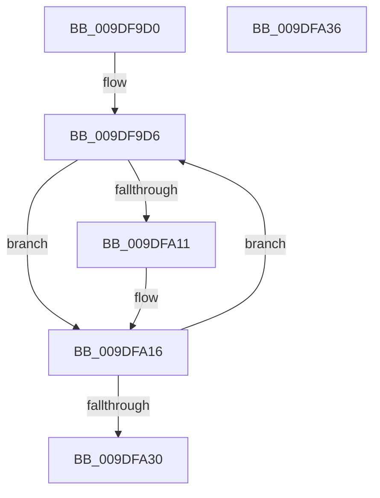

# WmipEventNotification

- RVA: `0x009DF9D0`–`0x009DFA37` (길이 `103` bytes)
- VA: `0x00000001409DF9D0`
- 실행 섹션: `PAGE`
- PDB 이름 있음: `예`; PDB Function 태그: `아니요`
- unwind 정보 RVA: `0x0005CF00`
- 디코드: `29`개 명령, `103/103` bytes 표시
- 미해석 바이트: `0` (있으면 어셈블리에 `.byte`로 보존)

> 이 문서는 커널 이미지의 기계어와 PDB 기호를 분석해 생성했습니다. 4번과 5번은 함수 원형과 자료형을 바이너리 사용 방식에서 추정한 C 해석이며 원본 소스 복구 결과는 아닙니다.

## 1. Dependencies

- 직접 호출 지점: **4**; 고유 호출 대상: **4**
- 직접 호출자로 확인된 함수: **0**
- RIP 상대 이미지 참조: **3**

### Outgoing calls
- `0x009DF9E4` → [ExInterlockedRemoveHeadList](../../text/38/ExInterlockedRemoveHeadList_function_003867B0.md) (function, `0x003867B0`)
- `0x009DFA03` → [WmipProcessEvent](WmipProcessEvent_function_009DFA40.md) (function, `0x009DFA40`)
- `0x009DFA11` → [WmipUnreferenceRegEntry](../../text/47/WmipUnreferenceRegEntry_function_0047B6F0.md) (function, `0x0047B6F0`)
- `0x009DFA1B` → [ExFreePoolWithTag](../../poolcode/B8/ExFreePoolWithTag_function_00B82870.md) (function, `0x00B82870`)

### Direct callers
- 이 함수 시작 RVA로 연결되는 직접 call은 확인되지 않았습니다. 간접 호출은 완전히 역산할 수 없습니다.

### Static image references
- `0x009DF9D6` → RVA `0x00EFFAA8` (`.data`; read)
- `0x009DF9DD` → RVA `0x00E09158` (`.data`; read)
- `0x009DFA23` → RVA `0x00EFFAA0` (`.data`; read/write)

## 2. Other-region calls and transfers

- 다른 실행 섹션으로 향하는 call: **3**
  - `0x009DF9E4` → [ExInterlockedRemoveHeadList](../../text/38/ExInterlockedRemoveHeadList_function_003867B0.md) (`PAGE` → `.text`)
  - `0x009DFA11` → [WmipUnreferenceRegEntry](../../text/47/WmipUnreferenceRegEntry_function_0047B6F0.md) (`PAGE` → `.text`)
  - `0x009DFA1B` → [ExFreePoolWithTag](../../poolcode/B8/ExFreePoolWithTag_function_00B82870.md) (`PAGE` → `POOLCODE`)
- 별도 외부 분기/꼬리 이동을 확인하지 못했습니다.

## 3. Assembly (complete function range)

```asm
009DF9D0  40 53                           push rbx
009DF9D2  48 83 EC 20                     sub rsp, 0x20
009DF9D6  48 8D 15 CB 00 52 00            lea rdx, [rip + 0x5200cb]
009DF9DD  48 8D 0D 74 97 42 00            lea rcx, [rip + 0x429774]
009DF9E4  E8 C7 6D 9A FF                  call 0x1403867b0
009DF9E9  41 B0 01                        mov r8b, 1
009DF9EC  48 8B D8                        mov rbx, rax
009DF9EF  48 8B 48 18                     mov rcx, qword ptr [rax + 0x18]
009DF9F3  8B 51 28                        mov edx, dword ptr [rcx + 0x28]
009DF9F6  83 61 28 00                     and dword ptr [rcx + 0x28], 0
009DF9FA  83 61 0C 00                     and dword ptr [rcx + 0xc], 0
009DF9FE  89 51 08                        mov dword ptr [rcx + 8], edx
009DFA01  33 D2                           xor edx, edx
009DFA03  E8 38 00 00 00                  call 0x1409dfa40
009DFA08  48 8B 4B 10                     mov rcx, qword ptr [rbx + 0x10]
009DFA0C  48 85 C9                        test rcx, rcx
009DFA0F  74 05                           je 0x1409dfa16
009DFA11  E8 DA BC A9 FF                  call 0x14047b6f0
009DFA16  33 D2                           xor edx, edx
009DFA18  48 8B CB                        mov rcx, rbx
009DFA1B  E8 50 2E 1A 00                  call 0x140b82870
009DFA20  83 C8 FF                        or eax, 0xffffffff
009DFA23  F0 0F C1 05 75 00 52 00         lock xadd dword ptr [rip + 0x520075], eax
009DFA2B  83 F8 01                        cmp eax, 1
009DFA2E  75 A6                           jne 0x1409df9d6
009DFA30  48 83 C4 20                     add rsp, 0x20
009DFA34  5B                              pop rbx
009DFA35  C3                              ret
009DFA36  CC                              int3
```

## 4. C-style interpretation (structured pseudocode)

```c
__int64 __fastcall WmipEventNotification(void)
{
    __int64 result;
    __int64 v_rsp;

    v_rsp = (v_rsp) - (32);
loc_009DF9D6:
    result = ExInterlockedRemoveHeadList(v_rip + 4364148, v_rip + 5374155, a3, a4);
    *(unsigned int *)(*(unsigned __int64 *)(result + 24) + 8) = (unsigned int)((unsigned int)(*(unsigned int *)(*(unsigned __int64 *)(result + 24) + 40)));
    a2 = 0;
    result = WmipProcessEvent(*(unsigned __int64 *)(result + 24), a2, 1, a4);
    if (*(unsigned __int64 *)(result + 16) != 0) {
        result = WmipUnreferenceRegEntry(*(unsigned __int64 *)(result + 16), a2, 1, a4);
    }
    a2 = 0;
    result = ExFreePoolWithTag(result, a2, 1, a4);
    result = (unsigned int)((result) | (0xFFFFFFFFULL));
    if (((unsigned int)(result)) != 1) goto loc_009DF9D6;
    v_rsp = (v_rsp) + (32);
    return result;
}
```

## 5. (Beta) C Style

```c
void WmipEventNotification(void)
{
    int64_t result;
    int64_t local_rsp;

    local_rsp = (local_rsp) - (32);
loc_009DF9D6:
    result = ExInterlockedRemoveHeadList(v_rip + 4364148, v_rip + 5374155, a3, a4);
    *(uint32_t *)(*(uint64_t *)(result + 0x18) + 0x8) = (uint32_t)((uint32_t)(*(uint32_t *)(*(uint64_t *)(result + 0x18) + 0x28)));
    a2 = 0;
    result = WmipProcessEvent(*(uint64_t *)(result + 0x18), a2, 1, a4);
    if (*(uint64_t *)(result + 0x10) != 0) {
        result = WmipUnreferenceRegEntry(*(uint64_t *)(result + 0x10), a2, 1, a4);
    }
    a2 = 0;
    result = ExFreePoolWithTag(result, a2, 1, a4);
    result = (uint32_t)((result) | (0xFFFFFFFFULL));
    if (((uint32_t)(result)) != 1) goto loc_009DF9D6;
    local_rsp = (local_rsp) + (32);
    return result;
}
```

## 6. Execution-region graph

[열기: 2D/3D 그래프와 함수 탐색 컨트롤 패널](../../../control-panel.html?section=page&rva=0x009DF9D0&view=graph)

- 2D 그래프는 위에서 아래로 흐르고, 3D 그래프는 빈 공간을 드래그해 회전합니다. Shift+드래그는 이동, 휠은 확대·축소, 함수 노드 선택은 대상 보고서 이동입니다.

### Static fallback


