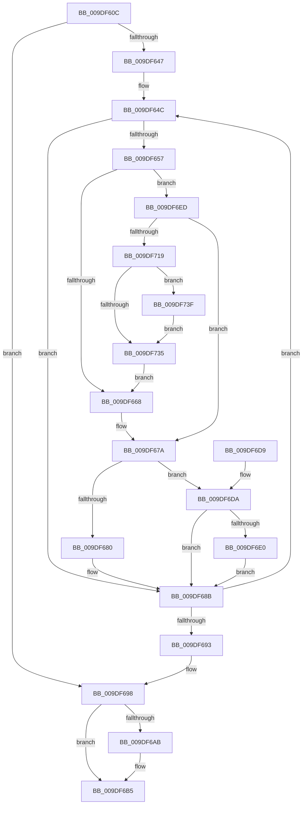

# WmipGenerateRegistrationNotification

- RVA: `0x009DF60C`–`0x009DF74B` (길이 `319` bytes)
- VA: `0x00000001409DF60C`
- 실행 섹션: `PAGE`
- PDB 이름 있음: `예`; PDB Function 태그: `아니요`
- unwind 정보 RVA: `0x000A3B14`
- 디코드: `96`개 명령, `319/319` bytes 표시
- 미해석 바이트: `0` (있으면 어셈블리에 `.byte`로 보존)

> 이 문서는 커널 이미지의 기계어와 PDB 기호를 분석해 생성했습니다. 4번과 5번은 함수 원형과 자료형을 바이너리 사용 방식에서 추정한 C 해석이며 원본 소스 복구 결과는 아닙니다.

## 1. Dependencies

- 직접 호출 지점: **9**; 고유 호출 대상: **8**
- 직접 호출자로 확인된 함수: **2**
- RIP 상대 이미지 참조: **1**

### Outgoing calls
- `0x009DF62B` → [WmipReferenceEntry](../9E/WmipReferenceEntry_function_009E1BF8.md) (function, `0x009E1BF8`)
- `0x009DF686` → [WmipEnableCollectionForNewGuid](WmipEnableCollectionForNewGuid_function_009DFC0C.md) (function, `0x009DFC0C`)
- `0x009DF6A1` → [WmipSendGuidUpdateNotifications](WmipSendGuidUpdateNotifications_function_009DE50C.md) (function, `0x009DE50C`)
- `0x009DF6B0` → [ExFreePoolWithTag](../../poolcode/B8/ExFreePoolWithTag_function_00B82870.md) (function, `0x00B82870`)
- `0x009DF6BF` → [WmipUnreferenceEntry](../9E/WmipUnreferenceEntry_function_009E0CC8.md) (function, `0x009E0CC8`)
- `0x009DF6E6` → [WmipDisableCollectionForRemovedGuid](WmipDisableCollectionForRemovedGuid_function_009DE88C.md) (function, `0x009DE88C`)
- `0x009DF706` → [ExAllocatePool2](../../poolcode/B8/ExAllocatePool2_function_00B820F0.md) (function, `0x00B820F0`)
- `0x009DF726` → [memcpy](../../text/6C/memcpy_function_006C6840.md) (function, `0x006C6840`)
- `0x009DF744` → [ExFreePoolWithTag](../../poolcode/B8/ExFreePoolWithTag_function_00B82870.md) (function, `0x00B82870`)

### Direct callers
- [WmipRemoveDS](WmipRemoveDS_function_009DD7D8.md) at `0x009DD7EF`
- [WmipAddDataSource](WmipAddDataSource_function_009DDC30.md) at `0x009DDDFA`

### Static image references
- `0x009DF6B8` → RVA `0x00E03648` (`.data`; read)

## 2. Other-region calls and transfers

- 다른 실행 섹션으로 향하는 call: **4**
  - `0x009DF6B0` → [ExFreePoolWithTag](../../poolcode/B8/ExFreePoolWithTag_function_00B82870.md) (`PAGE` → `POOLCODE`)
  - `0x009DF706` → [ExAllocatePool2](../../poolcode/B8/ExAllocatePool2_function_00B820F0.md) (`PAGE` → `POOLCODE`)
  - `0x009DF726` → [memcpy](../../text/6C/memcpy_function_006C6840.md) (`PAGE` → `.text`)
  - `0x009DF744` → [ExFreePoolWithTag](../../poolcode/B8/ExFreePoolWithTag_function_00B82870.md) (`PAGE` → `POOLCODE`)
- 별도 외부 분기/꼬리 이동을 확인하지 못했습니다.

## 3. Assembly (complete function range)

```asm
009DF60C  48 89 5C 24 10                  mov qword ptr [rsp + 0x10], rbx
009DF611  48 89 4C 24 08                  mov qword ptr [rsp + 8], rcx
009DF616  55                              push rbp
009DF617  56                              push rsi
009DF618  57                              push rdi
009DF619  41 54                           push r12
009DF61B  41 55                           push r13
009DF61D  41 56                           push r14
009DF61F  41 57                           push r15
009DF621  48 83 EC 20                     sub rsp, 0x20
009DF625  44 8B E2                        mov r12d, edx
009DF628  4C 8B F9                        mov r15, rcx
009DF62B  E8 C8 25 00 00                  call 0x1409e1bf8
009DF630  45 33 F6                        xor r14d, r14d
009DF633  4D 8D 6F 28                     lea r13, [r15 + 0x28]
009DF637  44 21 74 24 70                  and dword ptr [rsp + 0x70], r14d
009DF63C  33 DB                           xor ebx, ebx
009DF63E  49 8B 7D 00                     mov rdi, qword ptr [r13]
009DF642  49 3B FD                        cmp rdi, r13
009DF645  74 51                           je 0x1409df698
009DF647  44 8B 7C 24 70                  mov r15d, dword ptr [rsp + 0x70]
009DF64C  48 8D 77 D8                     lea rsi, [rdi - 0x28]
009DF650  8B 46 10                        mov eax, dword ptr [rsi + 0x10]
009DF653  A8 08                           test al, 8
009DF655  75 34                           jne 0x1409df68b
009DF657  48 8B 6E 38                     mov rbp, qword ptr [rsi + 0x38]
009DF65B  48 83 C5 48                     add rbp, 0x48
009DF65F  45 3B F7                        cmp r14d, r15d
009DF662  0F 84 85 00 00 00               je 0x1409df6ed
009DF668  41 8B C6                        mov eax, r14d
009DF66B  48 03 C0                        add rax, rax
009DF66E  41 FF C6                        inc r14d
009DF671  48 89 2C C3                     mov qword ptr [rbx + rax*8], rbp
009DF675  48 89 74 C3 08                  mov qword ptr [rbx + rax*8 + 8], rsi
009DF67A  41 83 FC 01                     cmp r12d, 1
009DF67E  75 5A                           jne 0x1409df6da
009DF680  48 8B D6                        mov rdx, rsi
009DF683  48 8B CD                        mov rcx, rbp
009DF686  E8 81 05 00 00                  call 0x1409dfc0c
009DF68B  48 8B 3F                        mov rdi, qword ptr [rdi]
009DF68E  49 3B FD                        cmp rdi, r13
009DF691  75 B9                           jne 0x1409df64c
009DF693  4C 8B 7C 24 60                  mov r15, qword ptr [rsp + 0x60]
009DF698  4C 8B C3                        mov r8, rbx
009DF69B  41 8B D6                        mov edx, r14d
009DF69E  41 8B CC                        mov ecx, r12d
009DF6A1  E8 66 EE FF FF                  call 0x1409de50c
009DF6A6  48 85 DB                        test rbx, rbx
009DF6A9  74 0A                           je 0x1409df6b5
009DF6AB  33 D2                           xor edx, edx
009DF6AD  48 8B CB                        mov rcx, rbx
009DF6B0  E8 BB 31 1A 00                  call 0x140b82870
009DF6B5  49 8B D7                        mov rdx, r15
009DF6B8  48 8D 0D 89 3F 42 00            lea rcx, [rip + 0x423f89]
009DF6BF  E8 04 16 00 00                  call 0x1409e0cc8
009DF6C4  48 8B 5C 24 68                  mov rbx, qword ptr [rsp + 0x68]
009DF6C9  48 83 C4 20                     add rsp, 0x20
009DF6CD  41 5F                           pop r15
009DF6CF  41 5E                           pop r14
009DF6D1  41 5D                           pop r13
009DF6D3  41 5C                           pop r12
009DF6D5  5F                              pop rdi
009DF6D6  5E                              pop rsi
009DF6D7  5D                              pop rbp
009DF6D8  C3                              ret
009DF6D9  CC                              int3
009DF6DA  41 83 FC 02                     cmp r12d, 2
009DF6DE  75 AB                           jne 0x1409df68b
009DF6E0  48 8B D6                        mov rdx, rsi
009DF6E3  48 8B CD                        mov rcx, rbp
009DF6E6  E8 A1 F1 FF FF                  call 0x1409de88c
009DF6EB  EB 9E                           jmp 0x1409df68b
009DF6ED  41 8D 47 40                     lea eax, [r15 + 0x40]
009DF6F1  B9 00 01 00 00                  mov ecx, 0x100
009DF6F6  8B D0                           mov edx, eax
009DF6F8  41 B8 57 6D 69 70               mov r8d, 0x70696d57
009DF6FE  48 C1 E2 04                     shl rdx, 4
009DF702  89 44 24 70                     mov dword ptr [rsp + 0x70], eax
009DF706  E8 E5 29 1A 00                  call 0x140b820f0
009DF70B  48 89 44 24 78                  mov qword ptr [rsp + 0x78], rax
009DF710  48 85 C0                        test rax, rax
009DF713  0F 84 61 FF FF FF               je 0x1409df67a
009DF719  45 8B C7                        mov r8d, r15d
009DF71C  48 8B D3                        mov rdx, rbx
009DF71F  49 C1 E0 04                     shl r8, 4
009DF723  48 8B C8                        mov rcx, rax
009DF726  E8 15 71 CE FF                  call 0x1406c6840
009DF72B  44 8B 7C 24 70                  mov r15d, dword ptr [rsp + 0x70]
009DF730  48 85 DB                        test rbx, rbx
009DF733  75 0A                           jne 0x1409df73f
009DF735  48 8B 5C 24 78                  mov rbx, qword ptr [rsp + 0x78]
009DF73A  E9 29 FF FF FF                  jmp 0x1409df668
009DF73F  33 D2                           xor edx, edx
009DF741  48 8B CB                        mov rcx, rbx
009DF744  E8 27 31 1A 00                  call 0x140b82870
009DF749  EB EA                           jmp 0x1409df735
```

## 4. C-style interpretation (structured pseudocode)

```c
__int64 __fastcall WmipGenerateRegistrationNotification(__int64 a1, int a2)
{
    __int64 result;
    __int64 v_r14;
    __int64 v_rbp;
    __int64 v_rbx;
    __int64 v_rsp;
    unsigned __int64 v_stack_p10;
    unsigned int v_stack_p18;
    unsigned int v_stack_p70;
    unsigned __int64 v_stack_p78;
    unsigned __int64 v_stack_p8;

    v_stack_p10 = v_rbx;
    v_stack_p8 = a1;
    v_rsp = (v_rsp) - (32);
    result = WmipReferenceEntry(a1, a2, a3, a4);
    v_r14 = 0;
    v_rbx = 0;
    if ((*(unsigned __int64 *)(a1 + 40)) == (a1 + 40)) goto loc_009DF698;
loc_009DF64C:
    if ((((unsigned __int8)((unsigned int)(*(unsigned int *)(*(unsigned __int64 *)(a1 + 40) - 40 + 16)))) & (8)) != 0) goto loc_009DF68B;
    v_rbp = (*(unsigned __int64 *)(*(unsigned __int64 *)(a1 + 40) - 40 + 56)) + (72);
    if (0 == ((unsigned int)((unsigned int)(v_stack_p18)))) goto loc_009DF6ED;
loc_009DF668:
    result = (0) + (0);
    v_r14 = (unsigned int)((v_r14) + 1);
    *(unsigned __int64 *)(v_rbx + result * 8) = v_rbp;
    *(unsigned __int64 *)(v_rbx + result * 8 + 8) = *(unsigned __int64 *)(a1 + 40) - 40;
loc_009DF67A:
    if (((unsigned int)((unsigned int)(a2))) != 1) goto loc_009DF6DA;
    result = WmipEnableCollectionForNewGuid(v_rbp, *(unsigned __int64 *)(a1 + 40) - 40, a3, a4);
loc_009DF68B:
    if ((*(unsigned __int64 *)(*(unsigned __int64 *)(a1 + 40))) != (a1 + 40)) goto loc_009DF64C;
loc_009DF698:
    result = WmipSendGuidUpdateNotifications((unsigned int)((unsigned int)((unsigned int)(a2))), (unsigned int)((unsigned int)(v_r14)), 0, a4);
    if (0 != 0) {
        a2 = 0;
        a1 = 0;
        result = ExFreePoolWithTag(a1, a2, 0, a4);
    }
    result = WmipUnreferenceEntry(v_rip + 4341641, v_stack_p8, 0, a4);
    v_rsp = (v_rsp) + (32);
    return result;
loc_009DF6DA:
    if (((unsigned int)((unsigned int)(a2))) != 2) goto loc_009DF68B;
    result = WmipDisableCollectionForRemovedGuid(v_rbp, *(unsigned __int64 *)(a1 + 40) - 40, 0, a4);
    goto loc_009DF68B;
loc_009DF6ED:
    a2 = ((unsigned int)((unsigned int)(v_stack_p8 + 64))) << (4);
    v_stack_p70 = (unsigned int)(v_stack_p8 + 64);
    result = ExAllocatePool2(256, a2, (unsigned int)(0x70696D57ULL), a4);
    v_stack_p78 = result;
    if (result == 0) goto loc_009DF67A;
    a3 = ((unsigned int)((unsigned int)(v_stack_p8))) << (4);
    result = memcpy(result, v_stack_p10, a3, a4);
    if (v_stack_p10 != 0) goto loc_009DF73F;
loc_009DF735:
    goto loc_009DF668;
loc_009DF73F:
    a2 = 0;
    result = ExFreePoolWithTag(v_stack_p78, a2, a3, a4);
    goto loc_009DF735;
}
```

## 5. (Beta) C Style

```c
int64_t WmipGenerateRegistrationNotification(void *Arg1, int32_t Arg2)
{
    uint8_t *arg1 = (uint8_t *)Arg1;

    int64_t result;
    int64_t local_r14;
    int64_t local_rbp;
    int64_t local_rbx;
    int64_t local_rsp;
    uint64_t v_stack_p10;
    uint32_t v_stack_p18;
    uint32_t v_stack_p70;
    uint64_t v_stack_p78;
    uint64_t v_stack_p8;

    v_stack_p10 = local_rbx;
    v_stack_p8 = Arg1;
    local_rsp = (local_rsp) - (32);
    result = WmipReferenceEntry(Arg1, Arg2, a3, a4);
    local_r14 = 0;
    local_rbx = 0;
    if ((*(uint64_t *)(arg1 + 0x28)) == (Arg1 + 40)) goto loc_009DF698;
loc_009DF64C:
    if ((((uint8_t)((uint32_t)(*(uint32_t *)(*(uint64_t *)(arg1 + 0x28) - 0x28 + 0x10)))) & (8)) != 0) goto loc_009DF68B;
    local_rbp = (*(uint64_t *)(*(uint64_t *)(arg1 + 0x28) - 0x28 + 0x38)) + (72);
    if (0 == ((uint32_t)((uint32_t)(v_stack_p18)))) goto loc_009DF6ED;
loc_009DF668:
    result = (0) + (0);
    local_r14 = (uint32_t)((local_r14) + 1);
    *(uint64_t *)(local_rbx + result * 8) = local_rbp;
    *(uint64_t *)(local_rbx + result * 8 + 0x8) = *(uint64_t *)(arg1 + 0x28) - 40;
loc_009DF67A:
    if (((uint32_t)((uint32_t)(Arg2))) != 1) goto loc_009DF6DA;
    result = WmipEnableCollectionForNewGuid(local_rbp, *(uint64_t *)(arg1 + 0x28) - 40, a3, a4);
loc_009DF68B:
    if ((*(uint64_t *)(*(uint64_t *)(arg1 + 0x28))) != (Arg1 + 40)) goto loc_009DF64C;
loc_009DF698:
    result = WmipSendGuidUpdateNotifications((uint32_t)((uint32_t)((uint32_t)(Arg2))), (uint32_t)((uint32_t)(local_r14)), 0, a4);
    if (0 != 0) {
        Arg2 = 0;
        Arg1 = 0;
        result = ExFreePoolWithTag(Arg1, Arg2, 0, a4);
    }
    result = WmipUnreferenceEntry(v_rip + 4341641, v_stack_p8, 0, a4);
    local_rsp = (local_rsp) + (32);
    return result;
loc_009DF6DA:
    if (((uint32_t)((uint32_t)(Arg2))) != 2) goto loc_009DF68B;
    result = WmipDisableCollectionForRemovedGuid(local_rbp, *(uint64_t *)(arg1 + 0x28) - 40, 0, a4);
    goto loc_009DF68B;
loc_009DF6ED:
    Arg2 = ((uint32_t)((uint32_t)(v_stack_p8 + 64))) << (4);
    v_stack_p70 = (uint32_t)(v_stack_p8 + 64);
    result = ExAllocatePool2(256, Arg2, (uint32_t)(0x70696D57ULL), a4);
    v_stack_p78 = result;
    if (result == 0) goto loc_009DF67A;
    a3 = ((uint32_t)((uint32_t)(v_stack_p8))) << (4);
    result = memcpy(result, v_stack_p10, a3, a4);
    if (v_stack_p10 != 0) goto loc_009DF73F;
loc_009DF735:
    goto loc_009DF668;
loc_009DF73F:
    Arg2 = 0;
    result = ExFreePoolWithTag(v_stack_p78, Arg2, a3, a4);
    goto loc_009DF735;
}
```

### 관측된 메모리 오프셋

구조체 형식이 확인되지 않은 접근은 인자 기준의 오프셋으로만 기록했습니다.

| 기준 인자 | 오프셋 표현 | 폭 (bit) | 접근 |
|---|---:|---:|---|
| `Arg1` | `+ 0x0` | `64` | `R` |
| `Arg1` | `+ 0x28` | `64` | `R` |

## 6. Execution-region graph

[열기: 2D/3D 그래프와 함수 탐색 컨트롤 패널](../../../control-panel.html?section=page&rva=0x009DF60C&view=graph)

- 2D 그래프는 위에서 아래로 흐르고, 3D 그래프는 빈 공간을 드래그해 회전합니다. Shift+드래그는 이동, 휠은 확대·축소, 함수 노드 선택은 대상 보고서 이동입니다.

### Static fallback


