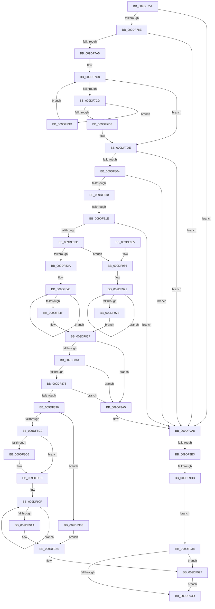

# WmipIncludeStaticNames

- RVA: `0x009DF754`–`0x009DF9C6` (길이 `626` bytes)
- VA: `0x00000001409DF754`
- 실행 섹션: `PAGE`
- PDB 이름 있음: `예`; PDB Function 태그: `예`
- unwind 정보 RVA: `0x000A3B30`
- 디코드: `167`개 명령, `626/626` bytes 표시
- 미해석 바이트: `0` (있으면 어셈블리에 `.byte`로 보존)

> 이 문서는 커널 이미지의 기계어와 PDB 기호를 분석해 생성했습니다. 4번과 5번은 함수 원형과 자료형을 바이너리 사용 방식에서 추정한 C 해석이며 원본 소스 복구 결과는 아닙니다.

## 1. Dependencies

- 직접 호출 지점: **13**; 고유 호출 대상: **11**
- 직접 호출자로 확인된 함수: **1**
- RIP 상대 이미지 참조: **5**

### Outgoing calls
- `0x009DF794` → [WmipFindGEByGuid](../9E/WmipFindGEByGuid_function_009E03A4.md) (function, `0x009E03A4`)
- `0x009DF7BC` → [KeWaitForSingleObject](../../text/20/KeWaitForSingleObject_function_0020E6B0.md) (function, `0x0020E6B0`)
- `0x009DF7D9` → [WmipReferenceEntry](../9E/WmipReferenceEntry_function_009E1BF8.md) (function, `0x009E1BF8`)
- `0x009DF7E7` → [KeReleaseMutex](../../text/39/KeReleaseMutex_function_00396810.md) (function, `0x00396810`)
- `0x009DF7F6` → [WmipUnreferenceEntry](../9E/WmipUnreferenceEntry_function_009E0CC8.md) (function, `0x009E0CC8`)
- `0x009DF885` → [ExAllocatePool2](../../poolcode/B8/ExAllocatePool2_function_00B820F0.md) (function, `0x00B820F0`)
- `0x009DF89F` → [memcpy](../../text/6C/memcpy_function_006C6840.md) (function, `0x006C6840`)
- `0x009DF8E8` → [RtlStringCbPrintfW](../../text/40/RtlStringCbPrintfW_function_0040FB40.md) (function, `0x0040FB40`)
- `0x009DF8F7` → [RtlStringCbCopyW](../../text/43/RtlStringCbCopyW_function_0043B910.md) (function, `0x0043B910`)
- `0x009DF908` → [RtlStringCbCatW](../../text/45/RtlStringCbCatW_function_00453E24.md) (function, `0x00453E24`)
- `0x009DF931` → [WmipUnreferenceEntry](../9E/WmipUnreferenceEntry_function_009E0CC8.md) (function, `0x009E0CC8`)
- `0x009DF948` → [_security_check_cookie](../../text/6A/_security_check_cookie_function_006AC640.md) (function, `0x006AC640`)
- `0x009DF996` → [RtlStringCbCopyW](../../text/43/RtlStringCbCopyW_function_0043B910.md) (function, `0x0043B910`)

### Direct callers
- [WmipProcessEvent](WmipProcessEvent_function_009DFA40.md) at `0x009DFA8A`

### Static image references
- `0x009DF768` → RVA `0x00E0A740` (`.data`; read)
- `0x009DF7A8` → RVA `0x00EFFA60` (`.data`; read)
- `0x009DF7EF` → RVA `0x00E03628` (`.data`; read)
- `0x009DF8CF` → RVA `0x00AFCAE0` (` ?? ::NNGAKEGL::`string'`; read)
- `0x009DF92A` → RVA `0x00E03608` (`.data`; read)

## 2. Other-region calls and transfers

- 다른 실행 섹션으로 향하는 call: **9**
  - `0x009DF7BC` → [KeWaitForSingleObject](../../text/20/KeWaitForSingleObject_function_0020E6B0.md) (`PAGE` → `.text`)
  - `0x009DF7E7` → [KeReleaseMutex](../../text/39/KeReleaseMutex_function_00396810.md) (`PAGE` → `.text`)
  - `0x009DF885` → [ExAllocatePool2](../../poolcode/B8/ExAllocatePool2_function_00B820F0.md) (`PAGE` → `POOLCODE`)
  - `0x009DF89F` → [memcpy](../../text/6C/memcpy_function_006C6840.md) (`PAGE` → `.text`)
  - `0x009DF8E8` → [RtlStringCbPrintfW](../../text/40/RtlStringCbPrintfW_function_0040FB40.md) (`PAGE` → `.text`)
  - `0x009DF8F7` → [RtlStringCbCopyW](../../text/43/RtlStringCbCopyW_function_0043B910.md) (`PAGE` → `.text`)
  - `0x009DF908` → [RtlStringCbCatW](../../text/45/RtlStringCbCatW_function_00453E24.md) (`PAGE` → `.text`)
  - `0x009DF948` → [_security_check_cookie](../../text/6A/_security_check_cookie_function_006AC640.md) (`PAGE` → `.text`)
  - `0x009DF996` → [RtlStringCbCopyW](../../text/43/RtlStringCbCopyW_function_0043B910.md) (`PAGE` → `.text`)
- call이 아닌 외부 분기/꼬리 이동: **3**
  - `0x009DF818` → [sub_00B2FEB2](../B2/Unknown_function_00B2FEB2.md) (`tail-transfer`)
  - `0x009DF9AD` → [sub_00B2FEB2 + 0x78](../B2/Unknown_function_00B2FEB2.md) (`tail-transfer`)
  - `0x009DF9B7` → [sub_00B2FEB2 + 0x78](../B2/Unknown_function_00B2FEB2.md) (`tail-transfer`)

## 3. Assembly (complete function range)

```asm
009DF754  48 89 5C 24 18                  mov qword ptr [rsp + 0x18], rbx
009DF759  55                              push rbp
009DF75A  56                              push rsi
009DF75B  57                              push rdi
009DF75C  41 54                           push r12
009DF75E  41 55                           push r13
009DF760  41 56                           push r14
009DF762  41 57                           push r15
009DF764  48 83 EC 50                     sub rsp, 0x50
009DF768  48 8B 05 D1 AF 42 00            mov rax, qword ptr [rip + 0x42afd1]
009DF76F  48 33 C4                        xor rax, rsp
009DF772  48 89 44 24 48                  mov qword ptr [rsp + 0x48], rax
009DF777  8B 41 2C                        mov eax, dword ptr [rcx + 0x2c]
009DF77A  45 33 FF                        xor r15d, r15d
009DF77D  44 8B EA                        mov r13d, edx
009DF780  48 8B D9                        mov rbx, rcx
009DF783  41 8B EF                        mov ebp, r15d
009DF786  A8 07                           test al, 7
009DF788  0F 84 1A 02 00 00               je 0x1409df9a8
009DF78E  48 83 C1 18                     add rcx, 0x18
009DF792  33 D2                           xor edx, edx
009DF794  E8 0B 0C 00 00                  call 0x1409e03a4
009DF799  48 8B F8                        mov rdi, rax
009DF79C  48 85 C0                        test rax, rax
009DF79F  0F 84 03 02 00 00               je 0x1409df9a8
009DF7A5  8B 73 04                        mov esi, dword ptr [rbx + 4]
009DF7A8  48 8D 0D B1 02 52 00            lea rcx, [rip + 0x5202b1]
009DF7AF  45 33 C9                        xor r9d, r9d
009DF7B2  4C 89 7C 24 20                  mov qword ptr [rsp + 0x20], r15
009DF7B7  45 33 C0                        xor r8d, r8d
009DF7BA  33 D2                           xor edx, edx
009DF7BC  E8 EF EE 82 FF                  call 0x14020e6b0
009DF7C1  48 8D 47 38                     lea rax, [rdi + 0x38]
009DF7C5  48 8B 08                        mov rcx, qword ptr [rax]
009DF7C8  48 3B C8                        cmp rcx, rax
009DF7CB  74 11                           je 0x1409df7de
009DF7CD  39 71 50                        cmp dword ptr [rcx + 0x50], esi
009DF7D0  0F 85 C7 01 00 00               jne 0x1409df99d
009DF7D6  48 8B E9                        mov rbp, rcx
009DF7D9  E8 1A 24 00 00                  call 0x1409e1bf8
009DF7DE  33 D2                           xor edx, edx
009DF7E0  48 8D 0D 79 02 52 00            lea rcx, [rip + 0x520279]
009DF7E7  E8 24 70 9B FF                  call 0x140396810
009DF7EC  48 8B D7                        mov rdx, rdi
009DF7EF  48 8D 0D 32 3E 42 00            lea rcx, [rip + 0x423e32]
009DF7F6  E8 CD 14 00 00                  call 0x1409e0cc8
009DF7FB  48 85 ED                        test rbp, rbp
009DF7FE  0F 84 A4 01 00 00               je 0x1409df9a8
009DF804  8B 4D 10                        mov ecx, dword ptr [rbp + 0x10]
009DF807  F6 C1 03                        test cl, 3
009DF80A  0F 84 98 01 00 00               je 0x1409df9a8
009DF810  8B 43 2C                        mov eax, dword ptr [rbx + 0x2c]
009DF813  8B 55 48                        mov edx, dword ptr [rbp + 0x48]
009DF816  A8 01                           test al, 1
009DF818  0F 85 94 06 15 00               jne 0x140b2feb2
009DF81E  8B 43 34                        mov eax, dword ptr [rbx + 0x34]
009DF821  89 44 24 30                     mov dword ptr [rsp + 0x30], eax
009DF825  3B C2                           cmp eax, edx
009DF827  0F 83 7B 01 00 00               jae 0x1409df9a8
009DF82D  4C 8B 65 58                     mov r12, qword ptr [rbp + 0x58]
009DF831  F6 C1 02                        test cl, 2
009DF834  0F 85 2C 01 00 00               jne 0x1409df966
009DF83A  49 83 C4 04                     add r12, 4
009DF83E  48 83 CF FF                     or rdi, 0xffffffffffffffff
009DF842  4C 8B F7                        mov r14, rdi
009DF845  49 FF C6                        inc r14
009DF848  66 47 39 3C 74                  cmp word ptr [r12 + r14*2], r15w
009DF84D  75 F6                           jne 0x1409df845
009DF84F  46 8D 34 75 10 00 00 00         lea r14d, [r14*2 + 0x10]
009DF857  45 8D 7D 01                     lea r15d, [r13 + 1]
009DF85B  45 3B FD                        cmp r15d, r13d
009DF85E  0F 82 41 01 00 00               jb 0x1409df9a5
009DF864  41 83 E7 FE                     and r15d, 0xfffffffe
009DF868  41 8B C7                        mov eax, r15d
009DF86B  F7 D0                           not eax
009DF86D  44 3B F0                        cmp r14d, eax
009DF870  0F 87 2F 01 00 00               ja 0x1409df9a5
009DF876  43 8D 14 37                     lea edx, [r15 + r14]
009DF87A  B9 00 01 00 00                  mov ecx, 0x100
009DF87F  41 B8 57 6D 69 70               mov r8d, 0x70696d57
009DF885  E8 66 28 1A 00                  call 0x140b820f0
009DF88A  48 8B F0                        mov rsi, rax
009DF88D  48 85 C0                        test rax, rax
009DF890  0F 84 0F 01 00 00               je 0x1409df9a5
009DF896  44 8B 03                        mov r8d, dword ptr [rbx]
009DF899  48 8B D3                        mov rdx, rbx
009DF89C  48 8B C8                        mov rcx, rax
009DF89F  E8 9C 6F CE FF                  call 0x1406c6840
009DF8A4  43 8D 04 37                     lea eax, [r15 + r14]
009DF8A8  44 89 7E 30                     mov dword ptr [rsi + 0x30], r15d
009DF8AC  89 06                           mov dword ptr [rsi], eax
009DF8AE  4C 03 FE                        add r15, rsi
009DF8B1  8B 45 10                        mov eax, dword ptr [rbp + 0x10]
009DF8B4  41 83 C6 FE                     add r14d, -2
009DF8B8  A8 02                           test al, 2
009DF8BA  0F 85 C8 00 00 00               jne 0x1409df988
009DF8C0  0F BA E0 11                     bt eax, 0x11
009DF8C4  73 05                           jae 0x1409df8cb
009DF8C6  0F BA 6E 2C 10                  bts dword ptr [rsi + 0x2c], 0x10
009DF8CB  48 8B 45 58                     mov rax, qword ptr [rbp + 0x58]
009DF8CF  4C 8D 05 0A D2 11 00            lea r8, [rip + 0x11d20a]
009DF8D6  44 8B 4C 24 30                  mov r9d, dword ptr [rsp + 0x30]
009DF8DB  48 8D 4C 24 38                  lea rcx, [rsp + 0x38]
009DF8E0  BA 0E 00 00 00                  mov edx, 0xe
009DF8E5  44 03 08                        add r9d, dword ptr [rax]
009DF8E8  E8 53 02 A3 FF                  call 0x14040fb40
009DF8ED  4D 8B C4                        mov r8, r12
009DF8F0  41 8B D6                        mov edx, r14d
009DF8F3  49 8D 4F 02                     lea rcx, [r15 + 2]
009DF8F7  E8 14 C0 A5 FF                  call 0x14043b910
009DF8FC  4C 8D 44 24 38                  lea r8, [rsp + 0x38]
009DF901  41 8B D6                        mov edx, r14d
009DF904  49 8D 4F 02                     lea rcx, [r15 + 2]
009DF908  E8 17 45 A7 FF                  call 0x140453e24
009DF90D  33 C0                           xor eax, eax
009DF90F  48 FF C7                        inc rdi
009DF912  66 41 39 44 7F 02               cmp word ptr [r15 + rdi*2 + 2], ax
009DF918  75 F5                           jne 0x1409df90f
009DF91A  66 FF C7                        inc di
009DF91D  66 03 FF                        add di, di
009DF920  66 41 89 3F                     mov word ptr [r15], di
009DF924  48 8B DE                        mov rbx, rsi
009DF927  48 8B D5                        mov rdx, rbp
009DF92A  48 8D 0D D7 3C 42 00            lea rcx, [rip + 0x423cd7]
009DF931  E8 92 13 00 00                  call 0x1409e0cc8
009DF936  EB 05                           jmp 0x1409df93d
009DF938  48 85 ED                        test rbp, rbp
009DF93B  75 EA                           jne 0x1409df927
009DF93D  48 8B C3                        mov rax, rbx
009DF940  48 8B 4C 24 48                  mov rcx, qword ptr [rsp + 0x48]
009DF945  48 33 CC                        xor rcx, rsp
009DF948  E8 F3 CC CC FF                  call 0x1406ac640
009DF94D  48 8B 9C 24 A0 00 00 00         mov rbx, qword ptr [rsp + 0xa0]
009DF955  48 83 C4 50                     add rsp, 0x50
009DF959  41 5F                           pop r15
009DF95B  41 5E                           pop r14
009DF95D  41 5D                           pop r13
009DF95F  41 5C                           pop r12
009DF961  5F                              pop rdi
009DF962  5E                              pop rsi
009DF963  5D                              pop rbp
009DF964  C3                              ret
009DF965  CC                              int3
009DF966  4D 8B 24 C4                     mov r12, qword ptr [r12 + rax*8]
009DF96A  48 83 CF FF                     or rdi, 0xffffffffffffffff
009DF96E  4C 8B F7                        mov r14, rdi
009DF971  49 FF C6                        inc r14
009DF974  66 47 39 3C 74                  cmp word ptr [r12 + r14*2], r15w
009DF979  75 F6                           jne 0x1409df971
009DF97B  46 8D 34 75 04 00 00 00         lea r14d, [r14*2 + 4]
009DF983  E9 CF FE FF FF                  jmp 0x1409df857
009DF988  41 8B D6                        mov edx, r14d
009DF98B  49 8D 4F 02                     lea rcx, [r15 + 2]
009DF98F  4D 8B C4                        mov r8, r12
009DF992  66 45 89 37                     mov word ptr [r15], r14w
009DF996  E8 75 BF A5 FF                  call 0x14043b910
009DF99B  EB 87                           jmp 0x1409df924
009DF99D  48 8B 09                        mov rcx, qword ptr [rcx]
009DF9A0  E9 23 FE FF FF                  jmp 0x1409df7c8
009DF9A5  45 33 FF                        xor r15d, r15d
009DF9A8  8B 43 2C                        mov eax, dword ptr [rbx + 0x2c]
009DF9AB  A8 01                           test al, 1
009DF9AD  0F 84 77 05 15 00               je 0x140b2ff2a
009DF9B3  41 83 FD 3C                     cmp r13d, 0x3c
009DF9B7  0F 82 6D 05 15 00               jb 0x140b2ff2a
009DF9BD  44 89 7B 38                     mov dword ptr [rbx + 0x38], r15d
009DF9C1  E9 72 FF FF FF                  jmp 0x1409df938
```

## 4. C-style interpretation (structured pseudocode)

```c
__int64 __fastcall WmipIncludeStaticNames(__int64 a1, int a2, int a3, int a4)
{
    __int64 result;
    __int64 v_r12;
    __int64 v_r14;
    __int64 v_r15;
    __int64 v_rdi;
    __int64 v_rsp;
    unsigned __int64 v_stack_m40;
    unsigned __int64 v_stack_m50;
    unsigned int v_stack_m58;
    unsigned __int64 v_stack_m68;
    unsigned __int64 v_stack_p18;

    v_stack_p18 = v_rbx;
    v_rsp = (v_rsp) - (80);
    result = (*(unsigned __int64 *)(v_rip + 4370385)) ^ (v_rsp);
    v_stack_m40 = result;
    v_r15 = 0;
    if ((((unsigned __int8)((unsigned int)(*(unsigned int *)(a1 + 44)))) & (7)) == 0) goto loc_009DF9A8;
    a1 = (a1) + (24);
    a2 = 0;
    result = WmipFindGEByGuid(a1, a2, a3, a4);
    if (result == 0) goto loc_009DF9A8;
    a4 = 0;
    v_stack_m68 = 0;
    a3 = 0;
    a2 = 0;
    result = KeWaitForSingleObject(v_rip + 5374641, a2, a3, a4);
loc_009DF7C8:
    if ((*(unsigned __int64 *)(result + 56)) == (result + 56)) goto loc_009DF7DE;
    if ((*(unsigned int *)(*(unsigned __int64 *)(result + 56) + 80)) != ((unsigned int)((unsigned int)(*(unsigned int *)(a1 + 4))))) goto loc_009DF99D;
    result = WmipReferenceEntry(*(unsigned __int64 *)(result + 56), a2, a3, a4);
loc_009DF7DE:
    a2 = 0;
    result = KeReleaseMutex(v_rip + 5374585, a2, a3, a4);
    result = WmipUnreferenceEntry(v_rip + 4341298, result, a3, a4);
    if (*(unsigned __int64 *)(result + 56) == 0) goto loc_009DF9A8;
    if ((((unsigned __int8)((unsigned int)(*(unsigned int *)(*(unsigned __int64 *)(result + 56) + 16)))) & (3)) == 0) goto loc_009DF9A8;
    v_stack_m58 = (unsigned int)((unsigned int)(*(unsigned int *)(a1 + 52)));
    if (((unsigned int)((unsigned int)(*(unsigned int *)(a1 + 52)))) >= ((unsigned int)((unsigned int)(*(unsigned int *)(*(unsigned __int64 *)(result + 56) + 72))))) goto loc_009DF9A8;
    if ((((unsigned __int8)((unsigned int)(*(unsigned int *)(*(unsigned __int64 *)(result + 56) + 16)))) & (2)) != 0) goto loc_009DF966;
    v_r12 = (*(unsigned __int64 *)(*(unsigned __int64 *)(result + 56) + 88)) + (4);
    v_rdi = (result) | (-1);
loc_009DF845:
    v_r14 = (v_rdi) + 1;
    if ((*(unsigned __int16 *)(v_r12 + v_r14 * 2)) != 0) goto loc_009DF845;
loc_009DF857:
    if (((unsigned int)((unsigned int)(a2) + 1)) < ((unsigned int)((unsigned int)(a2)))) goto loc_009DF9A5;
    v_r15 = (unsigned int)(((unsigned int)(a2) + 1) & (0xFFFFFFFEULL));
    result = (unsigned int)(~((unsigned int)((unsigned int)(v_r15))));
    if (((unsigned int)(v_r14 * 2 + 16)) > ((unsigned int)(result))) goto loc_009DF9A5;
    result = ExAllocatePool2(256, v_r15 + v_r14 * 2 + 16 * 1, (unsigned int)(0x70696D57ULL), a4);
    if (result == 0) goto loc_009DF9A5;
    result = memcpy(result, a1, (unsigned int)(*(unsigned int *)(a1)), a4);
    *(unsigned int *)(result + 48) = (unsigned int)(v_r15);
    *(unsigned int *)(result) = (unsigned int)(v_r15 + v_r14 * 2 + 16 * 1);
    v_r15 = (v_r15) + (result);
    v_r14 = (unsigned int)((v_r14 * 2 + 16) + (-2));
    if ((((unsigned __int8)((unsigned int)(*(unsigned int *)(*(unsigned __int64 *)(result + 56) + 16)))) & (2)) != 0) goto loc_009DF988;
    if (!(condition_is_above_or_equal)) {
    }
    a4 = (unsigned int)(((unsigned int)(v_stack_m58)) + (*(unsigned int *)(*(unsigned __int64 *)(*(unsigned __int64 *)(result + 56) + 88))));
    result = RtlStringCbPrintfW(v_stack_m50, 14, v_rip + 1167882, a4);
    result = RtlStringCbCopyW(v_r15 + 2, (unsigned int)((unsigned int)(v_r14)), v_r12, a4);
    result = RtlStringCbCatW(v_r15 + 2, (unsigned int)((unsigned int)(v_r14)), v_stack_m50, a4);
    result = 0;
loc_009DF90F:
    v_rdi = (v_rdi) + 1;
    if ((*(unsigned __int16 *)(v_r15 + v_rdi * 2 + 2)) != 0) goto loc_009DF90F;
    v_rdi = (unsigned __int16)((v_rdi) + 1);
    v_rdi = (unsigned __int16)((v_rdi) + ((unsigned __int16)(v_rdi)));
    *(unsigned __int16 *)(v_r15) = (unsigned __int16)(v_rdi);
loc_009DF924:
loc_009DF927:
    result = WmipUnreferenceEntry(v_rip + 4340951, *(unsigned __int64 *)(result + 56), v_stack_m50, a4);
    goto loc_009DF93D;
loc_009DF938:
    if (*(unsigned __int64 *)(result + 56) != 0) goto loc_009DF927;
loc_009DF93D:
    a1 = (v_stack_m40) ^ (v_rsp);
    result = _security_check_cookie(a1, *(unsigned __int64 *)(result + 56), v_stack_m50, a4);
    v_rsp = (v_rsp) + (80);
    return result;
loc_009DF966:
    v_rdi = (v_rdi) | (-1);
loc_009DF971:
    v_r14 = (v_rdi) + 1;
    if ((*(unsigned __int16 *)(*(unsigned __int64 *)(v_r12 + result * 8) + v_r14 * 2)) != ((unsigned __int16)(v_r15))) goto loc_009DF971;
    goto loc_009DF857;
loc_009DF988:
    *(unsigned __int16 *)(v_r15) = (unsigned __int16)(v_r14 * 2 + 4);
    result = RtlStringCbCopyW(v_r15 + 2, (unsigned int)((unsigned int)(v_r14 * 2 + 4)), *(unsigned __int64 *)(v_r12 + result * 8), a4);
    goto loc_009DF924;
loc_009DF99D:
    goto loc_009DF7C8;
loc_009DF9A5:
    v_r15 = 0;
loc_009DF9A8:
    *(unsigned int *)(v_stack_p18 + 56) = 0;
    goto loc_009DF938;
}
```

## 5. (Beta) C Style

```c
int64_t WmipIncludeStaticNames(void *Arg1, void *Arg2, int32_t Arg3, int32_t Arg4)
{
    uint8_t *arg1 = (uint8_t *)Arg1;
    uint8_t *arg2 = (uint8_t *)Arg2;

    int64_t result;
    int64_t local_r12;
    int64_t local_r14;
    int64_t local_r15;
    int64_t local_rdi;
    int64_t local_rsp;
    uint64_t v_stack_m40;
    uint64_t v_stack_m50;
    uint32_t v_stack_m58;
    uint64_t v_stack_m68;
    uint64_t v_stack_p18;

    v_stack_p18 = local_rbx;
    local_rsp = (local_rsp) - (80);
    result = (*(uint64_t *)(v_rip + 0x42AFD1)) ^ (local_rsp);
    v_stack_m40 = result;
    local_r15 = 0;
    if ((((uint8_t)((uint32_t)(*(uint32_t *)(arg1 + 0x2C)))) & (7)) == 0) goto loc_009DF9A8;
    Arg1 = (Arg1) + (24);
    Arg2 = 0;
    result = WmipFindGEByGuid(Arg1, Arg2, Arg3, Arg4);
    if (result == 0) goto loc_009DF9A8;
    Arg4 = 0;
    v_stack_m68 = 0;
    Arg3 = 0;
    Arg2 = 0;
    result = KeWaitForSingleObject(v_rip + 5374641, Arg2, Arg3, Arg4);
loc_009DF7C8:
    if ((*(uint64_t *)(result + 0x38)) == (result + 56)) goto loc_009DF7DE;
    if ((*(uint32_t *)(*(uint64_t *)(result + 0x38) + 0x50)) != ((uint32_t)((uint32_t)(*(uint32_t *)(arg1 + 0x4))))) goto loc_009DF99D;
    result = WmipReferenceEntry(*(uint64_t *)(result + 0x38), Arg2, Arg3, Arg4);
loc_009DF7DE:
    Arg2 = 0;
    result = KeReleaseMutex(v_rip + 5374585, Arg2, Arg3, Arg4);
    result = WmipUnreferenceEntry(v_rip + 4341298, result, Arg3, Arg4);
    if (*(uint64_t *)(result + 0x38) == 0) goto loc_009DF9A8;
    if ((((uint8_t)((uint32_t)(*(uint32_t *)(*(uint64_t *)(result + 0x38) + 0x10)))) & (3)) == 0) goto loc_009DF9A8;
    v_stack_m58 = (uint32_t)((uint32_t)(*(uint32_t *)(arg1 + 0x34)));
    if (((uint32_t)((uint32_t)(*(uint32_t *)(arg1 + 0x34)))) >= ((uint32_t)((uint32_t)(*(uint32_t *)(*(uint64_t *)(result + 0x38) + 0x48))))) goto loc_009DF9A8;
    if ((((uint8_t)((uint32_t)(*(uint32_t *)(*(uint64_t *)(result + 0x38) + 0x10)))) & (2)) != 0) goto loc_009DF966;
    local_r12 = (*(uint64_t *)(*(uint64_t *)(result + 0x38) + 0x58)) + (4);
    local_rdi = (result) | (-1);
loc_009DF845:
    local_r14 = (local_rdi) + 1;
    if ((*(uint16_t *)(local_r12 + local_r14 * 2)) != 0) goto loc_009DF845;
loc_009DF857:
    if (((uint32_t)((uint32_t)(Arg2) + 1)) < ((uint32_t)((uint32_t)(Arg2)))) goto loc_009DF9A5;
    local_r15 = (uint32_t)(((uint32_t)(Arg2) + 1) & (0xFFFFFFFEULL));
    result = (uint32_t)(~((uint32_t)((uint32_t)(local_r15))));
    if (((uint32_t)(local_r14 * 2 + 16)) > ((uint32_t)(result))) goto loc_009DF9A5;
    result = ExAllocatePool2(256, local_r15 + local_r14 * 2 + 16 * 1, (uint32_t)(0x70696D57ULL), Arg4);
    if (result == 0) goto loc_009DF9A5;
    result = memcpy(result, Arg1, (uint32_t)(*(uint32_t *)(arg1)), Arg4);
    *(uint32_t *)(result + 0x30) = (uint32_t)(local_r15);
    *(uint32_t *)(result) = (uint32_t)(local_r15 + local_r14 * 2 + 16 * 1);
    local_r15 = (local_r15) + (result);
    local_r14 = (uint32_t)((local_r14 * 2 + 16) + (-2));
    if ((((uint8_t)((uint32_t)(*(uint32_t *)(*(uint64_t *)(result + 0x38) + 0x10)))) & (2)) != 0) goto loc_009DF988;
    if (!(condition_is_above_or_equal)) {
    }
    Arg4 = (uint32_t)(((uint32_t)(v_stack_m58)) + (*(uint32_t *)(*(uint64_t *)(*(uint64_t *)(result + 0x38) + 0x58))));
    result = RtlStringCbPrintfW(v_stack_m50, 14, v_rip + 1167882, Arg4);
    result = RtlStringCbCopyW(local_r15 + 2, (uint32_t)((uint32_t)(local_r14)), local_r12, Arg4);
    result = RtlStringCbCatW(local_r15 + 2, (uint32_t)((uint32_t)(local_r14)), v_stack_m50, Arg4);
    result = 0;
loc_009DF90F:
    local_rdi = (local_rdi) + 1;
    if ((*(uint16_t *)(local_r15 + local_rdi * 2 + 0x2)) != 0) goto loc_009DF90F;
    local_rdi = (uint16_t)((local_rdi) + 1);
    local_rdi = (uint16_t)((local_rdi) + ((uint16_t)(local_rdi)));
    *(uint16_t *)(local_r15) = (uint16_t)(local_rdi);
loc_009DF924:
loc_009DF927:
    result = WmipUnreferenceEntry(v_rip + 4340951, *(uint64_t *)(result + 0x38), v_stack_m50, Arg4);
    goto loc_009DF93D;
loc_009DF938:
    if (*(uint64_t *)(result + 0x38) != 0) goto loc_009DF927;
loc_009DF93D:
    Arg1 = (v_stack_m40) ^ (local_rsp);
    result = _security_check_cookie(Arg1, *(uint64_t *)(result + 0x38), v_stack_m50, Arg4);
    local_rsp = (local_rsp) + (80);
    return result;
loc_009DF966:
    local_rdi = (local_rdi) | (-1);
loc_009DF971:
    local_r14 = (local_rdi) + 1;
    if ((*(uint16_t *)(*(uint64_t *)(local_r12 + result * 8) + local_r14 * 2)) != ((uint16_t)(local_r15))) goto loc_009DF971;
    goto loc_009DF857;
loc_009DF988:
    *(uint16_t *)(local_r15) = (uint16_t)(local_r14 * 2 + 4);
    result = RtlStringCbCopyW(local_r15 + 2, (uint32_t)((uint32_t)(local_r14 * 2 + 4)), *(uint64_t *)(local_r12 + result * 8), Arg4);
    goto loc_009DF924;
loc_009DF99D:
    goto loc_009DF7C8;
loc_009DF9A5:
    local_r15 = 0;
loc_009DF9A8:
    *(uint32_t *)(v_stack_p18 + 0x38) = 0;
    goto loc_009DF938;
}
```

### 관측된 메모리 오프셋

구조체 형식이 확인되지 않은 접근은 인자 기준의 오프셋으로만 기록했습니다.

| 기준 인자 | 오프셋 표현 | 폭 (bit) | 접근 |
|---|---:|---:|---|
| `Arg1` | `+ 0x0` | `32` | `R` |
| `Arg1` | `+ 0x4` | `32` | `R` |
| `Arg1` | `+ 0x2C` | `32` | `R` |
| `Arg1` | `+ 0x34` | `32` | `R` |
| `Arg1` | `+ 0x38` | `32` | `W` |
| `Arg2` | `+ 0x1` | `32` | `R` |

## 6. Execution-region graph

[열기: 2D/3D 그래프와 함수 탐색 컨트롤 패널](../../../control-panel.html?section=page&rva=0x009DF754&view=graph)

- 2D 그래프는 위에서 아래로 흐르고, 3D 그래프는 빈 공간을 드래그해 회전합니다. Shift+드래그는 이동, 휠은 확대·축소, 함수 노드 선택은 대상 보고서 이동입니다.

### Static fallback


