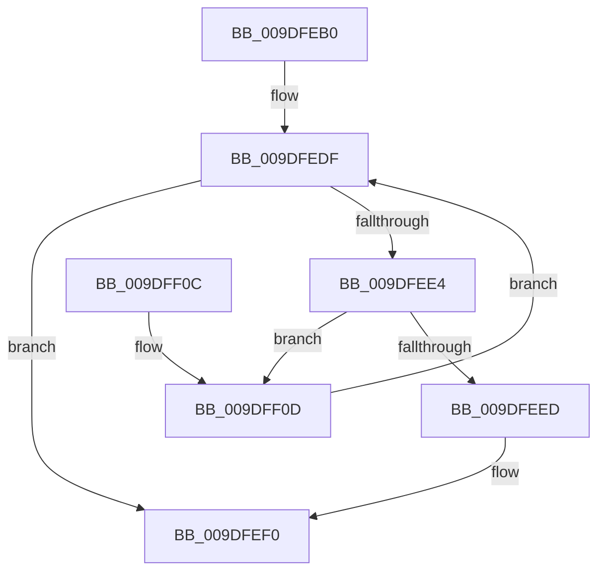

# WmipIsQuerySetGuid

- RVA: `0x009DFEB0`–`0x009DFF12` (길이 `98` bytes)
- VA: `0x00000001409DFEB0`
- 실행 섹션: `PAGE`
- PDB 이름 있음: `예`; PDB Function 태그: `아니요`
- unwind 정보 RVA: `0x00087858`
- 디코드: `29`개 명령, `98/98` bytes 표시
- 미해석 바이트: `0` (있으면 어셈블리에 `.byte`로 보존)

> 이 문서는 커널 이미지의 기계어와 PDB 기호를 분석해 생성했습니다. 4번과 5번은 함수 원형과 자료형을 바이너리 사용 방식에서 추정한 C 해석이며 원본 소스 복구 결과는 아닙니다.

## 1. Dependencies

- 직접 호출 지점: **2**; 고유 호출 대상: **2**
- 직접 호출자로 확인된 함수: **1**
- RIP 상대 이미지 참조: **1**

### Outgoing calls
- `0x009DFED3` → [KeWaitForSingleObject](../../text/20/KeWaitForSingleObject_function_0020E6B0.md) (function, `0x0020E6B0`)
- `0x009DFEF9` → [KeReleaseMutex](../../text/39/KeReleaseMutex_function_00396810.md) (function, `0x00396810`)

### Direct callers
- [WmipOpenBlock](../9E/WmipOpenBlock_function_009E00D0.md) at `0x009E01C3`

### Static image references
- `0x009DFEBF` → RVA `0x00EFFA60` (`.data`; read)

## 2. Other-region calls and transfers

- 다른 실행 섹션으로 향하는 call: **2**
  - `0x009DFED3` → [KeWaitForSingleObject](../../text/20/KeWaitForSingleObject_function_0020E6B0.md) (`PAGE` → `.text`)
  - `0x009DFEF9` → [KeReleaseMutex](../../text/39/KeReleaseMutex_function_00396810.md) (`PAGE` → `.text`)
- 별도 외부 분기/꼬리 이동을 확인하지 못했습니다.

## 3. Assembly (complete function range)

```asm
009DFEB0  48 89 5C 24 08                  mov qword ptr [rsp + 8], rbx
009DFEB5  57                              push rdi
009DFEB6  48 83 EC 30                     sub rsp, 0x30
009DFEBA  48 8B D9                        mov rbx, rcx
009DFEBD  33 FF                           xor edi, edi
009DFEBF  48 8D 0D 9A FB 51 00            lea rcx, [rip + 0x51fb9a]
009DFEC6  48 89 7C 24 20                  mov qword ptr [rsp + 0x20], rdi
009DFECB  45 33 C9                        xor r9d, r9d
009DFECE  45 33 C0                        xor r8d, r8d
009DFED1  33 D2                           xor edx, edx
009DFED3  E8 D8 E7 82 FF                  call 0x14020e6b0
009DFED8  48 83 C3 38                     add rbx, 0x38
009DFEDC  48 8B 0B                        mov rcx, qword ptr [rbx]
009DFEDF  48 3B CB                        cmp rcx, rbx
009DFEE2  74 0C                           je 0x1409dfef0
009DFEE4  F7 41 10 00 90 08 00            test dword ptr [rcx + 0x10], 0x89000
009DFEEB  75 20                           jne 0x1409dff0d
009DFEED  40 B7 01                        mov dil, 1
009DFEF0  33 D2                           xor edx, edx
009DFEF2  48 8D 0D 67 FB 51 00            lea rcx, [rip + 0x51fb67]
009DFEF9  E8 12 69 9B FF                  call 0x140396810
009DFEFE  48 8B 5C 24 40                  mov rbx, qword ptr [rsp + 0x40]
009DFF03  40 8A C7                        mov al, dil
009DFF06  48 83 C4 30                     add rsp, 0x30
009DFF0A  5F                              pop rdi
009DFF0B  C3                              ret
009DFF0C  CC                              int3
009DFF0D  48 8B 09                        mov rcx, qword ptr [rcx]
009DFF10  EB CD                           jmp 0x1409dfedf
```

## 4. C-style interpretation (structured pseudocode)

```c
__int64 __fastcall WmipIsQuerySetGuid(__int64 a1, int a2, int a3, int a4)
{
    __int64 result;
    __int64 v_rbx;
    __int64 v_rdi;
    __int64 v_rsp;
    unsigned __int64 v_stack_m18;
    unsigned __int64 v_stack_p8;

    v_stack_p8 = v_rbx;
    v_rsp = (v_rsp) - (48);
    v_rdi = 0;
    v_stack_m18 = 0;
    a4 = 0;
    a3 = 0;
    a2 = 0;
    result = KeWaitForSingleObject(v_rip + 5372826, a2, a3, a4);
    v_rbx = (a1) + (56);
loc_009DFEDF:
    if ((*(unsigned __int64 *)(v_rbx)) == v_rbx) goto loc_009DFEF0;
    if (((*(unsigned int *)(*(unsigned __int64 *)(v_rbx) + 16)) & (0x89000ULL)) != 0) goto loc_009DFF0D;
loc_009DFEF0:
    a2 = 0;
    result = KeReleaseMutex(v_rip + 5372775, a2, a3, a4);
    v_rsp = (v_rsp) + (48);
    return 1;
loc_009DFF0D:
    goto loc_009DFEDF;
}
```

## 5. (Beta) C Style

```c
int64_t WmipIsQuerySetGuid(void *Arg1, int32_t Arg2, int32_t Arg3, int32_t Arg4)
{
    uint8_t *arg1 = (uint8_t *)Arg1;

    int64_t result;
    int64_t local_rbx;
    int64_t local_rdi;
    int64_t local_rsp;
    uint64_t v_stack_m18;
    uint64_t v_stack_p8;

    v_stack_p8 = local_rbx;
    local_rsp = (local_rsp) - (48);
    local_rdi = 0;
    v_stack_m18 = 0;
    Arg4 = 0;
    Arg3 = 0;
    Arg2 = 0;
    result = KeWaitForSingleObject(v_rip + 5372826, Arg2, Arg3, Arg4);
    local_rbx = (Arg1) + (56);
loc_009DFEDF:
    if ((*(uint64_t *)(local_rbx)) == local_rbx) goto loc_009DFEF0;
    if (((*(uint32_t *)(*(uint64_t *)(local_rbx) + 0x10)) & (0x89000ULL)) != 0) goto loc_009DFF0D;
loc_009DFEF0:
    Arg2 = 0;
    result = KeReleaseMutex(v_rip + 5372775, Arg2, Arg3, Arg4);
    local_rsp = (local_rsp) + (48);
    return 1;
loc_009DFF0D:
    goto loc_009DFEDF;
}
```

### 관측된 메모리 오프셋

구조체 형식이 확인되지 않은 접근은 인자 기준의 오프셋으로만 기록했습니다.

| 기준 인자 | 오프셋 표현 | 폭 (bit) | 접근 |
|---|---:|---:|---|
| `Arg1` | `+ 0x0` | `64` | `R` |

## 6. Execution-region graph

[열기: 2D/3D 그래프와 함수 탐색 컨트롤 패널](../../../control-panel.html?section=page&rva=0x009DFEB0&view=graph)

- 2D 그래프는 위에서 아래로 흐르고, 3D 그래프는 빈 공간을 드래그해 회전합니다. Shift+드래그는 이동, 휠은 확대·축소, 함수 노드 선택은 대상 보고서 이동입니다.

### Static fallback


