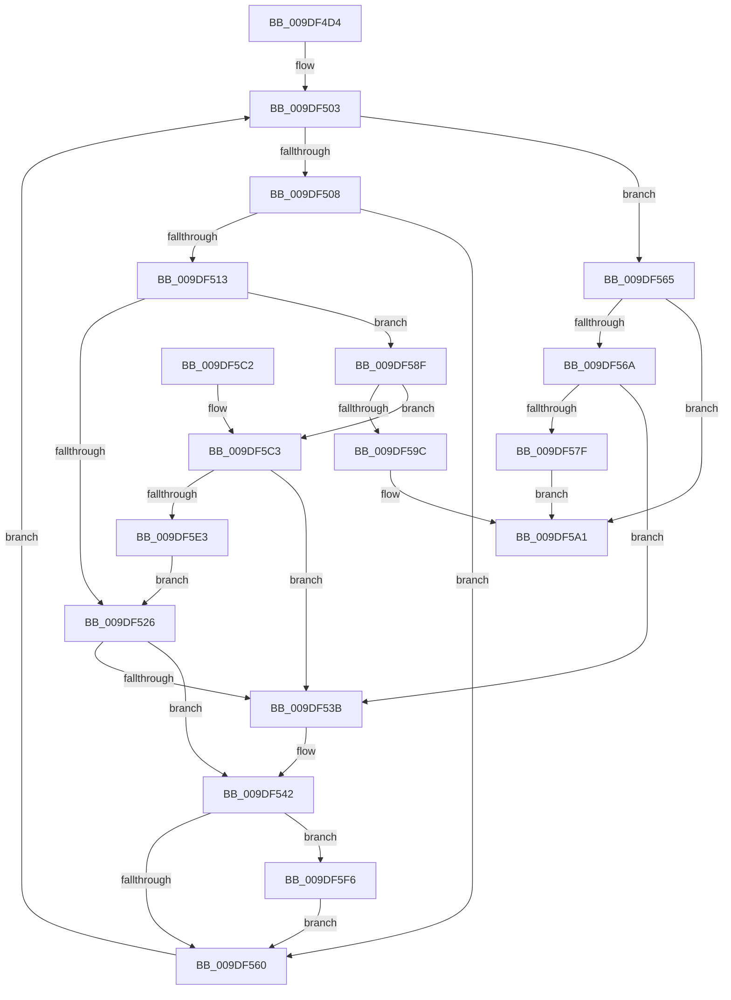

# WmipLinkDataSourceToList

- RVA: `0x009DF4D4`–`0x009DF606` (길이 `306` bytes)
- VA: `0x00000001409DF4D4`
- 실행 섹션: `PAGE`
- PDB 이름 있음: `예`; PDB Function 태그: `아니요`
- unwind 정보 RVA: `0x000A3AF4`
- 디코드: `88`개 명령, `306/306` bytes 표시
- 미해석 바이트: `0` (있으면 어셈블리에 `.byte`로 보존)

> 이 문서는 커널 이미지의 기계어와 PDB 기호를 분석해 생성했습니다. 4번과 5번은 함수 원형과 자료형을 바이너리 사용 방식에서 추정한 C 해석이며 원본 소스 복구 결과는 아닙니다.

## 1. Dependencies

- 직접 호출 지점: **3**; 고유 호출 대상: **3**
- 직접 호출자로 확인된 함수: **2**
- RIP 상대 이미지 참조: **2**

### Outgoing calls
- `0x009DF519` → [WmipFindGEByGuid](../9E/WmipFindGEByGuid_function_009E03A4.md) (function, `0x009E03A4`)
- `0x009DF58F` → [WmipAllocGuidEntry](WmipAllocGuidEntry_function_009DD93C.md) (function, `0x009DD93C`)
- `0x009DF5FC` → [WmipRegisterEtwProvider](../7B/WmipRegisterEtwProvider_function_007B40AC.md) (function, `0x007B40AC`)

### Direct callers
- [WmipUpdateAddGuid](../7B/WmipUpdateAddGuid_function_007B46C0.md) at `0x007B4764`
- [WmipAddDataSource](WmipAddDataSource_function_009DDC30.md) at `0x009DDD8B`

### Static image references
- `0x009DF56A` → RVA `0x00EFFB20` (`.data`; read)
- `0x009DF5CA` → RVA `0x00EFFB28` (`.data`; read)

## 2. Other-region calls and transfers

- 다른 실행 섹션으로 향하는 call: **0**
- 별도 외부 분기/꼬리 이동을 확인하지 못했습니다.

## 3. Assembly (complete function range)

```asm
009DF4D4  48 8B C4                        mov rax, rsp
009DF4D7  48 89 58 08                     mov qword ptr [rax + 8], rbx
009DF4DB  48 89 68 10                     mov qword ptr [rax + 0x10], rbp
009DF4DF  48 89 70 18                     mov qword ptr [rax + 0x18], rsi
009DF4E3  48 89 78 20                     mov qword ptr [rax + 0x20], rdi
009DF4E7  41 54                           push r12
009DF4E9  41 56                           push r14
009DF4EB  41 57                           push r15
009DF4ED  48 83 EC 20                     sub rsp, 0x20
009DF4F1  4C 8D 79 28                     lea r15, [rcx + 0x28]
009DF4F5  4D 8B E0                        mov r12, r8
009DF4F8  4D 8B 37                        mov r14, qword ptr [r15]
009DF4FB  40 8A EA                        mov bpl, dl
009DF4FE  48 8B D9                        mov rbx, rcx
009DF501  33 F6                           xor esi, esi
009DF503  4D 3B F7                        cmp r14, r15
009DF506  74 5D                           je 0x1409df565
009DF508  49 8D 7E D8                     lea rdi, [r14 - 0x28]
009DF50C  8B 47 10                        mov eax, dword ptr [rdi + 0x10]
009DF50F  A8 08                           test al, 8
009DF511  74 4D                           je 0x1409df560
009DF513  48 8B 4F 38                     mov rcx, qword ptr [rdi + 0x38]
009DF517  33 D2                           xor edx, edx
009DF519  E8 86 0E 00 00                  call 0x1409e03a4
009DF51E  48 8B C8                        mov rcx, rax
009DF521  48 85 C0                        test rax, rax
009DF524  74 69                           je 0x1409df58f
009DF526  83 67 10 F7                     and dword ptr [rdi + 0x10], 0xfffffff7
009DF52A  48 8D 41 38                     lea rax, [rcx + 0x38]
009DF52E  48 89 4F 38                     mov qword ptr [rdi + 0x38], rcx
009DF532  48 8B 50 08                     mov rdx, qword ptr [rax + 8]
009DF536  48 39 02                        cmp qword ptr [rdx], rax
009DF539  74 07                           je 0x1409df542
009DF53B  B9 03 00 00 00                  mov ecx, 3
009DF540  CD 29                           int 0x29
009DF542  48 89 07                        mov qword ptr [rdi], rax
009DF545  48 89 57 08                     mov qword ptr [rdi + 8], rdx
009DF549  48 89 3A                        mov qword ptr [rdx], rdi
009DF54C  48 89 78 08                     mov qword ptr [rax + 8], rdi
009DF550  FF 41 24                        inc dword ptr [rcx + 0x24]
009DF553  F7 47 10 00 00 08 00            test dword ptr [rdi + 0x10], 0x80000
009DF55A  0F 85 96 00 00 00               jne 0x1409df5f6
009DF560  4D 8B 36                        mov r14, qword ptr [r14]
009DF563  EB 9E                           jmp 0x1409df503
009DF565  40 84 ED                        test bpl, bpl
009DF568  74 37                           je 0x1409df5a1
009DF56A  48 8B 05 AF 05 52 00            mov rax, qword ptr [rip + 0x5205af]
009DF571  0F BA 6B 10 1E                  bts dword ptr [rbx + 0x10], 0x1e
009DF576  48 8B 48 08                     mov rcx, qword ptr [rax + 8]
009DF57A  48 39 01                        cmp qword ptr [rcx], rax
009DF57D  75 BC                           jne 0x1409df53b
009DF57F  48 89 03                        mov qword ptr [rbx], rax
009DF582  48 89 4B 08                     mov qword ptr [rbx + 8], rcx
009DF586  48 89 19                        mov qword ptr [rcx], rbx
009DF589  48 89 58 08                     mov qword ptr [rax + 8], rbx
009DF58D  EB 12                           jmp 0x1409df5a1
009DF58F  E8 A8 E3 FF FF                  call 0x1409dd93c
009DF594  48 8B C8                        mov rcx, rax
009DF597  48 85 C0                        test rax, rax
009DF59A  75 27                           jne 0x1409df5c3
009DF59C  BE 9A 00 00 C0                  mov esi, 0xc000009a
009DF5A1  48 8B 5C 24 40                  mov rbx, qword ptr [rsp + 0x40]
009DF5A6  8B C6                           mov eax, esi
009DF5A8  48 8B 74 24 50                  mov rsi, qword ptr [rsp + 0x50]
009DF5AD  48 8B 6C 24 48                  mov rbp, qword ptr [rsp + 0x48]
009DF5B2  48 8B 7C 24 58                  mov rdi, qword ptr [rsp + 0x58]
009DF5B7  48 83 C4 20                     add rsp, 0x20
009DF5BB  41 5F                           pop r15
009DF5BD  41 5E                           pop r14
009DF5BF  41 5C                           pop r12
009DF5C1  C3                              ret
009DF5C2  CC                              int3
009DF5C3  48 8B 47 38                     mov rax, qword ptr [rdi + 0x38]
009DF5C7  0F 10 00                        movups xmm0, xmmword ptr [rax]
009DF5CA  48 8B 05 57 05 52 00            mov rax, qword ptr [rip + 0x520557]
009DF5D1  F3 0F 7F 41 48                  movdqu xmmword ptr [rcx + 0x48], xmm0
009DF5D6  48 8B 10                        mov rdx, qword ptr [rax]
009DF5D9  48 39 42 08                     cmp qword ptr [rdx + 8], rax
009DF5DD  0F 85 58 FF FF FF               jne 0x1409df53b
009DF5E3  48 89 11                        mov qword ptr [rcx], rdx
009DF5E6  48 89 41 08                     mov qword ptr [rcx + 8], rax
009DF5EA  48 89 4A 08                     mov qword ptr [rdx + 8], rcx
009DF5EE  48 89 08                        mov qword ptr [rax], rcx
009DF5F1  E9 30 FF FF FF                  jmp 0x1409df526
009DF5F6  49 8B D4                        mov rdx, r12
009DF5F9  48 8B CF                        mov rcx, rdi
009DF5FC  E8 AB 4A DD FF                  call 0x1407b40ac
009DF601  E9 5A FF FF FF                  jmp 0x1409df560
```

## 4. C-style interpretation (structured pseudocode)

```c
__int64 __fastcall WmipLinkDataSourceToList(__int64 a1, int a2, __int64 a3)
{
    __int64 result;
    __int64 v_rsi;
    __int64 v_rsp;
    unsigned __int64 v_stack_p10;
    unsigned __int64 v_stack_p18;
    unsigned __int64 v_stack_p20;
    unsigned __int64 v_stack_p8;

    *(unsigned __int64 *)(v_rsp + 8) = v_rbx;
    *(unsigned __int64 *)(v_rsp + 16) = v_rbp;
    *(unsigned __int64 *)(v_rsp + 24) = v_rsi;
    *(unsigned __int64 *)(v_rsp + 32) = v_rdi;
    v_rsp = (v_rsp) - (32);
    v_rsi = 0;
loc_009DF503:
    if ((*(unsigned __int64 *)(a1 + 40)) == (a1 + 40)) goto loc_009DF565;
    if ((((unsigned __int8)((unsigned int)(*(unsigned int *)(*(unsigned __int64 *)(a1 + 40) - 40 + 16)))) & (8)) == 0) goto loc_009DF560;
    a2 = 0;
    result = WmipFindGEByGuid(*(unsigned __int64 *)(*(unsigned __int64 *)(a1 + 40) - 40 + 56), a2, a3, a4);
    if (result == 0) goto loc_009DF58F;
loc_009DF526:
    *(unsigned __int64 *)(*(unsigned __int64 *)(a1 + 40) - 40 + 56) = result;
    if ((*(unsigned __int64 *)(*(unsigned __int64 *)(result + 56 + 8))) != (result + 56)) {
        a1 = 3;
    }
    *(unsigned __int64 *)(*(unsigned __int64 *)(a1 + 40) - 40) = result + 56;
    *(unsigned __int64 *)(*(unsigned __int64 *)(a1 + 40) - 40 + 8) = *(unsigned __int64 *)(result + 56 + 8);
    *(unsigned __int64 *)(*(unsigned __int64 *)(result + 56 + 8)) = *(unsigned __int64 *)(a1 + 40) - 40;
    *(unsigned __int64 *)(result + 56 + 8) = *(unsigned __int64 *)(a1 + 40) - 40;
    if (((*(unsigned int *)(*(unsigned __int64 *)(a1 + 40) - 40 + 16)) & (0x80000ULL)) != 0) goto loc_009DF5F6;
loc_009DF560:
    goto loc_009DF503;
loc_009DF565:
    if ((unsigned __int8)((unsigned __int8)(a2)) == 0) goto loc_009DF5A1;
    if ((*(unsigned __int64 *)(*(unsigned __int64 *)(*(unsigned __int64 *)(v_rip + 5375407) + 8))) != (*(unsigned __int64 *)(v_rip + 5375407))) goto loc_009DF53B;
    *(unsigned __int64 *)(a1) = *(unsigned __int64 *)(v_rip + 5375407);
    *(unsigned __int64 *)(a1 + 8) = *(unsigned __int64 *)(*(unsigned __int64 *)(v_rip + 5375407) + 8);
    *(unsigned __int64 *)(*(unsigned __int64 *)(*(unsigned __int64 *)(v_rip + 5375407) + 8)) = a1;
    *(unsigned __int64 *)(*(unsigned __int64 *)(v_rip + 5375407) + 8) = a1;
    goto loc_009DF5A1;
loc_009DF58F:
    result = WmipAllocGuidEntry(*(unsigned __int64 *)(*(unsigned __int64 *)(v_rip + 5375407) + 8), *(unsigned __int64 *)(result + 56 + 8), a3, a4);
    if (result != 0) goto loc_009DF5C3;
loc_009DF5A1:
    v_rsp = (v_rsp) + (32);
    return (unsigned int)((unsigned int)((unsigned int)(0xC000009AULL)));
loc_009DF5C3:
    *(unsigned __int64 *)(result + 72) = v_xmm0;
    if ((*(unsigned __int64 *)(*(unsigned __int64 *)(*(unsigned __int64 *)(v_rip + 5375319)) + 8)) != (*(unsigned __int64 *)(v_rip + 5375319))) goto loc_009DF53B;
    *(unsigned __int64 *)(result) = *(unsigned __int64 *)(*(unsigned __int64 *)(v_rip + 5375319));
    *(unsigned __int64 *)(result + 8) = *(unsigned __int64 *)(v_rip + 5375319);
    *(unsigned __int64 *)(*(unsigned __int64 *)(*(unsigned __int64 *)(v_rip + 5375319)) + 8) = result;
    *(unsigned __int64 *)(*(unsigned __int64 *)(v_rip + 5375319)) = result;
    goto loc_009DF526;
loc_009DF5F6:
    result = WmipRegisterEtwProvider(v_stack_p20, a3, a3, a4);
    goto loc_009DF560;
}
```

## 5. (Beta) C Style

```c
int64_t WmipLinkDataSourceToList(void *Arg1, int32_t Arg2, int64_t Arg3)
{
    uint8_t *arg1 = (uint8_t *)Arg1;

    int64_t result;
    int64_t local_rsi;
    int64_t local_rsp;
    uint64_t v_stack_p10;
    uint64_t v_stack_p18;
    uint64_t v_stack_p20;
    uint64_t v_stack_p8;

    *(uint64_t *)(local_rsp + 0x8) = local_rbx;
    *(uint64_t *)(local_rsp + 0x10) = local_rbp;
    *(uint64_t *)(local_rsp + 0x18) = local_rsi;
    *(uint64_t *)(local_rsp + 0x20) = local_rdi;
    local_rsp = (local_rsp) - (32);
    local_rsi = 0;
loc_009DF503:
    if ((*(uint64_t *)(arg1 + 0x28)) == (Arg1 + 40)) goto loc_009DF565;
    if ((((uint8_t)((uint32_t)(*(uint32_t *)(*(uint64_t *)(arg1 + 0x28) - 0x28 + 0x10)))) & (8)) == 0) goto loc_009DF560;
    Arg2 = 0;
    result = WmipFindGEByGuid(*(uint64_t *)(*(uint64_t *)(arg1 + 0x28) - 0x28 + 0x38), Arg2, Arg3, a4);
    if (result == 0) goto loc_009DF58F;
loc_009DF526:
    *(uint64_t *)(*(uint64_t *)(arg1 + 0x28) - 0x28 + 0x38) = result;
    if ((*(uint64_t *)(*(uint64_t *)(result + 0x38 + 0x8))) != (result + 56)) {
        Arg1 = 3;
    }
    *(uint64_t *)(*(uint64_t *)(arg1 + 0x28) - 0x28) = result + 56;
    *(uint64_t *)(*(uint64_t *)(arg1 + 0x28) - 0x28 + 0x8) = *(uint64_t *)(result + 0x38 + 0x8);
    *(uint64_t *)(*(uint64_t *)(result + 0x38 + 0x8)) = *(uint64_t *)(arg1 + 0x28) - 40;
    *(uint64_t *)(result + 0x38 + 0x8) = *(uint64_t *)(arg1 + 0x28) - 40;
    if (((*(uint32_t *)(*(uint64_t *)(arg1 + 0x28) - 0x28 + 0x10)) & (0x80000ULL)) != 0) goto loc_009DF5F6;
loc_009DF560:
    goto loc_009DF503;
loc_009DF565:
    if ((uint8_t)((uint8_t)(Arg2)) == 0) goto loc_009DF5A1;
    if ((*(uint64_t *)(*(uint64_t *)(*(uint64_t *)(v_rip + 0x5205AF) + 0x8))) != (*(uint64_t *)(v_rip + 0x5205AF))) goto loc_009DF53B;
    *(uint64_t *)(arg1) = *(uint64_t *)(v_rip + 0x5205AF);
    *(uint64_t *)(arg1 + 0x8) = *(uint64_t *)(*(uint64_t *)(v_rip + 0x5205AF) + 0x8);
    *(void **)(*(uint64_t *)(*(uint64_t *)(v_rip + 0x5205AF) + 0x8)) = Arg1;
    *(void **)(*(uint64_t *)(v_rip + 0x5205AF) + 0x8) = Arg1;
    goto loc_009DF5A1;
loc_009DF58F:
    result = WmipAllocGuidEntry(*(uint64_t *)(*(uint64_t *)(v_rip + 0x5205AF) + 0x8), *(uint64_t *)(result + 0x38 + 0x8), Arg3, a4);
    if (result != 0) goto loc_009DF5C3;
loc_009DF5A1:
    local_rsp = (local_rsp) + (32);
    return (uint32_t)((uint32_t)((uint32_t)(0xC000009AULL)));
loc_009DF5C3:
    *(uint64_t *)(result + 0x48) = v_xmm0;
    if ((*(uint64_t *)(*(uint64_t *)(*(uint64_t *)(v_rip + 0x520557)) + 0x8)) != (*(uint64_t *)(v_rip + 0x520557))) goto loc_009DF53B;
    *(uint64_t *)(result) = *(uint64_t *)(*(uint64_t *)(v_rip + 0x520557));
    *(uint64_t *)(result + 0x8) = *(uint64_t *)(v_rip + 0x520557);
    *(uint64_t *)(*(uint64_t *)(*(uint64_t *)(v_rip + 0x520557)) + 0x8) = result;
    *(uint64_t *)(*(uint64_t *)(v_rip + 0x520557)) = result;
    goto loc_009DF526;
loc_009DF5F6:
    result = WmipRegisterEtwProvider(v_stack_p20, Arg3, Arg3, a4);
    goto loc_009DF560;
}
```

### 관측된 메모리 오프셋

구조체 형식이 확인되지 않은 접근은 인자 기준의 오프셋으로만 기록했습니다.

| 기준 인자 | 오프셋 표현 | 폭 (bit) | 접근 |
|---|---:|---:|---|
| `Arg1` | `+ 0x0` | `64` | `R` |
| `Arg1` | `+ 0x0` | `64` | `W` |
| `Arg1` | `+ 0x8` | `64` | `W` |
| `Arg1` | `+ 0x10` | `32` | `R/W` |
| `Arg1` | `+ 0x28` | `64` | `R` |

## 6. Execution-region graph

[열기: 2D/3D 그래프와 함수 탐색 컨트롤 패널](../../../control-panel.html?section=page&rva=0x009DF4D4&view=graph)

- 2D 그래프는 위에서 아래로 흐르고, 3D 그래프는 빈 공간을 드래그해 회전합니다. Shift+드래그는 이동, 휠은 확대·축소, 함수 노드 선택은 대상 보고서 이동입니다.

### Static fallback


