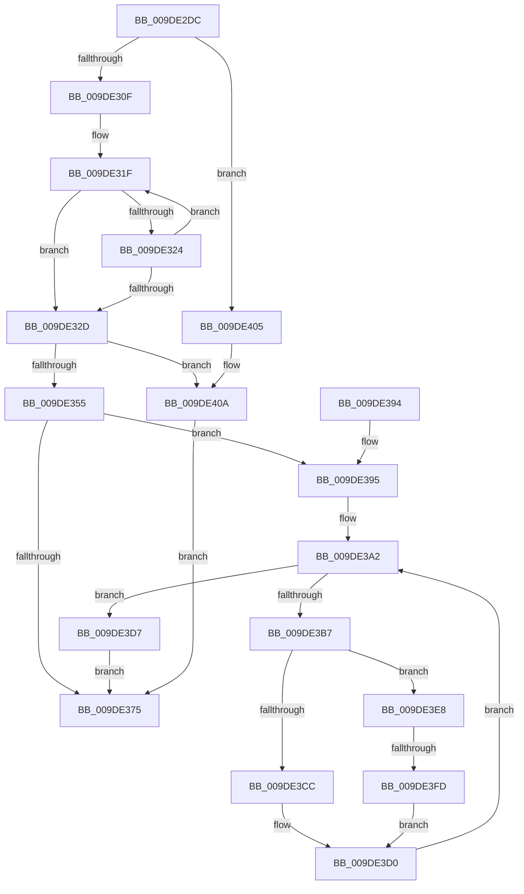

# WmipMangleInstanceName

- RVA: `0x009DE2DC`–`0x009DE411` (길이 `309` bytes)
- VA: `0x00000001409DE2DC`
- 실행 섹션: `PAGE`
- PDB 이름 있음: `예`; PDB Function 태그: `예`
- unwind 정보 RVA: `0x000A39B8`
- 디코드: `91`개 명령, `309/309` bytes 표시
- 미해석 바이트: `0` (있으면 어셈블리에 `.byte`로 보존)

> 이 문서는 커널 이미지의 기계어와 PDB 기호를 분석해 생성했습니다. 4번과 5번은 함수 원형과 자료형을 바이너리 사용 방식에서 추정한 C 해석이며 원본 소스 복구 결과는 아닙니다.

## 1. Dependencies

- 직접 호출 지점: **5**; 고유 호출 대상: **4**
- 직접 호출자로 확인된 함수: **1**
- RIP 상대 이미지 참조: **2**

### Outgoing calls
- `0x009DE35E` → [RtlStringCchCopyW](../../text/26/RtlStringCchCopyW_function_0026E9A4.md) (function, `0x0026E9A4`)
- `0x009DE368` → [WmipFindGEByGuid](../9E/WmipFindGEByGuid_function_009E03A4.md) (function, `0x009E03A4`)
- `0x009DE3AD` → [WmipFindISinGEbyName](../9E/WmipFindISinGEbyName_function_009E2BF0.md) (function, `0x009E2BF0`)
- `0x009DE3C1` → [WmipUnreferenceEntry](../9E/WmipUnreferenceEntry_function_009E0CC8.md) (function, `0x009E0CC8`)
- `0x009DE3E1` → [WmipUnreferenceEntry](../9E/WmipUnreferenceEntry_function_009E0CC8.md) (function, `0x009E0CC8`)

### Direct callers
- [WmipBuildInstanceSet](WmipBuildInstanceSet_function_009DDFC4.md) at `0x009DE1DD`

### Static image references
- `0x009DE3BA` → RVA `0x00E03608` (`.data`; read)
- `0x009DE3DA` → RVA `0x00E03628` (`.data`; read)

## 2. Other-region calls and transfers

- 다른 실행 섹션으로 향하는 call: **1**
  - `0x009DE35E` → [RtlStringCchCopyW](../../text/26/RtlStringCchCopyW_function_0026E9A4.md) (`PAGE` → `.text`)
- call이 아닌 외부 분기/꼬리 이동: **1**
  - `0x009DE3F7` → [sub_00B2FD7C](../B2/Unknown_function_00B2FD7C.md) (`tail-transfer`)

## 3. Assembly (complete function range)

```asm
009DE2DC  48 8B C4                        mov rax, rsp
009DE2DF  48 89 58 08                     mov qword ptr [rax + 8], rbx
009DE2E3  48 89 68 18                     mov qword ptr [rax + 0x18], rbp
009DE2E7  48 89 70 20                     mov qword ptr [rax + 0x20], rsi
009DE2EB  57                              push rdi
009DE2EC  41 54                           push r12
009DE2EE  41 55                           push r13
009DE2F0  41 56                           push r14
009DE2F2  41 57                           push r15
009DE2F4  48 83 EC 20                     sub rsp, 0x20
009DE2F8  33 DB                           xor ebx, ebx
009DE2FA  4D 8B F1                        mov r14, r9
009DE2FD  89 58 10                        mov dword ptr [rax + 0x10], ebx
009DE300  4D 8B F8                        mov r15, r8
009DE303  4C 8B D9                        mov r11, rcx
009DE306  48 85 D2                        test rdx, rdx
009DE309  0F 84 F6 00 00 00               je 0x1409de405
009DE30F  41 B9 FF FF FF 7F               mov r9d, 0x7fffffff
009DE315  44 8D 63 01                     lea r12d, [rbx + 1]
009DE319  45 8B D1                        mov r10d, r9d
009DE31C  48 8B C2                        mov rax, rdx
009DE31F  66 39 18                        cmp word ptr [rax], bx
009DE322  74 09                           je 0x1409de32d
009DE324  48 83 C0 02                     add rax, 2
009DE328  4D 2B D4                        sub r10, r12
009DE32B  75 F2                           jne 0x1409de31f
009DE32D  49 8B C2                        mov rax, r10
009DE330  48 F7 D8                        neg rax
009DE333  49 8B C2                        mov rax, r10
009DE336  1B C9                           sbb ecx, ecx
009DE338  4D 2B CA                        sub r9, r10
009DE33B  F7 D1                           not ecx
009DE33D  81 E1 0D 00 00 C0               and ecx, 0xc000000d
009DE343  48 F7 D8                        neg rax
009DE346  48 1B F6                        sbb rsi, rsi
009DE349  49 23 F1                        and rsi, r9
009DE34C  4D 85 D2                        test r10, r10
009DE34F  0F 84 B5 00 00 00               je 0x1409de40a
009DE355  4C 8B C2                        mov r8, rdx
009DE358  49 8B CE                        mov rcx, r14
009DE35B  49 8B D7                        mov rdx, r15
009DE35E  E8 41 06 89 FF                  call 0x14026e9a4
009DE363  33 D2                           xor edx, edx
009DE365  49 8B CB                        mov rcx, r11
009DE368  E8 37 20 00 00                  call 0x1409e03a4
009DE36D  48 8B E8                        mov rbp, rax
009DE370  48 85 C0                        test rax, rax
009DE373  75 20                           jne 0x1409de395
009DE375  48 8B 6C 24 60                  mov rbp, qword ptr [rsp + 0x60]
009DE37A  8B C3                           mov eax, ebx
009DE37C  48 8B 5C 24 50                  mov rbx, qword ptr [rsp + 0x50]
009DE381  48 8B 74 24 68                  mov rsi, qword ptr [rsp + 0x68]
009DE386  48 83 C4 20                     add rsp, 0x20
009DE38A  41 5F                           pop r15
009DE38C  41 5E                           pop r14
009DE38E  41 5D                           pop r13
009DE390  41 5C                           pop r12
009DE392  5F                              pop rdi
009DE393  C3                              ret
009DE394  CC                              int3
009DE395  41 BD 5A 00 00 00               mov r13d, 0x5a
009DE39B  48 FF CE                        dec rsi
009DE39E  41 0F B7 FD                     movzx edi, r13w
009DE3A2  4C 8D 44 24 58                  lea r8, [rsp + 0x58]
009DE3A7  49 8B D6                        mov rdx, r14
009DE3AA  48 8B CD                        mov rcx, rbp
009DE3AD  E8 3E 48 00 00                  call 0x1409e2bf0
009DE3B2  48 85 C0                        test rax, rax
009DE3B5  74 20                           je 0x1409de3d7
009DE3B7  48 8B D0                        mov rdx, rax
009DE3BA  48 8D 0D 47 52 42 00            lea rcx, [rip + 0x425247]
009DE3C1  E8 02 29 00 00                  call 0x1409e0cc8
009DE3C6  66 41 3B FD                     cmp di, r13w
009DE3CA  74 1C                           je 0x1409de3e8
009DE3CC  66 41 03 FC                     add di, r12w
009DE3D0  66 41 89 3C 76                  mov word ptr [r14 + rsi*2], di
009DE3D5  EB CB                           jmp 0x1409de3a2
009DE3D7  48 8B D5                        mov rdx, rbp
009DE3DA  48 8D 0D 47 52 42 00            lea rcx, [rip + 0x425247]
009DE3E1  E8 E2 28 00 00                  call 0x1409e0cc8
009DE3E6  EB 8D                           jmp 0x1409de375
009DE3E8  49 03 F4                        add rsi, r12
009DE3EB  49 8D 47 FF                     lea rax, [r15 - 1]
009DE3EF  BF 41 00 00 00                  mov edi, 0x41
009DE3F4  48 3B F0                        cmp rsi, rax
009DE3F7  0F 84 7F 19 15 00               je 0x140b2fd7c
009DE3FD  66 41 89 5C 76 02               mov word ptr [r14 + rsi*2 + 2], bx
009DE403  EB CB                           jmp 0x1409de3d0
009DE405  B9 0D 00 00 C0                  mov ecx, 0xc000000d
009DE40A  8B D9                           mov ebx, ecx
009DE40C  E9 64 FF FF FF                  jmp 0x1409de375
```

## 4. C-style interpretation (structured pseudocode)

```c
__int64 __fastcall WmipMangleInstanceName(__int64 a1, __int64 a2, __int64 a3, __int64 a4)
{
    __int64 result;
    __int64 v_r10;
    __int64 v_rbx;
    __int64 v_rdi;
    __int64 v_rsi;
    __int64 v_rsp;
    unsigned __int64 v_stack_p18;
    unsigned __int64 v_stack_p20;
    unsigned __int64 v_stack_p58;
    unsigned __int64 v_stack_p8;

    *(unsigned __int64 *)(v_rsp + 8) = v_rbx;
    *(unsigned __int64 *)(v_rsp + 24) = v_rbp;
    *(unsigned __int64 *)(v_rsp + 32) = v_rsi;
    v_rsp = (v_rsp) - (32);
    v_rbx = 0;
    *(unsigned int *)(v_rsp + 16) = 0;
    if (a2 == 0) goto loc_009DE405;
loc_009DE31F:
    if ((*(unsigned __int16 *)(a2)) == 0) goto loc_009DE32D;
    result = (a2) + (2);
    v_r10 = ((unsigned int)((unsigned int)((unsigned int)(0x7FFFFFFFULL)))) - (v_rbx + 1);
    if (condition_is_not_equal) goto loc_009DE31F;
loc_009DE32D:
    result = -(v_r10);
    a4 = ((unsigned int)(0x7FFFFFFFULL)) - (v_r10);
    a1 = (unsigned int)(~(a1));
    a1 = (unsigned int)((a1) & (0xC000000DULL));
    result = -(v_r10);
    v_rsi = (v_rsi) & (a4);
    if (v_r10 == 0) goto loc_009DE40A;
    result = RtlStringCchCopyW(a4, a3, a2, a4);
    a2 = 0;
    result = WmipFindGEByGuid(a1, a2, a2, a4);
    if (result != 0) goto loc_009DE395;
loc_009DE375:
    v_rsp = (v_rsp) + (32);
    return 0;
loc_009DE395:
    v_rsi = (v_stack_p20) - 1;
loc_009DE3A2:
    result = WmipFindISinGEbyName(v_stack_p18, a4, v_stack_p58, a4);
    if (result == 0) goto loc_009DE3D7;
    result = WmipUnreferenceEntry(v_rip + 4346439, result, v_stack_p58, a4);
    if (90 == 90) goto loc_009DE3E8;
    v_rdi = (unsigned __int16)((90) + ((unsigned __int16)(v_rbx + 1)));
loc_009DE3D0:
    *(unsigned __int16 *)(a4 + v_rsi * 2) = (unsigned __int16)(v_rdi);
    goto loc_009DE3A2;
loc_009DE3D7:
    result = WmipUnreferenceEntry(v_rip + 4346439, v_stack_p18, v_stack_p58, a4);
    goto loc_009DE375;
loc_009DE3E8:
    v_rsi = (v_rsi) + (v_rbx + 1);
    *(unsigned __int16 *)(a4 + v_rsi * 2 + 2) = (unsigned __int16)(v_stack_p8);
    goto loc_009DE3D0;
loc_009DE405:
loc_009DE40A:
    goto loc_009DE375;
}
```

## 5. (Beta) C Style

```c
int64_t WmipMangleInstanceName(int64_t Arg1, int64_t Arg2, void *Arg3, void *Arg4)
{
    uint8_t *arg3 = (uint8_t *)Arg3;
    uint8_t *arg4 = (uint8_t *)Arg4;

    int64_t result;
    int64_t local_r10;
    int64_t local_rbx;
    int64_t local_rdi;
    int64_t local_rsi;
    int64_t local_rsp;
    uint64_t v_stack_p18;
    uint64_t v_stack_p20;
    uint64_t v_stack_p58;
    uint64_t v_stack_p8;

    *(uint64_t *)(local_rsp + 0x8) = local_rbx;
    *(uint64_t *)(local_rsp + 0x18) = local_rbp;
    *(uint64_t *)(local_rsp + 0x20) = local_rsi;
    local_rsp = (local_rsp) - (32);
    local_rbx = 0;
    *(uint32_t *)(local_rsp + 0x10) = 0;
    if (Arg2 == 0) goto loc_009DE405;
loc_009DE31F:
    if ((*(uint16_t *)(Arg2)) == 0) goto loc_009DE32D;
    result = (Arg2) + (2);
    local_r10 = ((uint32_t)((uint32_t)((uint32_t)(0x7FFFFFFFULL)))) - (local_rbx + 1);
    if (condition_is_not_equal) goto loc_009DE31F;
loc_009DE32D:
    result = -(local_r10);
    Arg4 = ((uint32_t)(0x7FFFFFFFULL)) - (local_r10);
    Arg1 = (uint32_t)(~(Arg1));
    Arg1 = (uint32_t)((Arg1) & (0xC000000DULL));
    result = -(local_r10);
    local_rsi = (local_rsi) & (Arg4);
    if (local_r10 == 0) goto loc_009DE40A;
    result = RtlStringCchCopyW(Arg4, Arg3, Arg2, Arg4);
    Arg2 = 0;
    result = WmipFindGEByGuid(Arg1, Arg2, Arg2, Arg4);
    if (result != 0) goto loc_009DE395;
loc_009DE375:
    local_rsp = (local_rsp) + (32);
    return 0;
loc_009DE395:
    local_rsi = (v_stack_p20) - 1;
loc_009DE3A2:
    result = WmipFindISinGEbyName(v_stack_p18, Arg4, v_stack_p58, Arg4);
    if (result == 0) goto loc_009DE3D7;
    result = WmipUnreferenceEntry(v_rip + 4346439, result, v_stack_p58, Arg4);
    if (90 == 90) goto loc_009DE3E8;
    local_rdi = (uint16_t)((90) + ((uint16_t)(local_rbx + 1)));
loc_009DE3D0:
    *(uint16_t *)(arg4 + local_rsi * 2) = (uint16_t)(local_rdi);
    goto loc_009DE3A2;
loc_009DE3D7:
    result = WmipUnreferenceEntry(v_rip + 4346439, v_stack_p18, v_stack_p58, Arg4);
    goto loc_009DE375;
loc_009DE3E8:
    local_rsi = (local_rsi) + (local_rbx + 1);
    *(uint16_t *)(arg4 + local_rsi * 2 + 0x2) = (uint16_t)(v_stack_p8);
    goto loc_009DE3D0;
loc_009DE405:
loc_009DE40A:
    goto loc_009DE375;
}
```

### 관측된 메모리 오프셋

구조체 형식이 확인되지 않은 접근은 인자 기준의 오프셋으로만 기록했습니다.

| 기준 인자 | 오프셋 표현 | 폭 (bit) | 접근 |
|---|---:|---:|---|
| `Arg3` | `- 0x1` | `64` | `R` |
| `Arg4` | `+ 0x0 + rsi*2` | `16` | `W` |
| `Arg4` | `+ 0x2 + rsi*2` | `16` | `W` |

## 6. Execution-region graph

[열기: 2D/3D 그래프와 함수 탐색 컨트롤 패널](../../../control-panel.html?section=page&rva=0x009DE2DC&view=graph)

- 2D 그래프는 위에서 아래로 흐르고, 3D 그래프는 빈 공간을 드래그해 회전합니다. Shift+드래그는 이동, 휠은 확대·축소, 함수 노드 선택은 대상 보고서 이동입니다.

### Static fallback


