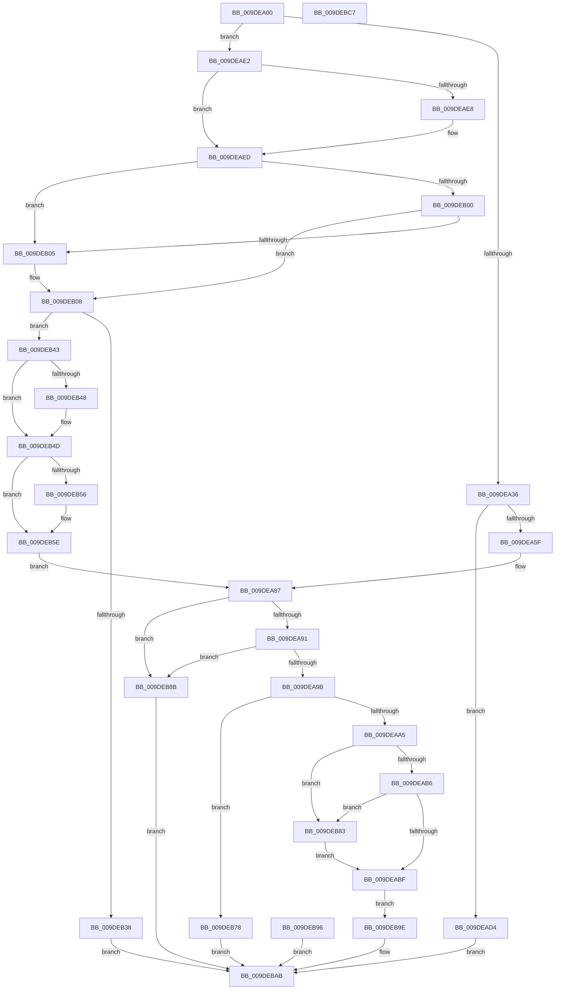

# WmipProbeAndCaptureGuidObjectAttributes

- RVA: `0x009DEA00`–`0x009DEBC8` (길이 `456` bytes)
- VA: `0x00000001409DEA00`
- 실행 섹션: `PAGE`
- PDB 이름 있음: `예`; PDB Function 태그: `아니요`
- unwind 정보 RVA: `0x000A3A5C`
- 디코드: `122`개 명령, `456/456` bytes 표시
- 미해석 바이트: `0` (있으면 어셈블리에 `.byte`로 보존)

> 이 문서는 커널 이미지의 기계어와 PDB 기호를 분석해 생성했습니다. 4번과 5번은 함수 원형과 자료형을 바이너리 사용 방식에서 추정한 C 해석이며 원본 소스 복구 결과는 아닙니다.

## 1. Dependencies

- 직접 호출 지점: **5**; 고유 호출 대상: **4**
- 직접 호출자로 확인된 함수: **1**
- RIP 상대 이미지 참조: **0**

### Outgoing calls
- `0x009DEA27` → [IoIs32bitProcess](../../text/40/IoIs32bitProcess_function_0040DFE0.md) (function, `0x0040DFE0`)
- `0x009DEA51` → [RtlCopyVolatileMemory](../../text/6B/RtlCopyVolatileMemory_function_006BC9D0.md) (function, `0x006BC9D0`)
- `0x009DEACA` → [memcpy](../../text/6C/memcpy_function_006C6840.md) (function, `0x006C6840`)
- `0x009DEAE8` → [ExRaiseDatatypeMisalignment](../89/ExRaiseDatatypeMisalignment_function_00899FD0.md) (function, `0x00899FD0`)
- `0x009DEB48` → [ExRaiseDatatypeMisalignment](../89/ExRaiseDatatypeMisalignment_function_00899FD0.md) (function, `0x00899FD0`)

### Direct callers
- [WmipIoControl](WmipIoControl_function_009DEBD0.md) at `0x009DEDD9`

### Static image references
- 디코드된 RIP-relative 메모리 참조가 없습니다.

## 2. Other-region calls and transfers

- 다른 실행 섹션으로 향하는 call: **3**
  - `0x009DEA27` → [IoIs32bitProcess](../../text/40/IoIs32bitProcess_function_0040DFE0.md) (`PAGE` → `.text`)
  - `0x009DEA51` → [RtlCopyVolatileMemory](../../text/6B/RtlCopyVolatileMemory_function_006BC9D0.md) (`PAGE` → `.text`)
  - `0x009DEACA` → [memcpy](../../text/6C/memcpy_function_006C6840.md) (`PAGE` → `.text`)
- 별도 외부 분기/꼬리 이동을 확인하지 못했습니다.

## 3. Assembly (complete function range)

```asm
009DEA00  48 89 5C 24 08                  mov qword ptr [rsp + 8], rbx
009DEA05  48 89 74 24 10                  mov qword ptr [rsp + 0x10], rsi
009DEA0A  48 89 7C 24 18                  mov qword ptr [rsp + 0x18], rdi
009DEA0F  41 55                           push r13
009DEA11  41 56                           push r14
009DEA13  41 57                           push r15
009DEA15  48 83 EC 40                     sub rsp, 0x40
009DEA19  49 8B F1                        mov rsi, r9
009DEA1C  4D 8B E8                        mov r13, r8
009DEA1F  48 8B FA                        mov rdi, rdx
009DEA22  4C 8B F9                        mov r15, rcx
009DEA25  33 C9                           xor ecx, ecx
009DEA27  E8 B4 F5 A2 FF                  call 0x14040dfe0
009DEA2C  33 DB                           xor ebx, ebx
009DEA2E  84 C0                           test al, al
009DEA30  0F 85 AC 00 00 00               jne 0x1409deae2
009DEA36  49 BE 00 00 FF FF FF 7F 00 00   movabs r14, 0x7fffffff0000
009DEA40  49 8B D6                        mov rdx, r14
009DEA43  49 3B F6                        cmp rsi, r14
009DEA46  48 0F 42 D6                     cmovb rdx, rsi
009DEA4A  44 8D 43 30                     lea r8d, [rbx + 0x30]
009DEA4E  49 8B CF                        mov rcx, r15
009DEA51  E8 7A DF CD FF                  call 0x1406bc9d0
009DEA56  49 8B 4F 10                     mov rcx, qword ptr [r15 + 0x10]
009DEA5A  48 85 C9                        test rcx, rcx
009DEA5D  74 75                           je 0x1409dead4
009DEA5F  0F 57 C0                        xorps xmm0, xmm0
009DEA62  0F 11 44 24 28                  movups xmmword ptr [rsp + 0x28], xmm0
009DEA67  49 3B CE                        cmp rcx, r14
009DEA6A  49 0F 43 CE                     cmovae rcx, r14
009DEA6E  90                              nop
009DEA6F  8B 01                           mov eax, dword ptr [rcx]
009DEA71  89 44 24 28                     mov dword ptr [rsp + 0x28], eax
009DEA75  48 8B 41 08                     mov rax, qword ptr [rcx + 8]
009DEA79  48 89 44 24 30                  mov qword ptr [rsp + 0x30], rax
009DEA7E  0F 10 44 24 28                  movups xmm0, xmmword ptr [rsp + 0x28]
009DEA83  F3 0F 7F 07                     movdqu xmmword ptr [rdi], xmm0
009DEA87  49 39 5F 20                     cmp qword ptr [r15 + 0x20], rbx
009DEA8B  0F 85 FA 00 00 00               jne 0x1409deb8b
009DEA91  49 39 5F 28                     cmp qword ptr [r15 + 0x28], rbx
009DEA95  0F 85 F0 00 00 00               jne 0x1409deb8b
009DEA9B  66 83 3F 5A                     cmp word ptr [rdi], 0x5a
009DEA9F  0F 85 D3 00 00 00               jne 0x1409deb78
009DEAA5  48 8B 47 08                     mov rax, qword ptr [rdi + 8]
009DEAA9  48 8D 48 5A                     lea rcx, [rax + 0x5a]
009DEAAD  49 3B CE                        cmp rcx, r14
009DEAB0  0F 87 CD 00 00 00               ja 0x1409deb83
009DEAB6  48 3B C8                        cmp rcx, rax
009DEAB9  0F 82 C4 00 00 00               jb 0x1409deb83
009DEABF  44 0F B7 07                     movzx r8d, word ptr [rdi]
009DEAC3  48 8B 57 08                     mov rdx, qword ptr [rdi + 8]
009DEAC7  49 8B CD                        mov rcx, r13
009DEACA  E8 71 7D CE FF                  call 0x1406c6840
009DEACF  E9 CA 00 00 00                  jmp 0x1409deb9e
009DEAD4  BB 0D 00 00 C0                  mov ebx, 0xc000000d
009DEAD9  89 5C 24 20                     mov dword ptr [rsp + 0x20], ebx
009DEADD  E9 C9 00 00 00                  jmp 0x1409debab
009DEAE2  40 F6 C6 03                     test sil, 3
009DEAE6  74 05                           je 0x1409deaed
009DEAE8  E8 E3 B4 EB FF                  call 0x140899fd0
009DEAED  48 8D 46 18                     lea rax, [rsi + 0x18]
009DEAF1  49 BE 00 00 FF FF FF 7F 00 00   movabs r14, 0x7fffffff0000
009DEAFB  49 3B C6                        cmp rax, r14
009DEAFE  77 05                           ja 0x1409deb05
009DEB00  48 3B C6                        cmp rax, rsi
009DEB03  73 03                           jae 0x1409deb08
009DEB05  41 8A 06                        mov al, byte ptr [r14]
009DEB08  41 C7 07 30 00 00 00            mov dword ptr [r15], 0x30
009DEB0F  8B 46 04                        mov eax, dword ptr [rsi + 4]
009DEB12  49 89 47 08                     mov qword ptr [r15 + 8], rax
009DEB16  8B 46 0C                        mov eax, dword ptr [rsi + 0xc]
009DEB19  41 89 47 18                     mov dword ptr [r15 + 0x18], eax
009DEB1D  8B 46 10                        mov eax, dword ptr [rsi + 0x10]
009DEB20  49 89 47 20                     mov qword ptr [r15 + 0x20], rax
009DEB24  8B 46 14                        mov eax, dword ptr [rsi + 0x14]
009DEB27  49 89 47 28                     mov qword ptr [r15 + 0x28], rax
009DEB2B  8B 4E 08                        mov ecx, dword ptr [rsi + 8]
009DEB2E  48 89 4C 24 28                  mov qword ptr [rsp + 0x28], rcx
009DEB33  48 85 C9                        test rcx, rcx
009DEB36  75 0B                           jne 0x1409deb43
009DEB38  BB 0D 00 00 C0                  mov ebx, 0xc000000d
009DEB3D  89 5C 24 20                     mov dword ptr [rsp + 0x20], ebx
009DEB41  EB 68                           jmp 0x1409debab
009DEB43  F6 C1 03                        test cl, 3
009DEB46  74 05                           je 0x1409deb4d
009DEB48  E8 83 B4 EB FF                  call 0x140899fd0
009DEB4D  48 8D 41 08                     lea rax, [rcx + 8]
009DEB51  48 3B C1                        cmp rax, rcx
009DEB54  73 08                           jae 0x1409deb5e
009DEB56  41 8A 06                        mov al, byte ptr [r14]
009DEB59  48 8B 4C 24 28                  mov rcx, qword ptr [rsp + 0x28]
009DEB5E  0F B7 01                        movzx eax, word ptr [rcx]
009DEB61  66 89 07                        mov word ptr [rdi], ax
009DEB64  0F B7 41 02                     movzx eax, word ptr [rcx + 2]
009DEB68  66 89 47 02                     mov word ptr [rdi + 2], ax
009DEB6C  8B 41 04                        mov eax, dword ptr [rcx + 4]
009DEB6F  48 89 47 08                     mov qword ptr [rdi + 8], rax
009DEB73  E9 0F FF FF FF                  jmp 0x1409dea87
009DEB78  BB 0D 00 00 C0                  mov ebx, 0xc000000d
009DEB7D  89 5C 24 20                     mov dword ptr [rsp + 0x20], ebx
009DEB81  EB 28                           jmp 0x1409debab
009DEB83  41 8A 06                        mov al, byte ptr [r14]
009DEB86  E9 34 FF FF FF                  jmp 0x1409deabf
009DEB8B  BB 0D 00 00 C0                  mov ebx, 0xc000000d
009DEB90  89 5C 24 20                     mov dword ptr [rsp + 0x20], ebx
009DEB94  EB 15                           jmp 0x1409debab
009DEB96  8B D8                           mov ebx, eax
009DEB98  89 44 24 20                     mov dword ptr [rsp + 0x20], eax
009DEB9C  EB 0D                           jmp 0x1409debab
009DEB9E  66 41 89 5D 5A                  mov word ptr [r13 + 0x5a], bx
009DEBA3  4C 89 6F 08                     mov qword ptr [rdi + 8], r13
009DEBA7  49 89 7F 10                     mov qword ptr [r15 + 0x10], rdi
009DEBAB  8B C3                           mov eax, ebx
009DEBAD  48 8B 5C 24 60                  mov rbx, qword ptr [rsp + 0x60]
009DEBB2  48 8B 74 24 68                  mov rsi, qword ptr [rsp + 0x68]
009DEBB7  48 8B 7C 24 70                  mov rdi, qword ptr [rsp + 0x70]
009DEBBC  48 83 C4 40                     add rsp, 0x40
009DEBC0  41 5F                           pop r15
009DEBC2  41 5E                           pop r14
009DEBC4  41 5D                           pop r13
009DEBC6  C3                              ret
009DEBC7  CC                              int3
```

## 4. C-style interpretation (structured pseudocode)

```c
__int64 __fastcall WmipProbeAndCaptureGuidObjectAttributes(__int64 a1, __int64 a2, __int64 a3, __int64 a4)
{
    __int64 result;
    __int64 v_rbx;
    __int64 v_rsp;
    unsigned __int64 v_stack_m28;
    unsigned __int64 v_stack_m30;
    unsigned int v_stack_m38;
    unsigned __int64 v_stack_p10;
    unsigned __int64 v_stack_p18;
    unsigned __int64 v_stack_p8;

    v_stack_p8 = v_rbx;
    v_stack_p10 = v_rsi;
    v_stack_p18 = v_rdi;
    v_rsp = (v_rsp) - (64);
    a1 = 0;
    result = IoIs32bitProcess(a1, a2, a3, a4);
    v_rbx = 0;
    if ((unsigned __int8)(result) != 0) goto loc_009DEAE2;
    a2 = v_r14;
    if (a4 < v_r14) { a2 = a4; }
    result = RtlCopyVolatileMemory(0, a2, v_rbx + 48, a4);
    if (*(unsigned __int64 *)(a1 + 16) == 0) goto loc_009DEAD4;
    v_stack_m30 = v_xmm0;
    a1 = *(unsigned __int64 *)(a1 + 16);
    if ((*(unsigned __int64 *)(a1 + 16)) >= v_r14) { a1 = v_r14; }
    v_stack_m30 = (unsigned int)((unsigned int)(*(unsigned int *)(a1)));
    v_stack_m28 = *(unsigned __int64 *)(a1 + 8);
    *(unsigned __int64 *)(a2) = v_xmm0;
loc_009DEA87:
    if ((*(unsigned __int64 *)(a1 + 32)) != 0) goto loc_009DEB8B;
    if ((*(unsigned __int64 *)(a1 + 40)) != 0) goto loc_009DEB8B;
    if ((*(unsigned __int16 *)(a2)) != 90) goto loc_009DEB78;
    if ((*(unsigned __int64 *)(a2 + 8) + 90) > v_r14) goto loc_009DEB83;
    if ((*(unsigned __int64 *)(a2 + 8) + 90) < (*(unsigned __int64 *)(a2 + 8))) goto loc_009DEB83;
loc_009DEABF:
    result = memcpy(a3, *(unsigned __int64 *)(a2 + 8), *(unsigned __int16 *)(a2), a4);
    goto loc_009DEB9E;
loc_009DEAD4:
    v_stack_m38 = (unsigned int)((unsigned int)(0xC000000DULL));
    goto loc_009DEBAB;
loc_009DEAE2:
    if ((((unsigned __int8)(a4)) & (3)) != 0) {
        result = ExRaiseDatatypeMisalignment(a3, *(unsigned __int64 *)(a2 + 8), *(unsigned __int16 *)(a2), a4);
    }
    if ((a4 + 24) > v_r14) goto loc_009DEB05;
    result = a4 + 24;
    if ((a4 + 24) < a4) {
        result = *(unsigned __int8 *)(v_r14);
    }
    *(unsigned int *)(a1) = 48;
    *(unsigned __int64 *)(a1 + 8) = (unsigned int)(*(unsigned int *)(a4 + 4));
    *(unsigned int *)(a1 + 24) = (unsigned int)((unsigned int)(*(unsigned int *)(a4 + 12)));
    *(unsigned __int64 *)(a1 + 32) = (unsigned int)(*(unsigned int *)(a4 + 16));
    *(unsigned __int64 *)(a1 + 40) = (unsigned int)(*(unsigned int *)(a4 + 20));
    v_stack_m30 = (unsigned int)(*(unsigned int *)(a4 + 8));
    if ((unsigned int)(*(unsigned int *)(a4 + 8)) != 0) goto loc_009DEB43;
    v_stack_m38 = (unsigned int)((unsigned int)(0xC000000DULL));
    goto loc_009DEBAB;
loc_009DEB43:
    result = (unsigned int)(*(unsigned int *)(a4 + 20));
    if ((((unsigned __int8)((unsigned int)(*(unsigned int *)(a4 + 8)))) & (3)) != 0) {
        result = ExRaiseDatatypeMisalignment((unsigned int)(*(unsigned int *)(a4 + 8)), *(unsigned __int64 *)(a2 + 8), *(unsigned __int16 *)(a2), a4);
    }
    result = (unsigned int)(*(unsigned int *)(a4 + 8)) + 8;
    if (((unsigned int)(*(unsigned int *)(a4 + 8)) + 8) < ((unsigned int)(*(unsigned int *)(a4 + 8)))) {
        result = *(unsigned __int8 *)(v_r14);
        a1 = v_stack_m30;
    }
    *(unsigned __int16 *)(a2) = (unsigned __int16)(*(unsigned __int16 *)(a1));
    *(unsigned __int16 *)(a2 + 2) = (unsigned __int16)(*(unsigned __int16 *)(a1 + 2));
    *(unsigned __int64 *)(a2 + 8) = (unsigned int)(*(unsigned int *)(a1 + 4));
    goto loc_009DEA87;
loc_009DEB78:
    v_stack_m38 = (unsigned int)((unsigned int)(0xC000000DULL));
    goto loc_009DEBAB;
loc_009DEB83:
    goto loc_009DEABF;
loc_009DEB8B:
    v_stack_m38 = (unsigned int)((unsigned int)(0xC000000DULL));
    goto loc_009DEBAB;
loc_009DEB9E:
    *(unsigned __int16 *)(a3 + 90) = (unsigned __int16)((unsigned int)(0xC000000DULL));
    *(unsigned __int64 *)(a2 + 8) = a3;
    *(unsigned __int64 *)(a1 + 16) = a2;
loc_009DEBAB:
    v_rsp = (v_rsp) + (64);
    return (unsigned int)((unsigned int)((unsigned int)(0xC000000DULL)));
}
```

## 5. (Beta) C Style

```c
int64_t WmipProbeAndCaptureGuidObjectAttributes(void *Arg1, void *Arg2, void *Arg3, int64_t Arg4)
{
    uint8_t *arg1 = (uint8_t *)Arg1;
    uint8_t *arg2 = (uint8_t *)Arg2;
    uint8_t *arg3 = (uint8_t *)Arg3;

    int64_t result;
    int64_t local_rbx;
    int64_t local_rsp;
    uint64_t v_stack_m28;
    uint64_t v_stack_m30;
    uint32_t v_stack_m38;
    uint64_t v_stack_p10;
    uint64_t v_stack_p18;
    uint64_t v_stack_p8;

    v_stack_p8 = local_rbx;
    v_stack_p10 = local_rsi;
    v_stack_p18 = local_rdi;
    local_rsp = (local_rsp) - (64);
    Arg1 = 0;
    result = IoIs32bitProcess(Arg1, Arg2, Arg3, Arg4);
    local_rbx = 0;
    if ((uint8_t)(result) != 0) goto loc_009DEAE2;
    Arg2 = local_r14;
    if (Arg4 < local_r14) { Arg2 = Arg4; }
    result = RtlCopyVolatileMemory(0, Arg2, local_rbx + 48, Arg4);
    if (*(uint64_t *)(arg1 + 0x10) == 0) goto loc_009DEAD4;
    v_stack_m30 = v_xmm0;
    Arg1 = *(uint64_t *)(arg1 + 0x10);
    if ((*(uint64_t *)(arg1 + 0x10)) >= local_r14) { Arg1 = local_r14; }
    v_stack_m30 = (uint32_t)((uint32_t)(*(uint32_t *)(arg1)));
    v_stack_m28 = *(uint64_t *)(arg1 + 0x8);
    *(uint64_t *)(arg2) = v_xmm0;
loc_009DEA87:
    if ((*(uint64_t *)(arg1 + 0x20)) != 0) goto loc_009DEB8B;
    if ((*(uint64_t *)(arg1 + 0x28)) != 0) goto loc_009DEB8B;
    if ((*(uint16_t *)(arg2)) != 90) goto loc_009DEB78;
    if ((*(uint64_t *)(arg2 + 0x8) + 90) > local_r14) goto loc_009DEB83;
    if ((*(uint64_t *)(arg2 + 0x8) + 90) < (*(uint64_t *)(arg2 + 0x8))) goto loc_009DEB83;
loc_009DEABF:
    result = memcpy(Arg3, *(uint64_t *)(arg2 + 0x8), *(uint16_t *)(arg2), Arg4);
    goto loc_009DEB9E;
loc_009DEAD4:
    v_stack_m38 = (uint32_t)((uint32_t)(0xC000000DULL));
    goto loc_009DEBAB;
loc_009DEAE2:
    if ((((uint8_t)(Arg4)) & (3)) != 0) {
        result = ExRaiseDatatypeMisalignment(Arg3, *(uint64_t *)(arg2 + 0x8), *(uint16_t *)(arg2), Arg4);
    }
    if ((Arg4 + 24) > local_r14) goto loc_009DEB05;
    result = Arg4 + 24;
    if ((Arg4 + 24) < Arg4) {
        result = *(uint8_t *)(local_r14);
    }
    *(uint32_t *)(arg1) = 48;
    *(uint64_t *)(arg1 + 0x8) = (uint32_t)(*(uint32_t *)(Arg4 + 0x4));
    *(uint32_t *)(arg1 + 0x18) = (uint32_t)((uint32_t)(*(uint32_t *)(Arg4 + 0xC)));
    *(uint64_t *)(arg1 + 0x20) = (uint32_t)(*(uint32_t *)(Arg4 + 0x10));
    *(uint64_t *)(arg1 + 0x28) = (uint32_t)(*(uint32_t *)(Arg4 + 0x14));
    v_stack_m30 = (uint32_t)(*(uint32_t *)(Arg4 + 0x8));
    if ((uint32_t)(*(uint32_t *)(Arg4 + 0x8)) != 0) goto loc_009DEB43;
    v_stack_m38 = (uint32_t)((uint32_t)(0xC000000DULL));
    goto loc_009DEBAB;
loc_009DEB43:
    result = (uint32_t)(*(uint32_t *)(Arg4 + 0x14));
    if ((((uint8_t)((uint32_t)(*(uint32_t *)(Arg4 + 0x8)))) & (3)) != 0) {
        result = ExRaiseDatatypeMisalignment((uint32_t)(*(uint32_t *)(Arg4 + 0x8)), *(uint64_t *)(arg2 + 0x8), *(uint16_t *)(arg2), Arg4);
    }
    result = (uint32_t)(*(uint32_t *)(Arg4 + 0x8)) + 8;
    if (((uint32_t)(*(uint32_t *)(Arg4 + 0x8)) + 8) < ((uint32_t)(*(uint32_t *)(Arg4 + 0x8)))) {
        result = *(uint8_t *)(local_r14);
        Arg1 = v_stack_m30;
    }
    *(uint16_t *)(arg2) = (uint16_t)(*(uint16_t *)(arg1));
    *(uint16_t *)(arg2 + 0x2) = (uint16_t)(*(uint16_t *)(arg1 + 0x2));
    *(uint64_t *)(arg2 + 0x8) = (uint32_t)(*(uint32_t *)(arg1 + 0x4));
    goto loc_009DEA87;
loc_009DEB78:
    v_stack_m38 = (uint32_t)((uint32_t)(0xC000000DULL));
    goto loc_009DEBAB;
loc_009DEB83:
    goto loc_009DEABF;
loc_009DEB8B:
    v_stack_m38 = (uint32_t)((uint32_t)(0xC000000DULL));
    goto loc_009DEBAB;
loc_009DEB9E:
    *(uint16_t *)(arg3 + 0x5A) = (uint16_t)((uint32_t)(0xC000000DULL));
    *(void **)(arg2 + 0x8) = Arg3;
    *(void **)(arg1 + 0x10) = Arg2;
loc_009DEBAB:
    local_rsp = (local_rsp) + (64);
    return (uint32_t)((uint32_t)((uint32_t)(0xC000000DULL)));
}
```

### 관측된 메모리 오프셋

구조체 형식이 확인되지 않은 접근은 인자 기준의 오프셋으로만 기록했습니다.

| 기준 인자 | 오프셋 표현 | 폭 (bit) | 접근 |
|---|---:|---:|---|
| `Arg1` | `+ 0x0` | `32` | `W` |
| `Arg1` | `+ 0x8` | `64` | `W` |
| `Arg1` | `+ 0x10` | `64` | `R` |
| `Arg1` | `+ 0x10` | `64` | `W` |
| `Arg1` | `+ 0x18` | `32` | `W` |
| `Arg1` | `+ 0x20` | `64` | `R` |
| `Arg1` | `+ 0x20` | `64` | `W` |
| `Arg1` | `+ 0x28` | `64` | `R` |
| `Arg1` | `+ 0x28` | `64` | `W` |
| `Arg2` | `+ 0x0` | `16` | `R` |
| `Arg2` | `+ 0x0` | `16` | `W` |
| `Arg2` | `+ 0x0` | `128` | `W` |
| `Arg2` | `+ 0x2` | `16` | `W` |
| `Arg2` | `+ 0x8` | `64` | `R` |
| `Arg2` | `+ 0x8` | `64` | `W` |
| `Arg3` | `+ 0x5A` | `16` | `W` |

## 6. Execution-region graph

[열기: 2D/3D 그래프와 함수 탐색 컨트롤 패널](../../../control-panel.html?section=page&rva=0x009DEA00&view=graph)

- 2D 그래프는 위에서 아래로 흐르고, 3D 그래프는 빈 공간을 드래그해 회전합니다. Shift+드래그는 이동, 휠은 확대·축소, 함수 노드 선택은 대상 보고서 이동입니다.

### Static fallback


