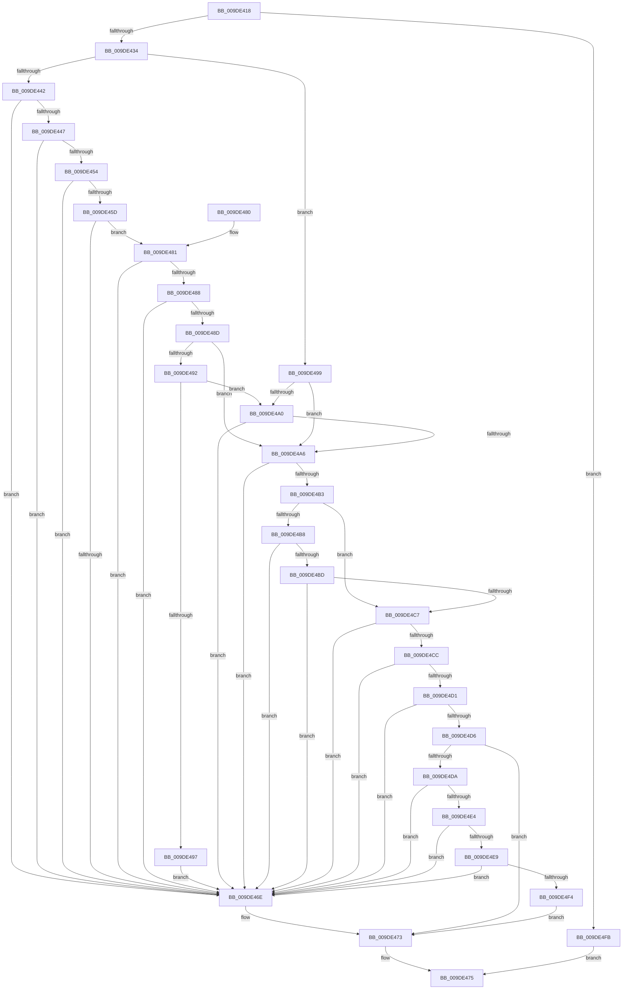

# WmipProbeWnodeMethodItem

- RVA: `0x009DE418`–`0x009DE505` (길이 `237` bytes)
- VA: `0x00000001409DE418`
- 실행 섹션: `PAGE`
- PDB 이름 있음: `예`; PDB Function 태그: `아니요`
- unwind 정보 RVA: `0x000A39E8`
- 디코드: `78`개 명령, `237/237` bytes 표시
- 미해석 바이트: `0` (있으면 어셈블리에 `.byte`로 보존)

> 이 문서는 커널 이미지의 기계어와 PDB 기호를 분석해 생성했습니다. 4번과 5번은 함수 원형과 자료형을 바이너리 사용 방식에서 추정한 C 해석이며 원본 소스 복구 결과는 아닙니다.

## 1. Dependencies

- 직접 호출 지점: **0**; 고유 호출 대상: **0**
- 직접 호출자로 확인된 함수: **1**
- RIP 상대 이미지 참조: **0**

### Outgoing calls
- 직접 디코드된 call 명령이 없습니다.

### Direct callers
- [WmipIoControl](WmipIoControl_function_009DEBD0.md) at `0x009DEF88`

### Static image references
- 디코드된 RIP-relative 메모리 참조가 없습니다.

## 2. Other-region calls and transfers

- 다른 실행 섹션으로 향하는 call: **0**
- 별도 외부 분기/꼬리 이동을 확인하지 못했습니다.

## 3. Assembly (complete function range)

```asm
009DE418  48 89 5C 24 08                  mov qword ptr [rsp + 8], rbx
009DE41D  48 89 7C 24 18                  mov qword ptr [rsp + 0x18], rdi
009DE422  44 8B D2                        mov r10d, edx
009DE425  41 8B D8                        mov ebx, r8d
009DE428  4C 8B C9                        mov r9, rcx
009DE42B  83 FA 44                        cmp edx, 0x44
009DE42E  0F 82 C7 00 00 00               jb 0x1409de4fb
009DE434  8B 79 40                        mov edi, dword ptr [rcx + 0x40]
009DE437  44 8B 41 3C                     mov r8d, dword ptr [rcx + 0x3c]
009DE43B  8B 49 30                        mov ecx, dword ptr [rcx + 0x30]
009DE43E  85 C9                           test ecx, ecx
009DE440  74 57                           je 0x1409de499
009DE442  83 F9 44                        cmp ecx, 0x44
009DE445  72 27                           jb 0x1409de46e
009DE447  48 8D 41 01                     lea rax, [rcx + 1]
009DE44B  48 83 E0 FE                     and rax, 0xfffffffffffffffe
009DE44F  48 3B C1                        cmp rax, rcx
009DE452  75 1A                           jne 0x1409de46e
009DE454  49 8D 42 FE                     lea rax, [r10 - 2]
009DE458  48 3B C8                        cmp rcx, rax
009DE45B  77 11                           ja 0x1409de46e
009DE45D  46 0F B7 1C 09                  movzx r11d, word ptr [rcx + r9]
009DE462  41 83 C3 02                     add r11d, 2
009DE466  44 03 D9                        add r11d, ecx
009DE469  44 3B D9                        cmp r11d, ecx
009DE46C  73 13                           jae 0x1409de481
009DE46E  BA 01 00 00 C0                  mov edx, 0xc0000001
009DE473  8B C2                           mov eax, edx
009DE475  48 8B 5C 24 08                  mov rbx, qword ptr [rsp + 8]
009DE47A  48 8B 7C 24 18                  mov rdi, qword ptr [rsp + 0x18]
009DE47F  C3                              ret
009DE480  CC                              int3
009DE481  33 D2                           xor edx, edx
009DE483  44 3B DB                        cmp r11d, ebx
009DE486  77 E6                           ja 0x1409de46e
009DE488  45 3B DA                        cmp r11d, r10d
009DE48B  77 E1                           ja 0x1409de46e
009DE48D  45 85 C0                        test r8d, r8d
009DE490  74 14                           je 0x1409de4a6
009DE492  45 3B C3                        cmp r8d, r11d
009DE495  73 09                           jae 0x1409de4a0
009DE497  EB D5                           jmp 0x1409de46e
009DE499  33 D2                           xor edx, edx
009DE49B  45 85 C0                        test r8d, r8d
009DE49E  74 06                           je 0x1409de4a6
009DE4A0  41 83 F8 44                     cmp r8d, 0x44
009DE4A4  72 C8                           jb 0x1409de46e
009DE4A6  49 8D 40 07                     lea rax, [r8 + 7]
009DE4AA  48 83 E0 F8                     and rax, 0xfffffffffffffff8
009DE4AE  49 3B C0                        cmp rax, r8
009DE4B1  75 BB                           jne 0x1409de46e
009DE4B3  45 85 C0                        test r8d, r8d
009DE4B6  74 0F                           je 0x1409de4c7
009DE4B8  41 3B FA                        cmp edi, r10d
009DE4BB  77 B1                           ja 0x1409de46e
009DE4BD  41 8B C2                        mov eax, r10d
009DE4C0  2B C7                           sub eax, edi
009DE4C2  44 3B C0                        cmp r8d, eax
009DE4C5  77 A7                           ja 0x1409de46e
009DE4C7  83 FB 44                        cmp ebx, 0x44
009DE4CA  72 A2                           jb 0x1409de46e
009DE4CC  44 3B C3                        cmp r8d, ebx
009DE4CF  77 9D                           ja 0x1409de46e
009DE4D1  45 85 C0                        test r8d, r8d
009DE4D4  74 98                           je 0x1409de46e
009DE4D6  85 D2                           test edx, edx
009DE4D8  78 99                           js 0x1409de473
009DE4DA  41 8B 41 2C                     mov eax, dword ptr [r9 + 0x2c]
009DE4DE  0F BA E0 0F                     bt eax, 0xf
009DE4E2  73 8A                           jae 0x1409de46e
009DE4E4  45 3B 11                        cmp r10d, dword ptr [r9]
009DE4E7  75 85                           jne 0x1409de46e
009DE4E9  A9 7F 7F FF FF                  test eax, 0xffff7f7f
009DE4EE  0F 85 7A FF FF FF               jne 0x1409de46e
009DE4F4  33 D2                           xor edx, edx
009DE4F6  E9 78 FF FF FF                  jmp 0x1409de473
009DE4FB  B8 01 00 00 C0                  mov eax, 0xc0000001
009DE500  E9 70 FF FF FF                  jmp 0x1409de475
```

## 4. C-style interpretation (structured pseudocode)

```c
__int64 __fastcall WmipProbeWnodeMethodItem(__int64 a1, int a2, int a3)
{
    __int64 result;
    __int64 v_r11;
    unsigned __int64 v_stack_p18;
    unsigned __int64 v_stack_p8;

    v_stack_p8 = v_rbx;
    v_stack_p18 = v_rdi;
    if (a2 < 68) goto loc_009DE4FB;
    if ((unsigned int)((unsigned int)(*(unsigned int *)(a1 + 48))) == 0) goto loc_009DE499;
    if (((unsigned int)((unsigned int)(*(unsigned int *)(a1 + 48)))) < 68) goto loc_009DE46E;
    result = ((unsigned int)(*(unsigned int *)(a1 + 48)) + 1) & (-2);
    if (result != ((unsigned int)(*(unsigned int *)(a1 + 48)))) goto loc_009DE46E;
    if (((unsigned int)(*(unsigned int *)(a1 + 48))) > ((unsigned int)(a2) - 2)) goto loc_009DE46E;
    v_r11 = (unsigned int)((*(unsigned __int16 *)((unsigned int)(*(unsigned int *)(a1 + 48)) + a1 * 1)) + (2));
    v_r11 = (unsigned int)((v_r11) + ((unsigned int)((unsigned int)(*(unsigned int *)(a1 + 48)))));
    if (((unsigned int)(v_r11)) >= ((unsigned int)((unsigned int)(*(unsigned int *)(a1 + 48))))) goto loc_009DE481;
loc_009DE46E:
loc_009DE473:
loc_009DE475:
    return (unsigned int)((unsigned int)((unsigned int)(0xC0000001ULL)));
loc_009DE481:
    a2 = 0;
    if (((unsigned int)(v_r11)) > ((unsigned int)(v_stack_p8))) goto loc_009DE46E;
    if (((unsigned int)(v_r11)) > ((unsigned int)((unsigned int)(a2)))) goto loc_009DE46E;
    if ((unsigned int)((unsigned int)(*(unsigned int *)(a1 + 60))) == 0) goto loc_009DE4A6;
    if (((unsigned int)((unsigned int)(*(unsigned int *)(a1 + 60)))) >= ((unsigned int)(v_r11))) goto loc_009DE4A0;
    goto loc_009DE46E;
loc_009DE499:
    a2 = 0;
    if ((unsigned int)((unsigned int)(*(unsigned int *)(a1 + 60))) == 0) goto loc_009DE4A6;
loc_009DE4A0:
    if (((unsigned int)((unsigned int)(*(unsigned int *)(a1 + 60)))) < 68) goto loc_009DE46E;
loc_009DE4A6:
    result = ((unsigned int)(*(unsigned int *)(a1 + 60)) + 7) & (-8);
    if (result != ((unsigned int)(*(unsigned int *)(a1 + 60)))) goto loc_009DE46E;
    if ((unsigned int)((unsigned int)(*(unsigned int *)(a1 + 60))) == 0) goto loc_009DE4C7;
    if (((unsigned int)(v_stack_p18)) > ((unsigned int)((unsigned int)(a2)))) goto loc_009DE46E;
    result = (unsigned int)(((unsigned int)((unsigned int)((unsigned int)(a2)))) - ((unsigned int)(v_stack_p18)));
    if (((unsigned int)((unsigned int)(*(unsigned int *)(a1 + 60)))) > ((unsigned int)(result))) goto loc_009DE46E;
loc_009DE4C7:
    if (((unsigned int)(v_stack_p8)) < 68) goto loc_009DE46E;
    if (((unsigned int)((unsigned int)(*(unsigned int *)(a1 + 60)))) > ((unsigned int)(v_stack_p8))) goto loc_009DE46E;
    if ((unsigned int)((unsigned int)(*(unsigned int *)(a1 + 60))) == 0) goto loc_009DE46E;
    if (sign_flag) goto loc_009DE473;
    if (condition_is_above_or_equal) goto loc_009DE46E;
    if (((unsigned int)((unsigned int)(a2))) != (*(unsigned int *)(a1))) goto loc_009DE46E;
    if ((((unsigned int)((unsigned int)(*(unsigned int *)(a1 + 44)))) & (0xFFFF7F7FULL)) != 0) goto loc_009DE46E;
    a2 = 0;
    goto loc_009DE473;
loc_009DE4FB:
    goto loc_009DE475;
}
```

## 5. (Beta) C Style

```c
int64_t WmipProbeWnodeMethodItem(void *Arg1, void *Arg2, int32_t Arg3)
{
    uint8_t *arg1 = (uint8_t *)Arg1;
    uint8_t *arg2 = (uint8_t *)Arg2;

    int64_t result;
    int64_t local_r11;
    uint64_t v_stack_p18;
    uint64_t v_stack_p8;

    v_stack_p8 = local_rbx;
    v_stack_p18 = local_rdi;
    if (Arg2 < 68) goto loc_009DE4FB;
    if ((uint32_t)((uint32_t)(*(uint32_t *)(arg1 + 0x30))) == 0) goto loc_009DE499;
    if (((uint32_t)((uint32_t)(*(uint32_t *)(arg1 + 0x30)))) < 68) goto loc_009DE46E;
    result = ((uint32_t)(*(uint32_t *)(arg1 + 0x30)) + 1) & (-2);
    if (result != ((uint32_t)(*(uint32_t *)(arg1 + 0x30)))) goto loc_009DE46E;
    if (((uint32_t)(*(uint32_t *)(arg1 + 0x30))) > ((uint32_t)(Arg2) - 2)) goto loc_009DE46E;
    local_r11 = (uint32_t)((*(uint16_t *)((uint32_t)(*(uint32_t *)(arg1 + 0x30)) + arg1 * 1)) + (2));
    local_r11 = (uint32_t)((local_r11) + ((uint32_t)((uint32_t)(*(uint32_t *)(arg1 + 0x30)))));
    if (((uint32_t)(local_r11)) >= ((uint32_t)((uint32_t)(*(uint32_t *)(arg1 + 0x30))))) goto loc_009DE481;
loc_009DE46E:
loc_009DE473:
loc_009DE475:
    return (uint32_t)((uint32_t)((uint32_t)(0xC0000001ULL)));
loc_009DE481:
    Arg2 = 0;
    if (((uint32_t)(local_r11)) > ((uint32_t)(v_stack_p8))) goto loc_009DE46E;
    if (((uint32_t)(local_r11)) > ((uint32_t)((uint32_t)(Arg2)))) goto loc_009DE46E;
    if ((uint32_t)((uint32_t)(*(uint32_t *)(arg1 + 0x3C))) == 0) goto loc_009DE4A6;
    if (((uint32_t)((uint32_t)(*(uint32_t *)(arg1 + 0x3C)))) >= ((uint32_t)(local_r11))) goto loc_009DE4A0;
    goto loc_009DE46E;
loc_009DE499:
    Arg2 = 0;
    if ((uint32_t)((uint32_t)(*(uint32_t *)(arg1 + 0x3C))) == 0) goto loc_009DE4A6;
loc_009DE4A0:
    if (((uint32_t)((uint32_t)(*(uint32_t *)(arg1 + 0x3C)))) < 68) goto loc_009DE46E;
loc_009DE4A6:
    result = ((uint32_t)(*(uint32_t *)(arg1 + 0x3C)) + 7) & (-8);
    if (result != ((uint32_t)(*(uint32_t *)(arg1 + 0x3C)))) goto loc_009DE46E;
    if ((uint32_t)((uint32_t)(*(uint32_t *)(arg1 + 0x3C))) == 0) goto loc_009DE4C7;
    if (((uint32_t)(v_stack_p18)) > ((uint32_t)((uint32_t)(Arg2)))) goto loc_009DE46E;
    result = (uint32_t)(((uint32_t)((uint32_t)((uint32_t)(Arg2)))) - ((uint32_t)(v_stack_p18)));
    if (((uint32_t)((uint32_t)(*(uint32_t *)(arg1 + 0x3C)))) > ((uint32_t)(result))) goto loc_009DE46E;
loc_009DE4C7:
    if (((uint32_t)(v_stack_p8)) < 68) goto loc_009DE46E;
    if (((uint32_t)((uint32_t)(*(uint32_t *)(arg1 + 0x3C)))) > ((uint32_t)(v_stack_p8))) goto loc_009DE46E;
    if ((uint32_t)((uint32_t)(*(uint32_t *)(arg1 + 0x3C))) == 0) goto loc_009DE46E;
    if (sign_flag) goto loc_009DE473;
    if (condition_is_above_or_equal) goto loc_009DE46E;
    if (((uint32_t)((uint32_t)(Arg2))) != (*(uint32_t *)(arg1))) goto loc_009DE46E;
    if ((((uint32_t)((uint32_t)(*(uint32_t *)(arg1 + 0x2C)))) & (0xFFFF7F7FULL)) != 0) goto loc_009DE46E;
    Arg2 = 0;
    goto loc_009DE473;
loc_009DE4FB:
    goto loc_009DE475;
}
```

### 관측된 메모리 오프셋

구조체 형식이 확인되지 않은 접근은 인자 기준의 오프셋으로만 기록했습니다.

| 기준 인자 | 오프셋 표현 | 폭 (bit) | 접근 |
|---|---:|---:|---|
| `Arg1` | `+ 0x0` | `32` | `R` |
| `Arg1` | `+ 0x2C` | `32` | `R` |
| `Arg1` | `+ 0x30` | `32` | `R` |
| `Arg1` | `+ 0x3C` | `32` | `R` |
| `Arg1` | `+ 0x40` | `32` | `R` |
| `Arg2` | `- 0x2` | `64` | `R` |

## 6. Execution-region graph

[열기: 2D/3D 그래프와 함수 탐색 컨트롤 패널](../../../control-panel.html?section=page&rva=0x009DE418&view=graph)

- 2D 그래프는 위에서 아래로 흐르고, 3D 그래프는 빈 공간을 드래그해 회전합니다. Shift+드래그는 이동, 휠은 확대·축소, 함수 노드 선택은 대상 보고서 이동입니다.

### Static fallback


