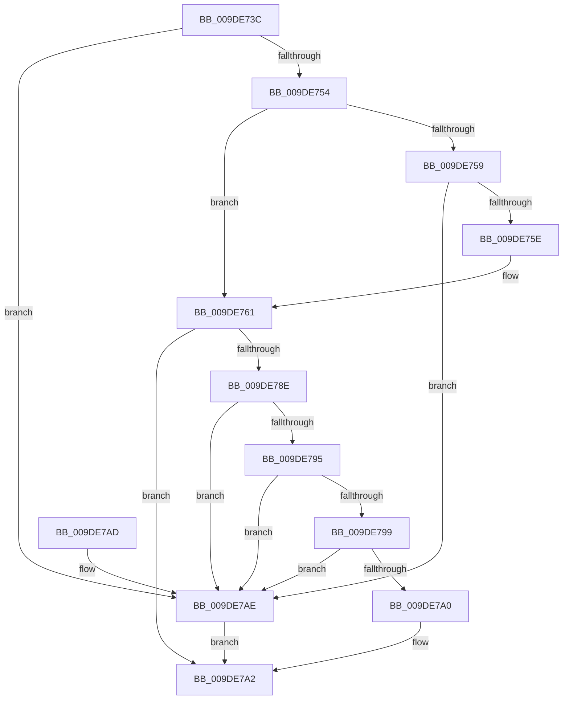

# WmipProbeWnodeSingleInstance

- RVA: `0x009DE73C`–`0x009DE7B5` (길이 `121` bytes)
- VA: `0x00000001409DE73C`
- 실행 섹션: `PAGE`
- PDB 이름 있음: `예`; PDB Function 태그: `아니요`
- unwind 정보 RVA: `0x000A3A10`
- 디코드: `40`개 명령, `121/121` bytes 표시
- 미해석 바이트: `0` (있으면 어셈블리에 `.byte`로 보존)

> 이 문서는 커널 이미지의 기계어와 PDB 기호를 분석해 생성했습니다. 4번과 5번은 함수 원형과 자료형을 바이너리 사용 방식에서 추정한 C 해석이며 원본 소스 복구 결과는 아닙니다.

## 1. Dependencies

- 직접 호출 지점: **1**; 고유 호출 대상: **1**
- 직접 호출자로 확인된 함수: **1**
- RIP 상대 이미지 참조: **0**

### Outgoing calls
- `0x009DE785` → [WmipProbeWnodeWorker](WmipProbeWnodeWorker_function_009DE7BC.md) (function, `0x009DE7BC`)

### Direct callers
- [WmipIoControl](WmipIoControl_function_009DEBD0.md) at `0x009DF0E1`

### Static image references
- 디코드된 RIP-relative 메모리 참조가 없습니다.

## 2. Other-region calls and transfers

- 다른 실행 섹션으로 향하는 call: **0**
- 별도 외부 분기/꼬리 이동을 확인하지 못했습니다.

## 3. Assembly (complete function range)

```asm
009DE73C  48 89 5C 24 08                  mov qword ptr [rsp + 8], rbx
009DE741  57                              push rdi
009DE742  48 83 EC 50                     sub rsp, 0x50
009DE746  8B FA                           mov edi, edx
009DE748  48 8B D9                        mov rbx, rcx
009DE74B  BA 40 00 00 00                  mov edx, 0x40
009DE750  3B FA                           cmp edi, edx
009DE752  72 5A                           jb 0x1409de7ae
009DE754  45 84 C9                        test r9b, r9b
009DE757  74 08                           je 0x1409de761
009DE759  44 3B C2                        cmp r8d, edx
009DE75C  72 50                           jb 0x1409de7ae
009DE75E  45 84 C9                        test r9b, r9b
009DE761  0F 94 C0                        sete al
009DE764  88 44 24 40                     mov byte ptr [rsp + 0x40], al
009DE768  8B 41 3C                        mov eax, dword ptr [rcx + 0x3c]
009DE76B  44 88 4C 24 38                  mov byte ptr [rsp + 0x38], r9b
009DE770  44 8B 49 38                     mov r9d, dword ptr [rcx + 0x38]
009DE774  44 89 44 24 30                  mov dword ptr [rsp + 0x30], r8d
009DE779  44 8B 41 30                     mov r8d, dword ptr [rcx + 0x30]
009DE77D  89 7C 24 28                     mov dword ptr [rsp + 0x28], edi
009DE781  89 44 24 20                     mov dword ptr [rsp + 0x20], eax
009DE785  E8 32 00 00 00                  call 0x1409de7bc
009DE78A  85 C0                           test eax, eax
009DE78C  78 14                           js 0x1409de7a2
009DE78E  8B 43 2C                        mov eax, dword ptr [rbx + 0x2c]
009DE791  A8 02                           test al, 2
009DE793  74 19                           je 0x1409de7ae
009DE795  3B 3B                           cmp edi, dword ptr [rbx]
009DE797  75 15                           jne 0x1409de7ae
009DE799  A9 7D FF FF FF                  test eax, 0xffffff7d
009DE79E  75 0E                           jne 0x1409de7ae
009DE7A0  33 C0                           xor eax, eax
009DE7A2  48 8B 5C 24 60                  mov rbx, qword ptr [rsp + 0x60]
009DE7A7  48 83 C4 50                     add rsp, 0x50
009DE7AB  5F                              pop rdi
009DE7AC  C3                              ret
009DE7AD  CC                              int3
009DE7AE  B8 01 00 00 C0                  mov eax, 0xc0000001
009DE7B3  EB ED                           jmp 0x1409de7a2
```

## 4. C-style interpretation (structured pseudocode)

```c
__int64 __fastcall WmipProbeWnodeSingleInstance(__int64 a1, int a2, int a3, unsigned __int8 a4)
{
    __int64 result;
    __int64 v_rsp;
    unsigned __int8 v_stack_m18;
    unsigned __int8 v_stack_m20;
    unsigned int v_stack_m28;
    unsigned int v_stack_m30;
    unsigned int v_stack_m38;
    unsigned __int64 v_stack_p8;

    v_stack_p8 = v_rbx;
    v_rsp = (v_rsp) - (80);
    if (((unsigned int)((unsigned int)(a2))) < 64) goto loc_009DE7AE;
    if (a4 == 0) goto loc_009DE761;
    if (a3 < 64) goto loc_009DE7AE;
loc_009DE761:
    result = (a4 == 0) ? 1 : 0;
    v_stack_m18 = (unsigned __int8)(result);
    v_stack_m20 = a4;
    v_stack_m28 = a3;
    v_stack_m30 = (unsigned int)((unsigned int)(a2));
    v_stack_m38 = (unsigned int)((unsigned int)(*(unsigned int *)(a1 + 60)));
    result = WmipProbeWnodeWorker(a1, 64, (unsigned int)(*(unsigned int *)(a1 + 48)), (unsigned int)(*(unsigned int *)(a1 + 56)));
    if (sign_flag) goto loc_009DE7A2;
    if ((((unsigned __int8)((unsigned int)(*(unsigned int *)(a1 + 44)))) & (2)) == 0) goto loc_009DE7AE;
    if (((unsigned int)((unsigned int)(a2))) != (*(unsigned int *)(a1))) goto loc_009DE7AE;
    if ((((unsigned int)((unsigned int)(*(unsigned int *)(a1 + 44)))) & (0xFFFFFF7DULL)) != 0) goto loc_009DE7AE;
    result = 0;
loc_009DE7A2:
    v_rsp = (v_rsp) + (80);
    return result;
loc_009DE7AE:
    goto loc_009DE7A2;
}
```

## 5. (Beta) C Style

```c
int64_t WmipProbeWnodeSingleInstance(void *Arg1, int32_t Arg2, int32_t Arg3, uint8_t Arg4)
{
    uint8_t *arg1 = (uint8_t *)Arg1;

    int64_t result;
    int64_t local_rsp;
    uint8_t v_stack_m18;
    uint8_t v_stack_m20;
    uint32_t v_stack_m28;
    uint32_t v_stack_m30;
    uint32_t v_stack_m38;
    uint64_t v_stack_p8;

    v_stack_p8 = local_rbx;
    local_rsp = (local_rsp) - (80);
    if (((uint32_t)((uint32_t)(Arg2))) < 64) goto loc_009DE7AE;
    if (Arg4 == 0) goto loc_009DE761;
    if (Arg3 < 64) goto loc_009DE7AE;
loc_009DE761:
    result = (Arg4 == 0) ? 1 : 0;
    v_stack_m18 = (uint8_t)(result);
    v_stack_m20 = Arg4;
    v_stack_m28 = Arg3;
    v_stack_m30 = (uint32_t)((uint32_t)(Arg2));
    v_stack_m38 = (uint32_t)((uint32_t)(*(uint32_t *)(arg1 + 0x3C)));
    result = WmipProbeWnodeWorker(Arg1, 64, (uint32_t)(*(uint32_t *)(arg1 + 0x30)), (uint32_t)(*(uint32_t *)(arg1 + 0x38)));
    if (sign_flag) goto loc_009DE7A2;
    if ((((uint8_t)((uint32_t)(*(uint32_t *)(arg1 + 0x2C)))) & (2)) == 0) goto loc_009DE7AE;
    if (((uint32_t)((uint32_t)(Arg2))) != (*(uint32_t *)(arg1))) goto loc_009DE7AE;
    if ((((uint32_t)((uint32_t)(*(uint32_t *)(arg1 + 0x2C)))) & (0xFFFFFF7DULL)) != 0) goto loc_009DE7AE;
    result = 0;
loc_009DE7A2:
    local_rsp = (local_rsp) + (80);
    return result;
loc_009DE7AE:
    goto loc_009DE7A2;
}
```

### 관측된 메모리 오프셋

구조체 형식이 확인되지 않은 접근은 인자 기준의 오프셋으로만 기록했습니다.

| 기준 인자 | 오프셋 표현 | 폭 (bit) | 접근 |
|---|---:|---:|---|
| `Arg1` | `+ 0x0` | `32` | `R` |
| `Arg1` | `+ 0x2C` | `32` | `R` |
| `Arg1` | `+ 0x30` | `32` | `R` |
| `Arg1` | `+ 0x38` | `32` | `R` |
| `Arg1` | `+ 0x3C` | `32` | `R` |

## 6. Execution-region graph

[열기: 2D/3D 그래프와 함수 탐색 컨트롤 패널](../../../control-panel.html?section=page&rva=0x009DE73C&view=graph)

- 2D 그래프는 위에서 아래로 흐르고, 3D 그래프는 빈 공간을 드래그해 회전합니다. Shift+드래그는 이동, 휠은 확대·축소, 함수 노드 선택은 대상 보고서 이동입니다.

### Static fallback


