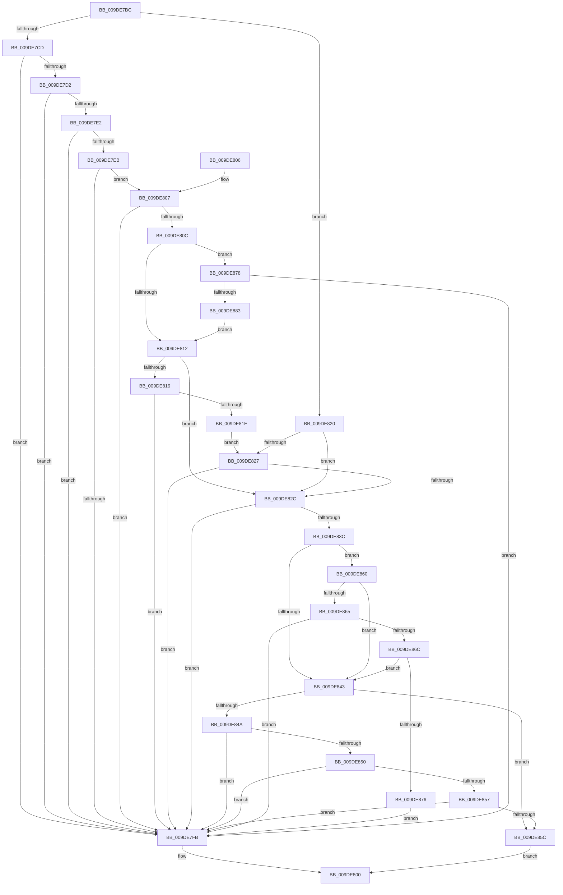

# WmipProbeWnodeWorker

- RVA: `0x009DE7BC`–`0x009DE885` (길이 `201` bytes)
- VA: `0x00000001409DE7BC`
- 실행 섹션: `PAGE`
- PDB 이름 있음: `예`; PDB Function 태그: `아니요`
- unwind 정보 RVA: `0x000A3A20`
- 디코드: `67`개 명령, `201/201` bytes 표시
- 미해석 바이트: `0` (있으면 어셈블리에 `.byte`로 보존)

> 이 문서는 커널 이미지의 기계어와 PDB 기호를 분석해 생성했습니다. 4번과 5번은 함수 원형과 자료형을 바이너리 사용 방식에서 추정한 C 해석이며 원본 소스 복구 결과는 아닙니다.

## 1. Dependencies

- 직접 호출 지점: **0**; 고유 호출 대상: **0**
- 직접 호출자로 확인된 함수: **3**
- RIP 상대 이미지 참조: **0**

### Outgoing calls
- 직접 디코드된 call 명령이 없습니다.

### Direct callers
- [WmipProbeWnodeSingleItem](../7B/WmipProbeWnodeSingleItem_function_007B3D34.md) at `0x007B3D6C`
- [WmipProbeWnodeSingleInstance](WmipProbeWnodeSingleInstance_function_009DE73C.md) at `0x009DE785`
- [WmipIoControl](WmipIoControl_function_009DEBD0.md) at `0x009DEF1D`

### Static image references
- 디코드된 RIP-relative 메모리 참조가 없습니다.

## 2. Other-region calls and transfers

- 다른 실행 섹션으로 향하는 call: **0**
- 별도 외부 분기/꼬리 이동을 확인하지 못했습니다.

## 3. Assembly (complete function range)

```asm
009DE7BC  48 89 7C 24 08                  mov qword ptr [rsp + 8], rdi
009DE7C1  44 8B 54 24 30                  mov r10d, dword ptr [rsp + 0x30]
009DE7C6  8B FA                           mov edi, edx
009DE7C8  45 85 C0                        test r8d, r8d
009DE7CB  74 53                           je 0x1409de820
009DE7CD  44 3B C2                        cmp r8d, edx
009DE7D0  72 29                           jb 0x1409de7fb
009DE7D2  45 8B D8                        mov r11d, r8d
009DE7D5  49 8D 43 01                     lea rax, [r11 + 1]
009DE7D9  48 83 E0 FE                     and rax, 0xfffffffffffffffe
009DE7DD  49 3B C3                        cmp rax, r11
009DE7E0  75 19                           jne 0x1409de7fb
009DE7E2  49 8D 42 FE                     lea rax, [r10 - 2]
009DE7E6  4C 3B D8                        cmp r11, rax
009DE7E9  77 10                           ja 0x1409de7fb
009DE7EB  41 0F B7 0C 0B                  movzx ecx, word ptr [r11 + rcx]
009DE7F0  83 C1 02                        add ecx, 2
009DE7F3  41 03 C8                        add ecx, r8d
009DE7F6  41 3B C8                        cmp ecx, r8d
009DE7F9  73 0C                           jae 0x1409de807
009DE7FB  B8 01 00 00 C0                  mov eax, 0xc0000001
009DE800  48 8B 7C 24 08                  mov rdi, qword ptr [rsp + 8]
009DE805  C3                              ret
009DE806  CC                              int3
009DE807  41 3B CA                        cmp ecx, r10d
009DE80A  77 EF                           ja 0x1409de7fb
009DE80C  3B 4C 24 38                     cmp ecx, dword ptr [rsp + 0x38]
009DE810  77 66                           ja 0x1409de878
009DE812  33 D2                           xor edx, edx
009DE814  45 85 C9                        test r9d, r9d
009DE817  74 13                           je 0x1409de82c
009DE819  44 3B C9                        cmp r9d, ecx
009DE81C  72 DD                           jb 0x1409de7fb
009DE81E  EB 07                           jmp 0x1409de827
009DE820  33 D2                           xor edx, edx
009DE822  45 85 C9                        test r9d, r9d
009DE825  74 05                           je 0x1409de82c
009DE827  44 3B CF                        cmp r9d, edi
009DE82A  72 CF                           jb 0x1409de7fb
009DE82C  41 8B C9                        mov ecx, r9d
009DE82F  48 8D 41 07                     lea rax, [rcx + 7]
009DE833  48 83 E0 F8                     and rax, 0xfffffffffffffff8
009DE837  48 3B C1                        cmp rax, rcx
009DE83A  75 BF                           jne 0x1409de7fb
009DE83C  80 7C 24 48 00                  cmp byte ptr [rsp + 0x48], 0
009DE841  75 1D                           jne 0x1409de860
009DE843  80 7C 24 40 00                  cmp byte ptr [rsp + 0x40], 0
009DE848  74 12                           je 0x1409de85c
009DE84A  39 7C 24 38                     cmp dword ptr [rsp + 0x38], edi
009DE84E  72 AB                           jb 0x1409de7fb
009DE850  44 3B 4C 24 38                  cmp r9d, dword ptr [rsp + 0x38]
009DE855  77 A4                           ja 0x1409de7fb
009DE857  45 85 C9                        test r9d, r9d
009DE85A  74 9F                           je 0x1409de7fb
009DE85C  8B C2                           mov eax, edx
009DE85E  EB A0                           jmp 0x1409de800
009DE860  45 85 C9                        test r9d, r9d
009DE863  74 DE                           je 0x1409de843
009DE865  44 39 54 24 28                  cmp dword ptr [rsp + 0x28], r10d
009DE86A  77 8F                           ja 0x1409de7fb
009DE86C  44 2B 54 24 28                  sub r10d, dword ptr [rsp + 0x28]
009DE871  45 3B CA                        cmp r9d, r10d
009DE874  76 CD                           jbe 0x1409de843
009DE876  EB 83                           jmp 0x1409de7fb
009DE878  80 7C 24 40 00                  cmp byte ptr [rsp + 0x40], 0
009DE87D  0F 85 78 FF FF FF               jne 0x1409de7fb
009DE883  EB 8D                           jmp 0x1409de812
```

## 4. C-style interpretation (structured pseudocode)

```c
__int64 __fastcall WmipProbeWnodeWorker(__int64 a1, int a2, int a3, int a4, unsigned int a5, unsigned int a6, unsigned int a7, unsigned __int8 a8, unsigned __int8 a9)
{
    __int64 result;
    __int64 v_r10;
    unsigned __int64 v_stack_p8;

    v_stack_p8 = v_rdi;
    if (a3 == 0) goto loc_009DE820;
    if (a3 < a2) goto loc_009DE7FB;
    result = ((unsigned int)(a3) + 1) & (-2);
    if (result != ((unsigned int)(a3))) goto loc_009DE7FB;
    if (((unsigned int)(a3)) > ((unsigned int)(a6) - 2)) goto loc_009DE7FB;
    a1 = (unsigned int)((*(unsigned __int16 *)((unsigned int)(a3) + a1 * 1)) + (2));
    a1 = (unsigned int)((a1) + (a3));
    if (((unsigned int)(a1)) >= a3) goto loc_009DE807;
loc_009DE7FB:
loc_009DE800:
    return (unsigned int)(0xC0000001ULL);
loc_009DE807:
    if (((unsigned int)(a1)) > ((unsigned int)((unsigned int)(a6)))) goto loc_009DE7FB;
    if (((unsigned int)(a1)) > a7) goto loc_009DE878;
loc_009DE812:
    a2 = 0;
    if (a4 == 0) goto loc_009DE82C;
    if (a4 < ((unsigned int)(a1))) goto loc_009DE7FB;
    goto loc_009DE827;
loc_009DE820:
    a2 = 0;
    if (a4 == 0) goto loc_009DE82C;
loc_009DE827:
    if (a4 < ((unsigned int)(v_stack_p8))) goto loc_009DE7FB;
loc_009DE82C:
    result = ((unsigned int)(a4) + 7) & (-8);
    if (result != ((unsigned int)(a4))) goto loc_009DE7FB;
    if (a9 != 0) goto loc_009DE860;
loc_009DE843:
    if (a8 == 0) goto loc_009DE85C;
    if (a7 < ((unsigned int)(v_stack_p8))) goto loc_009DE7FB;
    if (a4 > a7) goto loc_009DE7FB;
    if (a4 == 0) goto loc_009DE7FB;
loc_009DE85C:
    goto loc_009DE800;
loc_009DE860:
    if (a4 == 0) goto loc_009DE843;
    if (a5 > ((unsigned int)((unsigned int)(a6)))) goto loc_009DE7FB;
    v_r10 = (unsigned int)(((unsigned int)(a6)) - (a5));
    if (a4 <= ((unsigned int)(v_r10))) goto loc_009DE843;
    goto loc_009DE7FB;
loc_009DE878:
    if (a8 != 0) goto loc_009DE7FB;
    goto loc_009DE812;
}
```

## 5. (Beta) C Style

```c
int64_t WmipProbeWnodeWorker(int64_t Arg1, int32_t Arg2, int32_t Arg3, int32_t Arg4, uint32_t Arg5, void *Arg6, uint32_t Arg7, uint8_t Arg8, uint8_t Arg9)
{
    uint8_t *arg6 = (uint8_t *)Arg6;

    int64_t result;
    int64_t local_r10;
    uint64_t v_stack_p8;

    v_stack_p8 = local_rdi;
    if (Arg3 == 0) goto loc_009DE820;
    if (Arg3 < Arg2) goto loc_009DE7FB;
    result = ((uint32_t)(Arg3) + 1) & (-2);
    if (result != ((uint32_t)(Arg3))) goto loc_009DE7FB;
    if (((uint32_t)(Arg3)) > ((uint32_t)(Arg6) - 2)) goto loc_009DE7FB;
    Arg1 = (uint32_t)((*(uint16_t *)((uint32_t)(Arg3) + Arg1 * 1)) + (2));
    Arg1 = (uint32_t)((Arg1) + (Arg3));
    if (((uint32_t)(Arg1)) >= Arg3) goto loc_009DE807;
loc_009DE7FB:
loc_009DE800:
    return (uint32_t)(0xC0000001ULL);
loc_009DE807:
    if (((uint32_t)(Arg1)) > ((uint32_t)((uint32_t)(Arg6)))) goto loc_009DE7FB;
    if (((uint32_t)(Arg1)) > Arg7) goto loc_009DE878;
loc_009DE812:
    Arg2 = 0;
    if (Arg4 == 0) goto loc_009DE82C;
    if (Arg4 < ((uint32_t)(Arg1))) goto loc_009DE7FB;
    goto loc_009DE827;
loc_009DE820:
    Arg2 = 0;
    if (Arg4 == 0) goto loc_009DE82C;
loc_009DE827:
    if (Arg4 < ((uint32_t)(v_stack_p8))) goto loc_009DE7FB;
loc_009DE82C:
    result = ((uint32_t)(Arg4) + 7) & (-8);
    if (result != ((uint32_t)(Arg4))) goto loc_009DE7FB;
    if (Arg9 != 0) goto loc_009DE860;
loc_009DE843:
    if (Arg8 == 0) goto loc_009DE85C;
    if (Arg7 < ((uint32_t)(v_stack_p8))) goto loc_009DE7FB;
    if (Arg4 > Arg7) goto loc_009DE7FB;
    if (Arg4 == 0) goto loc_009DE7FB;
loc_009DE85C:
    goto loc_009DE800;
loc_009DE860:
    if (Arg4 == 0) goto loc_009DE843;
    if (Arg5 > ((uint32_t)((uint32_t)(Arg6)))) goto loc_009DE7FB;
    local_r10 = (uint32_t)(((uint32_t)(Arg6)) - (Arg5));
    if (Arg4 <= ((uint32_t)(local_r10))) goto loc_009DE843;
    goto loc_009DE7FB;
loc_009DE878:
    if (Arg8 != 0) goto loc_009DE7FB;
    goto loc_009DE812;
}
```

### 관측된 메모리 오프셋

구조체 형식이 확인되지 않은 접근은 인자 기준의 오프셋으로만 기록했습니다.

| 기준 인자 | 오프셋 표현 | 폭 (bit) | 접근 |
|---|---:|---:|---|
| `Arg6` | `- 0x2` | `64` | `R` |

## 6. Execution-region graph

[열기: 2D/3D 그래프와 함수 탐색 컨트롤 패널](../../../control-panel.html?section=page&rva=0x009DE7BC&view=graph)

- 2D 그래프는 위에서 아래로 흐르고, 3D 그래프는 빈 공간을 드래그해 회전합니다. Shift+드래그는 이동, 휠은 확대·축소, 함수 노드 선택은 대상 보고서 이동입니다.

### Static fallback


