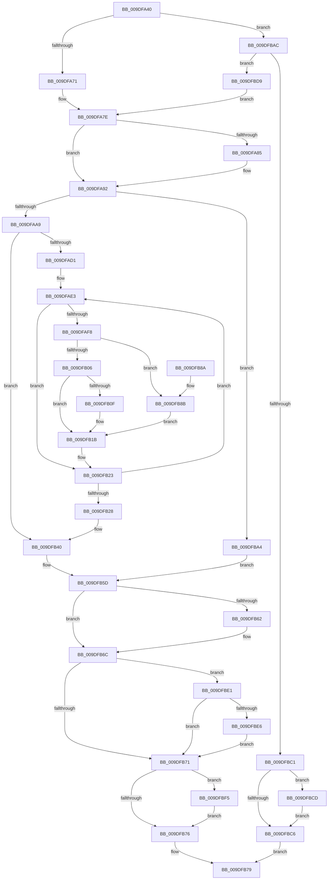

# WmipProcessEvent

- RVA: `0x009DFA40`–`0x009DFC04` (길이 `452` bytes)
- VA: `0x00000001409DFA40`
- 실행 섹션: `PAGE`
- PDB 이름 있음: `예`; PDB Function 태그: `아니요`
- unwind 정보 RVA: `0x000A3B64`
- 디코드: `129`개 명령, `452/452` bytes 표시
- 미해석 바이트: `0` (있으면 어셈블리에 `.byte`로 보존)

> 이 문서는 커널 이미지의 기계어와 PDB 기호를 분석해 생성했습니다. 4번과 5번은 함수 원형과 자료형을 바이너리 사용 방식에서 추정한 C 해석이며 원본 소스 복구 결과는 아닙니다.

## 1. Dependencies

- 직접 호출 지점: **14**; 고유 호출 대상: **11**
- 직접 호출자로 확인된 함수: **4**
- RIP 상대 이미지 참조: **2**

### Outgoing calls
- `0x009DFA8A` → [WmipIncludeStaticNames](WmipIncludeStaticNames_function_009DF754.md) (function, `0x009DF754`)
- `0x009DFA98` → [WmipFindGEByGuid](../9E/WmipFindGEByGuid_function_009E03A4.md) (function, `0x009E03A4`)
- `0x009DFAC0` → [KeWaitForSingleObject](../../text/20/KeWaitForSingleObject_function_0020E6B0.md) (function, `0x0020E6B0`)
- `0x009DFAEF` → [ObReferenceObjectSafe](../../text/41/ObReferenceObjectSafe_function_0041DAE0.md) (function, `0x0041DAE0`)
- `0x009DFB16` → [guard_dispatch_icall](../../text/6B/guard_dispatch_icall_function_006BAAD0.md) (function, `0x006BAAD0`)
- `0x009DFB1E` → [ObfDereferenceObject](../../text/2F/ObfDereferenceObject_function_002F9350.md) (function, `0x002F9350`)
- `0x009DFB49` → [KeReleaseMutex](../../text/39/KeReleaseMutex_function_00396810.md) (function, `0x00396810`)
- `0x009DFB58` → [WmipUnreferenceEntry](../9E/WmipUnreferenceEntry_function_009E0CC8.md) (function, `0x009E0CC8`)
- `0x009DFB67` → [ExFreePoolWithTag](../../poolcode/B8/ExFreePoolWithTag_function_00B82870.md) (function, `0x00B82870`)
- `0x009DFB94` → [WmipWriteWnodeToObject](../../text/49/WmipWriteWnodeToObject_function_00491C0C.md) (function, `0x00491C0C`)
- `0x009DFBAC` → [WmipDereferenceEvent](../AC/WmipDereferenceEvent_function_00ACE6E4.md) (function, `0x00ACE6E4`)
- `0x009DFBD2` → [ExFreePoolWithTag](../../poolcode/B8/ExFreePoolWithTag_function_00B82870.md) (function, `0x00B82870`)
- `0x009DFBEB` → [ExFreePoolWithTag](../../poolcode/B8/ExFreePoolWithTag_function_00B82870.md) (function, `0x00B82870`)
- `0x009DFBFA` → [ExFreePoolWithTag](../../poolcode/B8/ExFreePoolWithTag_function_00B82870.md) (function, `0x00B82870`)

### Direct callers
- [WmipGenerateBinaryMofNotification](../7B/WmipGenerateBinaryMofNotification_function_007B4348.md) at `0x007B44BA`
- [WmipSendGuidUpdateNotifications](WmipSendGuidUpdateNotifications_function_009DE50C.md) at `0x009DE639`
- [WmipEventNotification](WmipEventNotification_function_009DF9D0.md) at `0x009DFA03`
- [WmipGenerateMofResourceNotification](../AC/WmipGenerateMofResourceNotification_function_00AC83F4.md) at `0x00AC8500`

### Static image references
- `0x009DFAAC` → RVA `0x00EFFA60` (`.data`; read)
- `0x009DFB51` → RVA `0x00E03628` (`.data`; read)

## 2. Other-region calls and transfers

- 다른 실행 섹션으로 향하는 call: **10**
  - `0x009DFAC0` → [KeWaitForSingleObject](../../text/20/KeWaitForSingleObject_function_0020E6B0.md) (`PAGE` → `.text`)
  - `0x009DFAEF` → [ObReferenceObjectSafe](../../text/41/ObReferenceObjectSafe_function_0041DAE0.md) (`PAGE` → `.text`)
  - `0x009DFB16` → [guard_dispatch_icall](../../text/6B/guard_dispatch_icall_function_006BAAD0.md) (`PAGE` → `.text`)
  - `0x009DFB1E` → [ObfDereferenceObject](../../text/2F/ObfDereferenceObject_function_002F9350.md) (`PAGE` → `.text`)
  - `0x009DFB49` → [KeReleaseMutex](../../text/39/KeReleaseMutex_function_00396810.md) (`PAGE` → `.text`)
  - `0x009DFB67` → [ExFreePoolWithTag](../../poolcode/B8/ExFreePoolWithTag_function_00B82870.md) (`PAGE` → `POOLCODE`)
  - `0x009DFB94` → [WmipWriteWnodeToObject](../../text/49/WmipWriteWnodeToObject_function_00491C0C.md) (`PAGE` → `.text`)
  - `0x009DFBD2` → [ExFreePoolWithTag](../../poolcode/B8/ExFreePoolWithTag_function_00B82870.md) (`PAGE` → `POOLCODE`)
  - `0x009DFBEB` → [ExFreePoolWithTag](../../poolcode/B8/ExFreePoolWithTag_function_00B82870.md) (`PAGE` → `POOLCODE`)
  - `0x009DFBFA` → [ExFreePoolWithTag](../../poolcode/B8/ExFreePoolWithTag_function_00B82870.md) (`PAGE` → `POOLCODE`)
- 별도 외부 분기/꼬리 이동을 확인하지 못했습니다.

## 3. Assembly (complete function range)

```asm
009DFA40  44 88 44 24 18                  mov byte ptr [rsp + 0x18], r8b
009DFA45  88 54 24 10                     mov byte ptr [rsp + 0x10], dl
009DFA49  48 89 4C 24 08                  mov qword ptr [rsp + 8], rcx
009DFA4E  53                              push rbx
009DFA4F  55                              push rbp
009DFA50  56                              push rsi
009DFA51  57                              push rdi
009DFA52  41 54                           push r12
009DFA54  41 55                           push r13
009DFA56  41 56                           push r14
009DFA58  41 57                           push r15
009DFA5A  48 83 EC 38                     sub rsp, 0x38
009DFA5E  F7 41 2C 00 20 00 00            test dword ptr [rcx + 0x2c], 0x2000
009DFA65  41 8A E8                        mov bpl, r8b
009DFA68  48 8B F1                        mov rsi, rcx
009DFA6B  0F 85 3B 01 00 00               jne 0x1409dfbac
009DFA71  33 FF                           xor edi, edi
009DFA73  48 8B D9                        mov rbx, rcx
009DFA76  48 89 BC 24 98 00 00 00         mov qword ptr [rsp + 0x98], rdi
009DFA7E  8B 43 2C                        mov eax, dword ptr [rbx + 0x2c]
009DFA81  84 C0                           test al, al
009DFA83  79 0D                           jns 0x1409dfa92
009DFA85  8B 13                           mov edx, dword ptr [rbx]
009DFA87  48 8B CB                        mov rcx, rbx
009DFA8A  E8 C5 FC FF FF                  call 0x1409df754
009DFA8F  48 8B D8                        mov rbx, rax
009DFA92  48 8D 4B 18                     lea rcx, [rbx + 0x18]
009DFA96  B2 01                           mov dl, 1
009DFA98  E8 07 09 00 00                  call 0x1409e03a4
009DFA9D  4C 8B E8                        mov r13, rax
009DFAA0  48 85 C0                        test rax, rax
009DFAA3  0F 84 FB 00 00 00               je 0x1409dfba4
009DFAA9  45 33 FF                        xor r15d, r15d
009DFAAC  48 8D 0D AD FF 51 00            lea rcx, [rip + 0x51ffad]
009DFAB3  4C 21 7C 24 20                  and qword ptr [rsp + 0x20], r15
009DFAB8  45 33 C9                        xor r9d, r9d
009DFABB  45 33 C0                        xor r8d, r8d
009DFABE  33 D2                           xor edx, edx
009DFAC0  E8 EB EB 82 FF                  call 0x14020e6b0
009DFAC5  49 8D 45 28                     lea rax, [r13 + 0x28]
009DFAC9  4C 8B 20                        mov r12, qword ptr [rax]
009DFACC  4C 3B E0                        cmp r12, rax
009DFACF  74 6F                           je 0x1409dfb40
009DFAD1  40 8A BC 24 88 00 00 00         mov dil, byte ptr [rsp + 0x88]
009DFAD9  49 8D 75 28                     lea rsi, [r13 + 0x28]
009DFADD  41 BE 01 00 00 C0               mov r14d, 0xc0000001
009DFAE3  49 8D 6C 24 D8                  lea rbp, [r12 - 0x28]
009DFAE8  4D 8B 24 24                     mov r12, qword ptr [r12]
009DFAEC  48 8B CD                        mov rcx, rbp
009DFAEF  E8 EC DF A3 FF                  call 0x14041dae0
009DFAF4  84 C0                           test al, al
009DFAF6  74 2B                           je 0x1409dfb23
009DFAF8  8B 85 A4 00 00 00               mov eax, dword ptr [rbp + 0xa4]
009DFAFE  A8 02                           test al, 2
009DFB00  0F 84 85 00 00 00               je 0x1409dfb8b
009DFB06  48 8B 45 48                     mov rax, qword ptr [rbp + 0x48]
009DFB0A  48 85 C0                        test rax, rax
009DFB0D  74 0C                           je 0x1409dfb1b
009DFB0F  48 8B 55 50                     mov rdx, qword ptr [rbp + 0x50]
009DFB13  48 8B CB                        mov rcx, rbx
009DFB16  E8 B5 AF CD FF                  call 0x1406baad0
009DFB1B  48 8B CD                        mov rcx, rbp
009DFB1E  E8 2D 98 91 FF                  call 0x1402f9350
009DFB23  4C 3B E6                        cmp r12, rsi
009DFB26  75 BB                           jne 0x1409dfae3
009DFB28  48 8B BC 24 98 00 00 00         mov rdi, qword ptr [rsp + 0x98]
009DFB30  48 8B B4 24 80 00 00 00         mov rsi, qword ptr [rsp + 0x80]
009DFB38  40 8A AC 24 90 00 00 00         mov bpl, byte ptr [rsp + 0x90]
009DFB40  33 D2                           xor edx, edx
009DFB42  48 8D 0D 17 FF 51 00            lea rcx, [rip + 0x51ff17]
009DFB49  E8 C2 6C 9B FF                  call 0x140396810
009DFB4E  49 8B D5                        mov rdx, r13
009DFB51  48 8D 0D D0 3A 42 00            lea rcx, [rip + 0x423ad0]
009DFB58  E8 6B 11 00 00                  call 0x1409e0cc8
009DFB5D  40 84 ED                        test bpl, bpl
009DFB60  74 0A                           je 0x1409dfb6c
009DFB62  33 D2                           xor edx, edx
009DFB64  48 8B CE                        mov rcx, rsi
009DFB67  E8 04 2D 1A 00                  call 0x140b82870
009DFB6C  48 3B DE                        cmp rbx, rsi
009DFB6F  75 70                           jne 0x1409dfbe1
009DFB71  48 85 FF                        test rdi, rdi
009DFB74  75 7F                           jne 0x1409dfbf5
009DFB76  41 8B C7                        mov eax, r15d
009DFB79  48 83 C4 38                     add rsp, 0x38
009DFB7D  41 5F                           pop r15
009DFB7F  41 5E                           pop r14
009DFB81  41 5D                           pop r13
009DFB83  41 5C                           pop r12
009DFB85  5F                              pop rdi
009DFB86  5E                              pop rsi
009DFB87  5D                              pop rbp
009DFB88  5B                              pop rbx
009DFB89  C3                              ret
009DFB8A  CC                              int3
009DFB8B  44 8A C7                        mov r8b, dil
009DFB8E  48 8B D3                        mov rdx, rbx
009DFB91  48 8B CD                        mov rcx, rbp
009DFB94  E8 73 20 AB FF                  call 0x140491c0c
009DFB99  85 C0                           test eax, eax
009DFB9B  45 0F 48 FE                     cmovs r15d, r14d
009DFB9F  E9 77 FF FF FF                  jmp 0x1409dfb1b
009DFBA4  41 BF 95 02 00 C0               mov r15d, 0xc0000295
009DFBAA  EB B1                           jmp 0x1409dfb5d
009DFBAC  E8 33 EB 0E 00                  call 0x140ace6e4
009DFBB1  48 89 84 24 98 00 00 00         mov qword ptr [rsp + 0x98], rax
009DFBB9  48 8B F8                        mov rdi, rax
009DFBBC  48 85 C0                        test rax, rax
009DFBBF  75 18                           jne 0x1409dfbd9
009DFBC1  40 84 ED                        test bpl, bpl
009DFBC4  75 07                           jne 0x1409dfbcd
009DFBC6  B8 01 00 00 C0                  mov eax, 0xc0000001
009DFBCB  EB AC                           jmp 0x1409dfb79
009DFBCD  33 D2                           xor edx, edx
009DFBCF  48 8B CE                        mov rcx, rsi
009DFBD2  E8 99 2C 1A 00                  call 0x140b82870
009DFBD7  EB ED                           jmp 0x1409dfbc6
009DFBD9  48 8B DF                        mov rbx, rdi
009DFBDC  E9 9D FE FF FF                  jmp 0x1409dfa7e
009DFBE1  48 3B DF                        cmp rbx, rdi
009DFBE4  74 8B                           je 0x1409dfb71
009DFBE6  33 D2                           xor edx, edx
009DFBE8  48 8B CB                        mov rcx, rbx
009DFBEB  E8 80 2C 1A 00                  call 0x140b82870
009DFBF0  E9 7C FF FF FF                  jmp 0x1409dfb71
009DFBF5  33 D2                           xor edx, edx
009DFBF7  48 8B CF                        mov rcx, rdi
009DFBFA  E8 71 2C 1A 00                  call 0x140b82870
009DFBFF  E9 72 FF FF FF                  jmp 0x1409dfb76
```

## 4. C-style interpretation (structured pseudocode)

```c
__int64 __fastcall WmipProcessEvent(__int64 a1, unsigned __int8 a2, int a3, int a4)
{
    __int64 result;
    __int64 v_r15;
    __int64 v_rbx;
    __int64 v_rdi;
    __int64 v_rsp;
    unsigned __int64 v_stack_m58;
    unsigned __int8 v_stack_p10;
    unsigned __int8 v_stack_p18;
    unsigned __int64 v_stack_p20;
    unsigned __int64 v_stack_p8;
    unsigned __int64 v_stack_p98;

    v_stack_p18 = (unsigned __int8)(a3);
    v_stack_p10 = a2;
    v_stack_p8 = a1;
    v_rsp = (v_rsp) - (56);
    if (((*(unsigned int *)(a1 + 44)) & (0x2000ULL)) != 0) goto loc_009DFBAC;
    v_rdi = 0;
    v_stack_p20 = 0;
loc_009DFA7E:
    result = (unsigned int)(*(unsigned int *)(a1 + 44));
    v_rbx = a1;
    if (sign_flag) {
        a2 = *(unsigned int *)(a1);
        a1 = a1;
        result = WmipIncludeStaticNames(a1, a2, a3, a4);
        v_rbx = result;
    }
    result = WmipFindGEByGuid(v_rbx + 24, 1, a3, a4);
    if (result == 0) goto loc_009DFBA4;
    v_r15 = 0;
    a4 = 0;
    a3 = 0;
    a2 = 0;
    result = KeWaitForSingleObject(v_rip + 5373869, a2, a3, a4);
    if ((*(unsigned __int64 *)(result + 40)) == (result + 40)) goto loc_009DFB40;
loc_009DFAE3:
    result = ObReferenceObjectSafe(*(unsigned __int64 *)(result + 40) - 40, a2, a3, a4);
    if ((unsigned __int8)(result) == 0) goto loc_009DFB23;
    if ((((unsigned __int8)((unsigned int)(*(unsigned int *)(*(unsigned __int64 *)(result + 40) - 40 + 164)))) & (2)) == 0) goto loc_009DFB8B;
    result = *(unsigned __int64 *)(*(unsigned __int64 *)(result + 40) - 40 + 72);
    if (*(unsigned __int64 *)(*(unsigned __int64 *)(result + 40) - 40 + 72) != 0) {
        a2 = *(unsigned __int64 *)(*(unsigned __int64 *)(result + 40) - 40 + 80);
        a1 = v_rbx;
        result = guard_dispatch_icall(a1, a2, a3, a4);
    }
    result = ObfDereferenceObject(*(unsigned __int64 *)(result + 40) - 40, a2, a3, a4);
loc_009DFB23:
    if ((*(unsigned __int64 *)(*(unsigned __int64 *)(result + 40))) != (result + 40)) goto loc_009DFAE3;
loc_009DFB40:
    a2 = 0;
    result = KeReleaseMutex(v_rip + 5373719, a2, a3, a4);
    result = WmipUnreferenceEntry(v_rip + 4340432, result, a3, a4);
loc_009DFB5D:
    if ((unsigned __int8)(v_stack_p18) != 0) {
        a2 = 0;
        a1 = v_stack_p8;
        result = ExFreePoolWithTag(a1, a2, a3, a4);
    }
    if (v_rbx != v_stack_p8) goto loc_009DFBE1;
loc_009DFB71:
    if (v_stack_p20 != 0) goto loc_009DFBF5;
loc_009DFB76:
loc_009DFB79:
    v_rsp = (v_rsp) + (56);
    return 0;
loc_009DFB8B:
    result = WmipWriteWnodeToObject(v_stack_p18, v_rbx, (unsigned __int8)(v_stack_p20), a4);
    if (sign_flag) { v_r15 = (unsigned int)((unsigned int)(0xC0000001ULL)); }
    goto loc_009DFB1B;
loc_009DFBA4:
    goto loc_009DFB5D;
loc_009DFBAC:
    result = WmipDereferenceEvent(v_stack_p18, v_rbx, (unsigned __int8)(v_stack_p20), a4);
    v_stack_p98 = result;
    if (result != 0) goto loc_009DFBD9;
    if ((unsigned __int8)(v_stack_p18) != 0) goto loc_009DFBCD;
loc_009DFBC6:
    goto loc_009DFB79;
loc_009DFBCD:
    a2 = 0;
    result = ExFreePoolWithTag(v_stack_p8, a2, (unsigned __int8)(v_stack_p20), a4);
    goto loc_009DFBC6;
loc_009DFBD9:
    goto loc_009DFA7E;
loc_009DFBE1:
    if (result == result) goto loc_009DFB71;
    a2 = 0;
    result = ExFreePoolWithTag(result, a2, (unsigned __int8)(v_stack_p20), a4);
    goto loc_009DFB71;
loc_009DFBF5:
    a2 = 0;
    result = ExFreePoolWithTag(result, a2, (unsigned __int8)(v_stack_p20), a4);
    goto loc_009DFB76;
}
```

## 5. (Beta) C Style

```c
int64_t WmipProcessEvent(void *Arg1, uint8_t Arg2, int32_t Arg3, int32_t Arg4)
{
    uint8_t *arg1 = (uint8_t *)Arg1;

    int64_t result;
    int64_t local_r15;
    int64_t local_rbx;
    int64_t local_rdi;
    int64_t local_rsp;
    uint64_t v_stack_m58;
    uint8_t v_stack_p10;
    uint8_t v_stack_p18;
    uint64_t v_stack_p20;
    uint64_t v_stack_p8;
    uint64_t v_stack_p98;

    v_stack_p18 = (uint8_t)(Arg3);
    v_stack_p10 = Arg2;
    v_stack_p8 = Arg1;
    local_rsp = (local_rsp) - (56);
    if (((*(uint32_t *)(arg1 + 0x2C)) & (0x2000ULL)) != 0) goto loc_009DFBAC;
    local_rdi = 0;
    v_stack_p20 = 0;
loc_009DFA7E:
    result = (uint32_t)(*(uint32_t *)(arg1 + 0x2C));
    local_rbx = Arg1;
    if (sign_flag) {
        Arg2 = *(uint32_t *)(arg1);
        Arg1 = Arg1;
        result = WmipIncludeStaticNames(Arg1, Arg2, Arg3, Arg4);
        local_rbx = result;
    }
    result = WmipFindGEByGuid(local_rbx + 24, 1, Arg3, Arg4);
    if (result == 0) goto loc_009DFBA4;
    local_r15 = 0;
    Arg4 = 0;
    Arg3 = 0;
    Arg2 = 0;
    result = KeWaitForSingleObject(v_rip + 5373869, Arg2, Arg3, Arg4);
    if ((*(uint64_t *)(result + 0x28)) == (result + 40)) goto loc_009DFB40;
loc_009DFAE3:
    result = ObReferenceObjectSafe(*(uint64_t *)(result + 0x28) - 40, Arg2, Arg3, Arg4);
    if ((uint8_t)(result) == 0) goto loc_009DFB23;
    if ((((uint8_t)((uint32_t)(*(uint32_t *)(*(uint64_t *)(result + 0x28) - 0x28 + 0xA4)))) & (2)) == 0) goto loc_009DFB8B;
    result = *(uint64_t *)(*(uint64_t *)(result + 0x28) - 0x28 + 0x48);
    if (*(uint64_t *)(*(uint64_t *)(result + 0x28) - 0x28 + 0x48) != 0) {
        Arg2 = *(uint64_t *)(*(uint64_t *)(result + 0x28) - 0x28 + 0x50);
        Arg1 = local_rbx;
        result = guard_dispatch_icall(Arg1, Arg2, Arg3, Arg4);
    }
    result = ObfDereferenceObject(*(uint64_t *)(result + 0x28) - 40, Arg2, Arg3, Arg4);
loc_009DFB23:
    if ((*(uint64_t *)(*(uint64_t *)(result + 0x28))) != (result + 40)) goto loc_009DFAE3;
loc_009DFB40:
    Arg2 = 0;
    result = KeReleaseMutex(v_rip + 5373719, Arg2, Arg3, Arg4);
    result = WmipUnreferenceEntry(v_rip + 4340432, result, Arg3, Arg4);
loc_009DFB5D:
    if ((uint8_t)(v_stack_p18) != 0) {
        Arg2 = 0;
        Arg1 = v_stack_p8;
        result = ExFreePoolWithTag(Arg1, Arg2, Arg3, Arg4);
    }
    if (local_rbx != v_stack_p8) goto loc_009DFBE1;
loc_009DFB71:
    if (v_stack_p20 != 0) goto loc_009DFBF5;
loc_009DFB76:
loc_009DFB79:
    local_rsp = (local_rsp) + (56);
    return 0;
loc_009DFB8B:
    result = WmipWriteWnodeToObject(v_stack_p18, local_rbx, (uint8_t)(v_stack_p20), Arg4);
    if (sign_flag) { local_r15 = (uint32_t)((uint32_t)(0xC0000001ULL)); }
    goto loc_009DFB1B;
loc_009DFBA4:
    goto loc_009DFB5D;
loc_009DFBAC:
    result = WmipDereferenceEvent(v_stack_p18, local_rbx, (uint8_t)(v_stack_p20), Arg4);
    v_stack_p98 = result;
    if (result != 0) goto loc_009DFBD9;
    if ((uint8_t)(v_stack_p18) != 0) goto loc_009DFBCD;
loc_009DFBC6:
    goto loc_009DFB79;
loc_009DFBCD:
    Arg2 = 0;
    result = ExFreePoolWithTag(v_stack_p8, Arg2, (uint8_t)(v_stack_p20), Arg4);
    goto loc_009DFBC6;
loc_009DFBD9:
    goto loc_009DFA7E;
loc_009DFBE1:
    if (result == result) goto loc_009DFB71;
    Arg2 = 0;
    result = ExFreePoolWithTag(result, Arg2, (uint8_t)(v_stack_p20), Arg4);
    goto loc_009DFB71;
loc_009DFBF5:
    Arg2 = 0;
    result = ExFreePoolWithTag(result, Arg2, (uint8_t)(v_stack_p20), Arg4);
    goto loc_009DFB76;
}
```

### 관측된 메모리 오프셋

구조체 형식이 확인되지 않은 접근은 인자 기준의 오프셋으로만 기록했습니다.

| 기준 인자 | 오프셋 표현 | 폭 (bit) | 접근 |
|---|---:|---:|---|
| `Arg1` | `+ 0x2C` | `32` | `R` |

## 6. Execution-region graph

[열기: 2D/3D 그래프와 함수 탐색 컨트롤 패널](../../../control-panel.html?section=page&rva=0x009DFA40&view=graph)

- 2D 그래프는 위에서 아래로 흐르고, 3D 그래프는 빈 공간을 드래그해 회전합니다. Shift+드래그는 이동, 휠은 확대·축소, 함수 노드 선택은 대상 보고서 이동입니다.

### Static fallback


