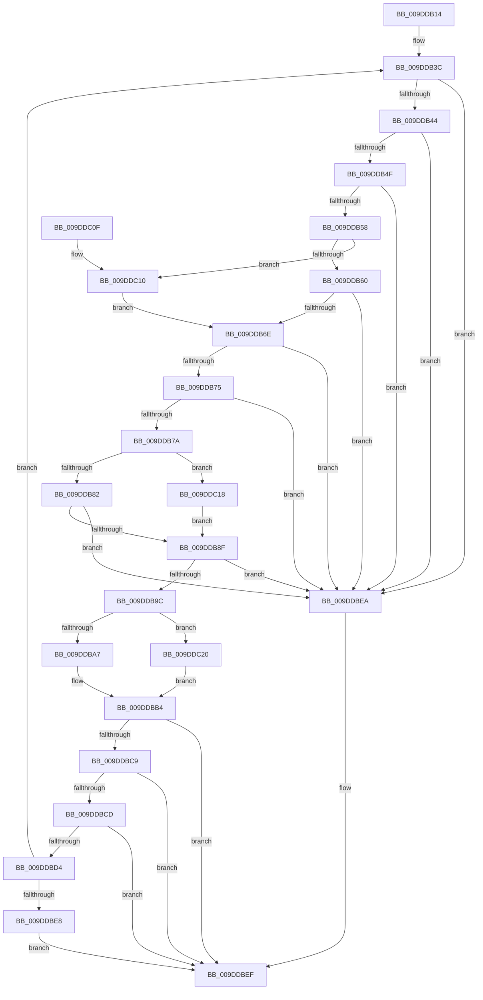

# WmipProcessWmiRegInfo

- RVA: `0x009DDB14`–`0x009DDC2A` (길이 `278` bytes)
- VA: `0x00000001409DDB14`
- 실행 섹션: `PAGE`
- PDB 이름 있음: `예`; PDB Function 태그: `아니요`
- unwind 정보 RVA: `0x000A3964`
- 디코드: `91`개 명령, `278/278` bytes 표시
- 미해석 바이트: `0` (있으면 어셈블리에 `.byte`로 보존)

> 이 문서는 커널 이미지의 기계어와 PDB 기호를 분석해 생성했습니다. 4번과 5번은 함수 원형과 자료형을 바이너리 사용 방식에서 추정한 C 해석이며 원본 소스 복구 결과는 아닙니다.

## 1. Dependencies

- 직접 호출 지점: **2**; 고유 호출 대상: **2**
- 직접 호출자로 확인된 함수: **1**
- RIP 상대 이미지 참조: **0**

### Outgoing calls
- `0x009DDBAF` → [WmipAddDataSource](WmipAddDataSource_function_009DDC30.md) (function, `0x009DDC30`)
- `0x009DDC23` → [WmipUpdateDataSource](WmipUpdateDataSource_function_009DD474.md) (function, `0x009DD474`)

### Direct callers
- [WmipRegisterOrUpdateDS](WmipRegisterOrUpdateDS_function_009DD9DC.md) at `0x009DDA8A`

### Static image references
- 디코드된 RIP-relative 메모리 참조가 없습니다.

## 2. Other-region calls and transfers

- 다른 실행 섹션으로 향하는 call: **0**
- 별도 외부 분기/꼬리 이동을 확인하지 못했습니다.

## 3. Assembly (complete function range)

```asm
009DDB14  48 89 5C 24 08                  mov qword ptr [rsp + 8], rbx
009DDB19  48 89 6C 24 10                  mov qword ptr [rsp + 0x10], rbp
009DDB1E  48 89 74 24 18                  mov qword ptr [rsp + 0x18], rsi
009DDB23  57                              push rdi
009DDB24  41 56                           push r14
009DDB26  41 57                           push r15
009DDB28  48 83 EC 30                     sub rsp, 0x30
009DDB2C  33 DB                           xor ebx, ebx
009DDB2E  45 8A F9                        mov r15b, r9b
009DDB31  8B EB                           mov ebp, ebx
009DDB33  41 8B F0                        mov esi, r8d
009DDB36  48 8B FA                        mov rdi, rdx
009DDB39  4C 8B F1                        mov r14, rcx
009DDB3C  39 37                           cmp dword ptr [rdi], esi
009DDB3E  0F 87 A6 00 00 00               ja 0x1409ddbea
009DDB44  8B 57 08                        mov edx, dword ptr [rdi + 8]
009DDB47  3B D6                           cmp edx, esi
009DDB49  0F 87 9B 00 00 00               ja 0x1409ddbea
009DDB4F  F6 C2 01                        test dl, 1
009DDB52  0F 85 92 00 00 00               jne 0x1409ddbea
009DDB58  85 D2                           test edx, edx
009DDB5A  0F 84 B0 00 00 00               je 0x1409ddc10
009DDB60  4C 8D 0C 17                     lea r9, [rdi + rdx]
009DDB64  41 0F B7 01                     movzx eax, word ptr [r9]
009DDB68  03 C2                           add eax, edx
009DDB6A  3B C6                           cmp eax, esi
009DDB6C  77 7C                           ja 0x1409ddbea
009DDB6E  8B 4F 0C                        mov ecx, dword ptr [rdi + 0xc]
009DDB71  3B CE                           cmp ecx, esi
009DDB73  77 75                           ja 0x1409ddbea
009DDB75  F6 C1 01                        test cl, 1
009DDB78  75 70                           jne 0x1409ddbea
009DDB7A  85 C9                           test ecx, ecx
009DDB7C  0F 84 96 00 00 00               je 0x1409ddc18
009DDB82  48 8D 14 0F                     lea rdx, [rdi + rcx]
009DDB86  0F B7 02                        movzx eax, word ptr [rdx]
009DDB89  03 C1                           add eax, ecx
009DDB8B  3B C6                           cmp eax, esi
009DDB8D  77 5B                           ja 0x1409ddbea
009DDB8F  8B 47 10                        mov eax, dword ptr [rdi + 0x10]
009DDB92  C1 E0 05                        shl eax, 5
009DDB95  83 C0 18                        add eax, 0x18
009DDB98  3B C6                           cmp eax, esi
009DDB9A  77 4E                           ja 0x1409ddbea
009DDB9C  44 8B C6                        mov r8d, esi
009DDB9F  49 8B CE                        mov rcx, r14
009DDBA2  45 84 FF                        test r15b, r15b
009DDBA5  75 79                           jne 0x1409ddc20
009DDBA7  48 89 54 24 20                  mov qword ptr [rsp + 0x20], rdx
009DDBAC  48 8B D7                        mov rdx, rdi
009DDBAF  E8 7C 00 00 00                  call 0x1409ddc30
009DDBB4  8B C8                           mov ecx, eax
009DDBB6  8D 45 01                        lea eax, [rbp + 1]
009DDBB9  85 C9                           test ecx, ecx
009DDBBB  0F 48 C5                        cmovs eax, ebp
009DDBBE  8B E8                           mov ebp, eax
009DDBC0  8B D0                           mov edx, eax
009DDBC2  8B 47 04                        mov eax, dword ptr [rdi + 4]
009DDBC5  85 C0                           test eax, eax
009DDBC7  74 26                           je 0x1409ddbef
009DDBC9  3B F0                           cmp esi, eax
009DDBCB  72 22                           jb 0x1409ddbef
009DDBCD  2B F0                           sub esi, eax
009DDBCF  83 FE 18                        cmp esi, 0x18
009DDBD2  72 1B                           jb 0x1409ddbef
009DDBD4  48 03 F8                        add rdi, rax
009DDBD7  48 8D 47 07                     lea rax, [rdi + 7]
009DDBDB  48 83 E0 F8                     and rax, 0xfffffffffffffff8
009DDBDF  48 3B C7                        cmp rax, rdi
009DDBE2  0F 84 54 FF FF FF               je 0x1409ddb3c
009DDBE8  EB 05                           jmp 0x1409ddbef
009DDBEA  B9 0D 00 00 C0                  mov ecx, 0xc000000d
009DDBEF  48 8B 74 24 60                  mov rsi, qword ptr [rsp + 0x60]
009DDBF4  85 ED                           test ebp, ebp
009DDBF6  48 8B 6C 24 58                  mov rbp, qword ptr [rsp + 0x58]
009DDBFB  0F 44 D9                        cmove ebx, ecx
009DDBFE  8B C3                           mov eax, ebx
009DDC00  48 8B 5C 24 50                  mov rbx, qword ptr [rsp + 0x50]
009DDC05  48 83 C4 30                     add rsp, 0x30
009DDC09  41 5F                           pop r15
009DDC0B  41 5E                           pop r14
009DDC0D  5F                              pop rdi
009DDC0E  C3                              ret
009DDC0F  CC                              int3
009DDC10  4C 8B CB                        mov r9, rbx
009DDC13  E9 56 FF FF FF                  jmp 0x1409ddb6e
009DDC18  48 8B D3                        mov rdx, rbx
009DDC1B  E9 6F FF FF FF                  jmp 0x1409ddb8f
009DDC20  48 8B D7                        mov rdx, rdi
009DDC23  E8 4C F8 FF FF                  call 0x1409dd474
009DDC28  EB 8A                           jmp 0x1409ddbb4
```

## 4. C-style interpretation (structured pseudocode)

```c
__int64 __fastcall WmipProcessWmiRegInfo(__int64 a1, __int64 a2, int a3, unsigned __int8 a4)
{
    __int64 result;
    __int64 v_rbx;
    __int64 v_rdi;
    __int64 v_rsi;
    __int64 v_rsp;
    unsigned __int64 v_stack_m28;
    unsigned __int64 v_stack_p10;
    unsigned __int64 v_stack_p18;
    unsigned __int64 v_stack_p8;

    v_stack_p8 = v_rbx;
    v_stack_p10 = v_rbp;
    v_stack_p18 = v_rsi;
    v_rsp = (v_rsp) - (48);
    v_rbx = 0;
loc_009DDB3C:
    if ((*(unsigned int *)(a2)) > ((unsigned int)((unsigned int)(a3)))) goto loc_009DDBEA;
    if (((unsigned int)((unsigned int)(*(unsigned int *)(a2 + 8)))) > ((unsigned int)((unsigned int)(a3)))) goto loc_009DDBEA;
    if ((((unsigned __int8)((unsigned int)(*(unsigned int *)(a2 + 8)))) & (1)) != 0) goto loc_009DDBEA;
    if ((unsigned int)((unsigned int)(*(unsigned int *)(a2 + 8))) == 0) goto loc_009DDC10;
    result = (unsigned int)((*(unsigned __int16 *)(a2 + (unsigned int)(*(unsigned int *)(a2 + 8)) * 1)) + ((unsigned int)((unsigned int)(*(unsigned int *)(a2 + 8)))));
    if (((unsigned int)(result)) > ((unsigned int)((unsigned int)(a3)))) goto loc_009DDBEA;
loc_009DDB6E:
    if (((unsigned int)((unsigned int)(*(unsigned int *)(a2 + 12)))) > ((unsigned int)((unsigned int)(a3)))) goto loc_009DDBEA;
    if ((((unsigned __int8)((unsigned int)(*(unsigned int *)(a2 + 12)))) & (1)) != 0) goto loc_009DDBEA;
    if ((unsigned int)((unsigned int)(*(unsigned int *)(a2 + 12))) == 0) goto loc_009DDC18;
    result = (unsigned int)((*(unsigned __int16 *)(a2 + (unsigned int)(*(unsigned int *)(a2 + 12)) * 1)) + ((unsigned int)((unsigned int)(*(unsigned int *)(a2 + 12)))));
    if (((unsigned int)(result)) > ((unsigned int)((unsigned int)(a3)))) goto loc_009DDBEA;
loc_009DDB8F:
    result = (unsigned int)(((unsigned int)(*(unsigned int *)(a2 + 16))) << (5));
    result = (unsigned int)((result) + (24));
    if (((unsigned int)(result)) > ((unsigned int)((unsigned int)(a3)))) goto loc_009DDBEA;
    if (a4 != 0) goto loc_009DDC20;
    v_stack_m28 = a2 + (unsigned int)(*(unsigned int *)(a2 + 12)) * 1;
    result = WmipAddDataSource(a1, a2, (unsigned int)((unsigned int)((unsigned int)(a3))), a2 + (unsigned int)(*(unsigned int *)(a2 + 8)) * 1);
loc_009DDBB4:
    result = 0 + 1;
    if (sign_flag) { result = 0; }
    if ((unsigned int)((unsigned int)(*(unsigned int *)(a2 + 4))) == 0) goto loc_009DDBEF;
    if (((unsigned int)((unsigned int)(a3))) < ((unsigned int)((unsigned int)(*(unsigned int *)(a2 + 4))))) goto loc_009DDBEF;
    v_rsi = (unsigned int)(((unsigned int)(a3)) - ((unsigned int)((unsigned int)(*(unsigned int *)(a2 + 4)))));
    if (((unsigned int)(v_rsi)) < 24) goto loc_009DDBEF;
    v_rdi = (a2) + ((unsigned int)(*(unsigned int *)(a2 + 4)));
    result = (v_rdi + 7) & (-8);
    if (result == v_rdi) goto loc_009DDB3C;
    goto loc_009DDBEF;
loc_009DDBEA:
loc_009DDBEF:
    if ((unsigned int)((unsigned int)((unsigned int)(result))) == 0) { v_rbx = (unsigned int)((unsigned int)(0xC000000DULL)); }
    v_rsp = (v_rsp) + (48);
    return (unsigned int)((unsigned int)(v_rbx));
loc_009DDC10:
    goto loc_009DDB6E;
loc_009DDC18:
    goto loc_009DDB8F;
loc_009DDC20:
    result = WmipUpdateDataSource((unsigned int)(0xC000000DULL), v_rdi, (unsigned int)((unsigned int)((unsigned int)(a3))), v_stack_p8);
    goto loc_009DDBB4;
}
```

## 5. (Beta) C Style

```c
int64_t WmipProcessWmiRegInfo(int64_t Arg1, void *Arg2, int32_t Arg3, uint8_t Arg4)
{
    uint8_t *arg2 = (uint8_t *)Arg2;

    int64_t result;
    int64_t local_rbx;
    int64_t local_rdi;
    int64_t local_rsi;
    int64_t local_rsp;
    uint64_t v_stack_m28;
    uint64_t v_stack_p10;
    uint64_t v_stack_p18;
    uint64_t v_stack_p8;

    v_stack_p8 = local_rbx;
    v_stack_p10 = local_rbp;
    v_stack_p18 = local_rsi;
    local_rsp = (local_rsp) - (48);
    local_rbx = 0;
loc_009DDB3C:
    if ((*(uint32_t *)(arg2)) > ((uint32_t)((uint32_t)(Arg3)))) goto loc_009DDBEA;
    if (((uint32_t)((uint32_t)(*(uint32_t *)(arg2 + 0x8)))) > ((uint32_t)((uint32_t)(Arg3)))) goto loc_009DDBEA;
    if ((((uint8_t)((uint32_t)(*(uint32_t *)(arg2 + 0x8)))) & (1)) != 0) goto loc_009DDBEA;
    if ((uint32_t)((uint32_t)(*(uint32_t *)(arg2 + 0x8))) == 0) goto loc_009DDC10;
    result = (uint32_t)((*(uint16_t *)(arg2 + (uint32_t)(*(uint32_t *)(arg2 + 0x8)) * 1)) + ((uint32_t)((uint32_t)(*(uint32_t *)(arg2 + 0x8)))));
    if (((uint32_t)(result)) > ((uint32_t)((uint32_t)(Arg3)))) goto loc_009DDBEA;
loc_009DDB6E:
    if (((uint32_t)((uint32_t)(*(uint32_t *)(arg2 + 0xC)))) > ((uint32_t)((uint32_t)(Arg3)))) goto loc_009DDBEA;
    if ((((uint8_t)((uint32_t)(*(uint32_t *)(arg2 + 0xC)))) & (1)) != 0) goto loc_009DDBEA;
    if ((uint32_t)((uint32_t)(*(uint32_t *)(arg2 + 0xC))) == 0) goto loc_009DDC18;
    result = (uint32_t)((*(uint16_t *)(arg2 + (uint32_t)(*(uint32_t *)(arg2 + 0xC)) * 1)) + ((uint32_t)((uint32_t)(*(uint32_t *)(arg2 + 0xC)))));
    if (((uint32_t)(result)) > ((uint32_t)((uint32_t)(Arg3)))) goto loc_009DDBEA;
loc_009DDB8F:
    result = (uint32_t)(((uint32_t)(*(uint32_t *)(arg2 + 0x10))) << (5));
    result = (uint32_t)((result) + (24));
    if (((uint32_t)(result)) > ((uint32_t)((uint32_t)(Arg3)))) goto loc_009DDBEA;
    if (Arg4 != 0) goto loc_009DDC20;
    v_stack_m28 = Arg2 + (uint32_t)(*(uint32_t *)(arg2 + 0xC)) * 1;
    result = WmipAddDataSource(Arg1, Arg2, (uint32_t)((uint32_t)((uint32_t)(Arg3))), Arg2 + (uint32_t)(*(uint32_t *)(arg2 + 0x8)) * 1);
loc_009DDBB4:
    result = 0 + 1;
    if (sign_flag) { result = 0; }
    if ((uint32_t)((uint32_t)(*(uint32_t *)(arg2 + 0x4))) == 0) goto loc_009DDBEF;
    if (((uint32_t)((uint32_t)(Arg3))) < ((uint32_t)((uint32_t)(*(uint32_t *)(arg2 + 0x4))))) goto loc_009DDBEF;
    local_rsi = (uint32_t)(((uint32_t)(Arg3)) - ((uint32_t)((uint32_t)(*(uint32_t *)(arg2 + 0x4)))));
    if (((uint32_t)(local_rsi)) < 24) goto loc_009DDBEF;
    local_rdi = (Arg2) + ((uint32_t)(*(uint32_t *)(arg2 + 0x4)));
    result = (local_rdi + 7) & (-8);
    if (result == local_rdi) goto loc_009DDB3C;
    goto loc_009DDBEF;
loc_009DDBEA:
loc_009DDBEF:
    if ((uint32_t)((uint32_t)((uint32_t)(result))) == 0) { local_rbx = (uint32_t)((uint32_t)(0xC000000DULL)); }
    local_rsp = (local_rsp) + (48);
    return (uint32_t)((uint32_t)(local_rbx));
loc_009DDC10:
    goto loc_009DDB6E;
loc_009DDC18:
    goto loc_009DDB8F;
loc_009DDC20:
    result = WmipUpdateDataSource((uint32_t)(0xC000000DULL), local_rdi, (uint32_t)((uint32_t)((uint32_t)(Arg3))), v_stack_p8);
    goto loc_009DDBB4;
}
```

### 관측된 메모리 오프셋

구조체 형식이 확인되지 않은 접근은 인자 기준의 오프셋으로만 기록했습니다.

| 기준 인자 | 오프셋 표현 | 폭 (bit) | 접근 |
|---|---:|---:|---|
| `Arg2` | `+ 0x0` | `16` | `R` |
| `Arg2` | `+ 0x0` | `32` | `R` |
| `Arg2` | `+ 0x0 + rcx*1` | `64` | `R` |
| `Arg2` | `+ 0x0 + rdx*1` | `64` | `R` |
| `Arg2` | `+ 0x4` | `32` | `R` |
| `Arg2` | `+ 0x7` | `64` | `R` |
| `Arg2` | `+ 0x8` | `32` | `R` |
| `Arg2` | `+ 0xC` | `32` | `R` |
| `Arg2` | `+ 0x10` | `32` | `R` |

## 6. Execution-region graph

[열기: 2D/3D 그래프와 함수 탐색 컨트롤 패널](../../../control-panel.html?section=page&rva=0x009DDB14&view=graph)

- 2D 그래프는 위에서 아래로 흐르고, 3D 그래프는 빈 공간을 드래그해 회전합니다. Shift+드래그는 이동, 휠은 확대·축소, 함수 노드 선택은 대상 보고서 이동입니다.

### Static fallback


