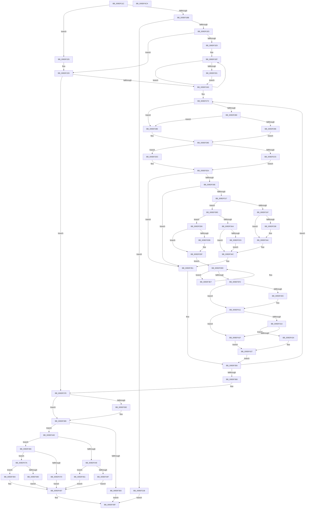

# WmipQueryAllDataMultiple

- RVA: `0x009DF11C`–`0x009DF4CB` (길이 `943` bytes)
- VA: `0x00000001409DF11C`
- 실행 섹션: `PAGE`
- PDB 이름 있음: `예`; PDB Function 태그: `아니요`
- unwind 정보 RVA: `0x000A3ACC`
- 디코드: `247`개 명령, `943/943` bytes 표시
- 미해석 바이트: `0` (있으면 어셈블리에 `.byte`로 보존)

> 이 문서는 커널 이미지의 기계어와 PDB 기호를 분석해 생성했습니다. 4번과 5번은 함수 원형과 자료형을 바이너리 사용 방식에서 추정한 C 해석이며 원본 소스 복구 결과는 아닙니다.

## 1. Dependencies

- 직접 호출 지점: **12**; 고유 호출 대상: **7**
- 직접 호출자로 확인된 함수: **2**
- RIP 상대 이미지 참조: **1**

### Outgoing calls
- `0x009DF19B` → [memset](../../text/6C/memset_function_006C6C40.md) (function, `0x006C6C40`)
- `0x009DF1A9` → [Feature_2327208251__private_IsEnabledDeviceUsageNoInline](../../text/64/Feature_2327208251__private_IsEnabledDeviceUsageNoInline_function_0064E4B4.md) (function, `0x0064E4B4`)
- `0x009DF1D3` → [ExAllocatePool2](../../poolcode/B8/ExAllocatePool2_function_00B820F0.md) (function, `0x00B820F0`)
- `0x009DF2A7` → [memset](../../text/6C/memset_function_006C6C40.md) (function, `0x006C6C40`)
- `0x009DF305` → [WmipQueryAllData](../9E/WmipQueryAllData_function_009E086C.md) (function, `0x009E086C`)
- `0x009DF32F` → [Feature_2327208251__private_IsEnabledDeviceUsageNoInline](../../text/64/Feature_2327208251__private_IsEnabledDeviceUsageNoInline_function_0064E4B4.md) (function, `0x0064E4B4`)
- `0x009DF384` → [ExFreePoolWithTag](../../poolcode/B8/ExFreePoolWithTag_function_00B82870.md) (function, `0x00B82870`)
- `0x009DF3BD` → [Feature_2327208251__private_IsEnabledDeviceUsageNoInline](../../text/64/Feature_2327208251__private_IsEnabledDeviceUsageNoInline_function_0064E4B4.md) (function, `0x0064E4B4`)
- `0x009DF403` → [Feature_2327208251__private_IsEnabledDeviceUsageNoInline](../../text/64/Feature_2327208251__private_IsEnabledDeviceUsageNoInline_function_0064E4B4.md) (function, `0x0064E4B4`)
- `0x009DF411` → [Feature_1045423416__private_IsEnabledDeviceUsageNoInline](../../text/4F/Feature_1045423416__private_IsEnabledDeviceUsageNoInline_function_004F5B08.md) (function, `0x004F5B08`)
- `0x009DF440` → [Feature_2327208251__private_IsEnabledDeviceUsageNoInline](../../text/64/Feature_2327208251__private_IsEnabledDeviceUsageNoInline_function_0064E4B4.md) (function, `0x0064E4B4`)
- `0x009DF4AA` → [_security_check_cookie](../../text/6A/_security_check_cookie_function_006AC640.md) (function, `0x006AC640`)

### Direct callers
- [IoWMIQueryAllDataMultiple](../7B/IoWMIQueryAllDataMultiple_function_007B20D0.md) at `0x007B215B`
- [WmipIoControl](WmipIoControl_function_009DEBD0.md) at `0x009DECCC`

### Static image references
- `0x009DF133` → RVA `0x00E0A740` (`.data`; read)

## 2. Other-region calls and transfers

- 다른 실행 섹션으로 향하는 call: **11**
  - `0x009DF19B` → [memset](../../text/6C/memset_function_006C6C40.md) (`PAGE` → `.text`)
  - `0x009DF1A9` → [Feature_2327208251__private_IsEnabledDeviceUsageNoInline](../../text/64/Feature_2327208251__private_IsEnabledDeviceUsageNoInline_function_0064E4B4.md) (`PAGE` → `.text`)
  - `0x009DF1D3` → [ExAllocatePool2](../../poolcode/B8/ExAllocatePool2_function_00B820F0.md) (`PAGE` → `POOLCODE`)
  - `0x009DF2A7` → [memset](../../text/6C/memset_function_006C6C40.md) (`PAGE` → `.text`)
  - `0x009DF32F` → [Feature_2327208251__private_IsEnabledDeviceUsageNoInline](../../text/64/Feature_2327208251__private_IsEnabledDeviceUsageNoInline_function_0064E4B4.md) (`PAGE` → `.text`)
  - `0x009DF384` → [ExFreePoolWithTag](../../poolcode/B8/ExFreePoolWithTag_function_00B82870.md) (`PAGE` → `POOLCODE`)
  - `0x009DF3BD` → [Feature_2327208251__private_IsEnabledDeviceUsageNoInline](../../text/64/Feature_2327208251__private_IsEnabledDeviceUsageNoInline_function_0064E4B4.md) (`PAGE` → `.text`)
  - `0x009DF403` → [Feature_2327208251__private_IsEnabledDeviceUsageNoInline](../../text/64/Feature_2327208251__private_IsEnabledDeviceUsageNoInline_function_0064E4B4.md) (`PAGE` → `.text`)
  - `0x009DF411` → [Feature_1045423416__private_IsEnabledDeviceUsageNoInline](../../text/4F/Feature_1045423416__private_IsEnabledDeviceUsageNoInline_function_004F5B08.md) (`PAGE` → `.text`)
  - `0x009DF440` → [Feature_2327208251__private_IsEnabledDeviceUsageNoInline](../../text/64/Feature_2327208251__private_IsEnabledDeviceUsageNoInline_function_0064E4B4.md) (`PAGE` → `.text`)
  - `0x009DF4AA` → [_security_check_cookie](../../text/6A/_security_check_cookie_function_006AC640.md) (`PAGE` → `.text`)
- 별도 외부 분기/꼬리 이동을 확인하지 못했습니다.

## 3. Assembly (complete function range)

```asm
009DF11C  48 89 5C 24 08                  mov qword ptr [rsp + 8], rbx
009DF121  55                              push rbp
009DF122  56                              push rsi
009DF123  57                              push rdi
009DF124  41 54                           push r12
009DF126  41 55                           push r13
009DF128  41 56                           push r14
009DF12A  41 57                           push r15
009DF12C  48 81 EC 00 01 00 00            sub rsp, 0x100
009DF133  48 8B 05 06 B6 42 00            mov rax, qword ptr [rip + 0x42b606]
009DF13A  48 33 C4                        xor rax, rsp
009DF13D  48 89 84 24 F0 00 00 00         mov qword ptr [rsp + 0xf0], rax
009DF145  48 8B BC 24 60 01 00 00         mov rdi, qword ptr [rsp + 0x160]
009DF14D  33 DB                           xor ebx, ebx
009DF14F  4C 8B A4 24 78 01 00 00         mov r12, qword ptr [rsp + 0x178]
009DF157  4C 8B F2                        mov r14, rdx
009DF15A  48 8B B4 24 70 01 00 00         mov rsi, qword ptr [rsp + 0x170]
009DF162  8B E9                           mov ebp, ecx
009DF164  4C 89 84 24 88 00 00 00         mov qword ptr [rsp + 0x88], r8
009DF16C  48 8D 8C 24 A4 00 00 00         lea rcx, [rsp + 0xa4]
009DF174  48 89 54 24 60                  mov qword ptr [rsp + 0x60], rdx
009DF179  44 8D 43 44                     lea r8d, [rbx + 0x44]
009DF17D  33 D2                           xor edx, edx
009DF17F  44 88 4C 24 31                  mov byte ptr [rsp + 0x31], r9b
009DF184  48 89 BC 24 90 00 00 00         mov qword ptr [rsp + 0x90], rdi
009DF18C  4C 89 A4 24 98 00 00 00         mov qword ptr [rsp + 0x98], r12
009DF194  89 9C 24 A0 00 00 00            mov dword ptr [rsp + 0xa0], ebx
009DF19B  E8 A0 7A CE FF                  call 0x1406c6c40
009DF1A0  89 5C 24 34                     mov dword ptr [rsp + 0x34], ebx
009DF1A4  48 89 5C 24 68                  mov qword ptr [rsp + 0x68], rbx
009DF1A9  E8 06 F3 C6 FF                  call 0x14064e4b4
009DF1AE  89 5C 24 48                     mov dword ptr [rsp + 0x48], ebx
009DF1B2  89 5C 24 38                     mov dword ptr [rsp + 0x38], ebx
009DF1B6  4D 85 F6                        test r14, r14
009DF1B9  75 6A                           jne 0x1409df225
009DF1BB  8B 2E                           mov ebp, dword ptr [rsi]
009DF1BD  B9 00 01 00 00                  mov ecx, 0x100
009DF1C2  41 B8 57 6D 69 70               mov r8d, 0x70696d57
009DF1C8  44 8B F5                        mov r14d, ebp
009DF1CB  48 8D 14 ED 00 00 00 00         lea rdx, [rbp*8]
009DF1D3  E8 18 2F 1A 00                  call 0x140b820f0
009DF1D8  48 89 44 24 78                  mov qword ptr [rsp + 0x78], rax
009DF1DD  48 8B D0                        mov rdx, rax
009DF1E0  48 85 C0                        test rax, rax
009DF1E3  74 36                           je 0x1409df21b
009DF1E5  85 ED                           test ebp, ebp
009DF1E7  74 44                           je 0x1409df22d
009DF1E9  48 8B C8                        mov rcx, rax
009DF1EC  48 2B F0                        sub rsi, rax
009DF1EF  48 8B 44 0E 08                  mov rax, qword ptr [rsi + rcx + 8]
009DF1F4  48 89 01                        mov qword ptr [rcx], rax
009DF1F7  48 8D 49 08                     lea rcx, [rcx + 8]
009DF1FB  49 83 EE 01                     sub r14, 1
009DF1FF  75 EE                           jne 0x1409df1ef
009DF201  48 8B CF                        mov rcx, rdi
009DF204  88 5C 24 30                     mov byte ptr [rsp + 0x30], bl
009DF208  48 89 4C 24 40                  mov qword ptr [rsp + 0x40], rcx
009DF20D  44 8B FB                        mov r15d, ebx
009DF210  4C 8B F3                        mov r14, rbx
009DF213  4C 8B EB                        mov r13, rbx
009DF216  48 8B F7                        mov rsi, rdi
009DF219  EB 32                           jmp 0x1409df24d
009DF21B  B8 9A 00 00 C0                  mov eax, 0xc000009a
009DF220  E9 7A 02 00 00                  jmp 0x1409df49f
009DF225  48 8B D3                        mov rdx, rbx
009DF228  48 89 5C 24 78                  mov qword ptr [rsp + 0x78], rbx
009DF22D  88 5C 24 30                     mov byte ptr [rsp + 0x30], bl
009DF231  48 8B CF                        mov rcx, rdi
009DF234  48 89 4C 24 40                  mov qword ptr [rsp + 0x40], rcx
009DF239  44 8B FB                        mov r15d, ebx
009DF23C  4C 8B F3                        mov r14, rbx
009DF23F  4C 8B EB                        mov r13, rbx
009DF242  48 8B F7                        mov rsi, rdi
009DF245  85 ED                           test ebp, ebp
009DF247  0F 84 2B 01 00 00               je 0x1409df378
009DF24D  4C 8B 44 24 60                  mov r8, qword ptr [rsp + 0x60]
009DF252  8B FB                           mov edi, ebx
009DF254  44 8B A4 24 68 01 00 00         mov r12d, dword ptr [rsp + 0x168]
009DF25C  49 2B D0                        sub rdx, r8
009DF25F  8B C5                           mov eax, ebp
009DF261  48 89 94 24 80 00 00 00         mov qword ptr [rsp + 0x80], rdx
009DF269  4C 89 44 24 50                  mov qword ptr [rsp + 0x50], r8
009DF26E  48 89 44 24 70                  mov qword ptr [rsp + 0x70], rax
009DF273  48 8D 84 24 A0 00 00 00         lea rax, [rsp + 0xa0]
009DF27B  48 3B F0                        cmp rsi, rax
009DF27E  74 0E                           je 0x1409df28e
009DF280  41 83 FC 48                     cmp r12d, 0x48
009DF284  72 08                           jb 0x1409df28e
009DF286  48 8B F1                        mov rsi, rcx
009DF289  41 8B EC                        mov ebp, r12d
009DF28C  EB 10                           jmp 0x1409df29e
009DF28E  48 8D B4 24 A0 00 00 00         lea rsi, [rsp + 0xa0]
009DF296  BD 48 00 00 00                  mov ebp, 0x48
009DF29B  4C 8B EB                        mov r13, rbx
009DF29E  33 D2                           xor edx, edx
009DF2A0  48 8B CE                        mov rcx, rsi
009DF2A3  44 8D 42 48                     lea r8d, [rdx + 0x48]
009DF2A7  E8 94 79 CE FF                  call 0x1406c6c40
009DF2AC  48 8B 44 24 50                  mov rax, qword ptr [rsp + 0x50]
009DF2B1  C7 46 2C 01 00 00 00            mov dword ptr [rsi + 0x2c], 1
009DF2B8  C7 06 30 00 00 00               mov dword ptr [rsi], 0x30
009DF2BE  48 39 5C 24 60                  cmp qword ptr [rsp + 0x60], rbx
009DF2C3  75 17                           jne 0x1409df2dc
009DF2C5  48 8B 8C 24 80 00 00 00         mov rcx, qword ptr [rsp + 0x80]
009DF2CD  48 8B 04 01                     mov rax, qword ptr [rcx + rax]
009DF2D1  48 89 46 10                     mov qword ptr [rsi + 0x10], rax
009DF2D5  48 8B 44 24 68                  mov rax, qword ptr [rsp + 0x68]
009DF2DA  EB 08                           jmp 0x1409df2e4
009DF2DC  48 8B 00                        mov rax, qword ptr [rax]
009DF2DF  48 89 44 24 68                  mov qword ptr [rsp + 0x68], rax
009DF2E4  44 8A 44 24 31                  mov r8b, byte ptr [rsp + 0x31]
009DF2E9  48 8D 4C 24 34                  lea rcx, [rsp + 0x34]
009DF2EE  48 8B 94 24 88 00 00 00         mov rdx, qword ptr [rsp + 0x88]
009DF2F6  4C 8B CE                        mov r9, rsi
009DF2F9  48 89 4C 24 28                  mov qword ptr [rsp + 0x28], rcx
009DF2FE  48 8B C8                        mov rcx, rax
009DF301  89 6C 24 20                     mov dword ptr [rsp + 0x20], ebp
009DF305  E8 62 15 00 00                  call 0x1409e086c
009DF30A  85 C0                           test eax, eax
009DF30C  78 43                           js 0x1409df351
009DF30E  8B 46 2C                        mov eax, dword ptr [rsi + 0x2c]
009DF311  0F BA E0 08                     bt eax, 8
009DF315  72 3A                           jb 0x1409df351
009DF317  FF 44 24 38                     inc dword ptr [rsp + 0x38]
009DF31B  A8 20                           test al, 0x20
009DF31D  74 7E                           je 0x1409df39d
009DF31F  8B 46 30                        mov eax, dword ptr [rsi + 0x30]
009DF322  BD F8 FF FF FF                  mov ebp, 0xfffffff8
009DF327  83 C0 07                        add eax, 7
009DF32A  23 C5                           and eax, ebp
009DF32C  44 03 F8                        add r15d, eax
009DF32F  E8 80 F1 C6 FF                  call 0x14064e4b4
009DF334  85 C0                           test eax, eax
009DF336  74 0C                           je 0x1409df344
009DF338  8B 46 30                        mov eax, dword ptr [rsi + 0x30]
009DF33B  83 C0 07                        add eax, 7
009DF33E  48 23 C5                        and rax, rbp
009DF341  4C 03 F0                        add r14, rax
009DF344  48 8D B4 24 A0 00 00 00         lea rsi, [rsp + 0xa0]
009DF34C  C6 44 24 30 01                  mov byte ptr [rsp + 0x30], 1
009DF351  48 8B 4C 24 40                  mov rcx, qword ptr [rsp + 0x40]
009DF356  48 83 44 24 50 08               add qword ptr [rsp + 0x50], 8
009DF35C  48 83 6C 24 70 01               sub qword ptr [rsp + 0x70], 1
009DF362  0F 85 0B FF FF FF               jne 0x1409df273
009DF368  48 8B BC 24 90 00 00 00         mov rdi, qword ptr [rsp + 0x90]
009DF370  4C 8B A4 24 98 00 00 00         mov r12, qword ptr [rsp + 0x98]
009DF378  48 8B 4C 24 78                  mov rcx, qword ptr [rsp + 0x78]
009DF37D  48 85 C9                        test rcx, rcx
009DF380  74 07                           je 0x1409df389
009DF382  33 D2                           xor edx, edx
009DF384  E8 E7 34 1A 00                  call 0x140b82870
009DF389  39 5C 24 38                     cmp dword ptr [rsp + 0x38], ebx
009DF38D  0F 85 AD 00 00 00               jne 0x1409df440
009DF393  B8 95 02 00 C0                  mov eax, 0xc0000295
009DF398  E9 02 01 00 00                  jmp 0x1409df49f
009DF39D  48 8D 84 24 A0 00 00 00         lea rax, [rsp + 0xa0]
009DF3A5  48 3B F0                        cmp rsi, rax
009DF3A8  75 2C                           jne 0x1409df3d6
009DF3AA  8B 6C 24 34                     mov ebp, dword ptr [rsp + 0x34]
009DF3AE  B9 F8 FF FF FF                  mov ecx, 0xfffffff8
009DF3B3  83 C5 07                        add ebp, 7
009DF3B6  8B C5                           mov eax, ebp
009DF3B8  23 C1                           and eax, ecx
009DF3BA  44 03 F8                        add r15d, eax
009DF3BD  E8 F2 F0 C6 FF                  call 0x14064e4b4
009DF3C2  85 C0                           test eax, eax
009DF3C4  74 86                           je 0x1409df34c
009DF3C6  B8 F8 FF FF FF                  mov eax, 0xfffffff8
009DF3CB  48 23 E8                        and rbp, rax
009DF3CE  4C 03 F5                        add r14, rbp
009DF3D1  E9 76 FF FF FF                  jmp 0x1409df34c
009DF3D6  4D 85 ED                        test r13, r13
009DF3D9  74 04                           je 0x1409df3df
009DF3DB  41 89 7D 0C                     mov dword ptr [r13 + 0xc], edi
009DF3DF  8B 46 0C                        mov eax, dword ptr [rsi + 0xc]
009DF3E2  4C 8B EE                        mov r13, rsi
009DF3E5  EB 07                           jmp 0x1409df3ee
009DF3E7  4C 03 E8                        add r13, rax
009DF3EA  41 8B 45 0C                     mov eax, dword ptr [r13 + 0xc]
009DF3EE  85 C0                           test eax, eax
009DF3F0  75 F5                           jne 0x1409df3e7
009DF3F2  8B 6C 24 34                     mov ebp, dword ptr [rsp + 0x34]
009DF3F6  B8 F8 FF FF FF                  mov eax, 0xfffffff8
009DF3FB  83 C5 07                        add ebp, 7
009DF3FE  23 E8                           and ebp, eax
009DF400  44 03 FD                        add r15d, ebp
009DF403  E8 AC F0 C6 FF                  call 0x14064e4b4
009DF408  85 C0                           test eax, eax
009DF40A  74 05                           je 0x1409df411
009DF40C  8B C5                           mov eax, ebp
009DF40E  4C 03 F0                        add r14, rax
009DF411  E8 F2 66 B1 FF                  call 0x1404f5b08
009DF416  85 C0                           test eax, eax
009DF418  74 05                           je 0x1409df41f
009DF41A  44 3B E5                        cmp r12d, ebp
009DF41D  76 05                           jbe 0x1409df424
009DF41F  44 2B E5                        sub r12d, ebp
009DF422  EB 03                           jmp 0x1409df427
009DF424  44 8B E3                        mov r12d, ebx
009DF427  48 8B 4C 24 40                  mov rcx, qword ptr [rsp + 0x40]
009DF42C  8B C5                           mov eax, ebp
009DF42E  48 03 C8                        add rcx, rax
009DF431  8B F9                           mov edi, ecx
009DF433  48 89 4C 24 40                  mov qword ptr [rsp + 0x40], rcx
009DF438  41 2B FD                        sub edi, r13d
009DF43B  E9 16 FF FF FF                  jmp 0x1409df356
009DF440  E8 6F F0 C6 FF                  call 0x14064e4b4
009DF445  85 C0                           test eax, eax
009DF447  75 1D                           jne 0x1409df466
009DF449  38 5C 24 30                     cmp byte ptr [rsp + 0x30], bl
009DF44D  74 12                           je 0x1409df461
009DF44F  8D 58 38                        lea ebx, [rax + 0x38]
009DF452  C7 47 2C 20 00 00 00            mov dword ptr [rdi + 0x2c], 0x20
009DF459  89 1F                           mov dword ptr [rdi], ebx
009DF45B  44 89 7F 30                     mov dword ptr [rdi + 0x30], r15d
009DF45F  EB 36                           jmp 0x1409df497
009DF461  41 8B DF                        mov ebx, r15d
009DF464  EB 31                           jmp 0x1409df497
009DF466  B8 FF FF FF FF                  mov eax, 0xffffffff
009DF46B  4C 3B F0                        cmp r14, rax
009DF46E  76 0A                           jbe 0x1409df47a
009DF470  C7 44 24 48 95 00 00 C0         mov dword ptr [rsp + 0x48], 0xc0000095
009DF478  EB 1D                           jmp 0x1409df497
009DF47A  38 5C 24 30                     cmp byte ptr [rsp + 0x30], bl
009DF47E  74 14                           je 0x1409df494
009DF480  BB 38 00 00 00                  mov ebx, 0x38
009DF485  C7 47 2C 20 00 00 00            mov dword ptr [rdi + 0x2c], 0x20
009DF48C  89 1F                           mov dword ptr [rdi], ebx
009DF48E  44 89 77 30                     mov dword ptr [rdi + 0x30], r14d
009DF492  EB 03                           jmp 0x1409df497
009DF494  41 8B DE                        mov ebx, r14d
009DF497  8B 44 24 48                     mov eax, dword ptr [rsp + 0x48]
009DF49B  41 89 1C 24                     mov dword ptr [r12], ebx
009DF49F  48 8B 8C 24 F0 00 00 00         mov rcx, qword ptr [rsp + 0xf0]
009DF4A7  48 33 CC                        xor rcx, rsp
009DF4AA  E8 91 D1 CC FF                  call 0x1406ac640
009DF4AF  48 8B 9C 24 40 01 00 00         mov rbx, qword ptr [rsp + 0x140]
009DF4B7  48 81 C4 00 01 00 00            add rsp, 0x100
009DF4BE  41 5F                           pop r15
009DF4C0  41 5E                           pop r14
009DF4C2  41 5D                           pop r13
009DF4C4  41 5C                           pop r12
009DF4C6  5F                              pop rdi
009DF4C7  5E                              pop rsi
009DF4C8  5D                              pop rbp
009DF4C9  C3                              ret
009DF4CA  CC                              int3
```

## 4. C-style interpretation (structured pseudocode)

```c
__int64 __fastcall WmipQueryAllDataMultiple(int a1, __int64 a2, __int64 a3, unsigned __int8 a4, __int64 a5, unsigned int a6, __int64 a7, __int64 a8)
{
    __int64 result;
    __int64 v_r12;
    __int64 v_r13;
    __int64 v_r14;
    __int64 v_r15;
    __int64 v_rbp;
    __int64 v_rbx;
    __int64 v_rdi;
    __int64 v_rsi;
    __int64 v_rsp;
    unsigned int v_stack_m100;
    unsigned int v_stack_m104;
    unsigned __int8 v_stack_m107;
    unsigned __int8 v_stack_m108;
    unsigned __int64 v_stack_m110;
    unsigned int v_stack_m118;
    unsigned __int64 v_stack_m48;
    unsigned __int64 v_stack_m94;
    unsigned int v_stack_m98;
    unsigned __int64 v_stack_mA0;
    unsigned __int64 v_stack_mA8;
    unsigned __int64 v_stack_mB0;
    unsigned __int64 v_stack_mB8;
    unsigned __int64 v_stack_mC0;
    unsigned __int64 v_stack_mC8;
    unsigned __int64 v_stack_mD0;
    unsigned __int64 v_stack_mD8;
    unsigned __int64 v_stack_mE8;
    unsigned int v_stack_mF0;
    unsigned __int64 v_stack_mF8;
    unsigned __int64 v_stack_p8;

    v_stack_p8 = v_rbx;
    v_rsp = (v_rsp) - (256);
    result = (*(unsigned __int64 *)(v_rip + 4371974)) ^ (v_rsp);
    v_stack_m48 = result;
    v_rbx = 0;
    v_stack_mB0 = a3;
    v_stack_mD8 = a2;
    a2 = 0;
    v_stack_m107 = a4;
    v_stack_mA8 = a5;
    v_stack_mA0 = a8;
    v_stack_m98 = 0;
    result = memset(v_stack_m94, a2, v_rbx + 68, a4);
    v_stack_m104 = 0;
    v_stack_mD0 = 0;
    result = Feature_2327208251__private_IsEnabledDeviceUsageNoInline(v_stack_m94, a2, v_rbx + 68, a4);
    v_stack_mF0 = 0;
    v_stack_m100 = 0;
    if (0 != 0) goto loc_009DF225;
    result = ExAllocatePool2(256, (unsigned int)(*(unsigned int *)(a7)) * 8, (unsigned int)(0x70696D57ULL), a4);
    v_stack_mC0 = result;
    if (result == 0) goto loc_009DF21B;
    if ((unsigned int)((unsigned int)(*(unsigned int *)(a7))) == 0) goto loc_009DF22D;
    v_rsi = (a7) - (result);
loc_009DF1EF:
    *(unsigned __int64 *)(result) = *(unsigned __int64 *)(v_rsi + result * 1 + 8);
    v_r14 = ((unsigned int)((unsigned int)((unsigned int)(*(unsigned int *)(a7))))) - (1);
    if (condition_is_not_equal) goto loc_009DF1EF;
    v_stack_m108 = 0;
    v_stack_mF8 = a5;
    goto loc_009DF24D;
loc_009DF21B:
    goto loc_009DF49F;
loc_009DF225:
    v_stack_mC0 = 0;
loc_009DF22D:
    v_stack_m108 = 0;
    v_stack_mF8 = a5;
    if ((unsigned int)((unsigned int)(*(unsigned int *)(a7))) == 0) goto loc_009DF378;
loc_009DF24D:
    a2 = (0) - (v_stack_mD8);
    v_stack_mB8 = a2;
    v_stack_mE8 = v_stack_mD8;
    v_stack_mC8 = (unsigned int)((unsigned int)((unsigned int)(*(unsigned int *)(a7))));
loc_009DF273:
    if (a5 == v_stack_m98) goto loc_009DF28E;
    if (((unsigned int)((unsigned int)(a6))) < 72) goto loc_009DF28E;
    goto loc_009DF29E;
loc_009DF28E:
loc_009DF29E:
    a2 = 0;
    result = memset(v_stack_m98, a2, a2 + 72, a4);
    *(unsigned int *)(v_stack_m98 + 44) = 1;
    *(unsigned int *)(v_stack_m98) = 48;
    if (v_stack_mD8 != 0) goto loc_009DF2DC;
    *(unsigned __int64 *)(v_stack_m98 + 16) = *(unsigned __int64 *)(v_stack_mB8 + v_stack_mE8 * 1);
    goto loc_009DF2E4;
loc_009DF2DC:
    v_stack_mD0 = *(unsigned __int64 *)(v_stack_mD0);
loc_009DF2E4:
    v_stack_m110 = v_stack_m104;
    v_stack_m118 = 72;
    result = WmipQueryAllData(*(unsigned __int64 *)(v_stack_mD0), v_stack_mB0, v_stack_m107, v_stack_m98);
    if (sign_flag) goto loc_009DF351;
    if (condition_is_below) goto loc_009DF351;
    if ((((unsigned __int8)((unsigned int)(*(unsigned int *)(v_stack_m98 + 44)))) & (32)) == 0) goto loc_009DF39D;
    result = (unsigned int)(((unsigned int)(*(unsigned int *)(v_stack_m98 + 48))) + (7));
    result = (unsigned int)((result) & ((unsigned int)((unsigned int)(0xFFFFFFF8ULL))));
    v_r15 = (unsigned int)((0) + ((unsigned int)(result)));
    result = Feature_2327208251__private_IsEnabledDeviceUsageNoInline(*(unsigned __int64 *)(v_stack_mD0), v_stack_mB0, v_stack_m107, v_stack_m98);
    v_r14 = 0;
    if ((unsigned int)(result) != 0) {
        result = *(unsigned int *)(v_stack_m98 + 48);
        result = (unsigned int)((result) + (7));
        result = (result) & ((unsigned int)(0xFFFFFFF8ULL));
        v_r14 = (0) + (result);
    }
loc_009DF34C:
    v_stack_m108 = 1;
loc_009DF351:
loc_009DF356:
    if (condition_is_not_equal) goto loc_009DF273;
loc_009DF378:
    if (v_stack_mC0 != 0) {
        a2 = 0;
        result = ExFreePoolWithTag(v_stack_mC0, a2, v_stack_m107, v_stack_m98);
    }
    if (v_stack_m100 != 0) goto loc_009DF440;
    goto loc_009DF49F;
loc_009DF39D:
    if (v_stack_m98 != v_stack_m98) goto loc_009DF3D6;
    v_rbp = (unsigned int)(((unsigned int)(v_stack_m104)) + (7));
    result = (unsigned int)(((unsigned int)((unsigned int)(v_rbp))) & ((unsigned int)((unsigned int)(0xFFFFFFF8ULL))));
    v_r15 = (unsigned int)((v_r15) + ((unsigned int)(result)));
    result = Feature_2327208251__private_IsEnabledDeviceUsageNoInline((unsigned int)(0xFFFFFFF8ULL), a2, v_stack_m107, v_stack_m98);
    if ((unsigned int)(result) == 0) goto loc_009DF34C;
    v_rbp = (v_rbp) & ((unsigned int)(0xFFFFFFF8ULL));
    v_r14 = (v_r14) + (v_rbp);
    goto loc_009DF34C;
loc_009DF3D6:
    if (0 != 0) {
        *(unsigned int *)(0 + 12) = (unsigned int)(v_stack_mA8);
    }
    goto loc_009DF3EE;
loc_009DF3E7:
    v_r13 = (v_stack_m98) + ((unsigned int)(*(unsigned int *)(v_stack_m98 + 12)));
loc_009DF3EE:
    if ((unsigned int)((unsigned int)(*(unsigned int *)(v_r13 + 12))) != 0) goto loc_009DF3E7;
    v_rbp = (unsigned int)(((unsigned int)(v_stack_m104)) + (7));
    v_rbp = (unsigned int)((v_rbp) & ((unsigned int)((unsigned int)(0xFFFFFFF8ULL))));
    v_r15 = (unsigned int)((v_r15) + ((unsigned int)(v_rbp)));
    result = Feature_2327208251__private_IsEnabledDeviceUsageNoInline((unsigned int)(0xFFFFFFF8ULL), a2, v_stack_m107, v_stack_m98);
    if ((unsigned int)(result) != 0) {
        result = (unsigned int)(v_rbp);
        v_r14 = (v_r14) + (result);
    }
    result = Feature_1045423416__private_IsEnabledDeviceUsageNoInline((unsigned int)(0xFFFFFFF8ULL), a2, v_stack_m107, v_stack_m98);
    if ((unsigned int)(result) == 0) goto loc_009DF41F;
    if (((unsigned int)(v_stack_mA0)) <= ((unsigned int)(v_rbp))) goto loc_009DF424;
loc_009DF41F:
    v_r12 = (unsigned int)((v_stack_mA0) - ((unsigned int)(v_rbp)));
    goto loc_009DF427;
loc_009DF424:
loc_009DF427:
    a1 = (v_stack_mF8) + ((unsigned int)((unsigned int)(v_rbp)));
    v_stack_mF8 = a1;
    v_rdi = (unsigned int)(((unsigned int)(a1)) - ((unsigned int)(v_r13)));
    goto loc_009DF356;
loc_009DF440:
    result = Feature_2327208251__private_IsEnabledDeviceUsageNoInline(a1, a2, v_stack_m107, v_stack_m98);
    if ((unsigned int)(result) != 0) goto loc_009DF466;
    if (v_stack_m108 == 0) goto loc_009DF461;
    *(unsigned int *)(v_rdi + 44) = 32;
    *(unsigned int *)(v_rdi) = (unsigned int)(result + 56);
    *(unsigned int *)(v_rdi + 48) = (unsigned int)(v_r15);
    goto loc_009DF497;
loc_009DF461:
    goto loc_009DF497;
loc_009DF466:
    if (v_r14 <= ((unsigned int)(0xFFFFFFFFULL))) goto loc_009DF47A;
    v_stack_mF0 = 0xC0000095ULL;
    goto loc_009DF497;
loc_009DF47A:
    if (v_stack_m108 == ((unsigned __int8)((unsigned int)((unsigned int)(v_r15))))) goto loc_009DF494;
    *(unsigned int *)(v_rdi + 44) = 32;
    *(unsigned int *)(v_rdi) = 56;
    *(unsigned int *)(v_rdi + 48) = (unsigned int)(v_r14);
    goto loc_009DF497;
loc_009DF494:
loc_009DF497:
    *(unsigned int *)(0) = (unsigned int)((unsigned int)((unsigned int)(v_r14)));
loc_009DF49F:
    a1 = (v_stack_m48) ^ (v_rsp);
    result = _security_check_cookie(a1, a2, v_stack_m107, v_stack_m98);
    v_rsp = (v_rsp) + (256);
    return result;
}
```

## 5. (Beta) C Style

```c
int64_t WmipQueryAllDataMultiple(int32_t Arg1, int64_t Arg2, int64_t Arg3, uint8_t Arg4, int64_t Arg5, uint32_t Arg6, void *Arg7, int64_t Arg8)
{
    uint8_t *arg7 = (uint8_t *)Arg7;

    int64_t result;
    int64_t local_r12;
    int64_t local_r13;
    int64_t local_r14;
    int64_t local_r15;
    int64_t local_rbp;
    int64_t local_rbx;
    int64_t local_rdi;
    int64_t local_rsi;
    int64_t local_rsp;
    uint32_t v_stack_m100;
    uint32_t v_stack_m104;
    uint8_t v_stack_m107;
    uint8_t v_stack_m108;
    uint64_t v_stack_m110;
    uint32_t v_stack_m118;
    uint64_t v_stack_m48;
    uint64_t v_stack_m94;
    uint32_t v_stack_m98;
    uint64_t v_stack_mA0;
    uint64_t v_stack_mA8;
    uint64_t v_stack_mB0;
    uint64_t v_stack_mB8;
    uint64_t v_stack_mC0;
    uint64_t v_stack_mC8;
    uint64_t v_stack_mD0;
    uint64_t v_stack_mD8;
    uint64_t v_stack_mE8;
    uint32_t v_stack_mF0;
    uint64_t v_stack_mF8;
    uint64_t v_stack_p8;

    v_stack_p8 = local_rbx;
    local_rsp = (local_rsp) - (256);
    result = (*(uint64_t *)(v_rip + 0x42B606)) ^ (local_rsp);
    v_stack_m48 = result;
    local_rbx = 0;
    v_stack_mB0 = Arg3;
    v_stack_mD8 = Arg2;
    Arg2 = 0;
    v_stack_m107 = Arg4;
    v_stack_mA8 = Arg5;
    v_stack_mA0 = Arg8;
    v_stack_m98 = 0;
    result = memset(v_stack_m94, Arg2, local_rbx + 68, Arg4);
    v_stack_m104 = 0;
    v_stack_mD0 = 0;
    result = Feature_2327208251__private_IsEnabledDeviceUsageNoInline(v_stack_m94, Arg2, local_rbx + 68, Arg4);
    v_stack_mF0 = 0;
    v_stack_m100 = 0;
    if (0 != 0) goto loc_009DF225;
    result = ExAllocatePool2(256, (uint32_t)(*(uint32_t *)(arg7)) * 8, (uint32_t)(0x70696D57ULL), Arg4);
    v_stack_mC0 = result;
    if (result == 0) goto loc_009DF21B;
    if ((uint32_t)((uint32_t)(*(uint32_t *)(arg7))) == 0) goto loc_009DF22D;
    local_rsi = (Arg7) - (result);
loc_009DF1EF:
    *(uint64_t *)(result) = *(uint64_t *)(local_rsi + result * 1 + 0x8);
    local_r14 = ((uint32_t)((uint32_t)((uint32_t)(*(uint32_t *)(arg7))))) - (1);
    if (condition_is_not_equal) goto loc_009DF1EF;
    v_stack_m108 = 0;
    v_stack_mF8 = Arg5;
    goto loc_009DF24D;
loc_009DF21B:
    goto loc_009DF49F;
loc_009DF225:
    v_stack_mC0 = 0;
loc_009DF22D:
    v_stack_m108 = 0;
    v_stack_mF8 = Arg5;
    if ((uint32_t)((uint32_t)(*(uint32_t *)(arg7))) == 0) goto loc_009DF378;
loc_009DF24D:
    Arg2 = (0) - (v_stack_mD8);
    v_stack_mB8 = Arg2;
    v_stack_mE8 = v_stack_mD8;
    v_stack_mC8 = (uint32_t)((uint32_t)((uint32_t)(*(uint32_t *)(arg7))));
loc_009DF273:
    if (Arg5 == v_stack_m98) goto loc_009DF28E;
    if (((uint32_t)((uint32_t)(Arg6))) < 72) goto loc_009DF28E;
    goto loc_009DF29E;
loc_009DF28E:
loc_009DF29E:
    Arg2 = 0;
    result = memset(v_stack_m98, Arg2, Arg2 + 72, Arg4);
    *(uint32_t *)(v_stack_m98 + 0x2C) = 1;
    *(uint32_t *)(v_stack_m98) = 48;
    if (v_stack_mD8 != 0) goto loc_009DF2DC;
    *(uint64_t *)(v_stack_m98 + 0x10) = *(uint64_t *)(v_stack_mB8 + v_stack_mE8 * 1);
    goto loc_009DF2E4;
loc_009DF2DC:
    v_stack_mD0 = *(uint64_t *)(v_stack_mD0);
loc_009DF2E4:
    v_stack_m110 = v_stack_m104;
    v_stack_m118 = 72;
    result = WmipQueryAllData(*(uint64_t *)(v_stack_mD0), v_stack_mB0, v_stack_m107, v_stack_m98);
    if (sign_flag) goto loc_009DF351;
    if (condition_is_below) goto loc_009DF351;
    if ((((uint8_t)((uint32_t)(*(uint32_t *)(v_stack_m98 + 0x2C)))) & (32)) == 0) goto loc_009DF39D;
    result = (uint32_t)(((uint32_t)(*(uint32_t *)(v_stack_m98 + 0x30))) + (7));
    result = (uint32_t)((result) & ((uint32_t)((uint32_t)(0xFFFFFFF8ULL))));
    local_r15 = (uint32_t)((0) + ((uint32_t)(result)));
    result = Feature_2327208251__private_IsEnabledDeviceUsageNoInline(*(uint64_t *)(v_stack_mD0), v_stack_mB0, v_stack_m107, v_stack_m98);
    local_r14 = 0;
    if ((uint32_t)(result) != 0) {
        result = *(uint32_t *)(v_stack_m98 + 0x30);
        result = (uint32_t)((result) + (7));
        result = (result) & ((uint32_t)(0xFFFFFFF8ULL));
        local_r14 = (0) + (result);
    }
loc_009DF34C:
    v_stack_m108 = 1;
loc_009DF351:
loc_009DF356:
    if (condition_is_not_equal) goto loc_009DF273;
loc_009DF378:
    if (v_stack_mC0 != 0) {
        Arg2 = 0;
        result = ExFreePoolWithTag(v_stack_mC0, Arg2, v_stack_m107, v_stack_m98);
    }
    if (v_stack_m100 != 0) goto loc_009DF440;
    goto loc_009DF49F;
loc_009DF39D:
    if (v_stack_m98 != v_stack_m98) goto loc_009DF3D6;
    local_rbp = (uint32_t)(((uint32_t)(v_stack_m104)) + (7));
    result = (uint32_t)(((uint32_t)((uint32_t)(local_rbp))) & ((uint32_t)((uint32_t)(0xFFFFFFF8ULL))));
    local_r15 = (uint32_t)((local_r15) + ((uint32_t)(result)));
    result = Feature_2327208251__private_IsEnabledDeviceUsageNoInline((uint32_t)(0xFFFFFFF8ULL), Arg2, v_stack_m107, v_stack_m98);
    if ((uint32_t)(result) == 0) goto loc_009DF34C;
    local_rbp = (local_rbp) & ((uint32_t)(0xFFFFFFF8ULL));
    local_r14 = (local_r14) + (local_rbp);
    goto loc_009DF34C;
loc_009DF3D6:
    if (0 != 0) {
        *(uint32_t *)(0 + 0xC) = (uint32_t)(v_stack_mA8);
    }
    goto loc_009DF3EE;
loc_009DF3E7:
    local_r13 = (v_stack_m98) + ((uint32_t)(*(uint32_t *)(v_stack_m98 + 0xC)));
loc_009DF3EE:
    if ((uint32_t)((uint32_t)(*(uint32_t *)(local_r13 + 0xC))) != 0) goto loc_009DF3E7;
    local_rbp = (uint32_t)(((uint32_t)(v_stack_m104)) + (7));
    local_rbp = (uint32_t)((local_rbp) & ((uint32_t)((uint32_t)(0xFFFFFFF8ULL))));
    local_r15 = (uint32_t)((local_r15) + ((uint32_t)(local_rbp)));
    result = Feature_2327208251__private_IsEnabledDeviceUsageNoInline((uint32_t)(0xFFFFFFF8ULL), Arg2, v_stack_m107, v_stack_m98);
    if ((uint32_t)(result) != 0) {
        result = (uint32_t)(local_rbp);
        local_r14 = (local_r14) + (result);
    }
    result = Feature_1045423416__private_IsEnabledDeviceUsageNoInline((uint32_t)(0xFFFFFFF8ULL), Arg2, v_stack_m107, v_stack_m98);
    if ((uint32_t)(result) == 0) goto loc_009DF41F;
    if (((uint32_t)(v_stack_mA0)) <= ((uint32_t)(local_rbp))) goto loc_009DF424;
loc_009DF41F:
    local_r12 = (uint32_t)((v_stack_mA0) - ((uint32_t)(local_rbp)));
    goto loc_009DF427;
loc_009DF424:
loc_009DF427:
    Arg1 = (v_stack_mF8) + ((uint32_t)((uint32_t)(local_rbp)));
    v_stack_mF8 = Arg1;
    local_rdi = (uint32_t)(((uint32_t)(Arg1)) - ((uint32_t)(local_r13)));
    goto loc_009DF356;
loc_009DF440:
    result = Feature_2327208251__private_IsEnabledDeviceUsageNoInline(Arg1, Arg2, v_stack_m107, v_stack_m98);
    if ((uint32_t)(result) != 0) goto loc_009DF466;
    if (v_stack_m108 == 0) goto loc_009DF461;
    *(uint32_t *)(local_rdi + 0x2C) = 32;
    *(uint32_t *)(local_rdi) = (uint32_t)(result + 56);
    *(uint32_t *)(local_rdi + 0x30) = (uint32_t)(local_r15);
    goto loc_009DF497;
loc_009DF461:
    goto loc_009DF497;
loc_009DF466:
    if (local_r14 <= ((uint32_t)(0xFFFFFFFFULL))) goto loc_009DF47A;
    v_stack_mF0 = 0xC0000095ULL;
    goto loc_009DF497;
loc_009DF47A:
    if (v_stack_m108 == ((uint8_t)((uint32_t)((uint32_t)(local_r15))))) goto loc_009DF494;
    *(uint32_t *)(local_rdi + 0x2C) = 32;
    *(uint32_t *)(local_rdi) = 56;
    *(uint32_t *)(local_rdi + 0x30) = (uint32_t)(local_r14);
    goto loc_009DF497;
loc_009DF494:
loc_009DF497:
    *(uint32_t *)(0) = (uint32_t)((uint32_t)((uint32_t)(local_r14)));
loc_009DF49F:
    Arg1 = (v_stack_m48) ^ (local_rsp);
    result = _security_check_cookie(Arg1, Arg2, v_stack_m107, v_stack_m98);
    local_rsp = (local_rsp) + (256);
    return result;
}
```

### 관측된 메모리 오프셋

구조체 형식이 확인되지 않은 접근은 인자 기준의 오프셋으로만 기록했습니다.

| 기준 인자 | 오프셋 표현 | 폭 (bit) | 접근 |
|---|---:|---:|---|
| `Arg7` | `+ 0x0` | `32` | `R` |
| `Arg7` | `+ 0x8 + rcx*1` | `64` | `R` |

## 6. Execution-region graph

[열기: 2D/3D 그래프와 함수 탐색 컨트롤 패널](../../../control-panel.html?section=page&rva=0x009DF11C&view=graph)

- 2D 그래프는 위에서 아래로 흐르고, 3D 그래프는 빈 공간을 드래그해 회전합니다. Shift+드래그는 이동, 휠은 확대·축소, 함수 노드 선택은 대상 보고서 이동입니다.

### Static fallback


