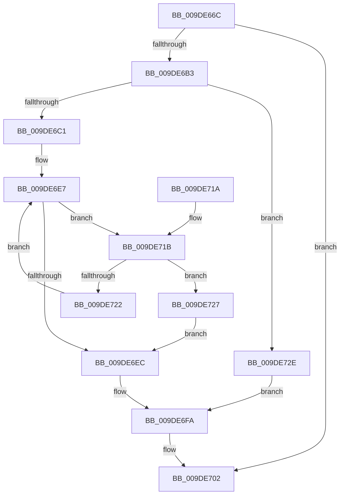

# WmipQueryGuidInfo

- RVA: `0x009DE66C`–`0x009DE735` (길이 `201` bytes)
- VA: `0x00000001409DE66C`
- 실행 섹션: `PAGE`
- PDB 이름 있음: `예`; PDB Function 태그: `아니요`
- unwind 정보 RVA: `0x000A39F8`
- 디코드: `56`개 명령, `201/201` bytes 표시
- 미해석 바이트: `0` (있으면 어셈블리에 `.byte`로 보존)

> 이 문서는 커널 이미지의 기계어와 PDB 기호를 분석해 생성했습니다. 4번과 5번은 함수 원형과 자료형을 바이너리 사용 방식에서 추정한 C 해석이며 원본 소스 복구 결과는 아닙니다.

## 1. Dependencies

- 직접 호출 지점: **4**; 고유 호출 대상: **4**
- 직접 호출자로 확인된 함수: **1**
- RIP 상대 이미지 참조: **2**

### Outgoing calls
- `0x009DE6A8` → [ObReferenceObjectByHandle](../86/ObReferenceObjectByHandle_function_00868DB0.md) (function, `0x00868DB0`)
- `0x009DE6DB` → [KeWaitForSingleObject](../../text/20/KeWaitForSingleObject_function_0020E6B0.md) (function, `0x0020E6B0`)
- `0x009DE6F5` → [KeReleaseMutex](../../text/39/KeReleaseMutex_function_00396810.md) (function, `0x00396810`)
- `0x009DE6FD` → [ObfDereferenceObject](../../text/2F/ObfDereferenceObject_function_002F9350.md) (function, `0x002F9350`)

### Direct callers
- [WmipIoControl](WmipIoControl_function_009DEBD0.md) at `0x009DEED2`

### Static image references
- `0x009DE68A` → RVA `0x00FC6D70` (`ALMOSTRO`; read)
- `0x009DE6C7` → RVA `0x00EFFA60` (`.data`; read)

## 2. Other-region calls and transfers

- 다른 실행 섹션으로 향하는 call: **3**
  - `0x009DE6DB` → [KeWaitForSingleObject](../../text/20/KeWaitForSingleObject_function_0020E6B0.md) (`PAGE` → `.text`)
  - `0x009DE6F5` → [KeReleaseMutex](../../text/39/KeReleaseMutex_function_00396810.md) (`PAGE` → `.text`)
  - `0x009DE6FD` → [ObfDereferenceObject](../../text/2F/ObfDereferenceObject_function_002F9350.md) (`PAGE` → `.text`)
- 별도 외부 분기/꼬리 이동을 확인하지 못했습니다.

## 3. Assembly (complete function range)

```asm
009DE66C  4C 8B DC                        mov r11, rsp
009DE66F  49 89 5B 10                     mov qword ptr [r11 + 0x10], rbx
009DE673  49 89 73 18                     mov qword ptr [r11 + 0x18], rsi
009DE677  49 89 7B 20                     mov qword ptr [r11 + 0x20], rdi
009DE67B  41 56                           push r14
009DE67D  48 83 EC 30                     sub rsp, 0x30
009DE681  49 83 63 F0 00                  and qword ptr [r11 - 0x10], 0
009DE686  49 8D 43 08                     lea rax, [r11 + 8]
009DE68A  4C 8B 05 DF 86 5E 00            mov r8, qword ptr [rip + 0x5e86df]
009DE691  4C 8B F1                        mov r14, rcx
009DE694  48 8B 09                        mov rcx, qword ptr [rcx]
009DE697  41 B1 01                        mov r9b, 1
009DE69A  49 83 63 08 00                  and qword ptr [r11 + 8], 0
009DE69F  BA 01 00 00 00                  mov edx, 1
009DE6A4  49 89 43 E8                     mov qword ptr [r11 - 0x18], rax
009DE6A8  E8 03 A7 E8 FF                  call 0x140868db0
009DE6AD  8B D8                           mov ebx, eax
009DE6AF  85 C0                           test eax, eax
009DE6B1  78 4F                           js 0x1409de702
009DE6B3  48 8B 7C 24 40                  mov rdi, qword ptr [rsp + 0x40]
009DE6B8  48 8B 77 38                     mov rsi, qword ptr [rdi + 0x38]
009DE6BC  48 85 F6                        test rsi, rsi
009DE6BF  74 6D                           je 0x1409de72e
009DE6C1  48 83 64 24 20 00               and qword ptr [rsp + 0x20], 0
009DE6C7  48 8D 0D 92 13 52 00            lea rcx, [rip + 0x521392]
009DE6CE  45 33 C9                        xor r9d, r9d
009DE6D1  41 C6 46 08 00                  mov byte ptr [r14 + 8], 0
009DE6D6  45 33 C0                        xor r8d, r8d
009DE6D9  33 D2                           xor edx, edx
009DE6DB  E8 D0 FF 82 FF                  call 0x14020e6b0
009DE6E0  48 83 C6 38                     add rsi, 0x38
009DE6E4  48 8B 0E                        mov rcx, qword ptr [rsi]
009DE6E7  48 3B CE                        cmp rcx, rsi
009DE6EA  75 2F                           jne 0x1409de71b
009DE6EC  33 D2                           xor edx, edx
009DE6EE  48 8D 0D 6B 13 52 00            lea rcx, [rip + 0x52136b]
009DE6F5  E8 16 81 9B FF                  call 0x140396810
009DE6FA  48 8B CF                        mov rcx, rdi
009DE6FD  E8 4E AC 91 FF                  call 0x1402f9350
009DE702  48 8B 74 24 50                  mov rsi, qword ptr [rsp + 0x50]
009DE707  8B C3                           mov eax, ebx
009DE709  48 8B 5C 24 48                  mov rbx, qword ptr [rsp + 0x48]
009DE70E  48 8B 7C 24 58                  mov rdi, qword ptr [rsp + 0x58]
009DE713  48 83 C4 30                     add rsp, 0x30
009DE717  41 5E                           pop r14
009DE719  C3                              ret
009DE71A  CC                              int3
009DE71B  8B 41 10                        mov eax, dword ptr [rcx + 0x10]
009DE71E  A8 04                           test al, 4
009DE720  75 05                           jne 0x1409de727
009DE722  48 8B 09                        mov rcx, qword ptr [rcx]
009DE725  EB C0                           jmp 0x1409de6e7
009DE727  41 C6 46 08 01                  mov byte ptr [r14 + 8], 1
009DE72C  EB BE                           jmp 0x1409de6ec
009DE72E  BB 01 03 00 C0                  mov ebx, 0xc0000301
009DE733  EB C5                           jmp 0x1409de6fa
```

## 4. C-style interpretation (structured pseudocode)

```c
__int64 __fastcall WmipQueryGuidInfo(__int64 a1)
{
    __int64 result;
    __int64 v_rsi;
    __int64 v_rsp;
    unsigned __int64 v_stack_m18;
    unsigned __int64 v_stack_p10;
    unsigned __int64 v_stack_p18;
    unsigned __int64 v_stack_p20;
    unsigned __int64 v_stack_p8;

    *(unsigned __int64 *)(v_rsp + 16) = v_rbx;
    *(unsigned __int64 *)(v_rsp + 24) = v_rsi;
    *(unsigned __int64 *)(v_rsp + 32) = v_rdi;
    v_rsp = (v_rsp) - (48);
    *(unsigned __int64 *)(v_rsp - 24) = v_rsp + 8;
    result = ObReferenceObjectByHandle(*(unsigned __int64 *)(a1), 1, *(unsigned __int64 *)(v_rip + 6194911), 1);
    if (sign_flag) goto loc_009DE702;
    if (*(unsigned __int64 *)(v_stack_p8 + 56) == 0) goto loc_009DE72E;
    a4 = 0;
    *(unsigned __int8 *)(a1 + 8) = 0;
    a3 = 0;
    a2 = 0;
    result = KeWaitForSingleObject(v_rip + 5378962, a2, a3, a4);
    v_rsi = (*(unsigned __int64 *)(v_stack_p8 + 56)) + (56);
loc_009DE6E7:
    if ((*(unsigned __int64 *)(v_rsi)) != v_rsi) goto loc_009DE71B;
loc_009DE6EC:
    a2 = 0;
    result = KeReleaseMutex(v_rip + 5378923, a2, a3, a4);
loc_009DE6FA:
    result = ObfDereferenceObject(v_stack_p8, a2, a3, a4);
loc_009DE702:
    v_rsp = (v_rsp) + (48);
    return (unsigned int)((unsigned int)((unsigned int)((unsigned int)(result))));
loc_009DE71B:
    if ((((unsigned __int8)((unsigned int)(*(unsigned int *)(v_stack_p8 + 16)))) & (4)) != 0) goto loc_009DE727;
    goto loc_009DE6E7;
loc_009DE727:
    *(unsigned __int8 *)(a1 + 8) = 1;
    goto loc_009DE6EC;
loc_009DE72E:
    goto loc_009DE6FA;
}
```

## 5. (Beta) C Style

```c
int64_t WmipQueryGuidInfo(void *Arg1)
{
    uint8_t *arg1 = (uint8_t *)Arg1;

    int64_t result;
    int64_t local_rsi;
    int64_t local_rsp;
    uint64_t v_stack_m18;
    uint64_t v_stack_p10;
    uint64_t v_stack_p18;
    uint64_t v_stack_p20;
    uint64_t v_stack_p8;

    *(uint64_t *)(local_rsp + 0x10) = local_rbx;
    *(uint64_t *)(local_rsp + 0x18) = local_rsi;
    *(uint64_t *)(local_rsp + 0x20) = local_rdi;
    local_rsp = (local_rsp) - (48);
    *(uint64_t *)(local_rsp - 0x18) = local_rsp + 8;
    result = ObReferenceObjectByHandle(*(uint64_t *)(arg1), 1, *(uint64_t *)(v_rip + 0x5E86DF), 1);
    if (sign_flag) goto loc_009DE702;
    if (*(uint64_t *)(v_stack_p8 + 0x38) == 0) goto loc_009DE72E;
    a4 = 0;
    *(uint8_t *)(arg1 + 0x8) = 0;
    a3 = 0;
    a2 = 0;
    result = KeWaitForSingleObject(v_rip + 5378962, a2, a3, a4);
    local_rsi = (*(uint64_t *)(v_stack_p8 + 0x38)) + (56);
loc_009DE6E7:
    if ((*(uint64_t *)(local_rsi)) != local_rsi) goto loc_009DE71B;
loc_009DE6EC:
    a2 = 0;
    result = KeReleaseMutex(v_rip + 5378923, a2, a3, a4);
loc_009DE6FA:
    result = ObfDereferenceObject(v_stack_p8, a2, a3, a4);
loc_009DE702:
    local_rsp = (local_rsp) + (48);
    return (uint32_t)((uint32_t)((uint32_t)((uint32_t)(result))));
loc_009DE71B:
    if ((((uint8_t)((uint32_t)(*(uint32_t *)(v_stack_p8 + 0x10)))) & (4)) != 0) goto loc_009DE727;
    goto loc_009DE6E7;
loc_009DE727:
    *(uint8_t *)(arg1 + 0x8) = 1;
    goto loc_009DE6EC;
loc_009DE72E:
    goto loc_009DE6FA;
}
```

### 관측된 메모리 오프셋

구조체 형식이 확인되지 않은 접근은 인자 기준의 오프셋으로만 기록했습니다.

| 기준 인자 | 오프셋 표현 | 폭 (bit) | 접근 |
|---|---:|---:|---|
| `Arg1` | `+ 0x0` | `64` | `R` |
| `Arg1` | `+ 0x8` | `8` | `W` |

## 6. Execution-region graph

[열기: 2D/3D 그래프와 함수 탐색 컨트롤 패널](../../../control-panel.html?section=page&rva=0x009DE66C&view=graph)

- 2D 그래프는 위에서 아래로 흐르고, 3D 그래프는 빈 공간을 드래그해 회전합니다. Shift+드래그는 이동, 휠은 확대·축소, 함수 노드 선택은 대상 보고서 이동입니다.

### Static fallback


