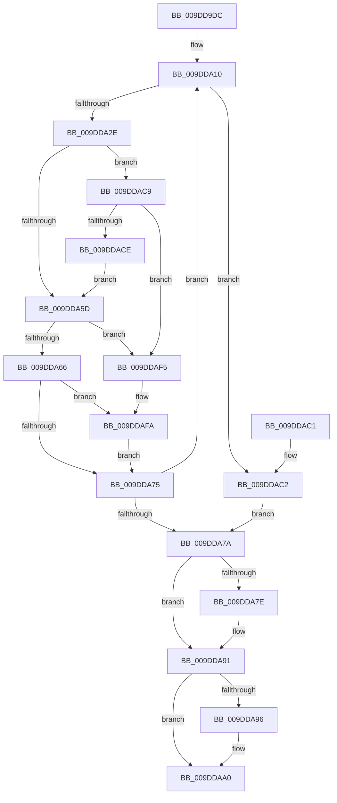

# WmipRegisterOrUpdateDS

- RVA: `0x009DD9DC`–`0x009DDB0E` (길이 `306` bytes)
- VA: `0x00000001409DD9DC`
- 실행 섹션: `PAGE`
- PDB 이름 있음: `예`; PDB Function 태그: `아니요`
- unwind 정보 RVA: `0x000A3944`
- 디코드: `88`개 명령, `306/306` bytes 표시
- 미해석 바이트: `0` (있으면 어셈블리에 `.byte`로 보존)

> 이 문서는 커널 이미지의 기계어와 PDB 기호를 분석해 생성했습니다. 4번과 5번은 함수 원형과 자료형을 바이너리 사용 방식에서 추정한 C 해석이며 원본 소스 복구 결과는 아닙니다.

## 1. Dependencies

- 직접 호출 지점: **6**; 고유 호출 대상: **4**
- 직접 호출자로 확인된 함수: **2**
- RIP 상대 이미지 참조: **0**

### Outgoing calls
- `0x009DDA1D` → [ExAllocatePool2](../../poolcode/B8/ExAllocatePool2_function_00B820F0.md) (function, `0x00B820F0`)
- `0x009DDA52` → [WmipSendWmiIrp](../9E/WmipSendWmiIrp_function_009E0484.md) (function, `0x009E0484`)
- `0x009DDA8A` → [WmipProcessWmiRegInfo](WmipProcessWmiRegInfo_function_009DDB14.md) (function, `0x009DDB14`)
- `0x009DDA9B` → [ExFreePoolWithTag](../../poolcode/B8/ExFreePoolWithTag_function_00B82870.md) (function, `0x00B82870`)
- `0x009DDAE9` → [WmipSendWmiIrp](../9E/WmipSendWmiIrp_function_009E0484.md) (function, `0x009E0484`)
- `0x009DDB01` → [ExFreePoolWithTag](../../poolcode/B8/ExFreePoolWithTag_function_00B82870.md) (function, `0x00B82870`)

### Direct callers
- [WmipRegistrationWorker](WmipRegistrationWorker_function_009DD820.md) at `0x009DD91B`
- [WmipRegisterDevice](../9E/WmipRegisterDevice_function_009E2808.md) at `0x009E2960`

### Static image references
- 디코드된 RIP-relative 메모리 참조가 없습니다.

## 2. Other-region calls and transfers

- 다른 실행 섹션으로 향하는 call: **3**
  - `0x009DDA1D` → [ExAllocatePool2](../../poolcode/B8/ExAllocatePool2_function_00B820F0.md) (`PAGE` → `POOLCODE`)
  - `0x009DDA9B` → [ExFreePoolWithTag](../../poolcode/B8/ExFreePoolWithTag_function_00B82870.md) (`PAGE` → `POOLCODE`)
  - `0x009DDB01` → [ExFreePoolWithTag](../../poolcode/B8/ExFreePoolWithTag_function_00B82870.md) (`PAGE` → `POOLCODE`)
- 별도 외부 분기/꼬리 이동을 확인하지 못했습니다.

## 3. Assembly (complete function range)

```asm
009DD9DC  48 8B C4                        mov rax, rsp
009DD9DF  48 89 58 08                     mov qword ptr [rax + 8], rbx
009DD9E3  48 89 68 10                     mov qword ptr [rax + 0x10], rbp
009DD9E7  48 89 70 18                     mov qword ptr [rax + 0x18], rsi
009DD9EB  48 89 78 20                     mov qword ptr [rax + 0x20], rdi
009DD9EF  41 54                           push r12
009DD9F1  41 56                           push r14
009DD9F3  41 57                           push r15
009DD9F5  48 83 EC 40                     sub rsp, 0x40
009DD9F9  33 F6                           xor esi, esi
009DD9FB  44 8A FA                        mov r15b, dl
009DD9FE  48 89 70 E0                     mov qword ptr [rax - 0x20], rsi
009DDA02  4C 8B F1                        mov r14, rcx
009DDA05  BD 00 20 00 00                  mov ebp, 0x2000
009DDA0A  41 BC 23 00 00 C0               mov r12d, 0xc0000023
009DDA10  8B D5                           mov edx, ebp
009DDA12  B9 40 00 00 00                  mov ecx, 0x40
009DDA17  41 B8 57 6D 69 44               mov r8d, 0x44696d57
009DDA1D  E8 CE 46 1A 00                  call 0x140b820f0
009DDA22  48 8B F8                        mov rdi, rax
009DDA25  48 85 C0                        test rax, rax
009DDA28  0F 84 94 00 00 00               je 0x1409ddac2
009DDA2E  41 8B 56 38                     mov edx, dword ptr [r14 + 0x38]
009DDA32  48 8D 44 24 30                  lea rax, [rsp + 0x30]
009DDA37  33 F6                           xor esi, esi
009DDA39  48 89 44 24 28                  mov qword ptr [rsp + 0x28], rax
009DDA3E  45 84 FF                        test r15b, r15b
009DDA41  48 89 7C 24 20                  mov qword ptr [rsp + 0x20], rdi
009DDA46  44 8B CD                        mov r9d, ebp
009DDA49  B1 0B                           mov cl, 0xb
009DDA4B  40 0F 95 C6                     setne sil
009DDA4F  4C 8B C6                        mov r8, rsi
009DDA52  E8 2D 2A 00 00                  call 0x1409e0484
009DDA57  8B D8                           mov ebx, eax
009DDA59  85 C0                           test eax, eax
009DDA5B  78 6C                           js 0x1409ddac9
009DDA5D  41 3B DC                        cmp ebx, r12d
009DDA60  0F 84 8F 00 00 00               je 0x1409ddaf5
009DDA66  48 8B 74 24 38                  mov rsi, qword ptr [rsp + 0x38]
009DDA6B  48 83 FE 04                     cmp rsi, 4
009DDA6F  0F 84 85 00 00 00               je 0x1409ddafa
009DDA75  41 3B DC                        cmp ebx, r12d
009DDA78  74 96                           je 0x1409dda10
009DDA7A  85 DB                           test ebx, ebx
009DDA7C  78 13                           js 0x1409dda91
009DDA7E  45 8A CF                        mov r9b, r15b
009DDA81  44 8B C6                        mov r8d, esi
009DDA84  48 8B D7                        mov rdx, rdi
009DDA87  49 8B CE                        mov rcx, r14
009DDA8A  E8 85 00 00 00                  call 0x1409ddb14
009DDA8F  8B D8                           mov ebx, eax
009DDA91  48 85 FF                        test rdi, rdi
009DDA94  74 0A                           je 0x1409ddaa0
009DDA96  33 D2                           xor edx, edx
009DDA98  48 8B CF                        mov rcx, rdi
009DDA9B  E8 D0 4D 1A 00                  call 0x140b82870
009DDAA0  48 8B 6C 24 68                  mov rbp, qword ptr [rsp + 0x68]
009DDAA5  8B C3                           mov eax, ebx
009DDAA7  48 8B 5C 24 60                  mov rbx, qword ptr [rsp + 0x60]
009DDAAC  48 8B 74 24 70                  mov rsi, qword ptr [rsp + 0x70]
009DDAB1  48 8B 7C 24 78                  mov rdi, qword ptr [rsp + 0x78]
009DDAB6  48 83 C4 40                     add rsp, 0x40
009DDABA  41 5F                           pop r15
009DDABC  41 5E                           pop r14
009DDABE  41 5C                           pop r12
009DDAC0  C3                              ret
009DDAC1  CC                              int3
009DDAC2  BB 9A 00 00 C0                  mov ebx, 0xc000009a
009DDAC7  EB B1                           jmp 0x1409dda7a
009DDAC9  41 3B C4                        cmp eax, r12d
009DDACC  74 27                           je 0x1409ddaf5
009DDACE  41 8B 56 38                     mov edx, dword ptr [r14 + 0x38]
009DDAD2  48 8D 44 24 30                  lea rax, [rsp + 0x30]
009DDAD7  48 89 44 24 28                  mov qword ptr [rsp + 0x28], rax
009DDADC  44 8B CD                        mov r9d, ebp
009DDADF  4C 8B C6                        mov r8, rsi
009DDAE2  48 89 7C 24 20                  mov qword ptr [rsp + 0x20], rdi
009DDAE7  B1 08                           mov cl, 8
009DDAE9  E8 96 29 00 00                  call 0x1409e0484
009DDAEE  8B D8                           mov ebx, eax
009DDAF0  E9 68 FF FF FF                  jmp 0x1409dda5d
009DDAF5  48 8B 74 24 38                  mov rsi, qword ptr [rsp + 0x38]
009DDAFA  8B 2F                           mov ebp, dword ptr [rdi]
009DDAFC  33 D2                           xor edx, edx
009DDAFE  48 8B CF                        mov rcx, rdi
009DDB01  E8 6A 4D 1A 00                  call 0x140b82870
009DDB06  41 8B DC                        mov ebx, r12d
009DDB09  E9 67 FF FF FF                  jmp 0x1409dda75
```

## 4. C-style interpretation (structured pseudocode)

```c
__int64 __fastcall WmipRegisterOrUpdateDS(__int64 a1, unsigned __int8 a2)
{
    __int64 result;
    __int64 v_rbx;
    __int64 v_rsi;
    __int64 v_rsp;
    unsigned __int64 v_stack_m20;
    unsigned __int64 v_stack_m28;
    unsigned __int64 v_stack_m30;
    unsigned __int64 v_stack_m38;
    unsigned __int64 v_stack_p10;
    unsigned __int64 v_stack_p18;
    unsigned __int64 v_stack_p20;
    unsigned __int64 v_stack_p28;
    unsigned __int64 v_stack_p30;
    unsigned __int64 v_stack_p38;
    unsigned __int64 v_stack_p8;

    *(unsigned __int64 *)(v_rsp + 8) = v_rbx;
    *(unsigned __int64 *)(v_rsp + 16) = v_rbp;
    *(unsigned __int64 *)(v_rsp + 24) = v_rsi;
    *(unsigned __int64 *)(v_rsp + 32) = v_rdi;
    v_rsp = (v_rsp) - (64);
    v_rsi = 0;
    *(unsigned __int64 *)(v_rsp - 32) = 0;
loc_009DDA10:
    result = ExAllocatePool2(64, (unsigned int)((unsigned int)((unsigned int)(0x2000ULL))), (unsigned int)(0x44696D57ULL), a4);
    if (result == 0) goto loc_009DDAC2;
    v_rsi = 0;
    v_stack_m30 = v_stack_m28;
    v_stack_m38 = result;
    v_rsi = (a2 != 0) ? 1 : 0;
    result = WmipSendWmiIrp(11, (unsigned int)(*(unsigned int *)(a1 + 56)), v_rsi, (unsigned int)((unsigned int)((unsigned int)(0x2000ULL))));
    if (sign_flag) goto loc_009DDAC9;
loc_009DDA5D:
    if (((unsigned int)((unsigned int)((unsigned int)(result)))) == ((unsigned int)((unsigned int)(0xC0000023ULL)))) goto loc_009DDAF5;
    if (v_stack_m20 == 4) goto loc_009DDAFA;
loc_009DDA75:
    if (((unsigned int)((unsigned int)((unsigned int)(result)))) == ((unsigned int)((unsigned int)(0xC0000023ULL)))) goto loc_009DDA10;
loc_009DDA7A:
    v_rbx = (unsigned int)((unsigned int)(result));
    if (!(sign_flag)) {
        a4 = a2;
        a3 = (unsigned int)(v_stack_m20);
        a2 = result;
        a1 = a1;
        result = WmipProcessWmiRegInfo(a1, a2, a3, a4);
        v_rbx = (unsigned int)(result);
    }
    if (result != 0) {
        a2 = 0;
        a1 = result;
        result = ExFreePoolWithTag(a1, a2, a3, a4);
    }
    v_rsp = (v_rsp) + (64);
    return (unsigned int)((unsigned int)(v_rbx));
loc_009DDAC2:
    goto loc_009DDA7A;
loc_009DDAC9:
    if (((unsigned int)((unsigned int)((unsigned int)(v_rbx)))) == ((unsigned int)((unsigned int)(0xC0000023ULL)))) goto loc_009DDAF5;
    v_stack_p28 = v_stack_p30;
    v_stack_p20 = v_stack_p20;
    result = WmipSendWmiIrp(8, (unsigned int)(*(unsigned int *)(a1 + 56)), v_stack_p18, (unsigned int)((unsigned int)(v_stack_p10)));
    goto loc_009DDA5D;
loc_009DDAF5:
loc_009DDAFA:
    a2 = 0;
    result = ExFreePoolWithTag(v_stack_p20, a2, v_stack_p18, (unsigned int)((unsigned int)(v_stack_p10)));
    goto loc_009DDA75;
}
```

## 5. (Beta) C Style

```c
int64_t WmipRegisterOrUpdateDS(void *Arg1, uint8_t Arg2)
{
    uint8_t *arg1 = (uint8_t *)Arg1;

    int64_t result;
    int64_t local_rbx;
    int64_t local_rsi;
    int64_t local_rsp;
    uint64_t v_stack_m20;
    uint64_t v_stack_m28;
    uint64_t v_stack_m30;
    uint64_t v_stack_m38;
    uint64_t v_stack_p10;
    uint64_t v_stack_p18;
    uint64_t v_stack_p20;
    uint64_t v_stack_p28;
    uint64_t v_stack_p30;
    uint64_t v_stack_p38;
    uint64_t v_stack_p8;

    *(uint64_t *)(local_rsp + 0x8) = local_rbx;
    *(uint64_t *)(local_rsp + 0x10) = local_rbp;
    *(uint64_t *)(local_rsp + 0x18) = local_rsi;
    *(uint64_t *)(local_rsp + 0x20) = local_rdi;
    local_rsp = (local_rsp) - (64);
    local_rsi = 0;
    *(uint64_t *)(local_rsp - 0x20) = 0;
loc_009DDA10:
    result = ExAllocatePool2(64, (uint32_t)((uint32_t)((uint32_t)(0x2000ULL))), (uint32_t)(0x44696D57ULL), a4);
    if (result == 0) goto loc_009DDAC2;
    local_rsi = 0;
    v_stack_m30 = v_stack_m28;
    v_stack_m38 = result;
    local_rsi = (Arg2 != 0) ? 1 : 0;
    result = WmipSendWmiIrp(11, (uint32_t)(*(uint32_t *)(arg1 + 0x38)), local_rsi, (uint32_t)((uint32_t)((uint32_t)(0x2000ULL))));
    if (sign_flag) goto loc_009DDAC9;
loc_009DDA5D:
    if (((uint32_t)((uint32_t)((uint32_t)(result)))) == ((uint32_t)((uint32_t)(0xC0000023ULL)))) goto loc_009DDAF5;
    if (v_stack_m20 == 4) goto loc_009DDAFA;
loc_009DDA75:
    if (((uint32_t)((uint32_t)((uint32_t)(result)))) == ((uint32_t)((uint32_t)(0xC0000023ULL)))) goto loc_009DDA10;
loc_009DDA7A:
    local_rbx = (uint32_t)((uint32_t)(result));
    if (!(sign_flag)) {
        a4 = Arg2;
        a3 = (uint32_t)(v_stack_m20);
        Arg2 = result;
        Arg1 = Arg1;
        result = WmipProcessWmiRegInfo(Arg1, Arg2, a3, a4);
        local_rbx = (uint32_t)(result);
    }
    if (result != 0) {
        Arg2 = 0;
        Arg1 = result;
        result = ExFreePoolWithTag(Arg1, Arg2, a3, a4);
    }
    local_rsp = (local_rsp) + (64);
    return (uint32_t)((uint32_t)(local_rbx));
loc_009DDAC2:
    goto loc_009DDA7A;
loc_009DDAC9:
    if (((uint32_t)((uint32_t)((uint32_t)(local_rbx)))) == ((uint32_t)((uint32_t)(0xC0000023ULL)))) goto loc_009DDAF5;
    v_stack_p28 = v_stack_p30;
    v_stack_p20 = v_stack_p20;
    result = WmipSendWmiIrp(8, (uint32_t)(*(uint32_t *)(arg1 + 0x38)), v_stack_p18, (uint32_t)((uint32_t)(v_stack_p10)));
    goto loc_009DDA5D;
loc_009DDAF5:
loc_009DDAFA:
    Arg2 = 0;
    result = ExFreePoolWithTag(v_stack_p20, Arg2, v_stack_p18, (uint32_t)((uint32_t)(v_stack_p10)));
    goto loc_009DDA75;
}
```

### 관측된 메모리 오프셋

구조체 형식이 확인되지 않은 접근은 인자 기준의 오프셋으로만 기록했습니다.

| 기준 인자 | 오프셋 표현 | 폭 (bit) | 접근 |
|---|---:|---:|---|
| `Arg1` | `+ 0x38` | `32` | `R` |

## 6. Execution-region graph

[열기: 2D/3D 그래프와 함수 탐색 컨트롤 패널](../../../control-panel.html?section=page&rva=0x009DD9DC&view=graph)

- 2D 그래프는 위에서 아래로 흐르고, 3D 그래프는 빈 공간을 드래그해 회전합니다. Shift+드래그는 이동, 휠은 확대·축소, 함수 노드 선택은 대상 보고서 이동입니다.

### Static fallback


