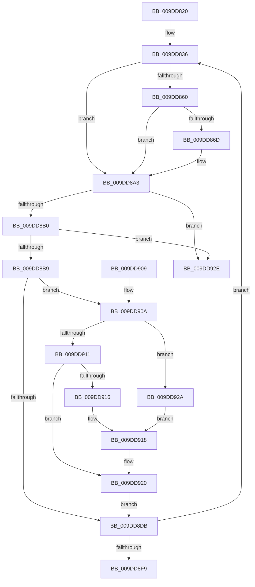

# WmipRegistrationWorker

- RVA: `0x009DD820`–`0x009DD935` (길이 `277` bytes)
- VA: `0x00000001409DD820`
- 실행 섹션: `PAGE`
- PDB 이름 있음: `예`; PDB Function 태그: `아니요`
- unwind 정보 RVA: `0x000A3920`
- 디코드: `73`개 명령, `277/277` bytes 표시
- 미해석 바이트: `0` (있으면 어셈블리에 `.byte`로 보존)

> 이 문서는 커널 이미지의 기계어와 PDB 기호를 분석해 생성했습니다. 4번과 5번은 함수 원형과 자료형을 바이너리 사용 방식에서 추정한 C 해석이며 원본 소스 복구 결과는 아닙니다.

## 1. Dependencies

- 직접 호출 지점: **9**; 고유 호출 대상: **6**
- 직접 호출자로 확인된 함수: **0**
- RIP 상대 이미지 참조: **5**

### Outgoing calls
- `0x009DD84B` → [KeWaitForSingleObject](../../text/20/KeWaitForSingleObject_function_0020E6B0.md) (function, `0x0020E6B0`)
- `0x009DD876` → [KeReleaseMutex](../../text/39/KeReleaseMutex_function_00396810.md) (function, `0x00396810`)
- `0x009DD87D` → [IoControlPnpDeviceActionQueue](../../text/4A/IoControlPnpDeviceActionQueue_function_004A42D4.md) (function, `0x004A42D4`)
- `0x009DD884` → [IoControlPnpDeviceActionQueue](../../text/4A/IoControlPnpDeviceActionQueue_function_004A42D4.md) (function, `0x004A42D4`)
- `0x009DD89E` → [KeWaitForSingleObject](../../text/20/KeWaitForSingleObject_function_0020E6B0.md) (function, `0x0020E6B0`)
- `0x009DD8CD` → [KeReleaseMutex](../../text/39/KeReleaseMutex_function_00396810.md) (function, `0x00396810`)
- `0x009DD8E0` → [ExFreePoolWithTag](../../poolcode/B8/ExFreePoolWithTag_function_00B82870.md) (function, `0x00B82870`)
- `0x009DD91B` → [WmipRegisterOrUpdateDS](WmipRegisterOrUpdateDS_function_009DD9DC.md) (function, `0x009DD9DC`)
- `0x009DD923` → [WmipUnreferenceRegEntry](../../text/47/WmipUnreferenceRegEntry_function_0047B6F0.md) (function, `0x0047B6F0`)

### Direct callers
- 이 함수 시작 RVA로 연결되는 직접 call은 확인되지 않았습니다. 간접 호출은 완전히 역산할 수 없습니다.

### Static image references
- `0x009DD82F` → RVA `0x00E09138` (`.data`; read)
- `0x009DD83C` → RVA `0x00EFFA60` (`.data`; read)
- `0x009DD860` → RVA `0x00EFFA98` (`.data`; read)
- `0x009DD8B9` → RVA `0x00E09138` (`.data`; write)
- `0x009DD8E8` → RVA `0x00E0EB0C` (`.data`; read/write)

## 2. Other-region calls and transfers

- 다른 실행 섹션으로 향하는 call: **8**
  - `0x009DD84B` → [KeWaitForSingleObject](../../text/20/KeWaitForSingleObject_function_0020E6B0.md) (`PAGE` → `.text`)
  - `0x009DD876` → [KeReleaseMutex](../../text/39/KeReleaseMutex_function_00396810.md) (`PAGE` → `.text`)
  - `0x009DD87D` → [IoControlPnpDeviceActionQueue](../../text/4A/IoControlPnpDeviceActionQueue_function_004A42D4.md) (`PAGE` → `.text`)
  - `0x009DD884` → [IoControlPnpDeviceActionQueue](../../text/4A/IoControlPnpDeviceActionQueue_function_004A42D4.md) (`PAGE` → `.text`)
  - `0x009DD89E` → [KeWaitForSingleObject](../../text/20/KeWaitForSingleObject_function_0020E6B0.md) (`PAGE` → `.text`)
  - `0x009DD8CD` → [KeReleaseMutex](../../text/39/KeReleaseMutex_function_00396810.md) (`PAGE` → `.text`)
  - `0x009DD8E0` → [ExFreePoolWithTag](../../poolcode/B8/ExFreePoolWithTag_function_00B82870.md) (`PAGE` → `POOLCODE`)
  - `0x009DD923` → [WmipUnreferenceRegEntry](../../text/47/WmipUnreferenceRegEntry_function_0047B6F0.md) (`PAGE` → `.text`)
- 별도 외부 분기/꼬리 이동을 확인하지 못했습니다.

## 3. Assembly (complete function range)

```asm
009DD820  48 89 5C 24 08                  mov qword ptr [rsp + 8], rbx
009DD825  48 89 6C 24 10                  mov qword ptr [rsp + 0x10], rbp
009DD82A  57                              push rdi
009DD82B  48 83 EC 30                     sub rsp, 0x30
009DD82F  48 8D 2D 02 B9 42 00            lea rbp, [rip + 0x42b902]
009DD836  48 83 64 24 20 00               and qword ptr [rsp + 0x20], 0
009DD83C  48 8D 0D 1D 22 52 00            lea rcx, [rip + 0x52221d]
009DD843  45 33 C9                        xor r9d, r9d
009DD846  45 33 C0                        xor r8d, r8d
009DD849  33 D2                           xor edx, edx
009DD84B  E8 60 0E 83 FF                  call 0x14020e6b0
009DD850  48 8B 1D E1 B8 42 00            mov rbx, qword ptr [rip + 0x42b8e1]
009DD857  48 8B 4B 18                     mov rcx, qword ptr [rbx + 0x18]
009DD85B  48 85 C9                        test rcx, rcx
009DD85E  74 43                           je 0x1409dd8a3
009DD860  48 8B 05 31 22 52 00            mov rax, qword ptr [rip + 0x522231]
009DD867  48 39 41 10                     cmp qword ptr [rcx + 0x10], rax
009DD86B  74 36                           je 0x1409dd8a3
009DD86D  33 D2                           xor edx, edx
009DD86F  48 8D 0D EA 21 52 00            lea rcx, [rip + 0x5221ea]
009DD876  E8 95 8F 9B FF                  call 0x140396810
009DD87B  B1 01                           mov cl, 1
009DD87D  E8 52 6A AC FF                  call 0x1404a42d4
009DD882  33 C9                           xor ecx, ecx
009DD884  E8 4B 6A AC FF                  call 0x1404a42d4
009DD889  48 83 64 24 20 00               and qword ptr [rsp + 0x20], 0
009DD88F  48 8D 0D CA 21 52 00            lea rcx, [rip + 0x5221ca]
009DD896  45 33 C9                        xor r9d, r9d
009DD899  45 33 C0                        xor r8d, r8d
009DD89C  33 D2                           xor edx, edx
009DD89E  E8 0D 0E 83 FF                  call 0x14020e6b0
009DD8A3  48 8B 05 8E B8 42 00            mov rax, qword ptr [rip + 0x42b88e]
009DD8AA  48 39 68 08                     cmp qword ptr [rax + 8], rbp
009DD8AE  75 7E                           jne 0x1409dd92e
009DD8B0  48 8B 08                        mov rcx, qword ptr [rax]
009DD8B3  48 39 41 08                     cmp qword ptr [rcx + 8], rax
009DD8B7  75 75                           jne 0x1409dd92e
009DD8B9  48 89 0D 78 B8 42 00            mov qword ptr [rip + 0x42b878], rcx
009DD8C0  33 D2                           xor edx, edx
009DD8C2  48 89 69 08                     mov qword ptr [rcx + 8], rbp
009DD8C6  48 8D 0D 93 21 52 00            lea rcx, [rip + 0x522193]
009DD8CD  E8 3E 8F 9B FF                  call 0x140396810
009DD8D2  48 8B 7B 18                     mov rdi, qword ptr [rbx + 0x18]
009DD8D6  48 85 FF                        test rdi, rdi
009DD8D9  75 2F                           jne 0x1409dd90a
009DD8DB  33 D2                           xor edx, edx
009DD8DD  48 8B CB                        mov rcx, rbx
009DD8E0  E8 8B 4F 1A 00                  call 0x140b82870
009DD8E5  83 C8 FF                        or eax, 0xffffffff
009DD8E8  F0 0F C1 05 1C 12 43 00         lock xadd dword ptr [rip + 0x43121c], eax
009DD8F0  83 F8 01                        cmp eax, 1
009DD8F3  0F 85 3D FF FF FF               jne 0x1409dd836
009DD8F9  48 8B 5C 24 40                  mov rbx, qword ptr [rsp + 0x40]
009DD8FE  48 8B 6C 24 48                  mov rbp, qword ptr [rsp + 0x48]
009DD903  48 83 C4 30                     add rsp, 0x30
009DD907  5F                              pop rdi
009DD908  C3                              ret
009DD909  CC                              int3
009DD90A  8B 4B 10                        mov ecx, dword ptr [rbx + 0x10]
009DD90D  85 C9                           test ecx, ecx
009DD90F  74 19                           je 0x1409dd92a
009DD911  83 F9 01                        cmp ecx, 1
009DD914  75 0A                           jne 0x1409dd920
009DD916  8A D1                           mov dl, cl
009DD918  48 8B CF                        mov rcx, rdi
009DD91B  E8 BC 00 00 00                  call 0x1409dd9dc
009DD920  48 8B CF                        mov rcx, rdi
009DD923  E8 C8 DD A9 FF                  call 0x14047b6f0
009DD928  EB B1                           jmp 0x1409dd8db
009DD92A  33 D2                           xor edx, edx
009DD92C  EB EA                           jmp 0x1409dd918
009DD92E  B9 03 00 00 00                  mov ecx, 3
009DD933  CD 29                           int 0x29
```

## 4. C-style interpretation (structured pseudocode)

```c
__int64 __fastcall WmipRegistrationWorker(__int64 a1, int a2, int a3, int a4)
{
    __int64 result;
    __int64 v_rsp;
    unsigned __int64 v_stack_m18;
    unsigned __int64 v_stack_p10;
    unsigned __int64 v_stack_p8;

    v_stack_p8 = v_rbx;
    v_stack_p10 = v_rbp;
    v_rsp = (v_rsp) - (48);
loc_009DD836:
    a4 = 0;
    a3 = 0;
    a2 = 0;
    result = KeWaitForSingleObject(v_rip + 5382685, a2, a3, a4);
    if (*(unsigned __int64 *)(*(unsigned __int64 *)(v_rip + 4372705) + 24) == 0) goto loc_009DD8A3;
    result = *(unsigned __int64 *)(v_rip + 5382705);
    if ((*(unsigned __int64 *)(*(unsigned __int64 *)(*(unsigned __int64 *)(v_rip + 4372705) + 24) + 16)) != (*(unsigned __int64 *)(v_rip + 5382705))) {
        a2 = 0;
        a1 = v_rip + 5382634;
        result = KeReleaseMutex(a1, a2, a3, a4);
        a1 = 1;
        result = IoControlPnpDeviceActionQueue(a1, a2, a3, a4);
        a1 = 0;
        result = IoControlPnpDeviceActionQueue(a1, a2, a3, a4);
        a1 = v_rip + 5382602;
        a4 = 0;
        a3 = 0;
        a2 = 0;
        result = KeWaitForSingleObject(a1, a2, a3, a4);
    }
    if ((*(unsigned __int64 *)(*(unsigned __int64 *)(v_rip + 4372622) + 8)) != (v_rip + 4372738)) goto loc_009DD92E;
    if ((*(unsigned __int64 *)(*(unsigned __int64 *)(*(unsigned __int64 *)(v_rip + 4372622)) + 8)) != (*(unsigned __int64 *)(v_rip + 4372622))) goto loc_009DD92E;
    *(unsigned __int64 *)(v_rip + 4372600) = *(unsigned __int64 *)(*(unsigned __int64 *)(v_rip + 4372622));
    a2 = 0;
    *(unsigned __int64 *)(*(unsigned __int64 *)(*(unsigned __int64 *)(v_rip + 4372622)) + 8) = v_rip + 4372738;
    result = KeReleaseMutex(v_rip + 5382547, a2, a3, a4);
    if (*(unsigned __int64 *)(*(unsigned __int64 *)(v_rip + 4372705) + 24) != 0) goto loc_009DD90A;
loc_009DD8DB:
    a2 = 0;
    result = ExFreePoolWithTag(*(unsigned __int64 *)(v_rip + 4372705), a2, a3, a4);
    result = (unsigned int)((result) | (0xFFFFFFFFULL));
    if (((unsigned int)(result)) != 1) goto loc_009DD836;
    v_rsp = (v_rsp) + (48);
    return result;
loc_009DD90A:
    if ((unsigned int)((unsigned int)(*(unsigned int *)(v_stack_p8 + 16))) == 0) goto loc_009DD92A;
    if (((unsigned int)((unsigned int)(*(unsigned int *)(v_stack_p8 + 16)))) != 1) goto loc_009DD920;
loc_009DD918:
    result = WmipRegisterOrUpdateDS(*(unsigned __int64 *)(*(unsigned __int64 *)(v_rip + 4372705) + 24), (unsigned __int8)((unsigned int)(*(unsigned int *)(v_stack_p8 + 16))), a3, a4);
loc_009DD920:
    result = WmipUnreferenceRegEntry(*(unsigned __int64 *)(*(unsigned __int64 *)(v_rip + 4372705) + 24), (unsigned __int8)((unsigned int)(*(unsigned int *)(v_stack_p8 + 16))), a3, a4);
    goto loc_009DD8DB;
loc_009DD92A:
    a2 = 0;
    goto loc_009DD918;
loc_009DD92E:
    return result;
}
```

## 5. (Beta) C Style

```c
int64_t WmipRegistrationWorker(int64_t Arg1, int32_t Arg2, int32_t Arg3, int32_t Arg4)
{
    int64_t result;
    int64_t local_rsp;
    uint64_t v_stack_m18;
    uint64_t v_stack_p10;
    uint64_t v_stack_p8;

    v_stack_p8 = local_rbx;
    v_stack_p10 = local_rbp;
    local_rsp = (local_rsp) - (48);
loc_009DD836:
    Arg4 = 0;
    Arg3 = 0;
    Arg2 = 0;
    result = KeWaitForSingleObject(v_rip + 5382685, Arg2, Arg3, Arg4);
    if (*(uint64_t *)(*(uint64_t *)(v_rip + 0x42B8E1) + 0x18) == 0) goto loc_009DD8A3;
    result = *(uint64_t *)(v_rip + 0x522231);
    if ((*(uint64_t *)(*(uint64_t *)(*(uint64_t *)(v_rip + 0x42B8E1) + 0x18) + 0x10)) != (*(uint64_t *)(v_rip + 0x522231))) {
        Arg2 = 0;
        Arg1 = v_rip + 5382634;
        result = KeReleaseMutex(Arg1, Arg2, Arg3, Arg4);
        Arg1 = 1;
        result = IoControlPnpDeviceActionQueue(Arg1, Arg2, Arg3, Arg4);
        Arg1 = 0;
        result = IoControlPnpDeviceActionQueue(Arg1, Arg2, Arg3, Arg4);
        Arg1 = v_rip + 5382602;
        Arg4 = 0;
        Arg3 = 0;
        Arg2 = 0;
        result = KeWaitForSingleObject(Arg1, Arg2, Arg3, Arg4);
    }
    if ((*(uint64_t *)(*(uint64_t *)(v_rip + 0x42B88E) + 0x8)) != (v_rip + 4372738)) goto loc_009DD92E;
    if ((*(uint64_t *)(*(uint64_t *)(*(uint64_t *)(v_rip + 0x42B88E)) + 0x8)) != (*(uint64_t *)(v_rip + 0x42B88E))) goto loc_009DD92E;
    *(uint64_t *)(v_rip + 0x42B878) = *(uint64_t *)(*(uint64_t *)(v_rip + 0x42B88E));
    Arg2 = 0;
    *(uint64_t *)(*(uint64_t *)(*(uint64_t *)(v_rip + 0x42B88E)) + 0x8) = v_rip + 4372738;
    result = KeReleaseMutex(v_rip + 5382547, Arg2, Arg3, Arg4);
    if (*(uint64_t *)(*(uint64_t *)(v_rip + 0x42B8E1) + 0x18) != 0) goto loc_009DD90A;
loc_009DD8DB:
    Arg2 = 0;
    result = ExFreePoolWithTag(*(uint64_t *)(v_rip + 0x42B8E1), Arg2, Arg3, Arg4);
    result = (uint32_t)((result) | (0xFFFFFFFFULL));
    if (((uint32_t)(result)) != 1) goto loc_009DD836;
    local_rsp = (local_rsp) + (48);
    return result;
loc_009DD90A:
    if ((uint32_t)((uint32_t)(*(uint32_t *)(v_stack_p8 + 0x10))) == 0) goto loc_009DD92A;
    if (((uint32_t)((uint32_t)(*(uint32_t *)(v_stack_p8 + 0x10)))) != 1) goto loc_009DD920;
loc_009DD918:
    result = WmipRegisterOrUpdateDS(*(uint64_t *)(*(uint64_t *)(v_rip + 0x42B8E1) + 0x18), (uint8_t)((uint32_t)(*(uint32_t *)(v_stack_p8 + 0x10))), Arg3, Arg4);
loc_009DD920:
    result = WmipUnreferenceRegEntry(*(uint64_t *)(*(uint64_t *)(v_rip + 0x42B8E1) + 0x18), (uint8_t)((uint32_t)(*(uint32_t *)(v_stack_p8 + 0x10))), Arg3, Arg4);
    goto loc_009DD8DB;
loc_009DD92A:
    Arg2 = 0;
    goto loc_009DD918;
loc_009DD92E:
    return result;
}
```

## 6. Execution-region graph

[열기: 2D/3D 그래프와 함수 탐색 컨트롤 패널](../../../control-panel.html?section=page&rva=0x009DD820&view=graph)

- 2D 그래프는 위에서 아래로 흐르고, 3D 그래프는 빈 공간을 드래그해 회전합니다. Shift+드래그는 이동, 휠은 확대·축소, 함수 노드 선택은 대상 보고서 이동입니다.

### Static fallback


