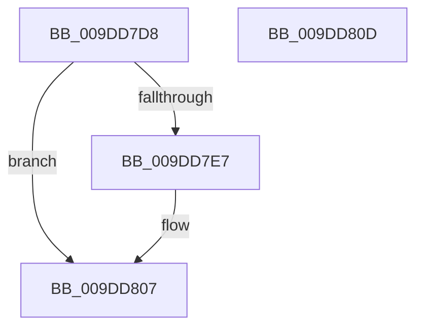

# WmipRemoveDS

- RVA: `0x009DD7D8`–`0x009DD80E` (길이 `54` bytes)
- VA: `0x00000001409DD7D8`
- 실행 섹션: `PAGE`
- PDB 이름 있음: `예`; PDB Function 태그: `아니요`
- unwind 정보 RVA: `0x0005CF00`
- 디코드: `16`개 명령, `54/54` bytes 표시
- 미해석 바이트: `0` (있으면 어셈블리에 `.byte`로 보존)

> 이 문서는 커널 이미지의 기계어와 PDB 기호를 분석해 생성했습니다. 4번과 5번은 함수 원형과 자료형을 바이너리 사용 방식에서 추정한 C 해석이며 원본 소스 복구 결과는 아닙니다.

## 1. Dependencies

- 직접 호출 지점: **2**; 고유 호출 대상: **2**
- 직접 호출자로 확인된 함수: **1**
- RIP 상대 이미지 참조: **1**

### Outgoing calls
- `0x009DD7EF` → [WmipGenerateRegistrationNotification](WmipGenerateRegistrationNotification_function_009DF60C.md) (function, `0x009DF60C`)
- `0x009DD802` → [WmipUnreferenceEntry](../9E/WmipUnreferenceEntry_function_009E0CC8.md) (function, `0x009E0CC8`)

### Direct callers
- [WmipDeregisterRegEntry](../../text/47/WmipDeregisterRegEntry_function_0047B568.md) at `0x0047B6B7`

### Static image references
- `0x009DD7F8` → RVA `0x00E03648` (`.data`; read)

## 2. Other-region calls and transfers

- 다른 실행 섹션으로 향하는 call: **0**
- 별도 외부 분기/꼬리 이동을 확인하지 못했습니다.

## 3. Assembly (complete function range)

```asm
009DD7D8  40 53                           push rbx
009DD7DA  48 83 EC 20                     sub rsp, 0x20
009DD7DE  48 8B 59 20                     mov rbx, qword ptr [rcx + 0x20]
009DD7E2  48 85 DB                        test rbx, rbx
009DD7E5  74 20                           je 0x1409dd807
009DD7E7  BA 02 00 00 00                  mov edx, 2
009DD7EC  48 8B CB                        mov rcx, rbx
009DD7EF  E8 18 1E 00 00                  call 0x1409df60c
009DD7F4  83 4B 10 01                     or dword ptr [rbx + 0x10], 1
009DD7F8  48 8D 0D 49 5E 42 00            lea rcx, [rip + 0x425e49]
009DD7FF  48 8B D3                        mov rdx, rbx
009DD802  E8 C1 34 00 00                  call 0x1409e0cc8
009DD807  48 83 C4 20                     add rsp, 0x20
009DD80B  5B                              pop rbx
009DD80C  C3                              ret
009DD80D  CC                              int3
```

## 4. C-style interpretation (structured pseudocode)

```c
__int64 __fastcall WmipRemoveDS(__int64 a1)
{
    __int64 result;
    __int64 v_rsp;

    v_rsp = (v_rsp) - (32);
    if (*(unsigned __int64 *)(a1 + 32) != 0) {
        a2 = 2;
        a1 = *(unsigned __int64 *)(a1 + 32);
        result = WmipGenerateRegistrationNotification(a1, a2, a3, a4);
        a1 = v_rip + 4349513;
        a2 = *(unsigned __int64 *)(a1 + 32);
        result = WmipUnreferenceEntry(a1, a2, a3, a4);
    }
    v_rsp = (v_rsp) + (32);
    return result;
}
```

## 5. (Beta) C Style

```c
int64_t WmipRemoveDS(void *Arg1)
{
    uint8_t *arg1 = (uint8_t *)Arg1;

    int64_t result;
    int64_t local_rsp;

    local_rsp = (local_rsp) - (32);
    if (*(uint64_t *)(arg1 + 0x20) != 0) {
        a2 = 2;
        Arg1 = *(uint64_t *)(arg1 + 0x20);
        result = WmipGenerateRegistrationNotification(Arg1, a2, a3, a4);
        Arg1 = v_rip + 4349513;
        a2 = *(uint64_t *)(arg1 + 0x20);
        result = WmipUnreferenceEntry(Arg1, a2, a3, a4);
    }
    local_rsp = (local_rsp) + (32);
    return result;
}
```

### 관측된 메모리 오프셋

구조체 형식이 확인되지 않은 접근은 인자 기준의 오프셋으로만 기록했습니다.

| 기준 인자 | 오프셋 표현 | 폭 (bit) | 접근 |
|---|---:|---:|---|
| `Arg1` | `+ 0x20` | `64` | `R` |

## 6. Execution-region graph

[열기: 2D/3D 그래프와 함수 탐색 컨트롤 패널](../../../control-panel.html?section=page&rva=0x009DD7D8&view=graph)

- 2D 그래프는 위에서 아래로 흐르고, 3D 그래프는 빈 공간을 드래그해 회전합니다. Shift+드래그는 이동, 휠은 확대·축소, 함수 노드 선택은 대상 보고서 이동입니다.

### Static fallback


