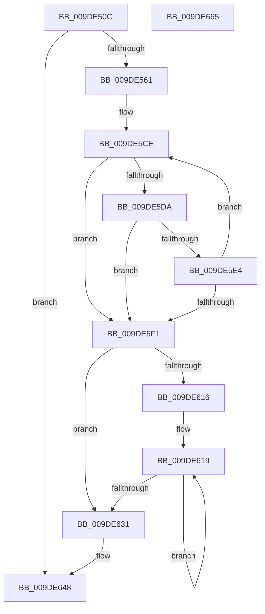

# WmipSendGuidUpdateNotifications

- RVA: `0x009DE50C`–`0x009DE666` (길이 `346` bytes)
- VA: `0x00000001409DE50C`
- 실행 섹션: `PAGE`
- PDB 이름 있음: `예`; PDB Function 태그: `아니요`
- unwind 정보 RVA: `0x00075C18`
- 디코드: `95`개 명령, `346/346` bytes 표시
- 미해석 바이트: `0` (있으면 어셈블리에 `.byte`로 보존)

> 이 문서는 커널 이미지의 기계어와 PDB 기호를 분석해 생성했습니다. 4번과 5번은 함수 원형과 자료형을 바이너리 사용 방식에서 추정한 C 해석이며 원본 소스 복구 결과는 아닙니다.

## 1. Dependencies

- 직접 호출 지점: **4**; 고유 호출 대상: **4**
- 직접 호출자로 확인된 함수: **2**
- RIP 상대 이미지 참조: **1**

### Outgoing calls
- `0x009DE54D` → [ExAllocatePool2](../../poolcode/B8/ExAllocatePool2_function_00B820F0.md) (function, `0x00B820F0`)
- `0x009DE569` → [memset](../../text/6C/memset_function_006C6C40.md) (function, `0x006C6C40`)
- `0x009DE639` → [WmipProcessEvent](WmipProcessEvent_function_009DFA40.md) (function, `0x009DFA40`)
- `0x009DE643` → [ExFreePoolWithTag](../../poolcode/B8/ExFreePoolWithTag_function_00B82870.md) (function, `0x00B82870`)

### Direct callers
- [WmipUpdateDataSource](WmipUpdateDataSource_function_009DD474.md) at `0x009DD6DB`
- [WmipUpdateDataSource](WmipUpdateDataSource_function_009DD474.md) at `0x009DD73B`
- [WmipUpdateDataSource](WmipUpdateDataSource_function_009DD474.md) at `0x009DD7A7`
- [WmipGenerateRegistrationNotification](WmipGenerateRegistrationNotification_function_009DF60C.md) at `0x009DF6A1`

### Static image references
- `0x009DE578` → RVA `0x00B06FB0` (` ?? ::NNGAKEGL::`string'`; read)

## 2. Other-region calls and transfers

- 다른 실행 섹션으로 향하는 call: **3**
  - `0x009DE54D` → [ExAllocatePool2](../../poolcode/B8/ExAllocatePool2_function_00B820F0.md) (`PAGE` → `POOLCODE`)
  - `0x009DE569` → [memset](../../text/6C/memset_function_006C6C40.md) (`PAGE` → `.text`)
  - `0x009DE643` → [ExFreePoolWithTag](../../poolcode/B8/ExFreePoolWithTag_function_00B82870.md) (`PAGE` → `POOLCODE`)
- 별도 외부 분기/꼬리 이동을 확인하지 못했습니다.

## 3. Assembly (complete function range)

```asm
009DE50C  48 89 5C 24 08                  mov qword ptr [rsp + 8], rbx
009DE511  48 89 6C 24 10                  mov qword ptr [rsp + 0x10], rbp
009DE516  48 89 74 24 18                  mov qword ptr [rsp + 0x18], rsi
009DE51B  57                              push rdi
009DE51C  41 54                           push r12
009DE51E  41 55                           push r13
009DE520  41 56                           push r14
009DE522  41 57                           push r15
009DE524  48 83 EC 20                     sub rsp, 0x20
009DE528  8B FA                           mov edi, edx
009DE52A  8B EA                           mov ebp, edx
009DE52C  49 8B F0                        mov rsi, r8
009DE52F  C1 E7 04                        shl edi, 4
009DE532  44 8B E1                        mov r12d, ecx
009DE535  83 C7 08                        add edi, 8
009DE538  41 B8 57 6D 69 70               mov r8d, 0x70696d57
009DE53E  B9 00 01 00 00                  mov ecx, 0x100
009DE543  44 8D 77 66                     lea r14d, [rdi + 0x66]
009DE547  41 8B D6                        mov edx, r14d
009DE54A  45 8B FE                        mov r15d, r14d
009DE54D  E8 9E 3B 1A 00                  call 0x140b820f0
009DE552  45 33 ED                        xor r13d, r13d
009DE555  48 8B D8                        mov rbx, rax
009DE558  48 85 C0                        test rax, rax
009DE55B  0F 84 E7 00 00 00               je 0x1409de648
009DE561  45 8B C7                        mov r8d, r15d
009DE564  33 D2                           xor edx, edx
009DE566  48 8B C8                        mov rcx, rax
009DE569  E8 D2 86 CE FF                  call 0x1406c6c40
009DE56E  0F 57 C0                        xorps xmm0, xmm0
009DE571  48 8D 4B 40                     lea rcx, [rbx + 0x40]
009DE575  0F 11 03                        movups xmmword ptr [rbx], xmm0
009DE578  4C 8D 05 31 8A 12 00            lea r8, [rip + 0x128a31]
009DE57F  0F 11 43 10                     movups xmmword ptr [rbx + 0x10], xmm0
009DE583  41 8D 55 0E                     lea edx, [r13 + 0xe]
009DE587  0F 11 43 20                     movups xmmword ptr [rbx + 0x20], xmm0
009DE58B  C7 43 18 A1 49 8D B4            mov dword ptr [rbx + 0x18], 0xb48d49a1
009DE592  C7 43 1C 77 E7 D0 11            mov dword ptr [rbx + 0x1c], 0x11d0e777
009DE599  C7 43 20 A5 0C 00 A0            mov dword ptr [rbx + 0x20], 0xa0000ca5
009DE5A0  C7 43 24 C9 06 29 10            mov dword ptr [rbx + 0x24], 0x102906c9
009DE5A7  44 89 33                        mov dword ptr [rbx], r14d
009DE5AA  C7 43 2C 0A 00 00 00            mov dword ptr [rbx + 0x2c], 0xa
009DE5B1  C7 43 30 40 00 00 00            mov dword ptr [rbx + 0x30], 0x40
009DE5B8  C7 43 38 60 00 00 00            mov dword ptr [rbx + 0x38], 0x60
009DE5BF  89 7B 3C                        mov dword ptr [rbx + 0x3c], edi
009DE5C2  66 C7 01 1C 00                  mov word ptr [rcx], 0x1c
009DE5C7  48 83 C1 02                     add rcx, 2
009DE5CB  4C 2B C1                        sub r8, rcx
009DE5CE  48 8D 82 F0 FF FF 7F            lea rax, [rdx + 0x7ffffff0]
009DE5D5  48 85 C0                        test rax, rax
009DE5D8  74 17                           je 0x1409de5f1
009DE5DA  41 0F B7 04 08                  movzx eax, word ptr [r8 + rcx]
009DE5DF  66 85 C0                        test ax, ax
009DE5E2  74 0D                           je 0x1409de5f1
009DE5E4  66 89 01                        mov word ptr [rcx], ax
009DE5E7  48 83 C1 02                     add rcx, 2
009DE5EB  48 83 EA 01                     sub rdx, 1
009DE5EF  75 DD                           jne 0x1409de5ce
009DE5F1  48 8D 41 FE                     lea rax, [rcx - 2]
009DE5F5  48 85 D2                        test rdx, rdx
009DE5F8  48 0F 45 C1                     cmovne rax, rcx
009DE5FC  66 44 89 28                     mov word ptr [rax], r13w
009DE600  8B 43 38                        mov eax, dword ptr [rbx + 0x38]
009DE603  48 8D 48 08                     lea rcx, [rax + 8]
009DE607  44 89 24 18                     mov dword ptr [rax + rbx], r12d
009DE60B  48 03 CB                        add rcx, rbx
009DE60E  89 6C 18 04                     mov dword ptr [rax + rbx + 4], ebp
009DE612  85 ED                           test ebp, ebp
009DE614  74 1B                           je 0x1409de631
009DE616  4C 8B C5                        mov r8, rbp
009DE619  48 8B 06                        mov rax, qword ptr [rsi]
009DE61C  48 8D 76 10                     lea rsi, [rsi + 0x10]
009DE620  0F 10 00                        movups xmm0, xmmword ptr [rax]
009DE623  F3 0F 7F 01                     movdqu xmmword ptr [rcx], xmm0
009DE627  48 8D 49 10                     lea rcx, [rcx + 0x10]
009DE62B  49 83 E8 01                     sub r8, 1
009DE62F  75 E8                           jne 0x1409de619
009DE631  45 33 C0                        xor r8d, r8d
009DE634  B2 01                           mov dl, 1
009DE636  48 8B CB                        mov rcx, rbx
009DE639  E8 02 14 00 00                  call 0x1409dfa40
009DE63E  33 D2                           xor edx, edx
009DE640  48 8B CB                        mov rcx, rbx
009DE643  E8 28 42 1A 00                  call 0x140b82870
009DE648  48 8B 5C 24 50                  mov rbx, qword ptr [rsp + 0x50]
009DE64D  48 8B 6C 24 58                  mov rbp, qword ptr [rsp + 0x58]
009DE652  48 8B 74 24 60                  mov rsi, qword ptr [rsp + 0x60]
009DE657  48 83 C4 20                     add rsp, 0x20
009DE65B  41 5F                           pop r15
009DE65D  41 5E                           pop r14
009DE65F  41 5D                           pop r13
009DE661  41 5C                           pop r12
009DE663  5F                              pop rdi
009DE664  C3                              ret
009DE665  CC                              int3
```

## 4. C-style interpretation (structured pseudocode)

```c
__int64 __fastcall WmipSendGuidUpdateNotifications(int a1, int a2, __int64 a3)
{
    __int64 result;
    __int64 v_r13;
    __int64 v_rdi;
    __int64 v_rsp;
    unsigned __int64 v_stack_p10;
    unsigned __int64 v_stack_p18;
    unsigned __int64 v_stack_p8;

    v_stack_p8 = v_rbx;
    v_stack_p10 = v_rbp;
    v_stack_p18 = v_rsi;
    v_rsp = (v_rsp) - (32);
    v_rdi = (unsigned int)(((unsigned int)(a2)) << (4));
    v_rdi = (unsigned int)((v_rdi) + (8));
    result = ExAllocatePool2(256, (unsigned int)((unsigned int)(v_rdi + 102)), (unsigned int)(0x70696D57ULL), a4);
    v_r13 = 0;
    if (result == 0) goto loc_009DE648;
    a2 = 0;
    result = memset(result, a2, (unsigned int)((unsigned int)((unsigned int)((unsigned int)(v_rdi + 102)))), a4);
    *(unsigned __int64 *)(result) = v_xmm0;
    *(unsigned __int64 *)(result + 16) = v_xmm0;
    *(unsigned __int64 *)(result + 32) = v_xmm0;
    *(unsigned int *)(result + 24) = 0xB48D49A1ULL;
    *(unsigned int *)(result + 28) = 0x11D0E777ULL;
    *(unsigned int *)(result + 32) = 0xA0000CA5ULL;
    *(unsigned int *)(result + 36) = 0x102906C9ULL;
    *(unsigned int *)(result) = (unsigned int)(v_rdi + 102);
    *(unsigned int *)(result + 44) = 10;
    *(unsigned int *)(result + 48) = 64;
    *(unsigned int *)(result + 56) = 96;
    *(unsigned int *)(result + 60) = (unsigned int)(v_rdi);
    *(unsigned __int16 *)(result + 64) = 28;
    a1 = (result + 64) + (2);
    a3 = (v_rip + 1215025) - (a1);
loc_009DE5CE:
    if (v_r13 + 14 + 2147483632 == 0) goto loc_009DE5F1;
    if ((unsigned __int16)(*(unsigned __int16 *)(a3 + a1 * 1)) == 0) goto loc_009DE5F1;
    *(unsigned __int16 *)(a1) = (unsigned __int16)(*(unsigned __int16 *)(a3 + a1 * 1));
    a1 = (a1) + (2);
    a2 = (v_r13 + 14) - (1);
    if (condition_is_not_equal) goto loc_009DE5CE;
loc_009DE5F1:
    result = a1 - 2;
    if (a2 != 0) { result = a1; }
    *(unsigned __int16 *)(result) = 0;
    *(unsigned int *)((unsigned int)(*(unsigned int *)(result + 56)) + result * 1) = (unsigned int)((unsigned int)(a1));
    a1 = ((unsigned int)(*(unsigned int *)(result + 56)) + 8) + (result);
    *(unsigned int *)((unsigned int)(*(unsigned int *)(result + 56)) + result * 1 + 4) = (unsigned int)((unsigned int)(a2));
    if ((unsigned int)((unsigned int)(a2)) == 0) goto loc_009DE631;
loc_009DE619:
    *(unsigned __int64 *)(a1) = v_xmm0;
    a3 = ((unsigned int)(a2)) - (1);
    if (condition_is_not_equal) goto loc_009DE619;
loc_009DE631:
    a3 = 0;
    result = WmipProcessEvent(result, 1, a3, a4);
    a2 = 0;
    result = ExFreePoolWithTag(result, a2, a3, a4);
loc_009DE648:
    v_rsp = (v_rsp) + (32);
    return result;
}
```

## 5. (Beta) C Style

```c
int64_t WmipSendGuidUpdateNotifications(int32_t Arg1, int32_t Arg2, void *Arg3)
{
    uint8_t *arg3 = (uint8_t *)Arg3;

    int64_t result;
    int64_t local_r13;
    int64_t local_rdi;
    int64_t local_rsp;
    uint64_t v_stack_p10;
    uint64_t v_stack_p18;
    uint64_t v_stack_p8;

    v_stack_p8 = local_rbx;
    v_stack_p10 = local_rbp;
    v_stack_p18 = local_rsi;
    local_rsp = (local_rsp) - (32);
    local_rdi = (uint32_t)(((uint32_t)(Arg2)) << (4));
    local_rdi = (uint32_t)((local_rdi) + (8));
    result = ExAllocatePool2(256, (uint32_t)((uint32_t)(local_rdi + 102)), (uint32_t)(0x70696D57ULL), a4);
    local_r13 = 0;
    if (result == 0) goto loc_009DE648;
    Arg2 = 0;
    result = memset(result, Arg2, (uint32_t)((uint32_t)((uint32_t)((uint32_t)(local_rdi + 102)))), a4);
    *(uint64_t *)(result) = v_xmm0;
    *(uint64_t *)(result + 0x10) = v_xmm0;
    *(uint64_t *)(result + 0x20) = v_xmm0;
    *(uint32_t *)(result + 0x18) = 0xB48D49A1ULL;
    *(uint32_t *)(result + 0x1C) = 0x11D0E777ULL;
    *(uint32_t *)(result + 0x20) = 0xA0000CA5ULL;
    *(uint32_t *)(result + 0x24) = 0x102906C9ULL;
    *(uint32_t *)(result) = (uint32_t)(local_rdi + 102);
    *(uint32_t *)(result + 0x2C) = 10;
    *(uint32_t *)(result + 0x30) = 64;
    *(uint32_t *)(result + 0x38) = 96;
    *(uint32_t *)(result + 0x3C) = (uint32_t)(local_rdi);
    *(uint16_t *)(result + 0x40) = 28;
    Arg1 = (result + 64) + (2);
    Arg3 = (v_rip + 1215025) - (Arg1);
loc_009DE5CE:
    if (local_r13 + 14 + 2147483632 == 0) goto loc_009DE5F1;
    if ((uint16_t)(*(uint16_t *)(arg3 + Arg1 * 1)) == 0) goto loc_009DE5F1;
    *(uint16_t *)(Arg1) = (uint16_t)(*(uint16_t *)(arg3 + Arg1 * 1));
    Arg1 = (Arg1) + (2);
    Arg2 = (local_r13 + 14) - (1);
    if (condition_is_not_equal) goto loc_009DE5CE;
loc_009DE5F1:
    result = Arg1 - 2;
    if (Arg2 != 0) { result = Arg1; }
    *(uint16_t *)(result) = 0;
    *(uint32_t *)((uint32_t)(*(uint32_t *)(result + 0x38)) + result * 1) = (uint32_t)((uint32_t)(Arg1));
    Arg1 = ((uint32_t)(*(uint32_t *)(result + 0x38)) + 8) + (result);
    *(uint32_t *)((uint32_t)(*(uint32_t *)(result + 0x38)) + result * 1 + 0x4) = (uint32_t)((uint32_t)(Arg2));
    if ((uint32_t)((uint32_t)(Arg2)) == 0) goto loc_009DE631;
loc_009DE619:
    *(uint64_t *)(Arg1) = v_xmm0;
    Arg3 = ((uint32_t)(Arg2)) - (1);
    if (condition_is_not_equal) goto loc_009DE619;
loc_009DE631:
    Arg3 = 0;
    result = WmipProcessEvent(result, 1, Arg3, a4);
    Arg2 = 0;
    result = ExFreePoolWithTag(result, Arg2, Arg3, a4);
loc_009DE648:
    local_rsp = (local_rsp) + (32);
    return result;
}
```

### 관측된 메모리 오프셋

구조체 형식이 확인되지 않은 접근은 인자 기준의 오프셋으로만 기록했습니다.

| 기준 인자 | 오프셋 표현 | 폭 (bit) | 접근 |
|---|---:|---:|---|
| `Arg3` | `+ 0x0` | `64` | `R` |
| `Arg3` | `+ 0x10` | `64` | `R` |

## 6. Execution-region graph

[열기: 2D/3D 그래프와 함수 탐색 컨트롤 패널](../../../control-panel.html?section=page&rva=0x009DE50C&view=graph)

- 2D 그래프는 위에서 아래로 흐르고, 3D 그래프는 빈 공간을 드래그해 회전합니다. Shift+드래그는 이동, 휠은 확대·축소, 함수 노드 선택은 대상 보고서 이동입니다.

### Static fallback


