# WmipUpdateDataSource

- RVA: `0x009DD474`–`0x009DD7D1` (길이 `861` bytes)
- VA: `0x00000001409DD474`
- 실행 섹션: `PAGE`
- PDB 이름 있음: `예`; PDB Function 태그: `아니요`
- unwind 정보 RVA: `0x000A3904`
- 디코드: `236`개 명령, `861/861` bytes 표시
- 미해석 바이트: `0` (있으면 어셈블리에 `.byte`로 보존)

> 이 문서는 커널 이미지의 기계어와 PDB 기호를 분석해 생성했습니다. 4번과 5번은 함수 원형과 자료형을 바이너리 사용 방식에서 추정한 C 해석이며 원본 소스 복구 결과는 아닙니다.

## 1. Dependencies

- 직접 호출 지점: **24**; 고유 호출 대상: **13**
- 직접 호출자로 확인된 함수: **1**
- RIP 상대 이미지 참조: **8**

### Outgoing calls
- `0x009DD4AF` → [WmipReferenceEntry](../9E/WmipReferenceEntry_function_009E1BF8.md) (function, `0x009E1BF8`)
- `0x009DD4F2` → [KeWaitForSingleObject](../../text/20/KeWaitForSingleObject_function_0020E6B0.md) (function, `0x0020E6B0`)
- `0x009DD521` → [WmipFindISInDSByGuid](../AC/WmipFindISInDSByGuid_function_00AC1A20.md) (function, `0x00AC1A20`)
- `0x009DD538` → [WmipUnreferenceEntry](../9E/WmipUnreferenceEntry_function_009E0CC8.md) (function, `0x009E0CC8`)
- `0x009DD561` → [WmipUpdateModifyGuid](../7B/WmipUpdateModifyGuid_function_007B4798.md) (function, `0x007B4798`)
- `0x009DD596` → [WmipCachePtrs](../A5/WmipCachePtrs_function_00A5FFF0.md) (function, `0x00A5FFF0`)
- `0x009DD5C0` → [KeReleaseMutex](../../text/39/KeReleaseMutex_function_00396810.md) (function, `0x00396810`)
- `0x009DD5CF` → [WmipUnreferenceEntry](../9E/WmipUnreferenceEntry_function_009E0CC8.md) (function, `0x009E0CC8`)
- `0x009DD61E` → [WmipGenerateBinaryMofNotification](../7B/WmipGenerateBinaryMofNotification_function_007B4348.md) (function, `0x007B4348`)
- `0x009DD632` → [WmipDisableCollectionForRemovedGuid](WmipDisableCollectionForRemovedGuid_function_009DE88C.md) (function, `0x009DE88C`)
- `0x009DD64D` → [KeWaitForSingleObject](../../text/20/KeWaitForSingleObject_function_0020E6B0.md) (function, `0x0020E6B0`)
- `0x009DD65A` → [WmipUnlinkInstanceSetFromGuidEntry](../9E/WmipUnlinkInstanceSetFromGuidEntry_function_009E2580.md) (function, `0x009E2580`)
- `0x009DD671` → [WmipUnreferenceEntry](../9E/WmipUnreferenceEntry_function_009E0CC8.md) (function, `0x009E0CC8`)
- `0x009DD6A1` → [WmipUnreferenceEntry](../9E/WmipUnreferenceEntry_function_009E0CC8.md) (function, `0x009E0CC8`)
- `0x009DD6AF` → [KeReleaseMutex](../../text/39/KeReleaseMutex_function_00396810.md) (function, `0x00396810`)
- `0x009DD6DB` → [WmipSendGuidUpdateNotifications](WmipSendGuidUpdateNotifications_function_009DE50C.md) (function, `0x009DE50C`)
- `0x009DD6E5` → [ExFreePoolWithTag](../../poolcode/B8/ExFreePoolWithTag_function_00B82870.md) (function, `0x00B82870`)
- `0x009DD723` → [WmipGenerateBinaryMofNotification](../7B/WmipGenerateBinaryMofNotification_function_007B4348.md) (function, `0x007B4348`)
- `0x009DD73B` → [WmipSendGuidUpdateNotifications](WmipSendGuidUpdateNotifications_function_009DE50C.md) (function, `0x009DE50C`)
- `0x009DD745` → [ExFreePoolWithTag](../../poolcode/B8/ExFreePoolWithTag_function_00B82870.md) (function, `0x00B82870`)
- `0x009DD783` → [WmipGenerateBinaryMofNotification](../7B/WmipGenerateBinaryMofNotification_function_007B4348.md) (function, `0x007B4348`)
- `0x009DD78F` → [WmipEnableCollectionForNewGuid](WmipEnableCollectionForNewGuid_function_009DFC0C.md) (function, `0x009DFC0C`)
- `0x009DD7A7` → [WmipSendGuidUpdateNotifications](WmipSendGuidUpdateNotifications_function_009DE50C.md) (function, `0x009DE50C`)
- `0x009DD7B1` → [ExFreePoolWithTag](../../poolcode/B8/ExFreePoolWithTag_function_00B82870.md) (function, `0x00B82870`)

### Direct callers
- [WmipProcessWmiRegInfo](WmipProcessWmiRegInfo_function_009DDB14.md) at `0x009DDC23`

### Static image references
- `0x009DD4CC` → RVA `0x00EFFA60` (`.data`; read)
- `0x009DD531` → RVA `0x00E03608` (`.data`; read)
- `0x009DD5C8` → RVA `0x00E03648` (`.data`; read)
- `0x009DD5FA` → RVA `0x00B4AF40` (`WmipBinaryMofGuid`; read)
- `0x009DD607` → RVA `0x00B4AF48` (`PAGE`; read)
- `0x009DD617` → RVA `0x00B4B0A0` (`GUID_MOF_RESOURCE_REMOVED_NOTIFICATION`; read)
- `0x009DD66A` → RVA `0x00E03628` (`.data`; read)
- `0x009DD71C` → RVA `0x00B4AFE8` (`GUID_MOF_RESOURCE_ADDED_NOTIFICATION`; read)

## 2. Other-region calls and transfers

- 다른 실행 섹션으로 향하는 call: **7**
  - `0x009DD4F2` → [KeWaitForSingleObject](../../text/20/KeWaitForSingleObject_function_0020E6B0.md) (`PAGE` → `.text`)
  - `0x009DD5C0` → [KeReleaseMutex](../../text/39/KeReleaseMutex_function_00396810.md) (`PAGE` → `.text`)
  - `0x009DD64D` → [KeWaitForSingleObject](../../text/20/KeWaitForSingleObject_function_0020E6B0.md) (`PAGE` → `.text`)
  - `0x009DD6AF` → [KeReleaseMutex](../../text/39/KeReleaseMutex_function_00396810.md) (`PAGE` → `.text`)
  - `0x009DD6E5` → [ExFreePoolWithTag](../../poolcode/B8/ExFreePoolWithTag_function_00B82870.md) (`PAGE` → `POOLCODE`)
  - `0x009DD745` → [ExFreePoolWithTag](../../poolcode/B8/ExFreePoolWithTag_function_00B82870.md) (`PAGE` → `POOLCODE`)
  - `0x009DD7B1` → [ExFreePoolWithTag](../../poolcode/B8/ExFreePoolWithTag_function_00B82870.md) (`PAGE` → `POOLCODE`)
- 별도 외부 분기/꼬리 이동을 확인하지 못했습니다.

## 3. Assembly (complete function range)

```asm
009DD474  48 89 5C 24 10                  mov qword ptr [rsp + 0x10], rbx
009DD479  44 89 44 24 18                  mov dword ptr [rsp + 0x18], r8d
009DD47E  55                              push rbp
009DD47F  56                              push rsi
009DD480  57                              push rdi
009DD481  41 54                           push r12
009DD483  41 55                           push r13
009DD485  41 56                           push r14
009DD487  41 57                           push r15
009DD489  48 8B EC                        mov rbp, rsp
009DD48C  48 83 EC 60                     sub rsp, 0x60
009DD490  48 8B 79 20                     mov rdi, qword ptr [rcx + 0x20]
009DD494  33 F6                           xor esi, esi
009DD496  48 89 75 E8                     mov qword ptr [rbp - 0x18], rsi
009DD49A  4C 8B F2                        mov r14, rdx
009DD49D  48 85 FF                        test rdi, rdi
009DD4A0  75 0A                           jne 0x1409dd4ac
009DD4A2  B8 34 00 00 C0                  mov eax, 0xc0000034
009DD4A7  E9 0C 03 00 00                  jmp 0x1409dd7b8
009DD4AC  48 8B CF                        mov rcx, rdi
009DD4AF  E8 44 47 00 00                  call 0x1409e1bf8
009DD4B4  48 8B DE                        mov rbx, rsi
009DD4B7  89 75 58                        mov dword ptr [rbp + 0x58], esi
009DD4BA  45 33 C9                        xor r9d, r9d
009DD4BD  48 89 5D E0                     mov qword ptr [rbp - 0x20], rbx
009DD4C1  45 33 C0                        xor r8d, r8d
009DD4C4  89 75 D0                        mov dword ptr [rbp - 0x30], esi
009DD4C7  33 D2                           xor edx, edx
009DD4C9  89 75 40                        mov dword ptr [rbp + 0x40], esi
009DD4CC  48 8D 0D 8D 25 52 00            lea rcx, [rip + 0x52258d]
009DD4D3  89 75 D8                        mov dword ptr [rbp - 0x28], esi
009DD4D6  44 8B E6                        mov r12d, esi
009DD4D9  89 75 DC                        mov dword ptr [rbp - 0x24], esi
009DD4DC  44 8B FE                        mov r15d, esi
009DD4DF  89 75 D4                        mov dword ptr [rbp - 0x2c], esi
009DD4E2  44 8B EE                        mov r13d, esi
009DD4E5  48 89 75 F0                     mov qword ptr [rbp - 0x10], rsi
009DD4E9  48 89 75 F8                     mov qword ptr [rbp - 8], rsi
009DD4ED  48 89 74 24 20                  mov qword ptr [rsp + 0x20], rsi
009DD4F2  E8 B9 11 83 FF                  call 0x14020e6b0
009DD4F7  41 39 5E 10                     cmp dword ptr [r14 + 0x10], ebx
009DD4FB  0F 86 B6 00 00 00               jbe 0x1409dd5b7
009DD501  44 8B 65 50                     mov r12d, dword ptr [rbp + 0x50]
009DD505  8B DE                           mov ebx, esi
009DD507  48 8B CF                        mov rcx, rdi
009DD50A  48 C1 E3 05                     shl rbx, 5
009DD50E  48 83 C3 18                     add rbx, 0x18
009DD512  49 03 DE                        add rbx, r14
009DD515  48 8B D3                        mov rdx, rbx
009DD518  F7 43 10 00 00 01 00            test dword ptr [rbx + 0x10], 0x10000
009DD51F  74 31                           je 0x1409dd552
009DD521  E8 FA 44 0E 00                  call 0x140ac1a20
009DD526  4C 8B F8                        mov r15, rax
009DD529  48 85 C0                        test rax, rax
009DD52C  74 6D                           je 0x1409dd59b
009DD52E  48 8B D0                        mov rdx, rax
009DD531  48 8D 0D D0 60 42 00            lea rcx, [rip + 0x4260d0]
009DD538  E8 8B 37 00 00                  call 0x1409e0cc8
009DD53D  48 8D 45 E0                     lea rax, [rbp - 0x20]
009DD541  4C 89 7D E8                     mov qword ptr [rbp - 0x18], r15
009DD545  4C 8D 4D D4                     lea r9, [rbp - 0x2c]
009DD549  49 8B D7                        mov rdx, r15
009DD54C  4C 8D 45 40                     lea r8, [rbp + 0x40]
009DD550  EB 3C                           jmp 0x1409dd58e
009DD552  48 8D 45 E8                     lea rax, [rbp - 0x18]
009DD556  45 8B CC                        mov r9d, r12d
009DD559  4D 8B C6                        mov r8, r14
009DD55C  48 89 44 24 20                  mov qword ptr [rsp + 0x20], rax
009DD561  E8 32 72 DD FF                  call 0x1407b4798
009DD566  83 F8 01                        cmp eax, 1
009DD569  75 0E                           jne 0x1409dd579
009DD56B  48 8D 45 F8                     lea rax, [rbp - 8]
009DD56F  4C 8D 4D D8                     lea r9, [rbp - 0x28]
009DD573  4C 8D 45 58                     lea r8, [rbp + 0x58]
009DD577  EB 11                           jmp 0x1409dd58a
009DD579  83 F8 02                        cmp eax, 2
009DD57C  75 1D                           jne 0x1409dd59b
009DD57E  48 8D 45 F0                     lea rax, [rbp - 0x10]
009DD582  4C 8D 4D DC                     lea r9, [rbp - 0x24]
009DD586  4C 8D 45 D0                     lea r8, [rbp - 0x30]
009DD58A  48 8B 55 E8                     mov rdx, qword ptr [rbp - 0x18]
009DD58E  48 8B CB                        mov rcx, rbx
009DD591  48 89 44 24 20                  mov qword ptr [rsp + 0x20], rax
009DD596  E8 55 2A 08 00                  call 0x140a5fff0
009DD59B  FF C6                           inc esi
009DD59D  41 3B 76 10                     cmp esi, dword ptr [r14 + 0x10]
009DD5A1  0F 82 5E FF FF FF               jb 0x1409dd505
009DD5A7  44 8B 6D 40                     mov r13d, dword ptr [rbp + 0x40]
009DD5AB  44 8B 65 58                     mov r12d, dword ptr [rbp + 0x58]
009DD5AF  44 8B 7D D0                     mov r15d, dword ptr [rbp - 0x30]
009DD5B3  48 8B 5D E0                     mov rbx, qword ptr [rbp - 0x20]
009DD5B7  33 D2                           xor edx, edx
009DD5B9  48 8D 0D A0 24 52 00            lea rcx, [rip + 0x5224a0]
009DD5C0  E8 4B 92 9B FF                  call 0x140396810
009DD5C5  48 8B D7                        mov rdx, rdi
009DD5C8  48 8D 0D 79 60 42 00            lea rcx, [rip + 0x426079]
009DD5CF  E8 F4 36 00 00                  call 0x1409e0cc8
009DD5D4  45 85 ED                        test r13d, r13d
009DD5D7  0F 84 0D 01 00 00               je 0x1409dd6ea
009DD5DD  45 33 F6                        xor r14d, r14d
009DD5E0  45 85 ED                        test r13d, r13d
009DD5E3  0F 84 E3 00 00 00               je 0x1409dd6cc
009DD5E9  41 8B F6                        mov esi, r14d
009DD5EC  48 03 F6                        add rsi, rsi
009DD5EF  48 8B 14 F3                     mov rdx, qword ptr [rbx + rsi*8]
009DD5F3  48 8D 3C F3                     lea rdi, [rbx + rsi*8]
009DD5F7  48 8B 0A                        mov rcx, qword ptr [rdx]
009DD5FA  48 2B 0D 3F D9 16 00            sub rcx, qword ptr [rip + 0x16d93f]
009DD601  75 0B                           jne 0x1409dd60e
009DD603  48 8B 4A 08                     mov rcx, qword ptr [rdx + 8]
009DD607  48 2B 0D 3A D9 16 00            sub rcx, qword ptr [rip + 0x16d93a]
009DD60E  48 85 C9                        test rcx, rcx
009DD611  75 10                           jne 0x1409dd623
009DD613  48 8B 4F 08                     mov rcx, qword ptr [rdi + 8]
009DD617  48 8D 15 82 DA 16 00            lea rdx, [rip + 0x16da82]
009DD61E  E8 25 6D DD FF                  call 0x1407b4348
009DD623  48 8B 5F 08                     mov rbx, qword ptr [rdi + 8]
009DD627  48 8B 7D E0                     mov rdi, qword ptr [rbp - 0x20]
009DD62B  48 8B D3                        mov rdx, rbx
009DD62E  48 8B 0C F7                     mov rcx, qword ptr [rdi + rsi*8]
009DD632  E8 55 12 00 00                  call 0x1409de88c
009DD637  33 F6                           xor esi, esi
009DD639  48 8D 0D 20 24 52 00            lea rcx, [rip + 0x522420]
009DD640  45 33 C9                        xor r9d, r9d
009DD643  48 89 74 24 20                  mov qword ptr [rsp + 0x20], rsi
009DD648  45 33 C0                        xor r8d, r8d
009DD64B  33 D2                           xor edx, edx
009DD64D  E8 5E 10 83 FF                  call 0x14020e6b0
009DD652  48 39 33                        cmp qword ptr [rbx], rsi
009DD655  74 08                           je 0x1409dd65f
009DD657  48 8B CB                        mov rcx, rbx
009DD65A  E8 21 4F 00 00                  call 0x1409e2580
009DD65F  8B 43 10                        mov eax, dword ptr [rbx + 0x10]
009DD662  A8 08                           test al, 8
009DD664  75 10                           jne 0x1409dd676
009DD666  48 8B 53 38                     mov rdx, qword ptr [rbx + 0x38]
009DD66A  48 8D 0D B7 5F 42 00            lea rcx, [rip + 0x425fb7]
009DD671  E8 52 36 00 00                  call 0x1409e0cc8
009DD676  48 8D 43 28                     lea rax, [rbx + 0x28]
009DD67A  48 89 73 38                     mov qword ptr [rbx + 0x38], rsi
009DD67E  48 8B 10                        mov rdx, qword ptr [rax]
009DD681  48 39 42 08                     cmp qword ptr [rdx + 8], rax
009DD685  75 3E                           jne 0x1409dd6c5
009DD687  48 8B 48 08                     mov rcx, qword ptr [rax + 8]
009DD68B  48 39 01                        cmp qword ptr [rcx], rax
009DD68E  75 35                           jne 0x1409dd6c5
009DD690  48 89 11                        mov qword ptr [rcx], rdx
009DD693  48 89 4A 08                     mov qword ptr [rdx + 8], rcx
009DD697  48 8B D3                        mov rdx, rbx
009DD69A  48 8D 0D 67 5F 42 00            lea rcx, [rip + 0x425f67]
009DD6A1  E8 22 36 00 00                  call 0x1409e0cc8
009DD6A6  33 D2                           xor edx, edx
009DD6A8  48 8D 0D B1 23 52 00            lea rcx, [rip + 0x5223b1]
009DD6AF  E8 5C 91 9B FF                  call 0x140396810
009DD6B4  41 FF C6                        inc r14d
009DD6B7  45 3B F5                        cmp r14d, r13d
009DD6BA  73 14                           jae 0x1409dd6d0
009DD6BC  48 8B 5D E0                     mov rbx, qword ptr [rbp - 0x20]
009DD6C0  E9 24 FF FF FF                  jmp 0x1409dd5e9
009DD6C5  B9 03 00 00 00                  mov ecx, 3
009DD6CA  CD 29                           int 0x29
009DD6CC  48 8B 7D E0                     mov rdi, qword ptr [rbp - 0x20]
009DD6D0  4C 8B C7                        mov r8, rdi
009DD6D3  41 8B D5                        mov edx, r13d
009DD6D6  B9 02 00 00 00                  mov ecx, 2
009DD6DB  E8 2C 0E 00 00                  call 0x1409de50c
009DD6E0  33 D2                           xor edx, edx
009DD6E2  48 8B CF                        mov rcx, rdi
009DD6E5  E8 86 51 1A 00                  call 0x140b82870
009DD6EA  45 85 FF                        test r15d, r15d
009DD6ED  74 5B                           je 0x1409dd74a
009DD6EF  48 8B 75 F0                     mov rsi, qword ptr [rbp - 0x10]
009DD6F3  48 8B DE                        mov rbx, rsi
009DD6F6  41 8B FF                        mov edi, r15d
009DD6F9  48 8B 13                        mov rdx, qword ptr [rbx]
009DD6FC  48 8B 0A                        mov rcx, qword ptr [rdx]
009DD6FF  48 2B 0D 3A D8 16 00            sub rcx, qword ptr [rip + 0x16d83a]
009DD706  75 0B                           jne 0x1409dd713
009DD708  48 8B 4A 08                     mov rcx, qword ptr [rdx + 8]
009DD70C  48 2B 0D 35 D8 16 00            sub rcx, qword ptr [rip + 0x16d835]
009DD713  48 85 C9                        test rcx, rcx
009DD716  75 10                           jne 0x1409dd728
009DD718  48 8B 4B 08                     mov rcx, qword ptr [rbx + 8]
009DD71C  48 8D 15 C5 D8 16 00            lea rdx, [rip + 0x16d8c5]
009DD723  E8 20 6C DD FF                  call 0x1407b4348
009DD728  48 83 C3 10                     add rbx, 0x10
009DD72C  48 83 EF 01                     sub rdi, 1
009DD730  75 C7                           jne 0x1409dd6f9
009DD732  4C 8B C6                        mov r8, rsi
009DD735  8D 4F 04                        lea ecx, [rdi + 4]
009DD738  41 8B D7                        mov edx, r15d
009DD73B  E8 CC 0D 00 00                  call 0x1409de50c
009DD740  33 D2                           xor edx, edx
009DD742  48 8B CE                        mov rcx, rsi
009DD745  E8 26 51 1A 00                  call 0x140b82870
009DD74A  45 85 E4                        test r12d, r12d
009DD74D  74 67                           je 0x1409dd7b6
009DD74F  4C 8B 75 F8                     mov r14, qword ptr [rbp - 8]
009DD753  49 8B DE                        mov rbx, r14
009DD756  41 8B F4                        mov esi, r12d
009DD759  48 8B 13                        mov rdx, qword ptr [rbx]
009DD75C  48 8B 0A                        mov rcx, qword ptr [rdx]
009DD75F  48 2B 0D DA D7 16 00            sub rcx, qword ptr [rip + 0x16d7da]
009DD766  75 0B                           jne 0x1409dd773
009DD768  48 8B 4A 08                     mov rcx, qword ptr [rdx + 8]
009DD76C  48 2B 0D D5 D7 16 00            sub rcx, qword ptr [rip + 0x16d7d5]
009DD773  48 85 C9                        test rcx, rcx
009DD776  75 10                           jne 0x1409dd788
009DD778  48 8B 4B 08                     mov rcx, qword ptr [rbx + 8]
009DD77C  48 8D 15 65 D8 16 00            lea rdx, [rip + 0x16d865]
009DD783  E8 C0 6B DD FF                  call 0x1407b4348
009DD788  48 8B 53 08                     mov rdx, qword ptr [rbx + 8]
009DD78C  48 8B 0B                        mov rcx, qword ptr [rbx]
009DD78F  E8 78 24 00 00                  call 0x1409dfc0c
009DD794  48 83 C3 10                     add rbx, 0x10
009DD798  48 83 EE 01                     sub rsi, 1
009DD79C  75 BB                           jne 0x1409dd759
009DD79E  4D 8B C6                        mov r8, r14
009DD7A1  8D 4E 01                        lea ecx, [rsi + 1]
009DD7A4  41 8B D4                        mov edx, r12d
009DD7A7  E8 60 0D 00 00                  call 0x1409de50c
009DD7AC  33 D2                           xor edx, edx
009DD7AE  49 8B CE                        mov rcx, r14
009DD7B1  E8 BA 50 1A 00                  call 0x140b82870
009DD7B6  33 C0                           xor eax, eax
009DD7B8  48 8B 9C 24 A8 00 00 00         mov rbx, qword ptr [rsp + 0xa8]
009DD7C0  48 83 C4 60                     add rsp, 0x60
009DD7C4  41 5F                           pop r15
009DD7C6  41 5E                           pop r14
009DD7C8  41 5D                           pop r13
009DD7CA  41 5C                           pop r12
009DD7CC  5F                              pop rdi
009DD7CD  5E                              pop rsi
009DD7CE  5D                              pop rbp
009DD7CF  C3                              ret
009DD7D0  CC                              int3
```

## 4. C-style interpretation (structured pseudocode)

```c
__int64 __fastcall WmipUpdateDataSource(__int64 a1, __int64 a2, int a3, int a4)
{
    __int64 result;
    __int64 v_r14;
    __int64 v_rbx;
    __int64 v_rdi;
    __int64 v_rsi;
    __int64 v_rsp;
    unsigned __int64 v_stack_m40;
    unsigned __int64 v_stack_m48;
    unsigned __int64 v_stack_m50;
    unsigned __int64 v_stack_m58;
    unsigned int v_stack_m5C;
    unsigned int v_stack_m60;
    unsigned int v_stack_m64;
    unsigned int v_stack_m68;
    unsigned __int64 v_stack_m78;
    unsigned __int64 v_stack_p10;
    unsigned int v_stack_p18;
    unsigned int v_stack_p20;
    unsigned int v_stack_p8;

    v_stack_p10 = v_rbx;
    v_stack_p18 = a3;
    v_rsp = (v_rsp) - (96);
    v_rsi = 0;
    v_stack_m50 = 0;
    if (*(unsigned __int64 *)(a1 + 32) != 0) goto loc_009DD4AC;
    goto loc_009DD7B8;
loc_009DD4AC:
    result = WmipReferenceEntry(*(unsigned __int64 *)(a1 + 32), a2, a3, a4);
    v_stack_p20 = 0;
    a4 = 0;
    v_stack_m58 = 0;
    a3 = 0;
    v_stack_m68 = 0;
    a2 = 0;
    v_stack_p8 = 0;
    v_stack_m60 = 0;
    v_stack_m5C = 0;
    v_stack_m64 = 0;
    v_stack_m48 = 0;
    v_stack_m40 = 0;
    v_stack_m78 = 0;
    result = KeWaitForSingleObject(v_rip + 5383565, a2, a3, a4);
    if ((*(unsigned int *)(a2 + 16)) <= 0) goto loc_009DD5B7;
loc_009DD505:
    v_rbx = (0) << (5);
    v_rbx = (v_rbx) + (24);
    v_rbx = (v_rbx) + (0);
    if (((*(unsigned int *)(v_rbx + 16)) & (0x10000ULL)) == 0) goto loc_009DD552;
    result = WmipFindISInDSByGuid(*(unsigned __int64 *)(a1 + 32), v_rbx, a3, a4);
    if (result == 0) goto loc_009DD59B;
    result = WmipUnreferenceEntry(v_rip + 4350160, result, a3, a4);
    v_stack_m50 = result;
    goto loc_009DD58E;
loc_009DD552:
    v_stack_m78 = v_stack_m50;
    result = WmipUpdateModifyGuid(v_rip + 4350160, result, 0, (unsigned int)((unsigned int)((unsigned int)(v_stack_p18))));
    if (((unsigned int)(result)) != 1) goto loc_009DD579;
    goto loc_009DD58A;
loc_009DD579:
    if (((unsigned int)(v_stack_m40)) != 2) goto loc_009DD59B;
loc_009DD58A:
loc_009DD58E:
    v_stack_m78 = v_stack_m48;
    result = WmipCachePtrs(v_rbx, v_stack_m50, v_stack_m68, v_stack_m5C);
loc_009DD59B:
    v_rsi = (unsigned int)((v_rsi) + 1);
    if (((unsigned int)(v_rsi)) < (*(unsigned int *)(a2 + 16))) goto loc_009DD505;
loc_009DD5B7:
    a2 = 0;
    result = KeReleaseMutex(v_rip + 5383328, a2, v_stack_m68, v_stack_m5C);
    result = WmipUnreferenceEntry(v_rip + 4350073, *(unsigned __int64 *)(a1 + 32), v_stack_m68, v_stack_m5C);
    if ((unsigned int)((unsigned int)(v_stack_p8)) == 0) goto loc_009DD6EA;
    v_r14 = 0;
    if ((unsigned int)((unsigned int)(v_stack_p8)) == 0) goto loc_009DD6CC;
loc_009DD5E9:
    v_rsi = (0) + (0);
    a1 = (*(unsigned __int64 *)(*(unsigned __int64 *)(v_stack_m58 + v_rsi * 8))) - (*(unsigned __int64 *)(v_rip + 1497407));
    if (!(condition_is_not_equal)) {
        a1 = *(unsigned __int64 *)(*(unsigned __int64 *)(v_stack_m58 + v_rsi * 8) + 8);
        a1 = (a1) - (*(unsigned __int64 *)(v_rip + 1497402));
    }
    if (a1 == 0) {
        a1 = *(unsigned __int64 *)(v_stack_m58 + v_rsi * 8 + 8);
        a2 = v_rip + 1497730;
        result = WmipGenerateBinaryMofNotification(a1, a2, v_stack_m68, v_stack_m5C);
    }
    result = WmipDisableCollectionForRemovedGuid(*(unsigned __int64 *)(v_stack_m58 + v_rsi * 8), *(unsigned __int64 *)(v_stack_m58 + v_rsi * 8 + 8), v_stack_m68, v_stack_m5C);
    v_rsi = 0;
    a4 = 0;
    v_stack_m78 = 0;
    a3 = 0;
    a2 = 0;
    result = KeWaitForSingleObject(v_rip + 5383200, a2, a3, a4);
    if ((*(unsigned __int64 *)(*(unsigned __int64 *)(v_stack_m58 + v_rsi * 8 + 8))) != 0) {
        a1 = *(unsigned __int64 *)(v_stack_m58 + v_rsi * 8 + 8);
        result = WmipUnlinkInstanceSetFromGuidEntry(a1, a2, a3, a4);
    }
    result = (unsigned int)(*(unsigned int *)(*(unsigned __int64 *)(v_stack_m58 + v_rsi * 8 + 8) + 16));
    if ((((unsigned __int8)((unsigned int)(*(unsigned int *)(*(unsigned __int64 *)(v_stack_m58 + v_rsi * 8 + 8) + 16)))) & (8)) == 0) {
        a2 = *(unsigned __int64 *)(*(unsigned __int64 *)(v_stack_m58 + v_rsi * 8 + 8) + 56);
        a1 = v_rip + 4349879;
        result = WmipUnreferenceEntry(a1, a2, a3, a4);
    }
    *(unsigned __int64 *)(*(unsigned __int64 *)(v_stack_m58 + v_rsi * 8 + 8) + 56) = 0;
    if ((*(unsigned __int64 *)(*(unsigned __int64 *)(*(unsigned __int64 *)(v_stack_m58 + v_rsi * 8 + 8) + 40) + 8)) != (*(unsigned __int64 *)(v_stack_m58 + v_rsi * 8 + 8) + 40)) goto loc_009DD6C5;
    if ((*(unsigned __int64 *)(*(unsigned __int64 *)(*(unsigned __int64 *)(v_stack_m58 + v_rsi * 8 + 8) + 40 + 8))) != (*(unsigned __int64 *)(v_stack_m58 + v_rsi * 8 + 8) + 40)) goto loc_009DD6C5;
    *(unsigned __int64 *)(*(unsigned __int64 *)(*(unsigned __int64 *)(v_stack_m58 + v_rsi * 8 + 8) + 40 + 8)) = *(unsigned __int64 *)(*(unsigned __int64 *)(v_stack_m58 + v_rsi * 8 + 8) + 40);
    *(unsigned __int64 *)(*(unsigned __int64 *)(*(unsigned __int64 *)(v_stack_m58 + v_rsi * 8 + 8) + 40) + 8) = *(unsigned __int64 *)(*(unsigned __int64 *)(v_stack_m58 + v_rsi * 8 + 8) + 40 + 8);
    result = WmipUnreferenceEntry(v_rip + 4349799, *(unsigned __int64 *)(v_stack_m58 + v_rsi * 8 + 8), a3, a4);
    a2 = 0;
    result = KeReleaseMutex(v_rip + 5383089, a2, a3, a4);
    v_r14 = (unsigned int)((v_r14) + 1);
    if (((unsigned int)(v_r14)) >= ((unsigned int)((unsigned int)(v_stack_p8)))) goto loc_009DD6D0;
    goto loc_009DD5E9;
loc_009DD6C5:
loc_009DD6CC:
loc_009DD6D0:
    result = WmipSendGuidUpdateNotifications(2, (unsigned int)((unsigned int)((unsigned int)(v_stack_p8))), v_stack_m58, a4);
    a2 = 0;
    result = ExFreePoolWithTag(v_stack_m58, a2, v_stack_m58, a4);
loc_009DD6EA:
    if ((unsigned int)((unsigned int)(v_stack_m68)) == 0) goto loc_009DD74A;
loc_009DD6F9:
    a1 = (*(unsigned __int64 *)(*(unsigned __int64 *)(v_stack_m48))) - (*(unsigned __int64 *)(v_rip + 1497146));
    if (!(condition_is_not_equal)) {
        a1 = *(unsigned __int64 *)(*(unsigned __int64 *)(v_stack_m48) + 8);
        a1 = (a1) - (*(unsigned __int64 *)(v_rip + 1497141));
    }
    if (a1 == 0) {
        a1 = *(unsigned __int64 *)(v_stack_m48 + 8);
        a2 = v_rip + 1497285;
        result = WmipGenerateBinaryMofNotification(a1, a2, v_stack_m58, a4);
    }
    v_rbx = (v_stack_m48) + (16);
    v_rdi = ((unsigned int)((unsigned int)((unsigned int)(v_stack_m68)))) - (1);
    if (condition_is_not_equal) goto loc_009DD6F9;
    result = WmipSendGuidUpdateNotifications(v_rdi + 4, (unsigned int)((unsigned int)((unsigned int)(v_stack_m68))), v_stack_m48, a4);
    a2 = 0;
    result = ExFreePoolWithTag(v_stack_m48, a2, v_stack_m48, a4);
loc_009DD74A:
    if ((unsigned int)((unsigned int)(v_stack_p20)) == 0) goto loc_009DD7B6;
loc_009DD759:
    a1 = (*(unsigned __int64 *)(*(unsigned __int64 *)(v_stack_m40))) - (*(unsigned __int64 *)(v_rip + 1497050));
    if (!(condition_is_not_equal)) {
        a1 = *(unsigned __int64 *)(*(unsigned __int64 *)(v_stack_m40) + 8);
        a1 = (a1) - (*(unsigned __int64 *)(v_rip + 1497045));
    }
    if (a1 == 0) {
        a1 = *(unsigned __int64 *)(v_stack_m40 + 8);
        a2 = v_rip + 1497189;
        result = WmipGenerateBinaryMofNotification(a1, a2, v_stack_m48, a4);
    }
    result = WmipEnableCollectionForNewGuid(*(unsigned __int64 *)(v_stack_m40), *(unsigned __int64 *)(v_stack_m40 + 8), v_stack_m48, a4);
    v_rbx = (v_stack_m40) + (16);
    v_rsi = ((unsigned int)((unsigned int)((unsigned int)(v_stack_p20)))) - (1);
    if (condition_is_not_equal) goto loc_009DD759;
    result = WmipSendGuidUpdateNotifications(v_rsi + 1, (unsigned int)((unsigned int)((unsigned int)(v_stack_p20))), v_stack_m40, a4);
    a2 = 0;
    result = ExFreePoolWithTag(v_stack_m40, a2, v_stack_m40, a4);
loc_009DD7B6:
    result = 0;
loc_009DD7B8:
    v_rsp = (v_rsp) + (96);
    return result;
}
```

## 5. (Beta) C Style

```c
int64_t WmipUpdateDataSource(void *Arg1, void *Arg2, int32_t Arg3, int32_t Arg4)
{
    uint8_t *arg1 = (uint8_t *)Arg1;
    uint8_t *arg2 = (uint8_t *)Arg2;

    int64_t result;
    int64_t local_r14;
    int64_t local_rbx;
    int64_t local_rdi;
    int64_t local_rsi;
    int64_t local_rsp;
    uint64_t v_stack_m40;
    uint64_t v_stack_m48;
    uint64_t v_stack_m50;
    uint64_t v_stack_m58;
    uint32_t v_stack_m5C;
    uint32_t v_stack_m60;
    uint32_t v_stack_m64;
    uint32_t v_stack_m68;
    uint64_t v_stack_m78;
    uint64_t v_stack_p10;
    uint32_t v_stack_p18;
    uint32_t v_stack_p20;
    uint32_t v_stack_p8;

    v_stack_p10 = local_rbx;
    v_stack_p18 = Arg3;
    local_rsp = (local_rsp) - (96);
    local_rsi = 0;
    v_stack_m50 = 0;
    if (*(uint64_t *)(arg1 + 0x20) != 0) goto loc_009DD4AC;
    goto loc_009DD7B8;
loc_009DD4AC:
    result = WmipReferenceEntry(*(uint64_t *)(arg1 + 0x20), Arg2, Arg3, Arg4);
    v_stack_p20 = 0;
    Arg4 = 0;
    v_stack_m58 = 0;
    Arg3 = 0;
    v_stack_m68 = 0;
    Arg2 = 0;
    v_stack_p8 = 0;
    v_stack_m60 = 0;
    v_stack_m5C = 0;
    v_stack_m64 = 0;
    v_stack_m48 = 0;
    v_stack_m40 = 0;
    v_stack_m78 = 0;
    result = KeWaitForSingleObject(v_rip + 5383565, Arg2, Arg3, Arg4);
    if ((*(uint32_t *)(arg2 + 0x10)) <= 0) goto loc_009DD5B7;
loc_009DD505:
    local_rbx = (0) << (5);
    local_rbx = (local_rbx) + (24);
    local_rbx = (local_rbx) + (0);
    if (((*(uint32_t *)(local_rbx + 0x10)) & (0x10000ULL)) == 0) goto loc_009DD552;
    result = WmipFindISInDSByGuid(*(uint64_t *)(arg1 + 0x20), local_rbx, Arg3, Arg4);
    if (result == 0) goto loc_009DD59B;
    result = WmipUnreferenceEntry(v_rip + 4350160, result, Arg3, Arg4);
    v_stack_m50 = result;
    goto loc_009DD58E;
loc_009DD552:
    v_stack_m78 = v_stack_m50;
    result = WmipUpdateModifyGuid(v_rip + 4350160, result, 0, (uint32_t)((uint32_t)((uint32_t)(v_stack_p18))));
    if (((uint32_t)(result)) != 1) goto loc_009DD579;
    goto loc_009DD58A;
loc_009DD579:
    if (((uint32_t)(v_stack_m40)) != 2) goto loc_009DD59B;
loc_009DD58A:
loc_009DD58E:
    v_stack_m78 = v_stack_m48;
    result = WmipCachePtrs(local_rbx, v_stack_m50, v_stack_m68, v_stack_m5C);
loc_009DD59B:
    local_rsi = (uint32_t)((local_rsi) + 1);
    if (((uint32_t)(local_rsi)) < (*(uint32_t *)(arg2 + 0x10))) goto loc_009DD505;
loc_009DD5B7:
    Arg2 = 0;
    result = KeReleaseMutex(v_rip + 5383328, Arg2, v_stack_m68, v_stack_m5C);
    result = WmipUnreferenceEntry(v_rip + 4350073, *(uint64_t *)(arg1 + 0x20), v_stack_m68, v_stack_m5C);
    if ((uint32_t)((uint32_t)(v_stack_p8)) == 0) goto loc_009DD6EA;
    local_r14 = 0;
    if ((uint32_t)((uint32_t)(v_stack_p8)) == 0) goto loc_009DD6CC;
loc_009DD5E9:
    local_rsi = (0) + (0);
    Arg1 = (*(uint64_t *)(*(uint64_t *)(v_stack_m58 + local_rsi * 8))) - (*(uint64_t *)(v_rip + 0x16D93F));
    if (!(condition_is_not_equal)) {
        Arg1 = *(uint64_t *)(*(uint64_t *)(v_stack_m58 + local_rsi * 8) + 0x8);
        Arg1 = (Arg1) - (*(uint64_t *)(v_rip + 0x16D93A));
    }
    if (Arg1 == NULL) {
        Arg1 = *(uint64_t *)(v_stack_m58 + local_rsi * 8 + 0x8);
        Arg2 = v_rip + 1497730;
        result = WmipGenerateBinaryMofNotification(Arg1, Arg2, v_stack_m68, v_stack_m5C);
    }
    result = WmipDisableCollectionForRemovedGuid(*(uint64_t *)(v_stack_m58 + local_rsi * 8), *(uint64_t *)(v_stack_m58 + local_rsi * 8 + 0x8), v_stack_m68, v_stack_m5C);
    local_rsi = 0;
    Arg4 = 0;
    v_stack_m78 = 0;
    Arg3 = 0;
    Arg2 = 0;
    result = KeWaitForSingleObject(v_rip + 5383200, Arg2, Arg3, Arg4);
    if ((*(uint64_t *)(*(uint64_t *)(v_stack_m58 + local_rsi * 8 + 0x8))) != 0) {
        Arg1 = *(uint64_t *)(v_stack_m58 + local_rsi * 8 + 0x8);
        result = WmipUnlinkInstanceSetFromGuidEntry(Arg1, Arg2, Arg3, Arg4);
    }
    result = (uint32_t)(*(uint32_t *)(*(uint64_t *)(v_stack_m58 + local_rsi * 8 + 0x8) + 0x10));
    if ((((uint8_t)((uint32_t)(*(uint32_t *)(*(uint64_t *)(v_stack_m58 + local_rsi * 8 + 0x8) + 0x10)))) & (8)) == 0) {
        Arg2 = *(uint64_t *)(*(uint64_t *)(v_stack_m58 + local_rsi * 8 + 0x8) + 0x38);
        Arg1 = v_rip + 4349879;
        result = WmipUnreferenceEntry(Arg1, Arg2, Arg3, Arg4);
    }
    *(uint64_t *)(*(uint64_t *)(v_stack_m58 + local_rsi * 8 + 0x8) + 0x38) = 0;
    if ((*(uint64_t *)(*(uint64_t *)(*(uint64_t *)(v_stack_m58 + local_rsi * 8 + 0x8) + 0x28) + 0x8)) != (*(uint64_t *)(v_stack_m58 + local_rsi * 8 + 0x8) + 40)) goto loc_009DD6C5;
    if ((*(uint64_t *)(*(uint64_t *)(*(uint64_t *)(v_stack_m58 + local_rsi * 8 + 0x8) + 0x28 + 0x8))) != (*(uint64_t *)(v_stack_m58 + local_rsi * 8 + 0x8) + 40)) goto loc_009DD6C5;
    *(uint64_t *)(*(uint64_t *)(*(uint64_t *)(v_stack_m58 + local_rsi * 8 + 0x8) + 0x28 + 0x8)) = *(uint64_t *)(*(uint64_t *)(v_stack_m58 + local_rsi * 8 + 0x8) + 0x28);
    *(uint64_t *)(*(uint64_t *)(*(uint64_t *)(v_stack_m58 + local_rsi * 8 + 0x8) + 0x28) + 0x8) = *(uint64_t *)(*(uint64_t *)(v_stack_m58 + local_rsi * 8 + 0x8) + 0x28 + 0x8);
    result = WmipUnreferenceEntry(v_rip + 4349799, *(uint64_t *)(v_stack_m58 + local_rsi * 8 + 0x8), Arg3, Arg4);
    Arg2 = 0;
    result = KeReleaseMutex(v_rip + 5383089, Arg2, Arg3, Arg4);
    local_r14 = (uint32_t)((local_r14) + 1);
    if (((uint32_t)(local_r14)) >= ((uint32_t)((uint32_t)(v_stack_p8)))) goto loc_009DD6D0;
    goto loc_009DD5E9;
loc_009DD6C5:
loc_009DD6CC:
loc_009DD6D0:
    result = WmipSendGuidUpdateNotifications(2, (uint32_t)((uint32_t)((uint32_t)(v_stack_p8))), v_stack_m58, Arg4);
    Arg2 = 0;
    result = ExFreePoolWithTag(v_stack_m58, Arg2, v_stack_m58, Arg4);
loc_009DD6EA:
    if ((uint32_t)((uint32_t)(v_stack_m68)) == 0) goto loc_009DD74A;
loc_009DD6F9:
    Arg1 = (*(uint64_t *)(*(uint64_t *)(v_stack_m48))) - (*(uint64_t *)(v_rip + 0x16D83A));
    if (!(condition_is_not_equal)) {
        Arg1 = *(uint64_t *)(*(uint64_t *)(v_stack_m48) + 0x8);
        Arg1 = (Arg1) - (*(uint64_t *)(v_rip + 0x16D835));
    }
    if (Arg1 == NULL) {
        Arg1 = *(uint64_t *)(v_stack_m48 + 0x8);
        Arg2 = v_rip + 1497285;
        result = WmipGenerateBinaryMofNotification(Arg1, Arg2, v_stack_m58, Arg4);
    }
    local_rbx = (v_stack_m48) + (16);
    local_rdi = ((uint32_t)((uint32_t)((uint32_t)(v_stack_m68)))) - (1);
    if (condition_is_not_equal) goto loc_009DD6F9;
    result = WmipSendGuidUpdateNotifications(local_rdi + 4, (uint32_t)((uint32_t)((uint32_t)(v_stack_m68))), v_stack_m48, Arg4);
    Arg2 = 0;
    result = ExFreePoolWithTag(v_stack_m48, Arg2, v_stack_m48, Arg4);
loc_009DD74A:
    if ((uint32_t)((uint32_t)(v_stack_p20)) == 0) goto loc_009DD7B6;
loc_009DD759:
    Arg1 = (*(uint64_t *)(*(uint64_t *)(v_stack_m40))) - (*(uint64_t *)(v_rip + 0x16D7DA));
    if (!(condition_is_not_equal)) {
        Arg1 = *(uint64_t *)(*(uint64_t *)(v_stack_m40) + 0x8);
        Arg1 = (Arg1) - (*(uint64_t *)(v_rip + 0x16D7D5));
    }
    if (Arg1 == NULL) {
        Arg1 = *(uint64_t *)(v_stack_m40 + 0x8);
        Arg2 = v_rip + 1497189;
        result = WmipGenerateBinaryMofNotification(Arg1, Arg2, v_stack_m48, Arg4);
    }
    result = WmipEnableCollectionForNewGuid(*(uint64_t *)(v_stack_m40), *(uint64_t *)(v_stack_m40 + 0x8), v_stack_m48, Arg4);
    local_rbx = (v_stack_m40) + (16);
    local_rsi = ((uint32_t)((uint32_t)((uint32_t)(v_stack_p20)))) - (1);
    if (condition_is_not_equal) goto loc_009DD759;
    result = WmipSendGuidUpdateNotifications(local_rsi + 1, (uint32_t)((uint32_t)((uint32_t)(v_stack_p20))), v_stack_m40, Arg4);
    Arg2 = 0;
    result = ExFreePoolWithTag(v_stack_m40, Arg2, v_stack_m40, Arg4);
loc_009DD7B6:
    result = 0;
loc_009DD7B8:
    local_rsp = (local_rsp) + (96);
    return result;
}
```

### 관측된 메모리 오프셋

구조체 형식이 확인되지 않은 접근은 인자 기준의 오프셋으로만 기록했습니다.

| 기준 인자 | 오프셋 표현 | 폭 (bit) | 접근 |
|---|---:|---:|---|
| `Arg1` | `+ 0x20` | `64` | `R` |
| `Arg2` | `+ 0x10` | `32` | `R` |

## 6. Execution-region graph

[열기: 2D/3D 그래프와 함수 탐색 컨트롤 패널](../../../control-panel.html?section=page&rva=0x009DD474&view=graph)

- 2D 그래프는 위에서 아래로 흐르고, 3D 그래프는 빈 공간을 드래그해 회전합니다. Shift+드래그는 이동, 휠은 확대·축소, 함수 노드 선택은 대상 보고서 이동입니다.

### Static fallback

```mermaid
flowchart TD
  bb_009DD474[BB_009DD474]
  bb_009DD4A2[BB_009DD4A2]
  bb_009DD4AC[BB_009DD4AC]
  bb_009DD501[BB_009DD501]
  bb_009DD505[BB_009DD505]
  bb_009DD521[BB_009DD521]
  bb_009DD52E[BB_009DD52E]
  bb_009DD552[BB_009DD552]
  bb_009DD56B[BB_009DD56B]
  bb_009DD579[BB_009DD579]
  bb_009DD57E[BB_009DD57E]
  bb_009DD58A[BB_009DD58A]
  bb_009DD58E[BB_009DD58E]
  bb_009DD59B[BB_009DD59B]
  bb_009DD5A7[BB_009DD5A7]
  bb_009DD5B7[BB_009DD5B7]
  bb_009DD5DD[BB_009DD5DD]
  bb_009DD5E9[BB_009DD5E9]
  bb_009DD603[BB_009DD603]
  bb_009DD60E[BB_009DD60E]
  bb_009DD613[BB_009DD613]
  bb_009DD623[BB_009DD623]
  bb_009DD657[BB_009DD657]
  bb_009DD65F[BB_009DD65F]
  bb_009DD666[BB_009DD666]
  bb_009DD676[BB_009DD676]
  bb_009DD687[BB_009DD687]
  bb_009DD690[BB_009DD690]
  bb_009DD6BC[BB_009DD6BC]
  bb_009DD6C5[BB_009DD6C5]
  bb_009DD6CC[BB_009DD6CC]
  bb_009DD6D0[BB_009DD6D0]
  bb_009DD6EA[BB_009DD6EA]
  bb_009DD6EF[BB_009DD6EF]
  bb_009DD6F9[BB_009DD6F9]
  bb_009DD708[BB_009DD708]
  bb_009DD713[BB_009DD713]
  bb_009DD718[BB_009DD718]
  bb_009DD728[BB_009DD728]
  bb_009DD732[BB_009DD732]
  bb_009DD74A[BB_009DD74A]
  bb_009DD74F[BB_009DD74F]
  bb_009DD759[BB_009DD759]
  bb_009DD768[BB_009DD768]
  bb_009DD773[BB_009DD773]
  bb_009DD778[BB_009DD778]
  bb_009DD788[BB_009DD788]
  bb_009DD79E[BB_009DD79E]
  bb_009DD7B6[BB_009DD7B6]
  bb_009DD7B8[BB_009DD7B8]
  bb_009DD7D0[BB_009DD7D0]
  bb_009DD474 -->|branch| bb_009DD4AC
  bb_009DD474 -->|fallthrough| bb_009DD4A2
  bb_009DD4A2 -->|branch| bb_009DD7B8
  bb_009DD4AC -->|branch| bb_009DD5B7
  bb_009DD4AC -->|fallthrough| bb_009DD501
  bb_009DD501 -->|flow| bb_009DD505
  bb_009DD505 -->|branch| bb_009DD552
  bb_009DD505 -->|fallthrough| bb_009DD521
  bb_009DD521 -->|branch| bb_009DD59B
  bb_009DD521 -->|fallthrough| bb_009DD52E
  bb_009DD52E -->|branch| bb_009DD58E
  bb_009DD552 -->|branch| bb_009DD579
  bb_009DD552 -->|fallthrough| bb_009DD56B
  bb_009DD56B -->|branch| bb_009DD58A
  bb_009DD579 -->|branch| bb_009DD59B
  bb_009DD579 -->|fallthrough| bb_009DD57E
  bb_009DD57E -->|flow| bb_009DD58A
  bb_009DD58A -->|flow| bb_009DD58E
  bb_009DD58E -->|flow| bb_009DD59B
  bb_009DD59B -->|branch| bb_009DD505
  bb_009DD59B -->|fallthrough| bb_009DD5A7
  bb_009DD5A7 -->|flow| bb_009DD5B7
  bb_009DD5B7 -->|branch| bb_009DD6EA
  bb_009DD5B7 -->|fallthrough| bb_009DD5DD
  bb_009DD5DD -->|branch| bb_009DD6CC
  bb_009DD5DD -->|fallthrough| bb_009DD5E9
  bb_009DD5E9 -->|branch| bb_009DD60E
  bb_009DD5E9 -->|fallthrough| bb_009DD603
  bb_009DD603 -->|flow| bb_009DD60E
  bb_009DD60E -->|branch| bb_009DD623
  bb_009DD60E -->|fallthrough| bb_009DD613
  bb_009DD613 -->|flow| bb_009DD623
  bb_009DD623 -->|branch| bb_009DD65F
  bb_009DD623 -->|fallthrough| bb_009DD657
  bb_009DD657 -->|flow| bb_009DD65F
  bb_009DD65F -->|branch| bb_009DD676
  bb_009DD65F -->|fallthrough| bb_009DD666
  bb_009DD666 -->|flow| bb_009DD676
  bb_009DD676 -->|branch| bb_009DD6C5
  bb_009DD676 -->|fallthrough| bb_009DD687
  bb_009DD687 -->|branch| bb_009DD6C5
  bb_009DD687 -->|fallthrough| bb_009DD690
  bb_009DD690 -->|branch| bb_009DD6D0
  bb_009DD690 -->|fallthrough| bb_009DD6BC
  bb_009DD6BC -->|branch| bb_009DD5E9
  bb_009DD6C5 -->|flow| bb_009DD6CC
  bb_009DD6CC -->|flow| bb_009DD6D0
  bb_009DD6D0 -->|flow| bb_009DD6EA
  bb_009DD6EA -->|branch| bb_009DD74A
  bb_009DD6EA -->|fallthrough| bb_009DD6EF
  bb_009DD6EF -->|flow| bb_009DD6F9
  bb_009DD6F9 -->|branch| bb_009DD713
  bb_009DD6F9 -->|fallthrough| bb_009DD708
  bb_009DD708 -->|flow| bb_009DD713
  bb_009DD713 -->|branch| bb_009DD728
  bb_009DD713 -->|fallthrough| bb_009DD718
  bb_009DD718 -->|flow| bb_009DD728
  bb_009DD728 -->|branch| bb_009DD6F9
  bb_009DD728 -->|fallthrough| bb_009DD732
  bb_009DD732 -->|flow| bb_009DD74A
  bb_009DD74A -->|branch| bb_009DD7B6
  bb_009DD74A -->|fallthrough| bb_009DD74F
  bb_009DD74F -->|flow| bb_009DD759
  bb_009DD759 -->|branch| bb_009DD773
  bb_009DD759 -->|fallthrough| bb_009DD768
  bb_009DD768 -->|flow| bb_009DD773
  bb_009DD773 -->|branch| bb_009DD788
  bb_009DD773 -->|fallthrough| bb_009DD778
  bb_009DD778 -->|flow| bb_009DD788
  bb_009DD788 -->|branch| bb_009DD759
  bb_009DD788 -->|fallthrough| bb_009DD79E
  bb_009DD79E -->|flow| bb_009DD7B6
  bb_009DD7B6 -->|flow| bb_009DD7B8
```


