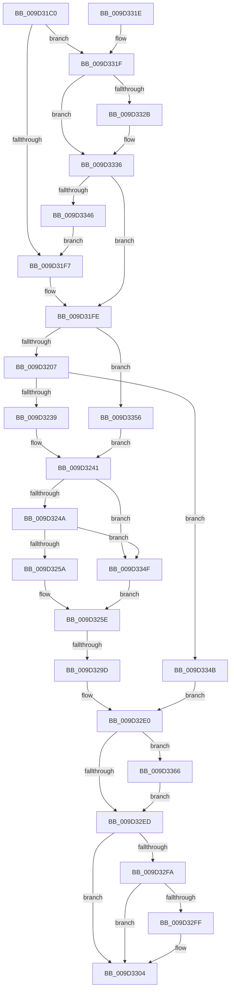

# _CmGetDeviceCompoundFilters

- RVA: `0x009D31C0`–`0x009D336D` (길이 `429` bytes)
- VA: `0x00000001409D31C0`
- 실행 섹션: `PAGE`
- PDB 이름 있음: `예`; PDB Function 태그: `예`
- unwind 정보 RVA: `0x000A1524`
- 디코드: `103`개 명령, `429/429` bytes 표시
- 미해석 바이트: `0` (있으면 어셈블리에 `.byte`로 보존)

> 이 문서는 커널 이미지의 기계어와 PDB 기호를 분석해 생성했습니다. 4번과 5번은 함수 원형과 자료형을 바이너리 사용 방식에서 추정한 C 해석이며 원본 소스 복구 결과는 아닙니다.

## 1. Dependencies

- 직접 호출 지점: **5**; 고유 호출 대상: **4**
- 직접 호출자로 확인된 함수: **1**
- RIP 상대 이미지 참조: **5**

### Outgoing calls
- `0x009D322C` → [_CmOpenDeviceRegKey](../8E/_CmOpenDeviceRegKey_function_008EE540.md) (function, `0x008EE540`)
- `0x009D3280` → [_RegRtlOpenKeyTransacted](../8E/_RegRtlOpenKeyTransacted_function_008EF810.md) (function, `0x008EF810`)
- `0x009D32D6` → [CmGetDeviceMappedPropertyFromRegProp](CmGetDeviceMappedPropertyFromRegProp_function_009D2A60.md) (function, `0x009D2A60`)
- `0x009D32FF` → [ZwClose](../../text/6A/ZwClose_function_006AD2B0.md) (function, `0x006AD2B0`)
- `0x009D3366` → [ZwClose](../../text/6A/ZwClose_function_006AD2B0.md) (function, `0x006AD2B0`)

### Direct callers
- [_CmGetDeviceMappedPropertyFromComposite](_CmGetDeviceMappedPropertyFromComposite_function_009D1684.md) at `0x009D189D`

### Static image references
- `0x009D31F7` → RVA `0x00014068` (`.rdata`; read)
- `0x009D326B` → RVA `0x00AFE870` (` ?? ::NNGAKEGL::`string'`; read)
- `0x009D3322` → RVA `0x000140C8` (`.rdata`; read)
- `0x009D332F` → RVA `0x000140D0` (`.rdata`; read)
- `0x009D3336` → RVA `0x000140E0` (`.rdata`; read)

## 2. Other-region calls and transfers

- 다른 실행 섹션으로 향하는 call: **2**
  - `0x009D32FF` → [ZwClose](../../text/6A/ZwClose_function_006AD2B0.md) (`PAGE` → `.text`)
  - `0x009D3366` → [ZwClose](../../text/6A/ZwClose_function_006AD2B0.md) (`PAGE` → `.text`)
- call이 아닌 외부 분기/꼬리 이동: **1**
  - `0x009D3297` → [sub_00B2F5B8](../B2/Unknown_function_00B2F5B8.md) (`tail-transfer`)

## 3. Assembly (complete function range)

```asm
009D31C0  48 8B C4                        mov rax, rsp
009D31C3  48 89 58 08                     mov qword ptr [rax + 8], rbx
009D31C7  55                              push rbp
009D31C8  56                              push rsi
009D31C9  57                              push rdi
009D31CA  41 54                           push r12
009D31CC  41 55                           push r13
009D31CE  41 56                           push r14
009D31D0  41 57                           push r15
009D31D2  48 83 EC 50                     sub rsp, 0x50
009D31D6  33 DB                           xor ebx, ebx
009D31D8  49 8B F1                        mov rsi, r9
009D31DB  48 21 58 18                     and qword ptr [rax + 0x18], rbx
009D31DF  49 8B E8                        mov rbp, r8
009D31E2  48 21 58 20                     and qword ptr [rax + 0x20], rbx
009D31E6  4C 8B FA                        mov r15, rdx
009D31E9  41 83 79 10 16                  cmp dword ptr [r9 + 0x10], 0x16
009D31EE  48 8B F9                        mov rdi, rcx
009D31F1  0F 84 28 01 00 00               je 0x1409d331f
009D31F7  4C 8D 35 6A 0E 64 FF            lea r14, [rip - 0x9bf196]
009D31FE  48 85 ED                        test rbp, rbp
009D3201  0F 85 4F 01 00 00               jne 0x1409d3356
009D3207  48 21 5C 24 38                  and qword ptr [rsp + 0x38], rbx
009D320C  48 8D 84 24 A0 00 00 00         lea rax, [rsp + 0xa0]
009D3214  48 89 44 24 30                  mov qword ptr [rsp + 0x30], rax
009D3219  44 8D 45 10                     lea r8d, [rbp + 0x10]
009D321D  88 5C 24 28                     mov byte ptr [rsp + 0x28], bl
009D3221  45 33 C9                        xor r9d, r9d
009D3224  C7 44 24 20 01 00 00 02         mov dword ptr [rsp + 0x20], 0x2000001
009D322C  E8 0F B3 F1 FF                  call 0x1408ee540
009D3231  85 C0                           test eax, eax
009D3233  0F 88 12 01 00 00               js 0x1409d334b
009D3239  48 8B 8C 24 A0 00 00 00         mov rcx, qword ptr [rsp + 0xa0]
009D3241  48 85 FF                        test rdi, rdi
009D3244  0F 84 05 01 00 00               je 0x1409d334f
009D324A  48 8B 87 E0 00 00 00            mov rax, qword ptr [rdi + 0xe0]
009D3251  48 85 C0                        test rax, rax
009D3254  0F 84 F5 00 00 00               je 0x1409d334f
009D325A  48 8B 50 08                     mov rdx, qword ptr [rax + 8]
009D325E  48 89 54 24 28                  mov qword ptr [rsp + 0x28], rdx
009D3263  48 8D 84 24 A8 00 00 00         lea rax, [rsp + 0xa8]
009D326B  48 8D 15 FE B5 12 00            lea rdx, [rip + 0x12b5fe]
009D3272  48 89 44 24 20                  mov qword ptr [rsp + 0x20], rax
009D3277  41 B9 1F 00 02 00               mov r9d, 0x2001f
009D327D  45 33 C0                        xor r8d, r8d
009D3280  E8 8B C5 F1 FF                  call 0x1408ef810
009D3285  4C 8B A4 24 C8 00 00 00         mov r12, qword ptr [rsp + 0xc8]
009D328D  44 8B AC 24 C0 00 00 00         mov r13d, dword ptr [rsp + 0xc0]
009D3295  85 C0                           test eax, eax
009D3297  0F 89 1B C3 15 00               jns 0x140b2f5b8
009D329D  21 5C 24 40                     and dword ptr [rsp + 0x40], ebx
009D32A1  4D 8B CE                        mov r9, r14
009D32A4  48 8B 84 24 B8 00 00 00         mov rax, qword ptr [rsp + 0xb8]
009D32AC  49 8B D7                        mov rdx, r15
009D32AF  4C 8B 84 24 A0 00 00 00         mov r8, qword ptr [rsp + 0xa0]
009D32B7  48 8B CF                        mov rcx, rdi
009D32BA  4C 89 64 24 38                  mov qword ptr [rsp + 0x38], r12
009D32BF  44 89 6C 24 30                  mov dword ptr [rsp + 0x30], r13d
009D32C4  48 89 44 24 28                  mov qword ptr [rsp + 0x28], rax
009D32C9  48 8B 84 24 B0 00 00 00         mov rax, qword ptr [rsp + 0xb0]
009D32D1  48 89 44 24 20                  mov qword ptr [rsp + 0x20], rax
009D32D6  E8 85 F7 FF FF                  call 0x1409d2a60
009D32DB  85 C0                           test eax, eax
009D32DD  0F 48 D8                        cmovs ebx, eax
009D32E0  48 8B 8C 24 A8 00 00 00         mov rcx, qword ptr [rsp + 0xa8]
009D32E8  48 85 C9                        test rcx, rcx
009D32EB  75 79                           jne 0x1409d3366
009D32ED  48 8B 8C 24 A0 00 00 00         mov rcx, qword ptr [rsp + 0xa0]
009D32F5  48 85 C9                        test rcx, rcx
009D32F8  74 0A                           je 0x1409d3304
009D32FA  48 85 ED                        test rbp, rbp
009D32FD  75 05                           jne 0x1409d3304
009D32FF  E8 AC 9F CD FF                  call 0x1406ad2b0
009D3304  8B C3                           mov eax, ebx
009D3306  48 8B 9C 24 90 00 00 00         mov rbx, qword ptr [rsp + 0x90]
009D330E  48 83 C4 50                     add rsp, 0x50
009D3312  41 5F                           pop r15
009D3314  41 5E                           pop r14
009D3316  41 5D                           pop r13
009D3318  41 5C                           pop r12
009D331A  5F                              pop rdi
009D331B  5E                              pop rsi
009D331C  5D                              pop rbp
009D331D  C3                              ret
009D331E  CC                              int3
009D331F  49 8B 01                        mov rax, qword ptr [r9]
009D3322  48 2B 05 9F 0D 64 FF            sub rax, qword ptr [rip - 0x9bf261]
009D3329  75 0B                           jne 0x1409d3336
009D332B  49 8B 41 08                     mov rax, qword ptr [r9 + 8]
009D332F  48 2B 05 9A 0D 64 FF            sub rax, qword ptr [rip - 0x9bf266]
009D3336  4C 8D 35 A3 0D 64 FF            lea r14, [rip - 0x9bf25d]
009D333D  48 85 C0                        test rax, rax
009D3340  0F 84 B8 FE FF FF               je 0x1409d31fe
009D3346  E9 AC FE FF FF                  jmp 0x1409d31f7
009D334B  8B D8                           mov ebx, eax
009D334D  EB 91                           jmp 0x1409d32e0
009D334F  33 D2                           xor edx, edx
009D3351  E9 08 FF FF FF                  jmp 0x1409d325e
009D3356  48 8B CD                        mov rcx, rbp
009D3359  48 89 8C 24 A0 00 00 00         mov qword ptr [rsp + 0xa0], rcx
009D3361  E9 DB FE FF FF                  jmp 0x1409d3241
009D3366  E8 45 9F CD FF                  call 0x1406ad2b0
009D336B  EB 80                           jmp 0x1409d32ed
```

## 4. C-style interpretation (structured pseudocode)

```c
__int64 __fastcall _CmGetDeviceCompoundFilters(__int64 a1, __int64 a2, __int64 a3, __int64 a4, __int64 a5, __int64 a6, unsigned int a7, __int64 a8)
{
    __int64 result;
    __int64 v_rbx;
    __int64 v_rsp;
    unsigned int v_stack_m48;
    unsigned __int64 v_stack_m50;
    unsigned __int64 v_stack_m58;
    unsigned __int8 v_stack_m60;
    unsigned int v_stack_m68;
    unsigned __int64 v_stack_p18;
    unsigned __int64 v_stack_p20;
    unsigned __int64 v_stack_p8;
    unsigned __int64 v_stack_pA0;

    *(unsigned __int64 *)(v_rsp + 8) = v_rbx;
    v_rsp = (v_rsp) - (80);
    v_rbx = 0;
    if ((*(unsigned int *)(a4 + 16)) == 22) goto loc_009D331F;
loc_009D31F7:
loc_009D31FE:
    if (a3 != 0) goto loc_009D3356;
    v_stack_m58 = v_stack_p18;
    v_stack_m60 = 0;
    a4 = 0;
    v_stack_m68 = 0x2000001ULL;
    result = _CmOpenDeviceRegKey(a1, a2, a3 + 16, a4);
    if (sign_flag) goto loc_009D334B;
loc_009D3241:
    if (a1 == 0) goto loc_009D334F;
    if (*(unsigned __int64 *)(a1 + 224) == 0) goto loc_009D334F;
loc_009D325E:
    v_stack_m60 = *(unsigned __int64 *)(*(unsigned __int64 *)(a1 + 224) + 8);
    v_stack_m68 = v_stack_p20;
    a3 = 0;
    result = _RegRtlOpenKeyTransacted(v_stack_p18, v_rip + 1226238, a3, (unsigned int)(0x2001FULL));
    v_stack_m50 = a8;
    v_stack_m58 = (unsigned int)((unsigned int)(a7));
    v_stack_m60 = a6;
    v_stack_m68 = a5;
    result = CmGetDeviceMappedPropertyFromRegProp(a1, a2, v_stack_p18, v_rip - 10219926);
    if (sign_flag) { v_rbx = (unsigned int)(result); }
loc_009D32E0:
    if (v_stack_p20 != 0) goto loc_009D3366;
loc_009D32ED:
    if (v_stack_p18 == 0) goto loc_009D3304;
    if (0 == 0) {
        result = ZwClose(v_stack_p18, a2, v_stack_p18, v_rip - 10219926);
    }
    v_rsp = (v_rsp) + (80);
    return (unsigned int)((unsigned int)(v_rbx));
loc_009D331F:
    result = (*(unsigned __int64 *)(v_rip - 10219926)) - (*(unsigned __int64 *)(v_rip - 10220129));
    if (!(condition_is_not_equal)) {
        result = *(unsigned __int64 *)(v_rip - 10219926 + 8);
        result = (result) - (*(unsigned __int64 *)(v_rip - 10220134));
    }
    if (result == 0) goto loc_009D31FE;
    goto loc_009D31F7;
loc_009D334B:
    goto loc_009D32E0;
loc_009D334F:
    a2 = 0;
    goto loc_009D325E;
loc_009D3356:
    v_stack_pA0 = 0;
    goto loc_009D3241;
loc_009D3366:
    result = ZwClose(0, a2, v_stack_p18, v_rip - 10219926);
    goto loc_009D32ED;
}
```

## 5. (Beta) C Style

```c
int64_t _CmGetDeviceCompoundFilters(int64_t Arg1, int64_t Arg2, int64_t Arg3, void *Arg4, int64_t Arg5, int64_t Arg6, uint32_t Arg7, int64_t Arg8)
{
    uint8_t *arg4 = (uint8_t *)Arg4;

    int64_t result;
    int64_t local_rbx;
    int64_t local_rsp;
    uint32_t v_stack_m48;
    uint64_t v_stack_m50;
    uint64_t v_stack_m58;
    uint8_t v_stack_m60;
    uint32_t v_stack_m68;
    uint64_t v_stack_p18;
    uint64_t v_stack_p20;
    uint64_t v_stack_p8;
    uint64_t v_stack_pA0;

    *(uint64_t *)(local_rsp + 0x8) = local_rbx;
    local_rsp = (local_rsp) - (80);
    local_rbx = 0;
    if ((*(uint32_t *)(arg4 + 0x10)) == 22) goto loc_009D331F;
loc_009D31F7:
loc_009D31FE:
    if (Arg3 != 0) goto loc_009D3356;
    v_stack_m58 = v_stack_p18;
    v_stack_m60 = 0;
    Arg4 = 0;
    v_stack_m68 = 0x2000001ULL;
    result = _CmOpenDeviceRegKey(Arg1, Arg2, Arg3 + 16, Arg4);
    if (sign_flag) goto loc_009D334B;
loc_009D3241:
    if (Arg1 == 0) goto loc_009D334F;
    if (*(uint64_t *)(Arg1 + 0xE0) == 0) goto loc_009D334F;
loc_009D325E:
    v_stack_m60 = *(uint64_t *)(*(uint64_t *)(Arg1 + 0xE0) + 0x8);
    v_stack_m68 = v_stack_p20;
    Arg3 = 0;
    result = _RegRtlOpenKeyTransacted(v_stack_p18, v_rip + 1226238, Arg3, (uint32_t)(0x2001FULL));
    v_stack_m50 = Arg8;
    v_stack_m58 = (uint32_t)((uint32_t)(Arg7));
    v_stack_m60 = Arg6;
    v_stack_m68 = Arg5;
    result = CmGetDeviceMappedPropertyFromRegProp(Arg1, Arg2, v_stack_p18, v_rip - 10219926);
    if (sign_flag) { local_rbx = (uint32_t)(result); }
loc_009D32E0:
    if (v_stack_p20 != 0) goto loc_009D3366;
loc_009D32ED:
    if (v_stack_p18 == 0) goto loc_009D3304;
    if (0 == 0) {
        result = ZwClose(v_stack_p18, Arg2, v_stack_p18, v_rip - 10219926);
    }
    local_rsp = (local_rsp) + (80);
    return (uint32_t)((uint32_t)(local_rbx));
loc_009D331F:
    result = (*(uint64_t *)(v_rip - 0x9BF196)) - (*(uint64_t *)(v_rip - 0x9BF261));
    if (!(condition_is_not_equal)) {
        result = *(uint64_t *)(v_rip - 0x9BF196 + 0x8);
        result = (result) - (*(uint64_t *)(v_rip - 0x9BF266));
    }
    if (result == 0) goto loc_009D31FE;
    goto loc_009D31F7;
loc_009D334B:
    goto loc_009D32E0;
loc_009D334F:
    Arg2 = 0;
    goto loc_009D325E;
loc_009D3356:
    v_stack_pA0 = 0;
    goto loc_009D3241;
loc_009D3366:
    result = ZwClose(0, Arg2, v_stack_p18, v_rip - 10219926);
    goto loc_009D32ED;
}
```

### 관측된 메모리 오프셋

구조체 형식이 확인되지 않은 접근은 인자 기준의 오프셋으로만 기록했습니다.

| 기준 인자 | 오프셋 표현 | 폭 (bit) | 접근 |
|---|---:|---:|---|
| `Arg4` | `+ 0x0` | `64` | `R` |
| `Arg4` | `+ 0x8` | `64` | `R` |
| `Arg4` | `+ 0x10` | `32` | `R` |

## 6. Execution-region graph

[열기: 2D/3D 그래프와 함수 탐색 컨트롤 패널](../../../control-panel.html?section=page&rva=0x009D31C0&view=graph)

- 2D 그래프는 위에서 아래로 흐르고, 3D 그래프는 빈 공간을 드래그해 회전합니다. Shift+드래그는 이동, 휠은 확대·축소, 함수 노드 선택은 대상 보고서 이동입니다.

### Static fallback


