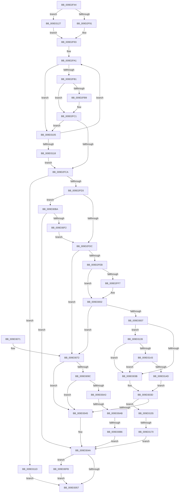

# _CmGetDeviceMappedPropertyFromInstanceKeyRegValue

- RVA: `0x009D2F44`–`0x009D3179` (길이 `565` bytes)
- VA: `0x00000001409D2F44`
- 실행 섹션: `PAGE`
- PDB 이름 있음: `예`; PDB Function 태그: `예`
- unwind 정보 RVA: `0x000A14F8`
- 디코드: `148`개 명령, `565/565` bytes 표시
- 미해석 바이트: `0` (있으면 어셈블리에 `.byte`로 보존)

> 이 문서는 커널 이미지의 기계어와 PDB 기호를 분석해 생성했습니다. 4번과 5번은 함수 원형과 자료형을 바이너리 사용 방식에서 추정한 C 해석이며 원본 소스 복구 결과는 아닙니다.

## 1. Dependencies

- 직접 호출 지점: **4**; 고유 호출 대상: **3**
- 직접 호출자로 확인된 함수: **2**
- RIP 상대 이미지 참조: **3**

### Outgoing calls
- `0x009D302E` → [PnpCtxRegQueryValue](../99/PnpCtxRegQueryValue_function_009940FC.md) (function, `0x009940FC`)
- `0x009D308E` → [PnpCtxRegQueryValue](../99/PnpCtxRegQueryValue_function_009940FC.md) (function, `0x009940FC`)
- `0x009D30E3` → [_CmOpenDeviceRegKey](../8E/_CmOpenDeviceRegKey_function_008EE540.md) (function, `0x008EE540`)
- `0x009D30FB` → [ZwClose](../../text/6A/ZwClose_function_006AD2B0.md) (function, `0x006AD2B0`)

### Direct callers
- [sub_008E1FBF](../8E/Unknown_function_008E1FBF.md) at `0x008E1FF6`
- [_CmGetDeviceMappedPropertyKeys](_CmGetDeviceMappedPropertyKeys_function_009D0D78.md) at `0x009D0FCC`

### Static image references
- `0x009D2F97` → RVA `0x00B4B720` (`PAGE`; read)
- `0x009D2FEE` → RVA `0x00014428` (`.rdata`; read)
- `0x009D2FFB` → RVA `0x00014430` (`.rdata`; read)

## 2. Other-region calls and transfers

- 다른 실행 섹션으로 향하는 call: **1**
  - `0x009D30FB` → [ZwClose](../../text/6A/ZwClose_function_006AD2B0.md) (`PAGE` → `.text`)
- call이 아닌 외부 분기/꼬리 이동: **3**
  - `0x009D30A5` → [sub_00B2F580](../B2/Unknown_function_00B2F580.md) (`tail-transfer`)
  - `0x009D30B0` → [sub_00B2F580](../B2/Unknown_function_00B2F580.md) (`tail-transfer`)
  - `0x009D316A` → [sub_00B2F580 + 0x2E](../B2/Unknown_function_00B2F580.md) (`tail-transfer`)

## 3. Assembly (complete function range)

```asm
009D2F44  48 89 5C 24 18                  mov qword ptr [rsp + 0x18], rbx
009D2F49  48 89 54 24 10                  mov qword ptr [rsp + 0x10], rdx
009D2F4E  48 89 4C 24 08                  mov qword ptr [rsp + 8], rcx
009D2F53  55                              push rbp
009D2F54  56                              push rsi
009D2F55  57                              push rdi
009D2F56  41 54                           push r12
009D2F58  41 55                           push r13
009D2F5A  41 56                           push r14
009D2F5C  41 57                           push r15
009D2F5E  48 8B EC                        mov rbp, rsp
009D2F61  48 83 EC 50                     sub rsp, 0x50
009D2F65  4C 8B 6D 60                     mov r13, qword ptr [rbp + 0x60]
009D2F69  33 D2                           xor edx, edx
009D2F6B  48 8B 45 78                     mov rax, qword ptr [rbp + 0x78]
009D2F6F  33 DB                           xor ebx, ebx
009D2F71  21 55 F0                        and dword ptr [rbp - 0x10], edx
009D2F74  4D 8B F1                        mov r14, r9
009D2F77  4C 8B 7D 68                     mov r15, qword ptr [rbp + 0x68]
009D2F7B  4D 8B E0                        mov r12, r8
009D2F7E  41 21 55 00                     and dword ptr [r13], edx
009D2F82  21 10                           and dword ptr [rax], edx
009D2F84  48 89 55 F8                     mov qword ptr [rbp - 8], rdx
009D2F88  4D 85 FF                        test r15, r15
009D2F8B  0F 85 96 01 00 00               jne 0x1409d3127
009D2F91  33 F6                           xor esi, esi
009D2F93  45 8B 59 10                     mov r11d, dword ptr [r9 + 0x10]
009D2F97  4C 8D 05 82 87 17 00            lea r8, [rip + 0x178782]
009D2F9E  45 33 D2                        xor r10d, r10d
009D2FA1  4D 8B 08                        mov r9, qword ptr [r8]
009D2FA4  49 8B F8                        mov rdi, r8
009D2FA7  45 3B 59 10                     cmp r11d, dword ptr [r9 + 0x10]
009D2FAB  0F 85 54 01 00 00               jne 0x1409d3105
009D2FB1  49 8B 0E                        mov rcx, qword ptr [r14]
009D2FB4  49 2B 09                        sub rcx, qword ptr [r9]
009D2FB7  75 08                           jne 0x1409d2fc1
009D2FB9  49 8B 4E 08                     mov rcx, qword ptr [r14 + 8]
009D2FBD  49 2B 49 08                     sub rcx, qword ptr [r9 + 8]
009D2FC1  48 85 C9                        test rcx, rcx
009D2FC4  0F 85 3B 01 00 00               jne 0x1409d3105
009D2FCA  48 85 FF                        test rdi, rdi
009D2FCD  0F 84 4A 01 00 00               je 0x1409d311d
009D2FD3  4D 85 E4                        test r12, r12
009D2FD6  0F 84 DE 00 00 00               je 0x1409d30ba
009D2FDC  41 83 7E 10 02                  cmp dword ptr [r14 + 0x10], 2
009D2FE1  4C 8B 47 10                     mov r8, qword ptr [rdi + 0x10]
009D2FE5  0F 85 87 00 00 00               jne 0x1409d3072
009D2FEB  49 8B 06                        mov rax, qword ptr [r14]
009D2FEE  48 2B 05 33 14 64 FF            sub rax, qword ptr [rip - 0x9bebcd]
009D2FF5  75 0B                           jne 0x1409d3002
009D2FF7  49 8B 46 08                     mov rax, qword ptr [r14 + 8]
009D2FFB  48 2B 05 2E 14 64 FF            sub rax, qword ptr [rip - 0x9bebd2]
009D3002  48 85 C0                        test rax, rax
009D3005  75 6B                           jne 0x1409d3072
009D3007  21 45 68                        and dword ptr [rbp + 0x68], eax
009D300A  4C 8D 4D F0                     lea r9, [rbp - 0x10]
009D300E  48 8D 45 60                     lea rax, [rbp + 0x60]
009D3012  C7 45 60 04 00 00 00            mov dword ptr [rbp + 0x60], 4
009D3019  48 89 44 24 28                  mov qword ptr [rsp + 0x28], rax
009D301E  4D 85 E4                        test r12, r12
009D3021  48 8D 45 68                     lea rax, [rbp + 0x68]
009D3025  49 0F 45 D4                     cmovne rdx, r12
009D3029  48 89 44 24 20                  mov qword ptr [rsp + 0x20], rax
009D302E  E8 C9 10 FC FF                  call 0x1409940fc
009D3033  85 C0                           test eax, eax
009D3035  0F 89 FE 00 00 00               jns 0x1409d3139
009D303B  33 C0                           xor eax, eax
009D303D  85 C0                           test eax, eax
009D303F  0F 85 10 01 00 00               jne 0x1409d3155
009D3045  BB 25 02 00 C0                  mov ebx, 0xc0000225
009D304A  48 8B 4D F8                     mov rcx, qword ptr [rbp - 8]
009D304E  48 85 C9                        test rcx, rcx
009D3051  0F 85 A4 00 00 00               jne 0x1409d30fb
009D3057  8B C3                           mov eax, ebx
009D3059  48 8B 9C 24 A0 00 00 00         mov rbx, qword ptr [rsp + 0xa0]
009D3061  48 83 C4 50                     add rsp, 0x50
009D3065  41 5F                           pop r15
009D3067  41 5E                           pop r14
009D3069  41 5D                           pop r13
009D306B  41 5C                           pop r12
009D306D  5F                              pop rdi
009D306E  5E                              pop rsi
009D306F  5D                              pop rbp
009D3070  C3                              ret
009D3071  CC                              int3
009D3072  48 8D 45 60                     lea rax, [rbp + 0x60]
009D3076  89 75 60                        mov dword ptr [rbp + 0x60], esi
009D3079  48 89 44 24 28                  mov qword ptr [rsp + 0x28], rax
009D307E  4C 8D 4D F0                     lea r9, [rbp - 0x10]
009D3082  4D 85 E4                        test r12, r12
009D3085  4C 89 7C 24 20                  mov qword ptr [rsp + 0x20], r15
009D308A  49 0F 45 D4                     cmovne rdx, r12
009D308E  E8 69 10 FC FF                  call 0x1409940fc
009D3093  8B C8                           mov ecx, eax
009D3095  3D 34 00 00 C0                  cmp eax, 0xc0000034
009D309A  74 A9                           je 0x1409d3045
009D309C  3D 7C 01 00 C0                  cmp eax, 0xc000017c
009D30A1  74 A2                           je 0x1409d3045
009D30A3  85 C0                           test eax, eax
009D30A5  0F 84 D5 C4 15 00               je 0x140b2f580
009D30AB  3D 23 00 00 C0                  cmp eax, 0xc0000023
009D30B0  0F 84 CA C4 15 00               je 0x140b2f580
009D30B6  8B D8                           mov ebx, eax
009D30B8  EB 90                           jmp 0x1409d304a
009D30BA  48 21 54 24 38                  and qword ptr [rsp + 0x38], rdx
009D30BF  48 8D 45 F8                     lea rax, [rbp - 8]
009D30C3  48 8B 4D 40                     mov rcx, qword ptr [rbp + 0x40]
009D30C7  45 33 C9                        xor r9d, r9d
009D30CA  48 89 44 24 30                  mov qword ptr [rsp + 0x30], rax
009D30CF  88 54 24 28                     mov byte ptr [rsp + 0x28], dl
009D30D3  48 8B 55 48                     mov rdx, qword ptr [rbp + 0x48]
009D30D7  45 8D 41 10                     lea r8d, [r9 + 0x10]
009D30DB  C7 44 24 20 01 00 00 00         mov dword ptr [rsp + 0x20], 1
009D30E3  E8 58 B4 F1 FF                  call 0x1408ee540
009D30E8  8B D8                           mov ebx, eax
009D30EA  85 C0                           test eax, eax
009D30EC  0F 88 58 FF FF FF               js 0x1409d304a
009D30F2  48 8B 55 F8                     mov rdx, qword ptr [rbp - 8]
009D30F6  E9 E1 FE FF FF                  jmp 0x1409d2fdc
009D30FB  E8 B0 A1 CD FF                  call 0x1406ad2b0
009D3100  E9 52 FF FF FF                  jmp 0x1409d3057
009D3105  33 FF                           xor edi, edi
009D3107  41 FF C2                        inc r10d
009D310A  49 83 C0 20                     add r8, 0x20
009D310E  41 83 FA 02                     cmp r10d, 2
009D3112  0F 82 89 FE FF FF               jb 0x1409d2fa1
009D3118  E9 AD FE FF FF                  jmp 0x1409d2fca
009D311D  BB 30 02 00 C0                  mov ebx, 0xc0000230
009D3122  E9 30 FF FF FF                  jmp 0x1409d3057
009D3127  8B 75 70                        mov esi, dword ptr [rbp + 0x70]
009D312A  8B C6                           mov eax, esi
009D312C  F7 D8                           neg eax
009D312E  48 1B C9                        sbb rcx, rcx
009D3131  4C 23 F9                        and r15, rcx
009D3134  E9 5A FE FF FF                  jmp 0x1409d2f93
009D3139  83 7D F0 04                     cmp dword ptr [rbp - 0x10], 4
009D313D  0F 85 F8 FE FF FF               jne 0x1409d303b
009D3143  83 7D 60 04                     cmp dword ptr [rbp + 0x60], 4
009D3147  0F 85 EE FE FF FF               jne 0x1409d303b
009D314D  8B 45 68                        mov eax, dword ptr [rbp + 0x68]
009D3150  E9 E8 FE FF FF                  jmp 0x1409d303d
009D3155  48 8B 45 78                     mov rax, qword ptr [rbp + 0x78]
009D3159  C7 00 01 00 00 00               mov dword ptr [rax], 1
009D315F  41 C7 45 00 11 00 00 00         mov dword ptr [r13], 0x11
009D3167  83 FE 01                        cmp esi, 1
009D316A  0F 82 3E C4 15 00               jb 0x140b2f5ae
009D3170  41 C6 07 FF                     mov byte ptr [r15], 0xff
009D3174  E9 D1 FE FF FF                  jmp 0x1409d304a
```

## 4. C-style interpretation (structured pseudocode)

```c
__int64 __fastcall _CmGetDeviceMappedPropertyFromInstanceKeyRegValue(__int64 a1, __int64 a2, __int64 a3, __int64 a4, unsigned int a5, unsigned int a6, unsigned int a7, __int64 a8)
{
    __int64 result;
    __int64 v_r10;
    __int64 v_r15;
    __int64 v_rbx;
    __int64 v_rdi;
    __int64 v_rsi;
    __int64 v_rsp;
    unsigned __int64 v_stack_m40;
    unsigned int v_stack_m48;
    unsigned __int64 v_stack_m60;
    unsigned __int64 v_stack_m68;
    unsigned __int64 v_stack_p10;
    unsigned __int64 v_stack_p18;
    unsigned __int64 v_stack_p20;
    unsigned int v_stack_p28;
    unsigned __int64 v_stack_p30;
    unsigned __int64 v_stack_p38;
    unsigned __int64 v_stack_p8;

    v_stack_p18 = v_rbx;
    v_stack_p10 = a2;
    v_stack_p8 = a1;
    v_rsp = (v_rsp) - (80);
    a2 = 0;
    v_rbx = 0;
    v_stack_m40 = 0;
    if (a6 != 0) goto loc_009D3127;
    v_rsi = 0;
loc_009D2F93:
    v_r10 = 0;
loc_009D2FA1:
    if (((unsigned int)((unsigned int)(*(unsigned int *)(a4 + 16)))) != (*(unsigned int *)(*(unsigned __int64 *)(v_rip + 1542018) + 16))) goto loc_009D3105;
    a1 = (*(unsigned __int64 *)(a4)) - (*(unsigned __int64 *)(*(unsigned __int64 *)(v_rip + 1542018)));
    if (!(condition_is_not_equal)) {
        a1 = *(unsigned __int64 *)(a4 + 8);
        a1 = (a1) - (*(unsigned __int64 *)(*(unsigned __int64 *)(v_rip + 1542018) + 8));
    }
    if (a1 != 0) goto loc_009D3105;
loc_009D2FCA:
    if (v_rip + 1542018 == 0) goto loc_009D311D;
    if (a3 == 0) goto loc_009D30BA;
loc_009D2FDC:
    if ((*(unsigned int *)(a4 + 16)) != 2) goto loc_009D3072;
    result = (*(unsigned __int64 *)(a4)) - (*(unsigned __int64 *)(v_rip - 10218445));
    if (!(condition_is_not_equal)) {
        result = *(unsigned __int64 *)(a4 + 8);
        result = (result) - (*(unsigned __int64 *)(v_rip - 10218450));
    }
    if (result != 0) goto loc_009D3072;
    v_stack_p28 = 4;
    v_stack_m60 = a5;
    if (a3 != 0) { a2 = a3; }
    v_stack_m68 = a6;
    result = PnpCtxRegQueryValue(a1, a2, *(unsigned __int64 *)(v_rip + 1542018 + 16), v_stack_m48);
    if (!sign_flag) goto loc_009D3139;
loc_009D303B:
    result = 0;
loc_009D303D:
    if (0 != 0) goto loc_009D3155;
loc_009D3045:
loc_009D304A:
    if (v_stack_m40 != 0) goto loc_009D30FB;
loc_009D3057:
    v_rsp = (v_rsp) + (80);
    return (unsigned int)((unsigned int)((unsigned int)(0xC0000225ULL)));
loc_009D3072:
    v_stack_p28 = 0;
    v_stack_p28 = a5;
    v_stack_p20 = a6;
    if (a3 != 0) { a2 = a3; }
    result = PnpCtxRegQueryValue(v_stack_m40, a2, *(unsigned __int64 *)(v_rip + 1542018 + 16), v_stack_m48);
    if (((unsigned int)(result)) == 0xC0000034ULL) goto loc_009D3045;
    if (((unsigned int)(result)) == 0xC000017CULL) goto loc_009D3045;
    goto loc_009D304A;
loc_009D30BA:
    a4 = 0;
    v_stack_p30 = v_stack_m40;
    v_stack_p28 = (unsigned __int8)(a2);
    v_stack_p20 = 1;
    result = _CmOpenDeviceRegKey(v_stack_p8, v_stack_p10, a4 + 16, a4);
    if (sign_flag) goto loc_009D304A;
    goto loc_009D2FDC;
loc_009D30FB:
    result = ZwClose(v_stack_p8, v_stack_m40, a4 + 16, a4);
    goto loc_009D3057;
loc_009D3105:
    v_rdi = 0;
    v_r10 = (unsigned int)((v_r10) + 1);
    a3 = (a4 + 16) + (32);
    if (((unsigned int)(v_r10)) < 2) goto loc_009D2FA1;
    goto loc_009D2FCA;
loc_009D311D:
    goto loc_009D3057;
loc_009D3127:
    result = (unsigned int)(-((unsigned int)((unsigned int)((unsigned int)(a7)))));
    v_r15 = (a6) & (v_stack_p8);
    goto loc_009D2F93;
loc_009D3139:
    if (v_stack_m48 != 4) goto loc_009D303B;
    if (a5 != 4) goto loc_009D303B;
    goto loc_009D303D;
loc_009D3155:
    *(unsigned int *)(a8) = 1;
    *(unsigned int *)(a5) = 17;
    *(unsigned __int8 *)(v_r15) = 255;
    goto loc_009D304A;
}
```

## 5. (Beta) C Style

```c
int64_t _CmGetDeviceMappedPropertyFromInstanceKeyRegValue(int64_t Arg1, int64_t Arg2, int64_t Arg3, void *Arg4, void *Arg5, uint32_t Arg6, uint32_t Arg7, void *Arg8)
{
    uint8_t *arg4 = (uint8_t *)Arg4;
    uint8_t *arg5 = (uint8_t *)Arg5;
    uint8_t *arg8 = (uint8_t *)Arg8;

    int64_t result;
    int64_t local_r10;
    int64_t local_r15;
    int64_t local_rbx;
    int64_t local_rdi;
    int64_t local_rsi;
    int64_t local_rsp;
    uint64_t v_stack_m40;
    uint32_t v_stack_m48;
    uint64_t v_stack_m60;
    uint64_t v_stack_m68;
    uint64_t v_stack_p10;
    uint64_t v_stack_p18;
    uint64_t v_stack_p20;
    uint32_t v_stack_p28;
    uint64_t v_stack_p30;
    uint64_t v_stack_p38;
    uint64_t v_stack_p8;

    v_stack_p18 = local_rbx;
    v_stack_p10 = Arg2;
    v_stack_p8 = Arg1;
    local_rsp = (local_rsp) - (80);
    Arg2 = 0;
    local_rbx = 0;
    v_stack_m40 = 0;
    if (Arg6 != 0) goto loc_009D3127;
    local_rsi = 0;
loc_009D2F93:
    local_r10 = 0;
loc_009D2FA1:
    if (((uint32_t)((uint32_t)(*(uint32_t *)(arg4 + 0x10)))) != (*(uint32_t *)(*(uint64_t *)(v_rip + 0x178782) + 0x10))) goto loc_009D3105;
    Arg1 = (*(uint64_t *)(arg4)) - (*(uint64_t *)(*(uint64_t *)(v_rip + 0x178782)));
    if (!(condition_is_not_equal)) {
        Arg1 = *(uint64_t *)(arg4 + 0x8);
        Arg1 = (Arg1) - (*(uint64_t *)(*(uint64_t *)(v_rip + 0x178782) + 0x8));
    }
    if (Arg1 != 0) goto loc_009D3105;
loc_009D2FCA:
    if (v_rip + 1542018 == 0) goto loc_009D311D;
    if (Arg3 == 0) goto loc_009D30BA;
loc_009D2FDC:
    if ((*(uint32_t *)(arg4 + 0x10)) != 2) goto loc_009D3072;
    result = (*(uint64_t *)(arg4)) - (*(uint64_t *)(v_rip - 0x9BEBCD));
    if (!(condition_is_not_equal)) {
        result = *(uint64_t *)(arg4 + 0x8);
        result = (result) - (*(uint64_t *)(v_rip - 0x9BEBD2));
    }
    if (result != 0) goto loc_009D3072;
    v_stack_p28 = 4;
    v_stack_m60 = Arg5;
    if (Arg3 != 0) { Arg2 = Arg3; }
    v_stack_m68 = Arg6;
    result = PnpCtxRegQueryValue(Arg1, Arg2, *(uint64_t *)(v_rip + 0x178782 + 0x10), v_stack_m48);
    if (!sign_flag) goto loc_009D3139;
loc_009D303B:
    result = 0;
loc_009D303D:
    if (0 != 0) goto loc_009D3155;
loc_009D3045:
loc_009D304A:
    if (v_stack_m40 != 0) goto loc_009D30FB;
loc_009D3057:
    local_rsp = (local_rsp) + (80);
    return (uint32_t)((uint32_t)((uint32_t)(0xC0000225ULL)));
loc_009D3072:
    v_stack_p28 = 0;
    v_stack_p28 = Arg5;
    v_stack_p20 = Arg6;
    if (Arg3 != 0) { Arg2 = Arg3; }
    result = PnpCtxRegQueryValue(v_stack_m40, Arg2, *(uint64_t *)(v_rip + 0x178782 + 0x10), v_stack_m48);
    if (((uint32_t)(result)) == 0xC0000034ULL) goto loc_009D3045;
    if (((uint32_t)(result)) == 0xC000017CULL) goto loc_009D3045;
    goto loc_009D304A;
loc_009D30BA:
    Arg4 = 0;
    v_stack_p30 = v_stack_m40;
    v_stack_p28 = (uint8_t)(Arg2);
    v_stack_p20 = 1;
    result = _CmOpenDeviceRegKey(v_stack_p8, v_stack_p10, Arg4 + 16, Arg4);
    if (sign_flag) goto loc_009D304A;
    goto loc_009D2FDC;
loc_009D30FB:
    result = ZwClose(v_stack_p8, v_stack_m40, Arg4 + 16, Arg4);
    goto loc_009D3057;
loc_009D3105:
    local_rdi = 0;
    local_r10 = (uint32_t)((local_r10) + 1);
    Arg3 = (Arg4 + 16) + (32);
    if (((uint32_t)(local_r10)) < 2) goto loc_009D2FA1;
    goto loc_009D2FCA;
loc_009D311D:
    goto loc_009D3057;
loc_009D3127:
    result = (uint32_t)(-((uint32_t)((uint32_t)((uint32_t)(Arg7)))));
    local_r15 = (Arg6) & (v_stack_p8);
    goto loc_009D2F93;
loc_009D3139:
    if (v_stack_m48 != 4) goto loc_009D303B;
    if (Arg5 != 4) goto loc_009D303B;
    goto loc_009D303D;
loc_009D3155:
    *(uint32_t *)(arg8) = 1;
    *(uint32_t *)(arg5) = 17;
    *(uint8_t *)(local_r15) = 255;
    goto loc_009D304A;
}
```

### 관측된 메모리 오프셋

구조체 형식이 확인되지 않은 접근은 인자 기준의 오프셋으로만 기록했습니다.

| 기준 인자 | 오프셋 표현 | 폭 (bit) | 접근 |
|---|---:|---:|---|
| `Arg4` | `+ 0x0` | `64` | `R` |
| `Arg4` | `+ 0x8` | `64` | `R` |
| `Arg4` | `+ 0x10` | `32` | `R` |
| `Arg5` | `+ 0x0` | `32` | `R/W` |
| `Arg5` | `+ 0x0` | `32` | `W` |
| `Arg8` | `+ 0x0` | `32` | `R/W` |
| `Arg8` | `+ 0x0` | `32` | `W` |

## 6. Execution-region graph

[열기: 2D/3D 그래프와 함수 탐색 컨트롤 패널](../../../control-panel.html?section=page&rva=0x009D2F44&view=graph)

- 2D 그래프는 위에서 아래로 흐르고, 3D 그래프는 빈 공간을 드래그해 회전합니다. Shift+드래그는 이동, 휠은 확대·축소, 함수 노드 선택은 대상 보고서 이동입니다.

### Static fallback


