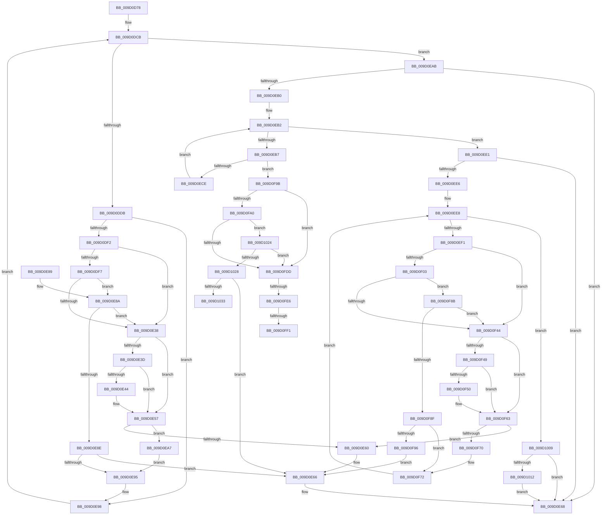

# _CmGetDeviceMappedPropertyKeys

- RVA: `0x009D0D78`–`0x009D1038` (길이 `704` bytes)
- VA: `0x00000001409D0D78`
- 실행 섹션: `PAGE`
- PDB 이름 있음: `예`; PDB Function 태그: `예`
- unwind 정보 RVA: `0x000A1370`
- 디코드: `193`개 명령, `704/704` bytes 표시
- 미해석 바이트: `0` (있으면 어셈블리에 `.byte`로 보존)

> 이 문서는 커널 이미지의 기계어와 PDB 기호를 분석해 생성했습니다. 4번과 5번은 함수 원형과 자료형을 바이너리 사용 방식에서 추정한 C 해석이며 원본 소스 복구 결과는 아닙니다.

## 1. Dependencies

- 직접 호출 지점: **3**; 고유 호출 대상: **3**
- 직접 호출자로 확인된 함수: **2**
- RIP 상대 이미지 참조: **1**

### Outgoing calls
- `0x009D0E27` → [CmGetDeviceMappedPropertyFromRegProp](CmGetDeviceMappedPropertyFromRegProp_function_009D2A60.md) (function, `0x009D2A60`)
- `0x009D0F33` → [_CmGetDeviceMappedPropertyFromComposite](_CmGetDeviceMappedPropertyFromComposite_function_009D1684.md) (function, `0x009D1684`)
- `0x009D0FCC` → [_CmGetDeviceMappedPropertyFromInstanceKeyRegValue](_CmGetDeviceMappedPropertyFromInstanceKeyRegValue_function_009D2F44.md) (function, `0x009D2F44`)

### Direct callers
- [sub_008E200E](../8E/Unknown_function_008E200E.md) at `0x008E20A7`
- [_CmDeleteDeviceWorker](../A0/_CmDeleteDeviceWorker_function_00A08F48.md) at `0x00A091B3`

### Static image references
- `0x009D0DCB` → RVA `0x00000000` (`image boundary/outside`; read)

## 2. Other-region calls and transfers

- 다른 실행 섹션으로 향하는 call: **0**
- call이 아닌 외부 분기/꼬리 이동: **4**
  - `0x009D0FE0` → [sub_00B2F552](../B2/Unknown_function_00B2F552.md) (`tail-transfer`)
  - `0x009D0FEB` → [sub_00B2F552](../B2/Unknown_function_00B2F552.md) (`tail-transfer`)
  - `0x009D1004` → [sub_00B2F552](../B2/Unknown_function_00B2F552.md) (`tail-transfer`)
  - `0x009D1033` → [sub_00B2F552 + 0xF](../B2/Unknown_function_00B2F552.md) (`tail-transfer`)

## 3. Assembly (complete function range)

```asm
009D0D78  48 8B C4                        mov rax, rsp
009D0D7B  48 89 58 10                     mov qword ptr [rax + 0x10], rbx
009D0D7F  48 89 68 18                     mov qword ptr [rax + 0x18], rbp
009D0D83  48 89 70 20                     mov qword ptr [rax + 0x20], rsi
009D0D87  48 89 48 08                     mov qword ptr [rax + 8], rcx
009D0D8B  57                              push rdi
009D0D8C  41 54                           push r12
009D0D8E  41 55                           push r13
009D0D90  41 56                           push r14
009D0D92  41 57                           push r15
009D0D94  48 83 EC 60                     sub rsp, 0x60
009D0D98  48 8B 9C 24 C0 00 00 00         mov rbx, qword ptr [rsp + 0xc0]
009D0DA0  4C 8B EA                        mov r13, rdx
009D0DA3  44 8B B4 24 B8 00 00 00         mov r14d, dword ptr [rsp + 0xb8]
009D0DAB  33 D2                           xor edx, edx
009D0DAD  48 8B AC 24 B0 00 00 00         mov rbp, qword ptr [rsp + 0xb0]
009D0DB5  45 8A F9                        mov r15b, r9b
009D0DB8  4D 8B E0                        mov r12, r8
009D0DBB  89 50 C8                        mov dword ptr [rax - 0x38], edx
009D0DBE  89 13                           mov dword ptr [rbx], edx
009D0DC0  4C 8B D9                        mov r11, rcx
009D0DC3  44 8B D2                        mov r10d, edx
009D0DC6  89 50 38                        mov dword ptr [rax + 0x38], edx
009D0DC9  8B FA                           mov edi, edx
009D0DCB  4C 8D 05 2E F2 62 FF            lea r8, [rip - 0x9d0dd2]
009D0DD2  83 FF 21                        cmp edi, 0x21
009D0DD5  0F 83 D0 00 00 00               jae 0x1409d0eab
009D0DDB  8B C7                           mov eax, edi
009D0DDD  48 8D 0C 40                     lea rcx, [rax + rax*2]
009D0DE1  49 8B B4 C8 A0 DE B4 00         mov rsi, qword ptr [r8 + rcx*8 + 0xb4dea0]
009D0DE9  48 85 F6                        test rsi, rsi
009D0DEC  0F 84 A6 00 00 00               je 0x1409d0e98
009D0DF2  45 84 FF                        test r15b, r15b
009D0DF5  75 41                           jne 0x1409d0e38
009D0DF7  89 54 24 40                     mov dword ptr [rsp + 0x40], edx
009D0DFB  48 8D 84 24 C0 00 00 00         lea rax, [rsp + 0xc0]
009D0E03  48 89 44 24 38                  mov qword ptr [rsp + 0x38], rax
009D0E08  4C 8B CE                        mov r9, rsi
009D0E0B  89 54 24 30                     mov dword ptr [rsp + 0x30], edx
009D0E0F  48 8D 44 24 50                  lea rax, [rsp + 0x50]
009D0E14  48 89 54 24 28                  mov qword ptr [rsp + 0x28], rdx
009D0E19  4D 8B C4                        mov r8, r12
009D0E1C  49 8B D5                        mov rdx, r13
009D0E1F  48 89 44 24 20                  mov qword ptr [rsp + 0x20], rax
009D0E24  49 8B CB                        mov rcx, r11
009D0E27  E8 34 1C 00 00                  call 0x1409d2a60
009D0E2C  33 D2                           xor edx, edx
009D0E2E  44 8B D0                        mov r10d, eax
009D0E31  3D 23 00 00 C0                  cmp eax, 0xc0000023
009D0E36  75 52                           jne 0x1409d0e8a
009D0E38  48 85 ED                        test rbp, rbp
009D0E3B  74 1A                           je 0x1409d0e57
009D0E3D  8B 03                           mov eax, dword ptr [rbx]
009D0E3F  41 3B C6                        cmp eax, r14d
009D0E42  73 13                           jae 0x1409d0e57
009D0E44  0F 10 06                        movups xmm0, xmmword ptr [rsi]
009D0E47  48 8D 0C 80                     lea rcx, [rax + rax*4]
009D0E4B  0F 11 44 8D 00                  movups xmmword ptr [rbp + rcx*4], xmm0
009D0E50  8B 46 10                        mov eax, dword ptr [rsi + 0x10]
009D0E53  89 44 8D 10                     mov dword ptr [rbp + rcx*4 + 0x10], eax
009D0E57  8B 03                           mov eax, dword ptr [rbx]
009D0E59  8D 48 01                        lea ecx, [rax + 1]
009D0E5C  3B C8                           cmp ecx, eax
009D0E5E  73 47                           jae 0x1409d0ea7
009D0E60  41 BA 95 00 00 C0               mov r10d, 0xc0000095
009D0E66  89 13                           mov dword ptr [rbx], edx
009D0E68  4C 8D 5C 24 60                  lea r11, [rsp + 0x60]
009D0E6D  41 8B C2                        mov eax, r10d
009D0E70  49 8B 5B 38                     mov rbx, qword ptr [r11 + 0x38]
009D0E74  49 8B 6B 40                     mov rbp, qword ptr [r11 + 0x40]
009D0E78  49 8B 73 48                     mov rsi, qword ptr [r11 + 0x48]
009D0E7C  49 8B E3                        mov rsp, r11
009D0E7F  41 5F                           pop r15
009D0E81  41 5E                           pop r14
009D0E83  41 5D                           pop r13
009D0E85  41 5C                           pop r12
009D0E87  5F                              pop rdi
009D0E88  C3                              ret
009D0E89  CC                              int3
009D0E8A  85 C0                           test eax, eax
009D0E8C  74 AA                           je 0x1409d0e38
009D0E8E  3D C0 00 00 C0                  cmp eax, 0xc00000c0
009D0E93  74 D1                           je 0x1409d0e66
009D0E95  44 8B D2                        mov r10d, edx
009D0E98  4C 8B 9C 24 90 00 00 00         mov r11, qword ptr [rsp + 0x90]
009D0EA0  FF C7                           inc edi
009D0EA2  E9 24 FF FF FF                  jmp 0x1409d0dcb
009D0EA7  89 0B                           mov dword ptr [rbx], ecx
009D0EA9  EB EA                           jmp 0x1409d0e95
009D0EAB  45 85 D2                        test r10d, r10d
009D0EAE  78 B8                           js 0x1409d0e68
009D0EB0  8B FA                           mov edi, edx
009D0EB2  83 FF 02                        cmp edi, 2
009D0EB5  73 2A                           jae 0x1409d0ee1
009D0EB7  8B C7                           mov eax, edi
009D0EB9  48 C1 E0 05                     shl rax, 5
009D0EBD  4A 8B B4 00 20 B7 B4 00         mov rsi, qword ptr [rax + r8 + 0xb4b720]
009D0EC5  48 85 F6                        test rsi, rsi
009D0EC8  0F 85 CD 00 00 00               jne 0x1409d0f9b
009D0ECE  4C 8B 9C 24 90 00 00 00         mov r11, qword ptr [rsp + 0x90]
009D0ED6  4C 8D 05 23 F1 62 FF            lea r8, [rip - 0x9d0edd]
009D0EDD  FF C7                           inc edi
009D0EDF  EB D1                           jmp 0x1409d0eb2
009D0EE1  45 85 D2                        test r10d, r10d
009D0EE4  78 82                           js 0x1409d0e68
009D0EE6  8B FA                           mov edi, edx
009D0EE8  83 FF 1C                        cmp edi, 0x1c
009D0EEB  0F 83 18 01 00 00               jae 0x1409d1009
009D0EF1  8B C7                           mov eax, edi
009D0EF3  48 03 C0                        add rax, rax
009D0EF6  49 8B B4 C0 A0 DB B4 00         mov rsi, qword ptr [r8 + rax*8 + 0xb4dba0]
009D0EFE  45 84 FF                        test r15b, r15b
009D0F01  75 41                           jne 0x1409d0f44
009D0F03  89 54 24 40                     mov dword ptr [rsp + 0x40], edx
009D0F07  48 8D 84 24 C0 00 00 00         lea rax, [rsp + 0xc0]
009D0F0F  48 89 44 24 38                  mov qword ptr [rsp + 0x38], rax
009D0F14  4C 8B CE                        mov r9, rsi
009D0F17  89 54 24 30                     mov dword ptr [rsp + 0x30], edx
009D0F1B  48 8D 44 24 50                  lea rax, [rsp + 0x50]
009D0F20  48 89 54 24 28                  mov qword ptr [rsp + 0x28], rdx
009D0F25  4D 8B C4                        mov r8, r12
009D0F28  49 8B D5                        mov rdx, r13
009D0F2B  48 89 44 24 20                  mov qword ptr [rsp + 0x20], rax
009D0F30  49 8B CB                        mov rcx, r11
009D0F33  E8 4C 07 00 00                  call 0x1409d1684
009D0F38  33 D2                           xor edx, edx
009D0F3A  44 8B D0                        mov r10d, eax
009D0F3D  3D 23 00 00 C0                  cmp eax, 0xc0000023
009D0F42  75 47                           jne 0x1409d0f8b
009D0F44  48 85 ED                        test rbp, rbp
009D0F47  74 1A                           je 0x1409d0f63
009D0F49  8B 03                           mov eax, dword ptr [rbx]
009D0F4B  41 3B C6                        cmp eax, r14d
009D0F4E  73 13                           jae 0x1409d0f63
009D0F50  0F 10 06                        movups xmm0, xmmword ptr [rsi]
009D0F53  48 8D 0C 80                     lea rcx, [rax + rax*4]
009D0F57  0F 11 44 8D 00                  movups xmmword ptr [rbp + rcx*4], xmm0
009D0F5C  8B 46 10                        mov eax, dword ptr [rsi + 0x10]
009D0F5F  89 44 8D 10                     mov dword ptr [rbp + rcx*4 + 0x10], eax
009D0F63  8B 03                           mov eax, dword ptr [rbx]
009D0F65  8D 48 01                        lea ecx, [rax + 1]
009D0F68  3B C8                           cmp ecx, eax
009D0F6A  0F 82 F0 FE FF FF               jb 0x1409d0e60
009D0F70  89 0B                           mov dword ptr [rbx], ecx
009D0F72  4C 8B 9C 24 90 00 00 00         mov r11, qword ptr [rsp + 0x90]
009D0F7A  4C 8D 05 7F F0 62 FF            lea r8, [rip - 0x9d0f81]
009D0F81  44 8B D2                        mov r10d, edx
009D0F84  FF C7                           inc edi
009D0F86  E9 5D FF FF FF                  jmp 0x1409d0ee8
009D0F8B  85 C0                           test eax, eax
009D0F8D  74 B5                           je 0x1409d0f44
009D0F8F  3D C0 00 00 C0                  cmp eax, 0xc00000c0
009D0F94  75 DC                           jne 0x1409d0f72
009D0F96  E9 CB FE FF FF                  jmp 0x1409d0e66
009D0F9B  45 84 FF                        test r15b, r15b
009D0F9E  75 3D                           jne 0x1409d0fdd
009D0FA0  48 8D 84 24 C0 00 00 00         lea rax, [rsp + 0xc0]
009D0FA8  4C 8B CE                        mov r9, rsi
009D0FAB  48 89 44 24 38                  mov qword ptr [rsp + 0x38], rax
009D0FB0  4D 8B C4                        mov r8, r12
009D0FB3  89 54 24 30                     mov dword ptr [rsp + 0x30], edx
009D0FB7  48 8D 44 24 50                  lea rax, [rsp + 0x50]
009D0FBC  48 89 54 24 28                  mov qword ptr [rsp + 0x28], rdx
009D0FC1  49 8B CB                        mov rcx, r11
009D0FC4  49 8B D5                        mov rdx, r13
009D0FC7  48 89 44 24 20                  mov qword ptr [rsp + 0x20], rax
009D0FCC  E8 73 1F 00 00                  call 0x1409d2f44
009D0FD1  33 D2                           xor edx, edx
009D0FD3  44 8B D0                        mov r10d, eax
009D0FD6  3D 23 00 00 C0                  cmp eax, 0xc0000023
009D0FDB  75 47                           jne 0x1409d1024
009D0FDD  48 85 ED                        test rbp, rbp
009D0FE0  0F 84 6C E5 15 00               je 0x140b2f552
009D0FE6  8B 03                           mov eax, dword ptr [rbx]
009D0FE8  41 3B C6                        cmp eax, r14d
009D0FEB  0F 83 61 E5 15 00               jae 0x140b2f552
009D0FF1  0F 10 06                        movups xmm0, xmmword ptr [rsi]
009D0FF4  48 8D 0C 80                     lea rcx, [rax + rax*4]
009D0FF8  0F 11 44 8D 00                  movups xmmword ptr [rbp + rcx*4], xmm0
009D0FFD  8B 46 10                        mov eax, dword ptr [rsi + 0x10]
009D1000  89 44 8D 10                     mov dword ptr [rbp + rcx*4 + 0x10], eax
009D1004  E9 49 E5 15 00                  jmp 0x140b2f552
009D1009  45 85 D2                        test r10d, r10d
009D100C  0F 88 56 FE FF FF               js 0x1409d0e68
009D1012  44 3B 33                        cmp r14d, dword ptr [rbx]
009D1015  45 1B D2                        sbb r10d, r10d
009D1018  41 81 E2 23 00 00 C0            and r10d, 0xc0000023
009D101F  E9 44 FE FF FF                  jmp 0x1409d0e68
009D1024  85 C0                           test eax, eax
009D1026  74 B5                           je 0x1409d0fdd
009D1028  3D C0 00 00 C0                  cmp eax, 0xc00000c0
009D102D  0F 84 33 FE FF FF               je 0x1409d0e66
009D1033  E9 29 E5 15 00                  jmp 0x140b2f561
```

## 4. C-style interpretation (structured pseudocode)

```c
__int64 __fastcall _CmGetDeviceMappedPropertyKeys(__int64 a1, __int64 a2, __int64 a3, unsigned __int8 a4, __int64 a5, unsigned int a6, __int64 a7)
{
    __int64 result;
    __int64 v_r10;
    __int64 v_rdi;
    __int64 v_rsp;
    unsigned __int64 v_stack_m10;
    unsigned int v_stack_m20;
    unsigned __int64 v_stack_m28;
    unsigned int v_stack_m30;
    unsigned __int64 v_stack_m38;
    unsigned __int64 v_stack_m40;
    unsigned int v_stack_m48;
    unsigned __int64 v_stack_m50;
    unsigned int v_stack_m58;
    unsigned __int64 v_stack_m60;
    unsigned __int64 v_stack_m68;
    unsigned __int64 v_stack_p30;

    *(unsigned __int64 *)(v_rsp + 16) = v_rbx;
    *(unsigned __int64 *)(v_rsp + 24) = v_rbp;
    *(unsigned __int64 *)(v_rsp + 32) = v_rsi;
    *(unsigned __int64 *)(v_rsp + 8) = a1;
    v_rsp = (v_rsp) - (96);
    a2 = 0;
    *(unsigned int *)(v_rsp - 56) = 0;
    *(unsigned int *)(a7) = 0;
    *(unsigned int *)(v_rsp + 56) = 0;
loc_009D0DCB:
    if (0 >= 33) goto loc_009D0EAB;
    if (*(unsigned __int64 *)(v_rip - 10292690 + 0 + 0 * 2 * 8 + 11853472) == 0) goto loc_009D0E98;
    if (a4 != 0) goto loc_009D0E38;
    v_stack_m48 = 0;
    v_stack_m50 = a7;
    v_stack_m58 = 0;
    v_stack_m60 = 0;
    v_stack_m68 = v_stack_m38;
    result = CmGetDeviceMappedPropertyFromRegProp(a1, 0, a3, *(unsigned __int64 *)(v_rip - 10292690 + 0 + 0 * 2 * 8 + 11853472));
    a2 = 0;
    if (((unsigned int)(result)) != 0xC0000023ULL) goto loc_009D0E8A;
loc_009D0E38:
    if (a5 == 0) goto loc_009D0E57;
    result = (unsigned int)(*(unsigned int *)(a7));
    if (((unsigned int)((unsigned int)(*(unsigned int *)(a7)))) < ((unsigned int)((unsigned int)(a6)))) {
        a1 = (unsigned int)(*(unsigned int *)(a7)) + (unsigned int)(*(unsigned int *)(a7)) * 4;
        *(unsigned __int64 *)(a5 + a1 * 4) = v_xmm0;
        result = *(unsigned int *)(*(unsigned __int64 *)(v_rip - 10292690 + 0 + 0 * 2 * 8 + 11853472) + 16);
        *(unsigned int *)(a5 + a1 * 4 + 16) = (unsigned int)(result);
    }
    if (((unsigned int)((unsigned int)(*(unsigned int *)(a7)) + 1)) >= ((unsigned int)((unsigned int)(*(unsigned int *)(a7))))) goto loc_009D0EA7;
loc_009D0E60:
loc_009D0E66:
    *(unsigned int *)(a7) = 0;
loc_009D0E68:
    return (unsigned int)((unsigned int)((unsigned int)(0xC0000095ULL)));
loc_009D0E8A:
    if ((unsigned int)((unsigned int)((unsigned int)((unsigned int)(0xC0000095ULL)))) == 0) goto loc_009D0E38;
    if (((unsigned int)((unsigned int)((unsigned int)((unsigned int)(0xC0000095ULL))))) == 0xC00000C0ULL) goto loc_009D0E66;
loc_009D0E95:
loc_009D0E98:
    v_rdi = (unsigned int)((0) + 1);
    goto loc_009D0DCB;
loc_009D0EA7:
    *(unsigned int *)(*(unsigned __int64 *)(v_stack_m28 + 56)) = (unsigned int)((unsigned int)(*(unsigned int *)(a7)) + 1);
    goto loc_009D0E95;
loc_009D0EAB:
    if (sign_flag) goto loc_009D0E68;
loc_009D0EB2:
    if (0 >= 2) goto loc_009D0EE1;
    result = (0) << (5);
    if (*(unsigned __int64 *)(result + a3 * 1 + 11843360) != 0) goto loc_009D0F9B;
    v_rdi = (unsigned int)((0) + 1);
    goto loc_009D0EB2;
loc_009D0EE1:
    if (sign_flag) goto loc_009D0E68;
loc_009D0EE8:
    if (0 >= 28) goto loc_009D1009;
    result = (0) + (0);
    if (a4 != 0) goto loc_009D0F44;
    v_stack_m20 = 0;
    v_stack_m28 = a7;
    v_stack_m30 = 0;
    v_stack_m38 = 0;
    v_stack_m40 = v_stack_m10;
    result = _CmGetDeviceMappedPropertyFromComposite(v_stack_p30, 0, a3, *(unsigned __int64 *)(v_rip - 10292957 + result * 8 + 11852704));
    a2 = 0;
    if (((unsigned int)(result)) != 0xC0000023ULL) goto loc_009D0F8B;
loc_009D0F44:
    if (*(unsigned __int64 *)(v_stack_m28 + 64) == 0) goto loc_009D0F63;
    result = (unsigned int)(*(unsigned int *)(*(unsigned __int64 *)(v_stack_m28 + 56)));
    if (((unsigned int)((unsigned int)(*(unsigned int *)(*(unsigned __int64 *)(v_stack_m28 + 56))))) < ((unsigned int)((unsigned int)(a6)))) {
        a1 = (unsigned int)(*(unsigned int *)(*(unsigned __int64 *)(v_stack_m28 + 56))) + (unsigned int)(*(unsigned int *)(*(unsigned __int64 *)(v_stack_m28 + 56))) * 4;
        *(unsigned __int64 *)(*(unsigned __int64 *)(v_stack_m28 + 64) + a1 * 4) = v_xmm0;
        result = *(unsigned int *)(*(unsigned __int64 *)(v_rip - 10292957 + result * 8 + 11852704) + 16);
        *(unsigned int *)(*(unsigned __int64 *)(v_stack_m28 + 64) + a1 * 4 + 16) = (unsigned int)(result);
    }
    if (((unsigned int)((unsigned int)(*(unsigned int *)(*(unsigned __int64 *)(v_stack_m28 + 56))) + 1)) < ((unsigned int)((unsigned int)(*(unsigned int *)(*(unsigned __int64 *)(v_stack_m28 + 56)))))) goto loc_009D0E60;
    *(unsigned int *)(*(unsigned __int64 *)(v_stack_m28 + 56)) = (unsigned int)((unsigned int)(*(unsigned int *)(*(unsigned __int64 *)(v_stack_m28 + 56))) + 1);
loc_009D0F72:
    v_rdi = (unsigned int)((0) + 1);
    goto loc_009D0EE8;
loc_009D0F8B:
    if ((unsigned int)((unsigned int)(*(unsigned int *)(*(unsigned __int64 *)(v_stack_m28 + 56)))) == 0) goto loc_009D0F44;
    if (((unsigned int)((unsigned int)(*(unsigned int *)(*(unsigned __int64 *)(v_stack_m28 + 56))))) != 0xC00000C0ULL) goto loc_009D0F72;
    goto loc_009D0E66;
loc_009D0F9B:
    if (a4 != 0) goto loc_009D0FDD;
    v_stack_m28 = a7;
    v_stack_m30 = 0;
    v_stack_m38 = 0;
    v_stack_m40 = v_stack_m10;
    result = _CmGetDeviceMappedPropertyFromInstanceKeyRegValue(v_stack_p30, 0, a3, *(unsigned __int64 *)(v_rip - 10292957 + result * 8 + 11852704));
    a2 = 0;
    if (((unsigned int)(result)) != 0xC0000023ULL) goto loc_009D1024;
loc_009D0FDD:
    *(unsigned __int64 *)(*(unsigned __int64 *)(v_stack_m28 + 64) + (unsigned int)(*(unsigned int *)(*(unsigned __int64 *)(v_stack_m28 + 56))) + (unsigned int)(*(unsigned int *)(*(unsigned __int64 *)(v_stack_m28 + 56))) * 4 * 4) = v_xmm0;
    *(unsigned int *)(*(unsigned __int64 *)(v_stack_m28 + 64) + (unsigned int)(*(unsigned int *)(*(unsigned __int64 *)(v_stack_m28 + 56))) + (unsigned int)(*(unsigned int *)(*(unsigned __int64 *)(v_stack_m28 + 56))) * 4 * 4 + 16) = (unsigned int)((unsigned int)(*(unsigned int *)(*(unsigned __int64 *)(v_rip - 10292957 + result * 8 + 11852704) + 16)));
loc_009D1009:
    if (sign_flag) goto loc_009D0E68;
    v_r10 = (unsigned int)(((unsigned int)((unsigned int)(result))) & (0xC0000023ULL));
    goto loc_009D0E68;
loc_009D1024:
    if ((unsigned int)((unsigned int)(*(unsigned int *)(*(unsigned __int64 *)(v_rip - 10292957 + result * 8 + 11852704) + 16))) == 0) goto loc_009D0FDD;
    if (((unsigned int)((unsigned int)(*(unsigned int *)(*(unsigned __int64 *)(v_rip - 10292957 + result * 8 + 11852704) + 16)))) == 0xC00000C0ULL) goto loc_009D0E66;
}
```

## 5. (Beta) C Style

```c
int64_t _CmGetDeviceMappedPropertyKeys(int64_t Arg1, int64_t Arg2, int64_t Arg3, uint8_t Arg4, int64_t Arg5, uint32_t Arg6, void *Arg7)
{
    uint8_t *arg7 = (uint8_t *)Arg7;

    int64_t result;
    int64_t local_r10;
    int64_t local_rdi;
    int64_t local_rsp;
    uint64_t v_stack_m10;
    uint32_t v_stack_m20;
    uint64_t v_stack_m28;
    uint32_t v_stack_m30;
    uint64_t v_stack_m38;
    uint64_t v_stack_m40;
    uint32_t v_stack_m48;
    uint64_t v_stack_m50;
    uint32_t v_stack_m58;
    uint64_t v_stack_m60;
    uint64_t v_stack_m68;
    uint64_t v_stack_p30;

    *(uint64_t *)(local_rsp + 0x10) = local_rbx;
    *(uint64_t *)(local_rsp + 0x18) = local_rbp;
    *(uint64_t *)(local_rsp + 0x20) = local_rsi;
    *(uint64_t *)(local_rsp + 0x8) = Arg1;
    local_rsp = (local_rsp) - (96);
    Arg2 = 0;
    *(uint32_t *)(local_rsp - 0x38) = 0;
    *(uint32_t *)(arg7) = 0;
    *(uint32_t *)(local_rsp + 0x38) = 0;
loc_009D0DCB:
    if (0 >= 33) goto loc_009D0EAB;
    if (*(uint64_t *)(v_rip - 0x9D0DD2 + 0x0 + 0x0 * 2 * 8 + 0xB4DEA0) == 0) goto loc_009D0E98;
    if (Arg4 != 0) goto loc_009D0E38;
    v_stack_m48 = 0;
    v_stack_m50 = Arg7;
    v_stack_m58 = 0;
    v_stack_m60 = 0;
    v_stack_m68 = v_stack_m38;
    result = CmGetDeviceMappedPropertyFromRegProp(Arg1, 0, Arg3, *(uint64_t *)(v_rip - 0x9D0DD2 + 0x0 + 0x0 * 2 * 8 + 0xB4DEA0));
    Arg2 = 0;
    if (((uint32_t)(result)) != 0xC0000023ULL) goto loc_009D0E8A;
loc_009D0E38:
    if (Arg5 == 0) goto loc_009D0E57;
    result = (uint32_t)(*(uint32_t *)(arg7));
    if (((uint32_t)((uint32_t)(*(uint32_t *)(arg7)))) < ((uint32_t)((uint32_t)(Arg6)))) {
        Arg1 = (uint32_t)(*(uint32_t *)(arg7)) + (uint32_t)(*(uint32_t *)(arg7)) * 4;
        *(uint64_t *)(Arg5 + Arg1 * 4) = v_xmm0;
        result = *(uint32_t *)(*(uint64_t *)(v_rip - 0x9D0DD2 + 0x0 + 0x0 * 2 * 8 + 0xB4DEA0) + 0x10);
        *(uint32_t *)(Arg5 + Arg1 * 4 + 0x10) = (uint32_t)(result);
    }
    if (((uint32_t)((uint32_t)(*(uint32_t *)(arg7)) + 1)) >= ((uint32_t)((uint32_t)(*(uint32_t *)(arg7))))) goto loc_009D0EA7;
loc_009D0E60:
loc_009D0E66:
    *(uint32_t *)(arg7) = 0;
loc_009D0E68:
    return (uint32_t)((uint32_t)((uint32_t)(0xC0000095ULL)));
loc_009D0E8A:
    if ((uint32_t)((uint32_t)((uint32_t)((uint32_t)(0xC0000095ULL)))) == 0) goto loc_009D0E38;
    if (((uint32_t)((uint32_t)((uint32_t)((uint32_t)(0xC0000095ULL))))) == 0xC00000C0ULL) goto loc_009D0E66;
loc_009D0E95:
loc_009D0E98:
    local_rdi = (uint32_t)((0) + 1);
    goto loc_009D0DCB;
loc_009D0EA7:
    *(uint32_t *)(*(uint64_t *)(v_stack_m28 + 0x38)) = (uint32_t)((uint32_t)(*(uint32_t *)(arg7)) + 1);
    goto loc_009D0E95;
loc_009D0EAB:
    if (sign_flag) goto loc_009D0E68;
loc_009D0EB2:
    if (0 >= 2) goto loc_009D0EE1;
    result = (0) << (5);
    if (*(uint64_t *)(result + Arg3 * 1 + 0xB4B720) != 0) goto loc_009D0F9B;
    local_rdi = (uint32_t)((0) + 1);
    goto loc_009D0EB2;
loc_009D0EE1:
    if (sign_flag) goto loc_009D0E68;
loc_009D0EE8:
    if (0 >= 28) goto loc_009D1009;
    result = (0) + (0);
    if (Arg4 != 0) goto loc_009D0F44;
    v_stack_m20 = 0;
    v_stack_m28 = Arg7;
    v_stack_m30 = 0;
    v_stack_m38 = 0;
    v_stack_m40 = v_stack_m10;
    result = _CmGetDeviceMappedPropertyFromComposite(v_stack_p30, 0, Arg3, *(uint64_t *)(v_rip - 0x9D0EDD + result * 8 + 0xB4DBA0));
    Arg2 = 0;
    if (((uint32_t)(result)) != 0xC0000023ULL) goto loc_009D0F8B;
loc_009D0F44:
    if (*(uint64_t *)(v_stack_m28 + 0x40) == 0) goto loc_009D0F63;
    result = (uint32_t)(*(uint32_t *)(*(uint64_t *)(v_stack_m28 + 0x38)));
    if (((uint32_t)((uint32_t)(*(uint32_t *)(*(uint64_t *)(v_stack_m28 + 0x38))))) < ((uint32_t)((uint32_t)(Arg6)))) {
        Arg1 = (uint32_t)(*(uint32_t *)(*(uint64_t *)(v_stack_m28 + 0x38))) + (uint32_t)(*(uint32_t *)(*(uint64_t *)(v_stack_m28 + 0x38))) * 4;
        *(uint64_t *)(*(uint64_t *)(v_stack_m28 + 0x40) + Arg1 * 4) = v_xmm0;
        result = *(uint32_t *)(*(uint64_t *)(v_rip - 0x9D0EDD + result * 8 + 0xB4DBA0) + 0x10);
        *(uint32_t *)(*(uint64_t *)(v_stack_m28 + 0x40) + Arg1 * 4 + 0x10) = (uint32_t)(result);
    }
    if (((uint32_t)((uint32_t)(*(uint32_t *)(*(uint64_t *)(v_stack_m28 + 0x38))) + 1)) < ((uint32_t)((uint32_t)(*(uint32_t *)(*(uint64_t *)(v_stack_m28 + 0x38)))))) goto loc_009D0E60;
    *(uint32_t *)(*(uint64_t *)(v_stack_m28 + 0x38)) = (uint32_t)((uint32_t)(*(uint32_t *)(*(uint64_t *)(v_stack_m28 + 0x38))) + 1);
loc_009D0F72:
    local_rdi = (uint32_t)((0) + 1);
    goto loc_009D0EE8;
loc_009D0F8B:
    if ((uint32_t)((uint32_t)(*(uint32_t *)(*(uint64_t *)(v_stack_m28 + 0x38)))) == 0) goto loc_009D0F44;
    if (((uint32_t)((uint32_t)(*(uint32_t *)(*(uint64_t *)(v_stack_m28 + 0x38))))) != 0xC00000C0ULL) goto loc_009D0F72;
    goto loc_009D0E66;
loc_009D0F9B:
    if (Arg4 != 0) goto loc_009D0FDD;
    v_stack_m28 = Arg7;
    v_stack_m30 = 0;
    v_stack_m38 = 0;
    v_stack_m40 = v_stack_m10;
    result = _CmGetDeviceMappedPropertyFromInstanceKeyRegValue(v_stack_p30, 0, Arg3, *(uint64_t *)(v_rip - 0x9D0EDD + result * 8 + 0xB4DBA0));
    Arg2 = 0;
    if (((uint32_t)(result)) != 0xC0000023ULL) goto loc_009D1024;
loc_009D0FDD:
    *(uint64_t *)(*(uint64_t *)(v_stack_m28 + 0x40) + (uint32_t)(*(uint32_t *)(*(uint64_t *)(v_stack_m28 + 0x38))) + (uint32_t)(*(uint32_t *)(*(uint64_t *)(v_stack_m28 + 0x38))) * 4 * 4) = v_xmm0;
    *(uint32_t *)(*(uint64_t *)(v_stack_m28 + 0x40) + (uint32_t)(*(uint32_t *)(*(uint64_t *)(v_stack_m28 + 0x38))) + (uint32_t)(*(uint32_t *)(*(uint64_t *)(v_stack_m28 + 0x38))) * 4 * 4 + 0x10) = (uint32_t)((uint32_t)(*(uint32_t *)(*(uint64_t *)(v_rip - 0x9D0EDD + result * 8 + 0xB4DBA0) + 0x10)));
loc_009D1009:
    if (sign_flag) goto loc_009D0E68;
    local_r10 = (uint32_t)(((uint32_t)((uint32_t)(result))) & (0xC0000023ULL));
    goto loc_009D0E68;
loc_009D1024:
    if ((uint32_t)((uint32_t)(*(uint32_t *)(*(uint64_t *)(v_rip - 0x9D0EDD + result * 8 + 0xB4DBA0) + 0x10))) == 0) goto loc_009D0FDD;
    if (((uint32_t)((uint32_t)(*(uint32_t *)(*(uint64_t *)(v_rip - 0x9D0EDD + result * 8 + 0xB4DBA0) + 0x10)))) == 0xC00000C0ULL) goto loc_009D0E66;
}
```

### 관측된 메모리 오프셋

구조체 형식이 확인되지 않은 접근은 인자 기준의 오프셋으로만 기록했습니다.

| 기준 인자 | 오프셋 표현 | 폭 (bit) | 접근 |
|---|---:|---:|---|
| `Arg7` | `+ 0x0` | `32` | `R` |
| `Arg7` | `+ 0x0` | `32` | `W` |

## 6. Execution-region graph

[열기: 2D/3D 그래프와 함수 탐색 컨트롤 패널](../../../control-panel.html?section=page&rva=0x009D0D78&view=graph)

- 2D 그래프는 위에서 아래로 흐르고, 3D 그래프는 빈 공간을 드래그해 회전합니다. Shift+드래그는 이동, 휠은 확대·축소, 함수 노드 선택은 대상 보고서 이동입니다.

### Static fallback


