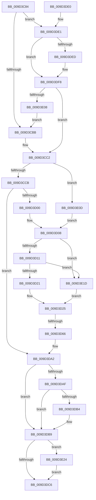

# _CmGetInstallerClassCompoundFilters

- RVA: `0x009D3C84`–`0x009D3E2B` (길이 `423` bytes)
- VA: `0x00000001409D3C84`
- 실행 섹션: `PAGE`
- PDB 이름 있음: `예`; PDB Function 태그: `예`
- unwind 정보 RVA: `0x000A15D0`
- 디코드: `100`개 명령, `423/423` bytes 표시
- 미해석 바이트: `0` (있으면 어셈블리에 `.byte`로 보존)

> 이 문서는 커널 이미지의 기계어와 PDB 기호를 분석해 생성했습니다. 4번과 5번은 함수 원형과 자료형을 바이너리 사용 방식에서 추정한 C 해석이며 원본 소스 복구 결과는 아닙니다.

## 1. Dependencies

- 직접 호출 지점: **5**; 고유 호출 대상: **4**
- 직접 호출자로 확인된 함수: **1**
- RIP 상대 이미지 참조: **5**

### Outgoing calls
- `0x009D3CF1` → [CmOpenCommonClassRegKey](../8E/CmOpenCommonClassRegKey_function_008EFF5C.md) (function, `0x008EFF5C`)
- `0x009D3D47` → [_RegRtlOpenKeyTransacted](../8E/_RegRtlOpenKeyTransacted_function_008EF810.md) (function, `0x008EF810`)
- `0x009D3D9B` → [_CmGetInstallerClassMappedPropertyFromRegProp](_CmGetInstallerClassMappedPropertyFromRegProp_function_009D3E34.md) (function, `0x009D3E34`)
- `0x009D3DB4` → [ZwClose](../../text/6A/ZwClose_function_006AD2B0.md) (function, `0x006AD2B0`)
- `0x009D3E24` → [ZwClose](../../text/6A/ZwClose_function_006AD2B0.md) (function, `0x006AD2B0`)

### Direct callers
- [_CmGetInstallerClassMappedPropertyFromComposite](_CmGetInstallerClassMappedPropertyFromComposite_function_009D398C.md) at `0x009D3A48`

### Static image references
- `0x009D3CBB` → RVA `0x00014140` (`.rdata`; read)
- `0x009D3D32` → RVA `0x00AFE870` (` ?? ::NNGAKEGL::`string'`; read)
- `0x009D3DE4` → RVA `0x00014158` (`.rdata`; read)
- `0x009D3DF1` → RVA `0x00014160` (`.rdata`; read)
- `0x009D3DF8` → RVA `0x00014188` (`.rdata`; read)

## 2. Other-region calls and transfers

- 다른 실행 섹션으로 향하는 call: **2**
  - `0x009D3DB4` → [ZwClose](../../text/6A/ZwClose_function_006AD2B0.md) (`PAGE` → `.text`)
  - `0x009D3E24` → [ZwClose](../../text/6A/ZwClose_function_006AD2B0.md) (`PAGE` → `.text`)
- call이 아닌 외부 분기/꼬리 이동: **1**
  - `0x009D3D60` → [sub_00B2F71C](../B2/Unknown_function_00B2F71C.md) (`tail-transfer`)

## 3. Assembly (complete function range)

```asm
009D3C84  48 8B C4                        mov rax, rsp
009D3C87  48 89 58 08                     mov qword ptr [rax + 8], rbx
009D3C8B  55                              push rbp
009D3C8C  56                              push rsi
009D3C8D  57                              push rdi
009D3C8E  41 54                           push r12
009D3C90  41 55                           push r13
009D3C92  41 56                           push r14
009D3C94  41 57                           push r15
009D3C96  48 83 EC 50                     sub rsp, 0x50
009D3C9A  48 83 60 18 00                  and qword ptr [rax + 0x18], 0
009D3C9F  49 8B F1                        mov rsi, r9
009D3CA2  48 83 60 20 00                  and qword ptr [rax + 0x20], 0
009D3CA7  49 8B E8                        mov rbp, r8
009D3CAA  41 83 79 10 14                  cmp dword ptr [r9 + 0x10], 0x14
009D3CAF  4C 8B FA                        mov r15, rdx
009D3CB2  48 8B F9                        mov rdi, rcx
009D3CB5  0F 84 26 01 00 00               je 0x1409d3de1
009D3CBB  4C 8D 35 7E 04 64 FF            lea r14, [rip - 0x9bfb82]
009D3CC2  48 85 ED                        test rbp, rbp
009D3CC5  0F 85 42 01 00 00               jne 0x1409d3e0d
009D3CCB  48 21 6C 24 38                  and qword ptr [rsp + 0x38], rbp
009D3CD0  48 8D 84 24 A0 00 00 00         lea rax, [rsp + 0xa0]
009D3CD8  48 89 44 24 30                  mov qword ptr [rsp + 0x30], rax
009D3CDD  44 8D 45 20                     lea r8d, [rbp + 0x20]
009D3CE1  40 88 6C 24 28                  mov byte ptr [rsp + 0x28], bpl
009D3CE6  45 33 C9                        xor r9d, r9d
009D3CE9  C7 44 24 20 01 00 00 02         mov dword ptr [rsp + 0x20], 0x2000001
009D3CF1  E8 66 C2 F1 FF                  call 0x1408eff5c
009D3CF6  8B D8                           mov ebx, eax
009D3CF8  85 C0                           test eax, eax
009D3CFA  0F 88 A2 00 00 00               js 0x1409d3da2
009D3D00  48 8B 8C 24 A0 00 00 00         mov rcx, qword ptr [rsp + 0xa0]
009D3D08  48 85 FF                        test rdi, rdi
009D3D0B  0F 84 0C 01 00 00               je 0x1409d3e1d
009D3D11  48 8B 87 E0 00 00 00            mov rax, qword ptr [rdi + 0xe0]
009D3D18  48 85 C0                        test rax, rax
009D3D1B  0F 84 FC 00 00 00               je 0x1409d3e1d
009D3D21  48 8B 50 08                     mov rdx, qword ptr [rax + 8]
009D3D25  48 89 54 24 28                  mov qword ptr [rsp + 0x28], rdx
009D3D2A  48 8D 84 24 A8 00 00 00         lea rax, [rsp + 0xa8]
009D3D32  48 8D 15 37 AB 12 00            lea rdx, [rip + 0x12ab37]
009D3D39  48 89 44 24 20                  mov qword ptr [rsp + 0x20], rax
009D3D3E  41 B9 1F 00 02 00               mov r9d, 0x2001f
009D3D44  45 33 C0                        xor r8d, r8d
009D3D47  E8 C4 BA F1 FF                  call 0x1408ef810
009D3D4C  4C 8B A4 24 C8 00 00 00         mov r12, qword ptr [rsp + 0xc8]
009D3D54  8B D8                           mov ebx, eax
009D3D56  44 8B AC 24 C0 00 00 00         mov r13d, dword ptr [rsp + 0xc0]
009D3D5E  85 C0                           test eax, eax
009D3D60  0F 89 B6 B9 15 00               jns 0x140b2f71c
009D3D66  48 8B 84 24 B8 00 00 00         mov rax, qword ptr [rsp + 0xb8]
009D3D6E  4D 8B CE                        mov r9, r14
009D3D71  4C 8B 84 24 A0 00 00 00         mov r8, qword ptr [rsp + 0xa0]
009D3D79  49 8B D7                        mov rdx, r15
009D3D7C  4C 89 64 24 38                  mov qword ptr [rsp + 0x38], r12
009D3D81  48 8B CF                        mov rcx, rdi
009D3D84  44 89 6C 24 30                  mov dword ptr [rsp + 0x30], r13d
009D3D89  48 89 44 24 28                  mov qword ptr [rsp + 0x28], rax
009D3D8E  48 8B 84 24 B0 00 00 00         mov rax, qword ptr [rsp + 0xb0]
009D3D96  48 89 44 24 20                  mov qword ptr [rsp + 0x20], rax
009D3D9B  E8 94 00 00 00                  call 0x1409d3e34
009D3DA0  8B D8                           mov ebx, eax
009D3DA2  48 8B 8C 24 A0 00 00 00         mov rcx, qword ptr [rsp + 0xa0]
009D3DAA  48 85 C9                        test rcx, rcx
009D3DAD  74 0A                           je 0x1409d3db9
009D3DAF  48 85 ED                        test rbp, rbp
009D3DB2  75 05                           jne 0x1409d3db9
009D3DB4  E8 F7 94 CD FF                  call 0x1406ad2b0
009D3DB9  48 8B 8C 24 A8 00 00 00         mov rcx, qword ptr [rsp + 0xa8]
009D3DC1  48 85 C9                        test rcx, rcx
009D3DC4  75 5E                           jne 0x1409d3e24
009D3DC6  8B C3                           mov eax, ebx
009D3DC8  48 8B 9C 24 90 00 00 00         mov rbx, qword ptr [rsp + 0x90]
009D3DD0  48 83 C4 50                     add rsp, 0x50
009D3DD4  41 5F                           pop r15
009D3DD6  41 5E                           pop r14
009D3DD8  41 5D                           pop r13
009D3DDA  41 5C                           pop r12
009D3DDC  5F                              pop rdi
009D3DDD  5E                              pop rsi
009D3DDE  5D                              pop rbp
009D3DDF  C3                              ret
009D3DE0  CC                              int3
009D3DE1  49 8B 01                        mov rax, qword ptr [r9]
009D3DE4  48 2B 05 6D 03 64 FF            sub rax, qword ptr [rip - 0x9bfc93]
009D3DEB  75 0B                           jne 0x1409d3df8
009D3DED  49 8B 41 08                     mov rax, qword ptr [r9 + 8]
009D3DF1  48 2B 05 68 03 64 FF            sub rax, qword ptr [rip - 0x9bfc98]
009D3DF8  4C 8D 35 89 03 64 FF            lea r14, [rip - 0x9bfc77]
009D3DFF  48 85 C0                        test rax, rax
009D3E02  0F 84 BA FE FF FF               je 0x1409d3cc2
009D3E08  E9 AE FE FF FF                  jmp 0x1409d3cbb
009D3E0D  48 8B CD                        mov rcx, rbp
009D3E10  48 89 8C 24 A0 00 00 00         mov qword ptr [rsp + 0xa0], rcx
009D3E18  E9 EB FE FF FF                  jmp 0x1409d3d08
009D3E1D  33 D2                           xor edx, edx
009D3E1F  E9 01 FF FF FF                  jmp 0x1409d3d25
009D3E24  E8 87 94 CD FF                  call 0x1406ad2b0
009D3E29  EB 9B                           jmp 0x1409d3dc6
```

## 4. C-style interpretation (structured pseudocode)

```c
__int64 __fastcall _CmGetInstallerClassCompoundFilters(__int64 a1, __int64 a2, __int64 a3, __int64 a4, __int64 a5, __int64 a6, unsigned int a7, __int64 a8)
{
    __int64 result;
    __int64 v_rsp;
    unsigned __int64 v_stack_m50;
    unsigned __int64 v_stack_m58;
    unsigned __int8 v_stack_m60;
    unsigned int v_stack_m68;
    unsigned __int64 v_stack_p18;
    unsigned __int64 v_stack_p20;
    unsigned __int64 v_stack_p8;
    unsigned __int64 v_stack_pA0;

    *(unsigned __int64 *)(v_rsp + 8) = v_rbx;
    v_rsp = (v_rsp) - (80);
    if ((*(unsigned int *)(a4 + 16)) == 20) goto loc_009D3DE1;
loc_009D3CBB:
loc_009D3CC2:
    if (a3 != 0) goto loc_009D3E0D;
    v_stack_m58 = v_stack_p18;
    v_stack_m60 = (unsigned __int8)(a3);
    a4 = 0;
    v_stack_m68 = 0x2000001ULL;
    result = CmOpenCommonClassRegKey(a1, a2, a3 + 32, a4);
    if (sign_flag) goto loc_009D3DA2;
loc_009D3D08:
    if (a1 == 0) goto loc_009D3E1D;
    if (*(unsigned __int64 *)(a1 + 224) == 0) goto loc_009D3E1D;
loc_009D3D25:
    v_stack_m60 = *(unsigned __int64 *)(*(unsigned __int64 *)(a1 + 224) + 8);
    v_stack_m68 = v_stack_p20;
    a3 = 0;
    result = _RegRtlOpenKeyTransacted(v_stack_p18, v_rip + 1223479, a3, (unsigned int)(0x2001FULL));
    v_stack_m50 = a8;
    v_stack_m58 = (unsigned int)((unsigned int)(a7));
    v_stack_m60 = a6;
    v_stack_m68 = a5;
    result = _CmGetInstallerClassMappedPropertyFromRegProp(a1, a2, v_stack_p18, v_rip - 10222466);
loc_009D3DA2:
    if (v_stack_p18 == 0) goto loc_009D3DB9;
    if (0 == 0) {
        result = ZwClose(v_stack_p18, a2, v_stack_p18, v_rip - 10222466);
    }
    if (v_stack_p20 != 0) goto loc_009D3E24;
loc_009D3DC6:
    v_rsp = (v_rsp) + (80);
    return (unsigned int)((unsigned int)((unsigned int)((unsigned int)(result))));
loc_009D3DE1:
    result = (*(unsigned __int64 *)(v_rip - 10222466)) - (*(unsigned __int64 *)(v_rip - 10222739));
    if (!(condition_is_not_equal)) {
        result = *(unsigned __int64 *)(v_rip - 10222466 + 8);
        result = (result) - (*(unsigned __int64 *)(v_rip - 10222744));
    }
    if (result == 0) goto loc_009D3CC2;
    goto loc_009D3CBB;
loc_009D3E0D:
    v_stack_pA0 = 0;
    goto loc_009D3D08;
loc_009D3E1D:
    a2 = 0;
    goto loc_009D3D25;
loc_009D3E24:
    result = ZwClose(0, a2, v_stack_p18, v_rip - 10222466);
    goto loc_009D3DC6;
}
```

## 5. (Beta) C Style

```c
int64_t _CmGetInstallerClassCompoundFilters(int64_t Arg1, int64_t Arg2, int64_t Arg3, void *Arg4, int64_t Arg5, int64_t Arg6, uint32_t Arg7, int64_t Arg8)
{
    uint8_t *arg4 = (uint8_t *)Arg4;

    int64_t result;
    int64_t local_rsp;
    uint64_t v_stack_m50;
    uint64_t v_stack_m58;
    uint8_t v_stack_m60;
    uint32_t v_stack_m68;
    uint64_t v_stack_p18;
    uint64_t v_stack_p20;
    uint64_t v_stack_p8;
    uint64_t v_stack_pA0;

    *(uint64_t *)(local_rsp + 0x8) = local_rbx;
    local_rsp = (local_rsp) - (80);
    if ((*(uint32_t *)(arg4 + 0x10)) == 20) goto loc_009D3DE1;
loc_009D3CBB:
loc_009D3CC2:
    if (Arg3 != 0) goto loc_009D3E0D;
    v_stack_m58 = v_stack_p18;
    v_stack_m60 = (uint8_t)(Arg3);
    Arg4 = 0;
    v_stack_m68 = 0x2000001ULL;
    result = CmOpenCommonClassRegKey(Arg1, Arg2, Arg3 + 32, Arg4);
    if (sign_flag) goto loc_009D3DA2;
loc_009D3D08:
    if (Arg1 == 0) goto loc_009D3E1D;
    if (*(uint64_t *)(Arg1 + 0xE0) == 0) goto loc_009D3E1D;
loc_009D3D25:
    v_stack_m60 = *(uint64_t *)(*(uint64_t *)(Arg1 + 0xE0) + 0x8);
    v_stack_m68 = v_stack_p20;
    Arg3 = 0;
    result = _RegRtlOpenKeyTransacted(v_stack_p18, v_rip + 1223479, Arg3, (uint32_t)(0x2001FULL));
    v_stack_m50 = Arg8;
    v_stack_m58 = (uint32_t)((uint32_t)(Arg7));
    v_stack_m60 = Arg6;
    v_stack_m68 = Arg5;
    result = _CmGetInstallerClassMappedPropertyFromRegProp(Arg1, Arg2, v_stack_p18, v_rip - 10222466);
loc_009D3DA2:
    if (v_stack_p18 == 0) goto loc_009D3DB9;
    if (0 == 0) {
        result = ZwClose(v_stack_p18, Arg2, v_stack_p18, v_rip - 10222466);
    }
    if (v_stack_p20 != 0) goto loc_009D3E24;
loc_009D3DC6:
    local_rsp = (local_rsp) + (80);
    return (uint32_t)((uint32_t)((uint32_t)((uint32_t)(result))));
loc_009D3DE1:
    result = (*(uint64_t *)(v_rip - 0x9BFB82)) - (*(uint64_t *)(v_rip - 0x9BFC93));
    if (!(condition_is_not_equal)) {
        result = *(uint64_t *)(v_rip - 0x9BFB82 + 0x8);
        result = (result) - (*(uint64_t *)(v_rip - 0x9BFC98));
    }
    if (result == 0) goto loc_009D3CC2;
    goto loc_009D3CBB;
loc_009D3E0D:
    v_stack_pA0 = 0;
    goto loc_009D3D08;
loc_009D3E1D:
    Arg2 = 0;
    goto loc_009D3D25;
loc_009D3E24:
    result = ZwClose(0, Arg2, v_stack_p18, v_rip - 10222466);
    goto loc_009D3DC6;
}
```

### 관측된 메모리 오프셋

구조체 형식이 확인되지 않은 접근은 인자 기준의 오프셋으로만 기록했습니다.

| 기준 인자 | 오프셋 표현 | 폭 (bit) | 접근 |
|---|---:|---:|---|
| `Arg4` | `+ 0x0` | `64` | `R` |
| `Arg4` | `+ 0x8` | `64` | `R` |
| `Arg4` | `+ 0x10` | `32` | `R` |

## 6. Execution-region graph

[열기: 2D/3D 그래프와 함수 탐색 컨트롤 패널](../../../control-panel.html?section=page&rva=0x009D3C84&view=graph)

- 2D 그래프는 위에서 아래로 흐르고, 3D 그래프는 빈 공간을 드래그해 회전합니다. Shift+드래그는 이동, 휠은 확대·축소, 함수 노드 선택은 대상 보고서 이동입니다.

### Static fallback


