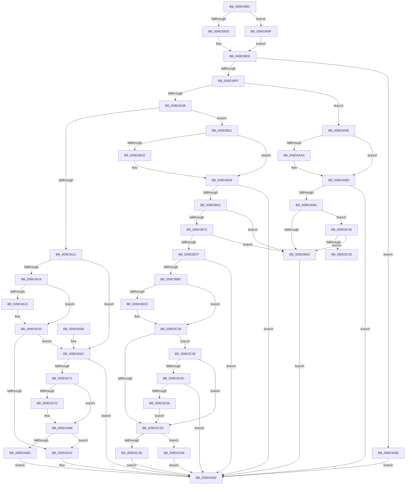

# _CmGetInstallerClassMappedPropertyFromComposite

- RVA: `0x009D398C`–`0x009D3C7B` (길이 `751` bytes)
- VA: `0x00000001409D398C`
- 실행 섹션: `PAGE`
- PDB 이름 있음: `예`; PDB Function 태그: `예`
- unwind 정보 RVA: `0x000A15A4`
- 디코드: `191`개 명령, `751/751` bytes 표시
- 미해석 바이트: `0` (있으면 어셈블리에 `.byte`로 보존)

> 이 문서는 커널 이미지의 기계어와 PDB 기호를 분석해 생성했습니다. 4번과 5번은 함수 원형과 자료형을 바이너리 사용 방식에서 추정한 C 해석이며 원본 소스 복구 결과는 아닙니다.

## 1. Dependencies

- 직접 호출 지점: **5**; 고유 호출 대상: **2**
- 직접 호출자로 확인된 함수: **2**
- RIP 상대 이미지 참조: **12**

### Outgoing calls
- `0x009D3A48` → [_CmGetInstallerClassCompoundFilters](_CmGetInstallerClassCompoundFilters_function_009D3C84.md) (function, `0x009D3C84`)
- `0x009D3AF3` → [PnpGetObjectProperty](../8E/PnpGetObjectProperty_function_008E2180.md) (function, `0x008E2180`)
- `0x009D3B6A` → [PnpGetObjectProperty](../8E/PnpGetObjectProperty_function_008E2180.md) (function, `0x008E2180`)
- `0x009D3BD0` → [PnpGetObjectProperty](../8E/PnpGetObjectProperty_function_008E2180.md) (function, `0x008E2180`)
- `0x009D3C20` → [PnpGetObjectProperty](../8E/PnpGetObjectProperty_function_008E2180.md) (function, `0x008E2180`)

### Direct callers
- [CmGetInstallerClassMappedPropertyKeys](../83/CmGetInstallerClassMappedPropertyKeys_function_00830704.md) at `0x0083091D`
- [CmGetInstallerClassMappedProperty](CmGetInstallerClassMappedProperty_function_009D3764.md) at `0x009D390D`

### Static image references
- `0x009D3A19` → RVA `0x00014158` (`.rdata`; read)
- `0x009D3A26` → RVA `0x00014160` (`.rdata`; read)
- `0x009D3A74` → RVA `0x00014170` (`.rdata`; read)
- `0x009D3A81` → RVA `0x00014178` (`.rdata`; read)
- `0x009D3AA1` → RVA `0x00014080` (`.rdata`; read)
- `0x009D3AAE` → RVA `0x00014088` (`.rdata`; read)
- `0x009D3AD2` → RVA `0x00014380` (`.rdata`; read)
- `0x009D3B14` → RVA `0x00014410` (`.rdata`; read)
- `0x009D3B21` → RVA `0x00014418` (`.rdata`; read)
- `0x009D3B49` → RVA `0x000143E0` (`.rdata`; read)
- `0x009D3BA9` → RVA `0x000143C8` (`.rdata`; read)
- `0x009D3BF9` → RVA `0x000143F8` (`.rdata`; read)

## 2. Other-region calls and transfers

- 다른 실행 섹션으로 향하는 call: **0**
- call이 아닌 외부 분기/꼬리 이동: **1**
  - `0x009D3C53` → [sub_00B2F6AC](../B2/Unknown_function_00B2F6AC.md) (`tail-transfer`)

## 3. Assembly (complete function range)

```asm
009D398C  48 8B C4                        mov rax, rsp
009D398F  48 89 58 10                     mov qword ptr [rax + 0x10], rbx
009D3993  48 89 48 08                     mov qword ptr [rax + 8], rcx
009D3997  55                              push rbp
009D3998  56                              push rsi
009D3999  57                              push rdi
009D399A  41 54                           push r12
009D399C  41 55                           push r13
009D399E  41 56                           push r14
009D39A0  41 57                           push r15
009D39A2  48 83 EC 60                     sub rsp, 0x60
009D39A6  4C 8B BC 24 C0 00 00 00         mov r15, qword ptr [rsp + 0xc0]
009D39AE  33 DB                           xor ebx, ebx
009D39B0  48 8B B4 24 D8 00 00 00         mov rsi, qword ptr [rsp + 0xd8]
009D39B8  4D 8B E0                        mov r12, r8
009D39BB  4C 8B B4 24 C8 00 00 00         mov r14, qword ptr [rsp + 0xc8]
009D39C3  4C 8B EA                        mov r13, rdx
009D39C6  89 58 20                        mov dword ptr [rax + 0x20], ebx
009D39C9  4C 8B D9                        mov r11, rcx
009D39CC  41 89 1F                        mov dword ptr [r15], ebx
009D39CF  44 8B D3                        mov r10d, ebx
009D39D2  89 1E                           mov dword ptr [rsi], ebx
009D39D4  4D 85 F6                        test r14, r14
009D39D7  0F 84 B2 00 00 00               je 0x1409d3a8f
009D39DD  8B AC 24 D0 00 00 00            mov ebp, dword ptr [rsp + 0xd0]
009D39E4  8B C5                           mov eax, ebp
009D39E6  F7 D8                           neg eax
009D39E8  48 1B C9                        sbb rcx, rcx
009D39EB  4C 23 F1                        and r14, rcx
009D39EE  41 8B 41 10                     mov eax, dword ptr [r9 + 0x10]
009D39F2  B9 02 00 00 00                  mov ecx, 2
009D39F7  3B C1                           cmp eax, ecx
009D39F9  0F 82 97 00 00 00               jb 0x1409d3a96
009D39FF  83 F8 0A                        cmp eax, 0xa
009D3A02  0F 84 96 00 00 00               je 0x1409d3a9e
009D3A08  83 F8 04                        cmp eax, 4
009D3A0B  0F 84 00 01 00 00               je 0x1409d3b11
009D3A11  83 F8 14                        cmp eax, 0x14
009D3A14  75 56                           jne 0x1409d3a6c
009D3A16  49 8B 09                        mov rcx, qword ptr [r9]
009D3A19  48 2B 0D 38 07 64 FF            sub rcx, qword ptr [rip - 0x9bf8c8]
009D3A20  75 0B                           jne 0x1409d3a2d
009D3A22  49 8B 49 08                     mov rcx, qword ptr [r9 + 8]
009D3A26  48 2B 0D 33 07 64 FF            sub rcx, qword ptr [rip - 0x9bf8cd]
009D3A2D  48 85 C9                        test rcx, rcx
009D3A30  75 3A                           jne 0x1409d3a6c
009D3A32  48 89 74 24 38                  mov qword ptr [rsp + 0x38], rsi
009D3A37  49 8B CB                        mov rcx, r11
009D3A3A  89 6C 24 30                     mov dword ptr [rsp + 0x30], ebp
009D3A3E  4C 89 74 24 28                  mov qword ptr [rsp + 0x28], r14
009D3A43  4C 89 7C 24 20                  mov qword ptr [rsp + 0x20], r15
009D3A48  E8 37 02 00 00                  call 0x1409d3c84
009D3A4D  44 8B D0                        mov r10d, eax
009D3A50  48 8B 9C 24 A8 00 00 00         mov rbx, qword ptr [rsp + 0xa8]
009D3A58  41 8B C2                        mov eax, r10d
009D3A5B  48 83 C4 60                     add rsp, 0x60
009D3A5F  41 5F                           pop r15
009D3A61  41 5E                           pop r14
009D3A63  41 5D                           pop r13
009D3A65  41 5C                           pop r12
009D3A67  5F                              pop rdi
009D3A68  5E                              pop rsi
009D3A69  5D                              pop rbp
009D3A6A  C3                              ret
009D3A6B  CC                              int3
009D3A6C  83 F8 15                        cmp eax, 0x15
009D3A6F  75 DF                           jne 0x1409d3a50
009D3A71  49 8B 01                        mov rax, qword ptr [r9]
009D3A74  48 2B 05 F5 06 64 FF            sub rax, qword ptr [rip - 0x9bf90b]
009D3A7B  75 0B                           jne 0x1409d3a88
009D3A7D  49 8B 41 08                     mov rax, qword ptr [r9 + 8]
009D3A81  48 2B 05 F0 06 64 FF            sub rax, qword ptr [rip - 0x9bf910]
009D3A88  48 85 C0                        test rax, rax
009D3A8B  74 A5                           je 0x1409d3a32
009D3A8D  EB C1                           jmp 0x1409d3a50
009D3A8F  8B EB                           mov ebp, ebx
009D3A91  E9 58 FF FF FF                  jmp 0x1409d39ee
009D3A96  41 BA 30 02 00 C0               mov r10d, 0xc0000230
009D3A9C  EB B2                           jmp 0x1409d3a50
009D3A9E  49 8B 01                        mov rax, qword ptr [r9]
009D3AA1  48 2B 05 D8 05 64 FF            sub rax, qword ptr [rip - 0x9bfa28]
009D3AA8  75 0B                           jne 0x1409d3ab5
009D3AAA  49 8B 41 08                     mov rax, qword ptr [r9 + 8]
009D3AAE  48 2B 05 D3 05 64 FF            sub rax, qword ptr [rip - 0x9bfa2d]
009D3AB5  48 85 C0                        test rax, rax
009D3AB8  75 96                           jne 0x1409d3a50
009D3ABA  89 5C 24 50                     mov dword ptr [rsp + 0x50], ebx
009D3ABE  48 8D 84 24 B8 00 00 00         lea rax, [rsp + 0xb8]
009D3AC6  48 89 44 24 48                  mov qword ptr [rsp + 0x48], rax
009D3ACB  44 8B C1                        mov r8d, ecx
009D3ACE  89 6C 24 40                     mov dword ptr [rsp + 0x40], ebp
009D3AD2  48 8D 05 A7 08 64 FF            lea rax, [rip - 0x9bf759]
009D3AD9  4C 89 74 24 38                  mov qword ptr [rsp + 0x38], r14
009D3ADE  4D 8B CC                        mov r9, r12
009D3AE1  4C 89 7C 24 30                  mov qword ptr [rsp + 0x30], r15
009D3AE6  49 8B CB                        mov rcx, r11
009D3AE9  48 89 44 24 28                  mov qword ptr [rsp + 0x28], rax
009D3AEE  48 89 5C 24 20                  mov qword ptr [rsp + 0x20], rbx
009D3AF3  E8 88 E6 F0 FF                  call 0x1408e2180
009D3AF8  44 8B D0                        mov r10d, eax
009D3AFB  85 C0                           test eax, eax
009D3AFD  0F 85 43 01 00 00               jne 0x1409d3c46
009D3B03  8B 84 24 B8 00 00 00            mov eax, dword ptr [rsp + 0xb8]
009D3B0A  89 06                           mov dword ptr [rsi], eax
009D3B0C  E9 3F FF FF FF                  jmp 0x1409d3a50
009D3B11  49 8B 01                        mov rax, qword ptr [r9]
009D3B14  48 2B 05 F5 08 64 FF            sub rax, qword ptr [rip - 0x9bf70b]
009D3B1B  75 0B                           jne 0x1409d3b28
009D3B1D  49 8B 41 08                     mov rax, qword ptr [r9 + 8]
009D3B21  48 2B 05 F0 08 64 FF            sub rax, qword ptr [rip - 0x9bf710]
009D3B28  48 85 C0                        test rax, rax
009D3B2B  0F 85 1F FF FF FF               jne 0x1409d3a50
009D3B31  89 5C 24 50                     mov dword ptr [rsp + 0x50], ebx
009D3B35  48 8D 84 24 B8 00 00 00         lea rax, [rsp + 0xb8]
009D3B3D  48 89 44 24 48                  mov qword ptr [rsp + 0x48], rax
009D3B42  44 8B C1                        mov r8d, ecx
009D3B45  89 6C 24 40                     mov dword ptr [rsp + 0x40], ebp
009D3B49  48 8D 05 90 08 64 FF            lea rax, [rip - 0x9bf770]
009D3B50  4C 89 74 24 38                  mov qword ptr [rsp + 0x38], r14
009D3B55  4D 8B CC                        mov r9, r12
009D3B58  4C 89 7C 24 30                  mov qword ptr [rsp + 0x30], r15
009D3B5D  49 8B CB                        mov rcx, r11
009D3B60  48 89 44 24 28                  mov qword ptr [rsp + 0x28], rax
009D3B65  48 89 5C 24 20                  mov qword ptr [rsp + 0x20], rbx
009D3B6A  E8 11 E6 F0 FF                  call 0x1408e2180
009D3B6F  44 8B D0                        mov r10d, eax
009D3B72  85 C0                           test eax, eax
009D3B74  74 8D                           je 0x1409d3b03
009D3B76  BB 23 00 00 C0                  mov ebx, 0xc0000023
009D3B7B  3B C3                           cmp eax, ebx
009D3B7D  74 84                           je 0x1409d3b03
009D3B7F  BF 25 02 00 C0                  mov edi, 0xc0000225
009D3B84  3B C7                           cmp eax, edi
009D3B86  0F 85 C4 FE FF FF               jne 0x1409d3a50
009D3B8C  33 C9                           xor ecx, ecx
009D3B8E  48 8D 84 24 B8 00 00 00         lea rax, [rsp + 0xb8]
009D3B96  89 4C 24 50                     mov dword ptr [rsp + 0x50], ecx
009D3B9A  4D 8B CC                        mov r9, r12
009D3B9D  48 89 44 24 48                  mov qword ptr [rsp + 0x48], rax
009D3BA2  49 8B D5                        mov rdx, r13
009D3BA5  89 4C 24 40                     mov dword ptr [rsp + 0x40], ecx
009D3BA9  48 8D 05 18 08 64 FF            lea rax, [rip - 0x9bf7e8]
009D3BB0  48 89 4C 24 38                  mov qword ptr [rsp + 0x38], rcx
009D3BB5  44 8D 41 02                     lea r8d, [rcx + 2]
009D3BB9  4C 89 7C 24 30                  mov qword ptr [rsp + 0x30], r15
009D3BBE  48 89 44 24 28                  mov qword ptr [rsp + 0x28], rax
009D3BC3  48 89 4C 24 20                  mov qword ptr [rsp + 0x20], rcx
009D3BC8  48 8B 8C 24 A0 00 00 00         mov rcx, qword ptr [rsp + 0xa0]
009D3BD0  E8 AB E5 F0 FF                  call 0x1408e2180
009D3BD5  44 8B D0                        mov r10d, eax
009D3BD8  3B C7                           cmp eax, edi
009D3BDA  75 4C                           jne 0x1409d3c28
009D3BDC  33 C9                           xor ecx, ecx
009D3BDE  48 8D 84 24 B8 00 00 00         lea rax, [rsp + 0xb8]
009D3BE6  89 4C 24 50                     mov dword ptr [rsp + 0x50], ecx
009D3BEA  4D 8B CC                        mov r9, r12
009D3BED  48 89 44 24 48                  mov qword ptr [rsp + 0x48], rax
009D3BF2  49 8B D5                        mov rdx, r13
009D3BF5  89 4C 24 40                     mov dword ptr [rsp + 0x40], ecx
009D3BF9  48 8D 05 F8 07 64 FF            lea rax, [rip - 0x9bf808]
009D3C00  48 89 4C 24 38                  mov qword ptr [rsp + 0x38], rcx
009D3C05  44 8D 41 02                     lea r8d, [rcx + 2]
009D3C09  4C 89 7C 24 30                  mov qword ptr [rsp + 0x30], r15
009D3C0E  48 89 44 24 28                  mov qword ptr [rsp + 0x28], rax
009D3C13  48 89 4C 24 20                  mov qword ptr [rsp + 0x20], rcx
009D3C18  48 8B 8C 24 A0 00 00 00         mov rcx, qword ptr [rsp + 0xa0]
009D3C20  E8 5B E5 F0 FF                  call 0x1408e2180
009D3C25  44 8B D0                        mov r10d, eax
009D3C28  45 85 D2                        test r10d, r10d
009D3C2B  78 2B                           js 0x1409d3c58
009D3C2D  C7 06 01 00 00 00               mov dword ptr [rsi], 1
009D3C33  41 C7 07 11 00 00 00            mov dword ptr [r15], 0x11
009D3C3A  3B 2E                           cmp ebp, dword ptr [rsi]
009D3C3C  73 2A                           jae 0x1409d3c68
009D3C3E  44 8B D3                        mov r10d, ebx
009D3C41  E9 0A FE FF FF                  jmp 0x1409d3a50
009D3C46  BB 23 00 00 C0                  mov ebx, 0xc0000023
009D3C4B  3B C3                           cmp eax, ebx
009D3C4D  0F 84 B0 FE FF FF               je 0x1409d3b03
009D3C53  E9 54 BA 15 00                  jmp 0x140b2f6ac
009D3C58  44 3B D7                        cmp r10d, edi
009D3C5B  74 D0                           je 0x1409d3c2d
009D3C5D  44 3B D3                        cmp r10d, ebx
009D3C60  0F 85 EA FD FF FF               jne 0x1409d3a50
009D3C66  EB C5                           jmp 0x1409d3c2d
009D3C68  44 3B D7                        cmp r10d, edi
009D3C6B  0F 95 C0                        setne al
009D3C6E  FE C8                           dec al
009D3C70  41 88 06                        mov byte ptr [r14], al
009D3C73  45 33 D2                        xor r10d, r10d
009D3C76  E9 D5 FD FF FF                  jmp 0x1409d3a50
```

## 4. C-style interpretation (structured pseudocode)

```c
__int64 __fastcall _CmGetInstallerClassMappedPropertyFromComposite(__int64 a1, __int64 a2, __int64 a3, __int64 a4, __int64 a5, __int64 a6, unsigned int a7, __int64 a8)
{
    __int64 result;
    __int64 v_r10;
    __int64 v_r14;
    __int64 v_rbx;
    __int64 v_rsp;
    unsigned __int64 v_stack_m60;
    unsigned int v_stack_m68;
    unsigned __int64 v_stack_m70;
    unsigned __int64 v_stack_m78;
    unsigned __int64 v_stack_p10;
    unsigned __int64 v_stack_p20;
    unsigned __int64 v_stack_p28;
    unsigned __int64 v_stack_p30;
    unsigned __int64 v_stack_p38;
    unsigned int v_stack_p40;
    unsigned __int64 v_stack_p48;
    unsigned int v_stack_p50;
    unsigned __int64 v_stack_pA0;
    unsigned __int64 v_stack_pB8;

    *(unsigned __int64 *)(v_rsp + 16) = v_rbx;
    *(unsigned __int64 *)(v_rsp + 8) = a1;
    v_rsp = (v_rsp) - (96);
    v_rbx = 0;
    *(unsigned int *)(v_rsp + 32) = 0;
    *(unsigned int *)(a5) = 0;
    *(unsigned int *)(a8) = 0;
    if (a6 == 0) goto loc_009D3A8F;
    result = (unsigned int)(-((unsigned int)((unsigned int)((unsigned int)(a7)))));
    v_r14 = (a6) & (a1);
loc_009D39EE:
    if (((unsigned int)((unsigned int)(*(unsigned int *)(a4 + 16)))) < 2) goto loc_009D3A96;
    if (((unsigned int)((unsigned int)(*(unsigned int *)(a4 + 16)))) == 10) goto loc_009D3A9E;
    if (((unsigned int)((unsigned int)(*(unsigned int *)(a4 + 16)))) == 4) goto loc_009D3B11;
    if (((unsigned int)((unsigned int)(*(unsigned int *)(a4 + 16)))) != 20) goto loc_009D3A6C;
    a1 = (*(unsigned __int64 *)(a4)) - (*(unsigned __int64 *)(v_rip - 10221768));
    if (!(condition_is_not_equal)) {
        a1 = *(unsigned __int64 *)(a4 + 8);
        a1 = (a1) - (*(unsigned __int64 *)(v_rip - 10221773));
    }
    if (a1 != 0) goto loc_009D3A6C;
loc_009D3A32:
    v_stack_m60 = a8;
    v_stack_m68 = (unsigned int)((unsigned int)(a7));
    v_stack_m70 = v_r14;
    v_stack_m78 = a5;
    result = _CmGetInstallerClassCompoundFilters(a1, a2, a3, a4);
loc_009D3A50:
    v_rsp = (v_rsp) + (96);
    return (unsigned int)((unsigned int)((unsigned int)((unsigned int)(result))));
loc_009D3A6C:
    if (((unsigned int)((unsigned int)((unsigned int)((unsigned int)((unsigned int)(result)))))) != 21) goto loc_009D3A50;
    result = (*(unsigned __int64 *)(a4)) - (*(unsigned __int64 *)(v_rip - 10221835));
    if (!(condition_is_not_equal)) {
        result = *(unsigned __int64 *)(a4 + 8);
        result = (result) - (*(unsigned __int64 *)(v_rip - 10221840));
    }
    if (result == 0) goto loc_009D3A32;
    goto loc_009D3A50;
loc_009D3A8F:
    goto loc_009D39EE;
loc_009D3A96:
    goto loc_009D3A50;
loc_009D3A9E:
    result = (*(unsigned __int64 *)(a4)) - (*(unsigned __int64 *)(v_rip - 10222120));
    if (!(condition_is_not_equal)) {
        result = *(unsigned __int64 *)(a4 + 8);
        result = (result) - (*(unsigned __int64 *)(v_rip - 10222125));
    }
    if (result != 0) goto loc_009D3A50;
    v_stack_p50 = (unsigned int)(v_stack_p10);
    v_stack_p48 = v_stack_pB8;
    v_stack_p40 = (unsigned int)((unsigned int)((unsigned int)(v_stack_p10)));
    v_stack_p38 = v_r14;
    v_stack_p30 = a5;
    v_stack_p28 = v_rip - 10221401;
    v_stack_p20 = v_stack_p10;
    result = PnpGetObjectProperty(a1, a2, (unsigned int)((unsigned int)(a1)), a3);
    if ((unsigned int)(result) != 0) goto loc_009D3C46;
loc_009D3B03:
    *(unsigned int *)(a8) = (unsigned int)((unsigned int)(v_stack_pB8));
    goto loc_009D3A50;
loc_009D3B11:
    result = (*(unsigned __int64 *)(a3)) - (*(unsigned __int64 *)(v_rip - 10221323));
    if (!(condition_is_not_equal)) {
        result = *(unsigned __int64 *)(a3 + 8);
        result = (result) - (*(unsigned __int64 *)(v_rip - 10221328));
    }
    if (result != 0) goto loc_009D3A50;
    v_stack_p50 = (unsigned int)(v_stack_p10);
    v_stack_p48 = v_stack_pB8;
    v_stack_p40 = (unsigned int)((unsigned int)((unsigned int)(v_stack_p10)));
    v_stack_p38 = v_r14;
    v_stack_p30 = a5;
    v_stack_p28 = v_rip - 10221424;
    v_stack_p20 = v_stack_p10;
    result = PnpGetObjectProperty(a1, a2, (unsigned int)((unsigned int)(a1)), a3);
    if ((unsigned int)(result) == 0) goto loc_009D3B03;
    if (((unsigned int)(result)) == ((unsigned int)((unsigned int)(0xC0000023ULL)))) goto loc_009D3B03;
    if (((unsigned int)(result)) != ((unsigned int)((unsigned int)(0xC0000225ULL)))) goto loc_009D3A50;
    a1 = 0;
    v_stack_p50 = 0;
    v_stack_p48 = v_stack_pB8;
    v_stack_p40 = 0;
    v_stack_p38 = 0;
    v_stack_p30 = a5;
    v_stack_p28 = v_rip - 10221544;
    v_stack_p20 = 0;
    result = PnpGetObjectProperty(v_stack_pA0, a2, a1 + 2, a3);
    v_r10 = (unsigned int)((unsigned int)(result));
    if (((unsigned int)(result)) == ((unsigned int)((unsigned int)(0xC0000225ULL)))) {
        a1 = 0;
        result = v_stack_pB8;
        v_stack_p50 = 0;
        a4 = a3;
        v_stack_p48 = result;
        a2 = a2;
        v_stack_p40 = 0;
        result = v_rip - 10221576;
        v_stack_p38 = 0;
        a3 = a1 + 2;
        v_stack_p30 = a5;
        v_stack_p28 = result;
        v_stack_p20 = 0;
        a1 = v_stack_pA0;
        result = PnpGetObjectProperty(a1, a2, a3, a4);
        v_r10 = (unsigned int)(result);
    }
    if (sign_flag) goto loc_009D3C58;
loc_009D3C2D:
    *(unsigned int *)(a8) = 1;
    *(unsigned int *)(a5) = 17;
    if (((unsigned int)((unsigned int)((unsigned int)(v_stack_p10)))) >= (*(unsigned int *)(a8))) goto loc_009D3C68;
    goto loc_009D3A50;
loc_009D3C46:
    if (((unsigned int)(result)) == ((unsigned int)((unsigned int)(0xC0000023ULL)))) goto loc_009D3B03;
loc_009D3C58:
    if (((unsigned int)((unsigned int)((unsigned int)((unsigned int)(0xC0000023ULL))))) == ((unsigned int)((unsigned int)(0xC0000225ULL)))) goto loc_009D3C2D;
    if (((unsigned int)((unsigned int)((unsigned int)((unsigned int)(0xC0000023ULL))))) != ((unsigned int)((unsigned int)(0xC0000023ULL)))) goto loc_009D3A50;
    goto loc_009D3C2D;
loc_009D3C68:
    result = (((unsigned int)((unsigned int)((unsigned int)((unsigned int)(0xC0000023ULL))))) != ((unsigned int)((unsigned int)(0xC0000225ULL)))) ? 1 : 0;
    result = (unsigned __int8)((result) - 1);
    *(unsigned __int8 *)(v_r14) = (unsigned __int8)(result);
    v_r10 = 0;
    goto loc_009D3A50;
}
```

## 5. (Beta) C Style

```c
int64_t _CmGetInstallerClassMappedPropertyFromComposite(int64_t Arg1, int64_t Arg2, int64_t Arg3, void *Arg4, void *Arg5, int64_t Arg6, uint32_t Arg7, void *Arg8)
{
    uint8_t *arg4 = (uint8_t *)Arg4;
    uint8_t *arg5 = (uint8_t *)Arg5;
    uint8_t *arg8 = (uint8_t *)Arg8;

    int64_t result;
    int64_t local_r10;
    int64_t local_r14;
    int64_t local_rbx;
    int64_t local_rsp;
    uint64_t v_stack_m60;
    uint32_t v_stack_m68;
    uint64_t v_stack_m70;
    uint64_t v_stack_m78;
    uint64_t v_stack_p10;
    uint64_t v_stack_p20;
    uint64_t v_stack_p28;
    uint64_t v_stack_p30;
    uint64_t v_stack_p38;
    uint32_t v_stack_p40;
    uint64_t v_stack_p48;
    uint32_t v_stack_p50;
    uint64_t v_stack_pA0;
    uint64_t v_stack_pB8;

    *(uint64_t *)(local_rsp + 0x10) = local_rbx;
    *(uint64_t *)(local_rsp + 0x8) = Arg1;
    local_rsp = (local_rsp) - (96);
    local_rbx = 0;
    *(uint32_t *)(local_rsp + 0x20) = 0;
    *(uint32_t *)(arg5) = 0;
    *(uint32_t *)(arg8) = 0;
    if (Arg6 == 0) goto loc_009D3A8F;
    result = (uint32_t)(-((uint32_t)((uint32_t)((uint32_t)(Arg7)))));
    local_r14 = (Arg6) & (Arg1);
loc_009D39EE:
    if (((uint32_t)((uint32_t)(*(uint32_t *)(arg4 + 0x10)))) < 2) goto loc_009D3A96;
    if (((uint32_t)((uint32_t)(*(uint32_t *)(arg4 + 0x10)))) == 10) goto loc_009D3A9E;
    if (((uint32_t)((uint32_t)(*(uint32_t *)(arg4 + 0x10)))) == 4) goto loc_009D3B11;
    if (((uint32_t)((uint32_t)(*(uint32_t *)(arg4 + 0x10)))) != 20) goto loc_009D3A6C;
    Arg1 = (*(uint64_t *)(arg4)) - (*(uint64_t *)(v_rip - 0x9BF8C8));
    if (!(condition_is_not_equal)) {
        Arg1 = *(uint64_t *)(arg4 + 0x8);
        Arg1 = (Arg1) - (*(uint64_t *)(v_rip - 0x9BF8CD));
    }
    if (Arg1 != 0) goto loc_009D3A6C;
loc_009D3A32:
    v_stack_m60 = Arg8;
    v_stack_m68 = (uint32_t)((uint32_t)(Arg7));
    v_stack_m70 = local_r14;
    v_stack_m78 = Arg5;
    result = _CmGetInstallerClassCompoundFilters(Arg1, Arg2, Arg3, Arg4);
loc_009D3A50:
    local_rsp = (local_rsp) + (96);
    return (uint32_t)((uint32_t)((uint32_t)((uint32_t)(result))));
loc_009D3A6C:
    if (((uint32_t)((uint32_t)((uint32_t)((uint32_t)((uint32_t)(result)))))) != 21) goto loc_009D3A50;
    result = (*(uint64_t *)(arg4)) - (*(uint64_t *)(v_rip - 0x9BF90B));
    if (!(condition_is_not_equal)) {
        result = *(uint64_t *)(arg4 + 0x8);
        result = (result) - (*(uint64_t *)(v_rip - 0x9BF910));
    }
    if (result == 0) goto loc_009D3A32;
    goto loc_009D3A50;
loc_009D3A8F:
    goto loc_009D39EE;
loc_009D3A96:
    goto loc_009D3A50;
loc_009D3A9E:
    result = (*(uint64_t *)(arg4)) - (*(uint64_t *)(v_rip - 0x9BFA28));
    if (!(condition_is_not_equal)) {
        result = *(uint64_t *)(arg4 + 0x8);
        result = (result) - (*(uint64_t *)(v_rip - 0x9BFA2D));
    }
    if (result != 0) goto loc_009D3A50;
    v_stack_p50 = (uint32_t)(v_stack_p10);
    v_stack_p48 = v_stack_pB8;
    v_stack_p40 = (uint32_t)((uint32_t)((uint32_t)(v_stack_p10)));
    v_stack_p38 = local_r14;
    v_stack_p30 = Arg5;
    v_stack_p28 = v_rip - 10221401;
    v_stack_p20 = v_stack_p10;
    result = PnpGetObjectProperty(Arg1, Arg2, (uint32_t)((uint32_t)(Arg1)), Arg3);
    if ((uint32_t)(result) != 0) goto loc_009D3C46;
loc_009D3B03:
    *(uint32_t *)(arg8) = (uint32_t)((uint32_t)(v_stack_pB8));
    goto loc_009D3A50;
loc_009D3B11:
    result = (*(uint64_t *)(Arg3)) - (*(uint64_t *)(v_rip - 0x9BF70B));
    if (!(condition_is_not_equal)) {
        result = *(uint64_t *)(Arg3 + 0x8);
        result = (result) - (*(uint64_t *)(v_rip - 0x9BF710));
    }
    if (result != 0) goto loc_009D3A50;
    v_stack_p50 = (uint32_t)(v_stack_p10);
    v_stack_p48 = v_stack_pB8;
    v_stack_p40 = (uint32_t)((uint32_t)((uint32_t)(v_stack_p10)));
    v_stack_p38 = local_r14;
    v_stack_p30 = Arg5;
    v_stack_p28 = v_rip - 10221424;
    v_stack_p20 = v_stack_p10;
    result = PnpGetObjectProperty(Arg1, Arg2, (uint32_t)((uint32_t)(Arg1)), Arg3);
    if ((uint32_t)(result) == 0) goto loc_009D3B03;
    if (((uint32_t)(result)) == ((uint32_t)((uint32_t)(0xC0000023ULL)))) goto loc_009D3B03;
    if (((uint32_t)(result)) != ((uint32_t)((uint32_t)(0xC0000225ULL)))) goto loc_009D3A50;
    Arg1 = 0;
    v_stack_p50 = 0;
    v_stack_p48 = v_stack_pB8;
    v_stack_p40 = 0;
    v_stack_p38 = 0;
    v_stack_p30 = Arg5;
    v_stack_p28 = v_rip - 10221544;
    v_stack_p20 = 0;
    result = PnpGetObjectProperty(v_stack_pA0, Arg2, Arg1 + 2, Arg3);
    local_r10 = (uint32_t)((uint32_t)(result));
    if (((uint32_t)(result)) == ((uint32_t)((uint32_t)(0xC0000225ULL)))) {
        Arg1 = 0;
        result = v_stack_pB8;
        v_stack_p50 = 0;
        Arg4 = Arg3;
        v_stack_p48 = result;
        Arg2 = Arg2;
        v_stack_p40 = 0;
        result = v_rip - 10221576;
        v_stack_p38 = 0;
        Arg3 = Arg1 + 2;
        v_stack_p30 = Arg5;
        v_stack_p28 = result;
        v_stack_p20 = 0;
        Arg1 = v_stack_pA0;
        result = PnpGetObjectProperty(Arg1, Arg2, Arg3, Arg4);
        local_r10 = (uint32_t)(result);
    }
    if (sign_flag) goto loc_009D3C58;
loc_009D3C2D:
    *(uint32_t *)(arg8) = 1;
    *(uint32_t *)(arg5) = 17;
    if (((uint32_t)((uint32_t)((uint32_t)(v_stack_p10)))) >= (*(uint32_t *)(arg8))) goto loc_009D3C68;
    goto loc_009D3A50;
loc_009D3C46:
    if (((uint32_t)(result)) == ((uint32_t)((uint32_t)(0xC0000023ULL)))) goto loc_009D3B03;
loc_009D3C58:
    if (((uint32_t)((uint32_t)((uint32_t)((uint32_t)(0xC0000023ULL))))) == ((uint32_t)((uint32_t)(0xC0000225ULL)))) goto loc_009D3C2D;
    if (((uint32_t)((uint32_t)((uint32_t)((uint32_t)(0xC0000023ULL))))) != ((uint32_t)((uint32_t)(0xC0000023ULL)))) goto loc_009D3A50;
    goto loc_009D3C2D;
loc_009D3C68:
    result = (((uint32_t)((uint32_t)((uint32_t)((uint32_t)(0xC0000023ULL))))) != ((uint32_t)((uint32_t)(0xC0000225ULL)))) ? 1 : 0;
    result = (uint8_t)((result) - 1);
    *(uint8_t *)(local_r14) = (uint8_t)(result);
    local_r10 = 0;
    goto loc_009D3A50;
}
```

### 관측된 메모리 오프셋

구조체 형식이 확인되지 않은 접근은 인자 기준의 오프셋으로만 기록했습니다.

| 기준 인자 | 오프셋 표현 | 폭 (bit) | 접근 |
|---|---:|---:|---|
| `Arg4` | `+ 0x0` | `64` | `R` |
| `Arg4` | `+ 0x8` | `64` | `R` |
| `Arg4` | `+ 0x10` | `32` | `R` |
| `Arg5` | `+ 0x0` | `32` | `W` |
| `Arg8` | `+ 0x0` | `32` | `R` |
| `Arg8` | `+ 0x0` | `32` | `W` |

## 6. Execution-region graph

[열기: 2D/3D 그래프와 함수 탐색 컨트롤 패널](../../../control-panel.html?section=page&rva=0x009D398C&view=graph)

- 2D 그래프는 위에서 아래로 흐르고, 3D 그래프는 빈 공간을 드래그해 회전합니다. Shift+드래그는 이동, 휠은 확대·축소, 함수 노드 선택은 대상 보고서 이동입니다.

### Static fallback


