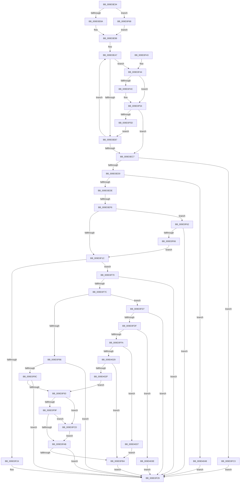

# _CmGetInstallerClassMappedPropertyFromRegProp

- RVA: `0x009D3E34`–`0x009D4052` (길이 `542` bytes)
- VA: `0x00000001409D3E34`
- 실행 섹션: `PAGE`
- PDB 이름 있음: `예`; PDB Function 태그: `예`
- unwind 정보 RVA: `0x000A15FC`
- 디코드: `156`개 명령, `542/542` bytes 표시
- 미해석 바이트: `0` (있으면 어셈블리에 `.byte`로 보존)

> 이 문서는 커널 이미지의 기계어와 PDB 기호를 분석해 생성했습니다. 4번과 5번은 함수 원형과 자료형을 바이너리 사용 방식에서 추정한 C 해석이며 원본 소스 복구 결과는 아닙니다.

## 1. Dependencies

- 직접 호출 지점: **6**; 고유 호출 대상: **5**
- 직접 호출자로 확인된 함수: **4**
- RIP 상대 이미지 참조: **1**

### Outgoing calls
- `0x009D3F0C` → [CmGetInstallerClassRegProp](../99/CmGetInstallerClassRegProp_function_00994940.md) (function, `0x00994940`)
- `0x009D3F96` → [PnpParseIndirectInfString](PnpParseIndirectInfString_function_009D3374.md) (function, `0x009D3374`)
- `0x009D3FA2` → [PnpParseIndirectResourceString](PnpParseIndirectResourceString_function_009D3444.md) (function, `0x009D3444`)
- `0x009D3FB9` → [ExFreePoolWithTag](../../poolcode/B8/ExFreePoolWithTag_function_00B82870.md) (function, `0x00B82870`)
- `0x009D3FED` → [ExAllocatePool2](../../poolcode/B8/ExAllocatePool2_function_00B820F0.md) (function, `0x00B820F0`)
- `0x009D4020` → [CmGetInstallerClassRegProp](../99/CmGetInstallerClassRegProp_function_00994940.md) (function, `0x00994940`)

### Direct callers
- [CmGetInstallerClassCompoundFiltersWorker](../83/CmGetInstallerClassCompoundFiltersWorker_function_00830130.md) at `0x008305A7`
- [CmGetInstallerClassCompoundFiltersWorker](../83/CmGetInstallerClassCompoundFiltersWorker_function_00830130.md) at `0x0083061D`
- [CmGetInstallerClassMappedPropertyKeys](../83/CmGetInstallerClassMappedPropertyKeys_function_00830704.md) at `0x008307AA`
- [CmGetInstallerClassMappedProperty](CmGetInstallerClassMappedProperty_function_009D3764.md) at `0x009D3821`
- [_CmGetInstallerClassCompoundFilters](_CmGetInstallerClassCompoundFilters_function_009D3C84.md) at `0x009D3D9B`

### Static image references
- `0x009D3E9D` → RVA `0x00B4C710` (`CmClassRegPropMap`; read)

## 2. Other-region calls and transfers

- 다른 실행 섹션으로 향하는 call: **2**
  - `0x009D3FB9` → [ExFreePoolWithTag](../../poolcode/B8/ExFreePoolWithTag_function_00B82870.md) (`PAGE` → `POOLCODE`)
  - `0x009D3FED` → [ExAllocatePool2](../../poolcode/B8/ExAllocatePool2_function_00B820F0.md) (`PAGE` → `POOLCODE`)
- call이 아닌 외부 분기/꼬리 이동: **1**
  - `0x009D3EF0` → [sub_00B2F794](../B2/Unknown_function_00B2F794.md) (`tail-transfer`)

## 3. Assembly (complete function range)

```asm
009D3E34  48 8B C4                        mov rax, rsp
009D3E37  48 89 58 20                     mov qword ptr [rax + 0x20], rbx
009D3E3B  4C 89 40 18                     mov qword ptr [rax + 0x18], r8
009D3E3F  48 89 50 10                     mov qword ptr [rax + 0x10], rdx
009D3E43  48 89 48 08                     mov qword ptr [rax + 8], rcx
009D3E47  55                              push rbp
009D3E48  56                              push rsi
009D3E49  57                              push rdi
009D3E4A  41 54                           push r12
009D3E4C  41 55                           push r13
009D3E4E  41 56                           push r14
009D3E50  41 57                           push r15
009D3E52  48 8B EC                        mov rbp, rsp
009D3E55  48 83 EC 50                     sub rsp, 0x50
009D3E59  4C 8B 6D 60                     mov r13, qword ptr [rbp + 0x60]
009D3E5D  45 33 E4                        xor r12d, r12d
009D3E60  4C 8B 7D 78                     mov r15, qword ptr [rbp + 0x78]
009D3E64  4D 8B D1                        mov r10, r9
009D3E67  48 8B 75 68                     mov rsi, qword ptr [rbp + 0x68]
009D3E6B  49 8B D8                        mov rbx, r8
009D3E6E  44 89 65 F0                     mov dword ptr [rbp - 0x10], r12d
009D3E72  45 89 65 00                     mov dword ptr [r13], r12d
009D3E76  45 89 27                        mov dword ptr [r15], r12d
009D3E79  44 89 65 F8                     mov dword ptr [rbp - 8], r12d
009D3E7D  44 89 65 F4                     mov dword ptr [rbp - 0xc], r12d
009D3E81  48 85 F6                        test rsi, rsi
009D3E84  0F 84 DE 00 00 00               je 0x1409d3f68
009D3E8A  44 8B 75 70                     mov r14d, dword ptr [rbp + 0x70]
009D3E8E  41 8B C6                        mov eax, r14d
009D3E91  F7 D8                           neg eax
009D3E93  48 1B C9                        sbb rcx, rcx
009D3E96  48 23 F1                        and rsi, rcx
009D3E99  45 8B 59 10                     mov r11d, dword ptr [r9 + 0x10]
009D3E9D  48 8D 15 6C 88 17 00            lea rdx, [rip + 0x17886c]
009D3EA4  45 8B C4                        mov r8d, r12d
009D3EA7  4C 8B 0A                        mov r9, qword ptr [rdx]
009D3EAA  48 8B FA                        mov rdi, rdx
009D3EAD  45 3B 59 10                     cmp r11d, dword ptr [r9 + 0x10]
009D3EB1  0F 84 8D 00 00 00               je 0x1409d3f44
009D3EB7  41 FF C0                        inc r8d
009D3EBA  48 83 C2 18                     add rdx, 0x18
009D3EBE  49 8B FC                        mov rdi, r12
009D3EC1  41 83 F8 09                     cmp r8d, 9
009D3EC5  72 E0                           jb 0x1409d3ea7
009D3EC7  48 85 FF                        test rdi, rdi
009D3ECA  0F 84 F3 00 00 00               je 0x1409d3fc3
009D3ED0  44 8B 67 0C                     mov r12d, dword ptr [rdi + 0xc]
009D3ED4  41 83 FC 19                     cmp r12d, 0x19
009D3ED8  0F 84 6A 01 00 00               je 0x1409d4048
009D3EDE  48 8B 55 48                     mov rdx, qword ptr [rbp + 0x48]
009D3EE2  45 8B CC                        mov r9d, r12d
009D3EE5  48 8B 4D 40                     mov rcx, qword ptr [rbp + 0x40]
009D3EE9  4C 8B C3                        mov r8, rbx
009D3EEC  41 83 FC 1B                     cmp r12d, 0x1b
009D3EF0  0F 84 9E B8 15 00               je 0x140b2f794
009D3EF6  4C 89 7C 24 30                  mov qword ptr [rsp + 0x30], r15
009D3EFB  48 8D 45 F0                     lea rax, [rbp - 0x10]
009D3EFF  48 89 74 24 28                  mov qword ptr [rsp + 0x28], rsi
009D3F04  48 89 44 24 20                  mov qword ptr [rsp + 0x20], rax
009D3F09  45 89 37                        mov dword ptr [r15], r14d
009D3F0C  E8 2F 0A FC FF                  call 0x140994940
009D3F11  8B D8                           mov ebx, eax
009D3F13  BA 23 00 00 C0                  mov edx, 0xc0000023
009D3F18  85 C0                           test eax, eax
009D3F1A  75 46                           jne 0x1409d3f62
009D3F1C  8B 4F 10                        mov ecx, dword ptr [rdi + 0x10]
009D3F1F  39 4D F0                        cmp dword ptr [rbp - 0x10], ecx
009D3F22  74 4C                           je 0x1409d3f70
009D3F24  BB 0D 00 00 C0                  mov ebx, 0xc000000d
009D3F29  8B C3                           mov eax, ebx
009D3F2B  48 8B 9C 24 A8 00 00 00         mov rbx, qword ptr [rsp + 0xa8]
009D3F33  48 83 C4 50                     add rsp, 0x50
009D3F37  41 5F                           pop r15
009D3F39  41 5E                           pop r14
009D3F3B  41 5D                           pop r13
009D3F3D  41 5C                           pop r12
009D3F3F  5F                              pop rdi
009D3F40  5E                              pop rsi
009D3F41  5D                              pop rbp
009D3F42  C3                              ret
009D3F43  CC                              int3
009D3F44  49 8B 0A                        mov rcx, qword ptr [r10]
009D3F47  49 2B 09                        sub rcx, qword ptr [r9]
009D3F4A  75 08                           jne 0x1409d3f54
009D3F4C  49 8B 4A 08                     mov rcx, qword ptr [r10 + 8]
009D3F50  49 2B 49 08                     sub rcx, qword ptr [r9 + 8]
009D3F54  48 85 C9                        test rcx, rcx
009D3F57  0F 84 6A FF FF FF               je 0x1409d3ec7
009D3F5D  E9 55 FF FF FF                  jmp 0x1409d3eb7
009D3F62  3B DA                           cmp ebx, edx
009D3F64  75 C3                           jne 0x1409d3f29
009D3F66  EB B4                           jmp 0x1409d3f1c
009D3F68  45 8B F4                        mov r14d, r12d
009D3F6B  E9 29 FF FF FF                  jmp 0x1409d3e99
009D3F70  8B 47 08                        mov eax, dword ptr [rdi + 8]
009D3F73  41 89 45 00                     mov dword ptr [r13], eax
009D3F77  83 F8 12                        cmp eax, 0x12
009D3F7A  75 AD                           jne 0x1409d3f29
009D3F7C  41 8B 07                        mov eax, dword ptr [r15]
009D3F7F  89 45 60                        mov dword ptr [rbp + 0x60], eax
009D3F82  85 DB                           test ebx, ebx
009D3F84  75 51                           jne 0x1409d3fd7
009D3F86  41 83 FE 02                     cmp r14d, 2
009D3F8A  72 9D                           jb 0x1409d3f29
009D3F8C  33 FF                           xor edi, edi
009D3F8E  48 85 F6                        test rsi, rsi
009D3F91  74 96                           je 0x1409d3f29
009D3F93  48 8B CE                        mov rcx, rsi
009D3F96  E8 D9 F3 FF FF                  call 0x1409d3374
009D3F9B  84 C0                           test al, al
009D3F9D  75 2E                           jne 0x1409d3fcd
009D3F9F  48 8B CE                        mov rcx, rsi
009D3FA2  E8 9D F4 FF FF                  call 0x1409d3444
009D3FA7  84 C0                           test al, al
009D3FA9  75 22                           jne 0x1409d3fcd
009D3FAB  48 85 FF                        test rdi, rdi
009D3FAE  0F 84 75 FF FF FF               je 0x1409d3f29
009D3FB4  33 D2                           xor edx, edx
009D3FB6  48 8B CF                        mov rcx, rdi
009D3FB9  E8 B2 E8 1A 00                  call 0x140b82870
009D3FBE  E9 66 FF FF FF                  jmp 0x1409d3f29
009D3FC3  BB 30 02 00 C0                  mov ebx, 0xc0000230
009D3FC8  E9 5C FF FF FF                  jmp 0x1409d3f29
009D3FCD  41 C7 45 00 19 00 00 00         mov dword ptr [r13], 0x19
009D3FD5  EB D4                           jmp 0x1409d3fab
009D3FD7  3B DA                           cmp ebx, edx
009D3FD9  0F 85 4A FF FF FF               jne 0x1409d3f29
009D3FDF  48 8B D0                        mov rdx, rax
009D3FE2  B9 00 01 00 00                  mov ecx, 0x100
009D3FE7  41 B8 50 4E 50 52               mov r8d, 0x52504e50
009D3FED  E8 FE E0 1A 00                  call 0x140b820f0
009D3FF2  48 8B F8                        mov rdi, rax
009D3FF5  48 85 C0                        test rax, rax
009D3FF8  74 44                           je 0x1409d403e
009D3FFA  4C 8B 45 50                     mov r8, qword ptr [rbp + 0x50]
009D3FFE  48 8D 45 60                     lea rax, [rbp + 0x60]
009D4002  48 8B 55 48                     mov rdx, qword ptr [rbp + 0x48]
009D4006  45 8B CC                        mov r9d, r12d
009D4009  48 8B 4D 40                     mov rcx, qword ptr [rbp + 0x40]
009D400D  48 89 44 24 30                  mov qword ptr [rsp + 0x30], rax
009D4012  48 8D 45 F8                     lea rax, [rbp - 8]
009D4016  48 89 7C 24 28                  mov qword ptr [rsp + 0x28], rdi
009D401B  48 89 44 24 20                  mov qword ptr [rsp + 0x20], rax
009D4020  E8 1B 09 FC FF                  call 0x140994940
009D4025  85 C0                           test eax, eax
009D4027  78 0E                           js 0x1409d4037
009D4029  83 7D 60 02                     cmp dword ptr [rbp + 0x60], 2
009D402D  72 85                           jb 0x1409d3fb4
009D402F  48 8B F7                        mov rsi, rdi
009D4032  E9 5C FF FF FF                  jmp 0x1409d3f93
009D4037  8B D8                           mov ebx, eax
009D4039  E9 76 FF FF FF                  jmp 0x1409d3fb4
009D403E  BB 17 00 00 C0                  mov ebx, 0xc0000017
009D4043  E9 E1 FE FF FF                  jmp 0x1409d3f29
009D4048  BB BB 00 00 C0                  mov ebx, 0xc00000bb
009D404D  E9 D7 FE FF FF                  jmp 0x1409d3f29
```

## 4. C-style interpretation (structured pseudocode)

```c
__int64 __fastcall _CmGetInstallerClassMappedPropertyFromRegProp(__int64 a1, __int64 a2, __int64 a3, __int64 a4, unsigned int a5, __int64 a6, unsigned int a7, __int64 a8)
{
    __int64 result;
    __int64 v_r12;
    __int64 v_rdi;
    __int64 v_rsi;
    __int64 v_rsp;
    unsigned int v_stack_m40;
    unsigned int v_stack_m44;
    unsigned int v_stack_m48;
    unsigned __int64 v_stack_m58;
    unsigned __int64 v_stack_m60;
    unsigned __int64 v_stack_m68;
    unsigned __int64 v_stack_p10;
    unsigned __int64 v_stack_p18;
    unsigned __int64 v_stack_p20;
    unsigned int v_stack_p28;
    unsigned __int64 v_stack_p30;
    unsigned __int64 v_stack_p8;

    *(unsigned __int64 *)(v_rsp + 32) = v_rbx;
    *(unsigned __int64 *)(v_rsp + 24) = a3;
    *(unsigned __int64 *)(v_rsp + 16) = a2;
    *(unsigned __int64 *)(v_rsp + 8) = a1;
    v_rsp = (v_rsp) - (80);
    v_r12 = 0;
    v_stack_m48 = 0;
    *(unsigned int *)(a5) = 0;
    *(unsigned int *)(a8) = 0;
    v_stack_m40 = 0;
    v_stack_m44 = 0;
    if (a6 == 0) goto loc_009D3F68;
    result = (unsigned int)(-((unsigned int)((unsigned int)((unsigned int)(a7)))));
    v_rsi = (a6) & (a1);
loc_009D3E99:
loc_009D3EA7:
    if (((unsigned int)((unsigned int)(*(unsigned int *)(a4 + 16)))) == (*(unsigned int *)(*(unsigned __int64 *)(v_rip + 1542252) + 16))) goto loc_009D3F44;
loc_009D3EB7:
    a3 = (unsigned int)((0) + 1);
    a2 = (v_rip + 1542252) + (24);
    if (((unsigned int)(a3)) < 9) goto loc_009D3EA7;
loc_009D3EC7:
    if (0 == 0) goto loc_009D3FC3;
    if (((unsigned int)((unsigned int)(*(unsigned int *)(0 + 12)))) == 25) goto loc_009D4048;
    v_stack_m58 = a8;
    v_stack_m60 = v_rsi;
    v_stack_m68 = v_stack_m48;
    *(unsigned int *)(a8) = (unsigned int)((unsigned int)(a7));
    result = CmGetInstallerClassRegProp(v_stack_p8, v_stack_p10, a3, (unsigned int)((unsigned int)((unsigned int)(*(unsigned int *)(0 + 12)))));
    if ((unsigned int)(result) != 0) goto loc_009D3F62;
loc_009D3F1C:
    if (v_stack_m48 == ((unsigned int)((unsigned int)(*(unsigned int *)(0 + 16))))) goto loc_009D3F70;
loc_009D3F29:
    v_rsp = (v_rsp) + (80);
    return (unsigned int)((unsigned int)((unsigned int)(0xC000000DULL)));
loc_009D3F44:
    a1 = (*(unsigned __int64 *)(a4)) - (*(unsigned __int64 *)((unsigned int)((unsigned int)((unsigned int)(*(unsigned int *)(0 + 12))))));
    if (!(condition_is_not_equal)) {
        a1 = *(unsigned __int64 *)(a4 + 8);
        a1 = (a1) - (*(unsigned __int64 *)((unsigned int)((unsigned int)((unsigned int)(*(unsigned int *)(0 + 12)))) + 8));
    }
    if (a1 == 0) goto loc_009D3EC7;
    goto loc_009D3EB7;
loc_009D3F62:
    if (((unsigned int)(v_stack_p20)) != ((unsigned int)((unsigned int)(0xC0000023ULL)))) goto loc_009D3F29;
    goto loc_009D3F1C;
loc_009D3F68:
    goto loc_009D3E99;
loc_009D3F70:
    *(unsigned int *)(a5) = (unsigned int)((unsigned int)(*(unsigned int *)(0 + 8)));
    if (((unsigned int)((unsigned int)(*(unsigned int *)(0 + 8)))) != 18) goto loc_009D3F29;
    v_stack_p28 = (unsigned int)((unsigned int)(*(unsigned int *)(a8)));
    if ((unsigned int)(v_stack_p20) != 0) goto loc_009D3FD7;
    if (((unsigned int)((unsigned int)((unsigned int)((unsigned int)(*(unsigned int *)(0 + 12)))))) < 2) goto loc_009D3F29;
    v_rdi = 0;
    if (v_rsi == 0) goto loc_009D3F29;
loc_009D3F93:
    result = PnpParseIndirectInfString(v_rsi, (unsigned int)(0xC0000023ULL), a3, (unsigned int)((unsigned int)((unsigned int)(*(unsigned int *)(0 + 12)))));
    if ((unsigned __int8)(result) != 0) goto loc_009D3FCD;
    result = PnpParseIndirectResourceString(v_rsi, (unsigned int)(0xC0000023ULL), a3, (unsigned int)((unsigned int)((unsigned int)(*(unsigned int *)(0 + 12)))));
    if ((unsigned __int8)(result) != 0) goto loc_009D3FCD;
loc_009D3FAB:
    if (0 == 0) goto loc_009D3F29;
loc_009D3FB4:
    a2 = 0;
    result = ExFreePoolWithTag(0, a2, a3, (unsigned int)((unsigned int)((unsigned int)(*(unsigned int *)(0 + 12)))));
    goto loc_009D3F29;
loc_009D3FC3:
    goto loc_009D3F29;
loc_009D3FCD:
    *(unsigned int *)(a5) = 25;
    goto loc_009D3FAB;
loc_009D3FD7:
    if (((unsigned int)((unsigned int)(0xC0000230ULL))) != 0) goto loc_009D3F29;
    result = ExAllocatePool2(256, result, (unsigned int)(0x52504E50ULL), (unsigned int)((unsigned int)((unsigned int)(*(unsigned int *)(0 + 12)))));
    if (result == 0) goto loc_009D403E;
    v_stack_p30 = a5;
    v_stack_p28 = result;
    v_stack_p20 = v_stack_m40;
    result = CmGetInstallerClassRegProp(v_stack_p8, v_stack_p10, v_stack_p18, (unsigned int)((unsigned int)((unsigned int)(*(unsigned int *)(0 + 12)))));
    if (sign_flag) goto loc_009D4037;
    if (a5 < 2) goto loc_009D3FB4;
    goto loc_009D3F93;
loc_009D4037:
    goto loc_009D3FB4;
loc_009D403E:
    goto loc_009D3F29;
loc_009D4048:
    goto loc_009D3F29;
}
```

## 5. (Beta) C Style

```c
int64_t _CmGetInstallerClassMappedPropertyFromRegProp(int64_t Arg1, int64_t Arg2, int64_t Arg3, void *Arg4, void *Arg5, int64_t Arg6, uint32_t Arg7, void *Arg8)
{
    uint8_t *arg4 = (uint8_t *)Arg4;
    uint8_t *arg5 = (uint8_t *)Arg5;
    uint8_t *arg8 = (uint8_t *)Arg8;

    int64_t result;
    int64_t local_r12;
    int64_t local_rdi;
    int64_t local_rsi;
    int64_t local_rsp;
    uint32_t v_stack_m40;
    uint32_t v_stack_m44;
    uint32_t v_stack_m48;
    uint64_t v_stack_m58;
    uint64_t v_stack_m60;
    uint64_t v_stack_m68;
    uint64_t v_stack_p10;
    uint64_t v_stack_p18;
    uint64_t v_stack_p20;
    uint32_t v_stack_p28;
    uint64_t v_stack_p30;
    uint64_t v_stack_p8;

    *(uint64_t *)(local_rsp + 0x20) = local_rbx;
    *(uint64_t *)(local_rsp + 0x18) = Arg3;
    *(uint64_t *)(local_rsp + 0x10) = Arg2;
    *(uint64_t *)(local_rsp + 0x8) = Arg1;
    local_rsp = (local_rsp) - (80);
    local_r12 = 0;
    v_stack_m48 = 0;
    *(uint32_t *)(arg5) = 0;
    *(uint32_t *)(arg8) = 0;
    v_stack_m40 = 0;
    v_stack_m44 = 0;
    if (Arg6 == 0) goto loc_009D3F68;
    result = (uint32_t)(-((uint32_t)((uint32_t)((uint32_t)(Arg7)))));
    local_rsi = (Arg6) & (Arg1);
loc_009D3E99:
loc_009D3EA7:
    if (((uint32_t)((uint32_t)(*(uint32_t *)(arg4 + 0x10)))) == (*(uint32_t *)(*(uint64_t *)(v_rip + 0x17886C) + 0x10))) goto loc_009D3F44;
loc_009D3EB7:
    Arg3 = (uint32_t)((0) + 1);
    Arg2 = (v_rip + 1542252) + (24);
    if (((uint32_t)(Arg3)) < 9) goto loc_009D3EA7;
loc_009D3EC7:
    if (0 == 0) goto loc_009D3FC3;
    if (((uint32_t)((uint32_t)(*(uint32_t *)(0 + 0xC)))) == 25) goto loc_009D4048;
    v_stack_m58 = Arg8;
    v_stack_m60 = local_rsi;
    v_stack_m68 = v_stack_m48;
    *(uint32_t *)(arg8) = (uint32_t)((uint32_t)(Arg7));
    result = CmGetInstallerClassRegProp(v_stack_p8, v_stack_p10, Arg3, (uint32_t)((uint32_t)((uint32_t)(*(uint32_t *)(0 + 0xC)))));
    if ((uint32_t)(result) != 0) goto loc_009D3F62;
loc_009D3F1C:
    if (v_stack_m48 == ((uint32_t)((uint32_t)(*(uint32_t *)(0 + 0x10))))) goto loc_009D3F70;
loc_009D3F29:
    local_rsp = (local_rsp) + (80);
    return (uint32_t)((uint32_t)((uint32_t)(0xC000000DULL)));
loc_009D3F44:
    Arg1 = (*(uint64_t *)(arg4)) - (*(uint64_t *)((uint32_t)((uint32_t)((uint32_t)(*(uint32_t *)(0 + 0xC))))));
    if (!(condition_is_not_equal)) {
        Arg1 = *(uint64_t *)(arg4 + 0x8);
        Arg1 = (Arg1) - (*(uint64_t *)((uint32_t)((uint32_t)((uint32_t)(*(uint32_t *)(0 + 0xC)))) + 0x8));
    }
    if (Arg1 == 0) goto loc_009D3EC7;
    goto loc_009D3EB7;
loc_009D3F62:
    if (((uint32_t)(v_stack_p20)) != ((uint32_t)((uint32_t)(0xC0000023ULL)))) goto loc_009D3F29;
    goto loc_009D3F1C;
loc_009D3F68:
    goto loc_009D3E99;
loc_009D3F70:
    *(uint32_t *)(arg5) = (uint32_t)((uint32_t)(*(uint32_t *)(0 + 0x8)));
    if (((uint32_t)((uint32_t)(*(uint32_t *)(0 + 0x8)))) != 18) goto loc_009D3F29;
    v_stack_p28 = (uint32_t)((uint32_t)(*(uint32_t *)(arg8)));
    if ((uint32_t)(v_stack_p20) != 0) goto loc_009D3FD7;
    if (((uint32_t)((uint32_t)((uint32_t)((uint32_t)(*(uint32_t *)(0 + 0xC)))))) < 2) goto loc_009D3F29;
    local_rdi = 0;
    if (local_rsi == 0) goto loc_009D3F29;
loc_009D3F93:
    result = PnpParseIndirectInfString(local_rsi, (uint32_t)(0xC0000023ULL), Arg3, (uint32_t)((uint32_t)((uint32_t)(*(uint32_t *)(0 + 0xC)))));
    if ((uint8_t)(result) != 0) goto loc_009D3FCD;
    result = PnpParseIndirectResourceString(local_rsi, (uint32_t)(0xC0000023ULL), Arg3, (uint32_t)((uint32_t)((uint32_t)(*(uint32_t *)(0 + 0xC)))));
    if ((uint8_t)(result) != 0) goto loc_009D3FCD;
loc_009D3FAB:
    if (0 == 0) goto loc_009D3F29;
loc_009D3FB4:
    Arg2 = 0;
    result = ExFreePoolWithTag(0, Arg2, Arg3, (uint32_t)((uint32_t)((uint32_t)(*(uint32_t *)(0 + 0xC)))));
    goto loc_009D3F29;
loc_009D3FC3:
    goto loc_009D3F29;
loc_009D3FCD:
    *(uint32_t *)(arg5) = 25;
    goto loc_009D3FAB;
loc_009D3FD7:
    if (((uint32_t)((uint32_t)(0xC0000230ULL))) != 0) goto loc_009D3F29;
    result = ExAllocatePool2(256, result, (uint32_t)(0x52504E50ULL), (uint32_t)((uint32_t)((uint32_t)(*(uint32_t *)(0 + 0xC)))));
    if (result == 0) goto loc_009D403E;
    v_stack_p30 = Arg5;
    v_stack_p28 = result;
    v_stack_p20 = v_stack_m40;
    result = CmGetInstallerClassRegProp(v_stack_p8, v_stack_p10, v_stack_p18, (uint32_t)((uint32_t)((uint32_t)(*(uint32_t *)(0 + 0xC)))));
    if (sign_flag) goto loc_009D4037;
    if (Arg5 < 2) goto loc_009D3FB4;
    goto loc_009D3F93;
loc_009D4037:
    goto loc_009D3FB4;
loc_009D403E:
    goto loc_009D3F29;
loc_009D4048:
    goto loc_009D3F29;
}
```

### 관측된 메모리 오프셋

구조체 형식이 확인되지 않은 접근은 인자 기준의 오프셋으로만 기록했습니다.

| 기준 인자 | 오프셋 표현 | 폭 (bit) | 접근 |
|---|---:|---:|---|
| `Arg4` | `+ 0x0` | `64` | `R` |
| `Arg4` | `+ 0x8` | `64` | `R` |
| `Arg4` | `+ 0x10` | `32` | `R` |
| `Arg5` | `+ 0x0` | `32` | `W` |
| `Arg8` | `+ 0x0` | `32` | `R` |
| `Arg8` | `+ 0x0` | `32` | `W` |

## 6. Execution-region graph

[열기: 2D/3D 그래프와 함수 탐색 컨트롤 패널](../../../control-panel.html?section=page&rva=0x009D3E34&view=graph)

- 2D 그래프는 위에서 아래로 흐르고, 3D 그래프는 빈 공간을 드래그해 회전합니다. Shift+드래그는 이동, 휠은 확대·축소, 함수 노드 선택은 대상 보고서 이동입니다.

### Static fallback


