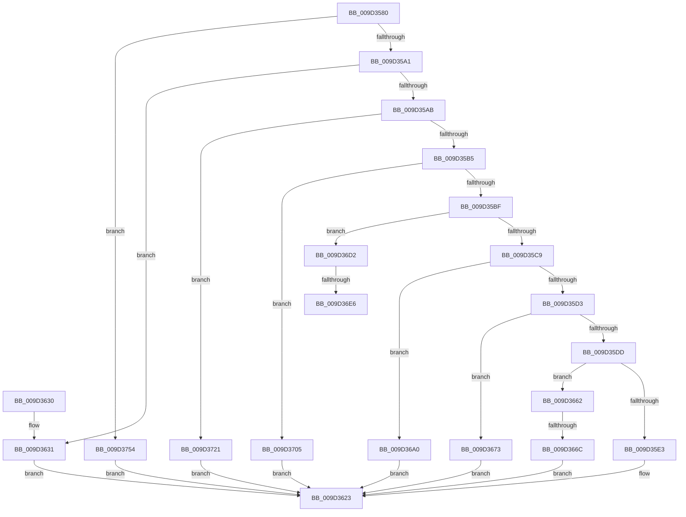

# _PnpDispatchInstallerClass

- RVA: `0x009D3580`–`0x009D375E` (길이 `478` bytes)
- VA: `0x00000001409D3580`
- 실행 섹션: `PAGE`
- PDB 이름 있음: `예`; PDB Function 태그: `예`
- unwind 정보 RVA: `0x000A1568`
- 디코드: `108`개 명령, `478/478` bytes 표시
- 미해석 바이트: `0` (있으면 어셈블리에 `.byte`로 보존)

> 이 문서는 커널 이미지의 기계어와 PDB 기호를 분석해 생성했습니다. 4번과 5번은 함수 원형과 자료형을 바이너리 사용 방식에서 추정한 C 해석이며 원본 소스 복구 결과는 아닙니다.

## 1. Dependencies

- 직접 호출 지점: **8**; 고유 호출 대상: **8**
- 직접 호출자로 확인된 함수: **0**
- RIP 상대 이미지 참조: **1**

### Outgoing calls
- `0x009D361E` → [CmGetInstallerClassMappedProperty](CmGetInstallerClassMappedProperty_function_009D3764.md) (function, `0x009D3764`)
- `0x009D3625` → [PnpMapCmStatusToDispatchStatus](../../text/45/PnpMapCmStatusToDispatchStatus_function_0045461C.md) (function, `0x0045461C`)
- `0x009D365B` → [CmOpenInstallerClassRegKey](CmOpenInstallerClassRegKey_function_009D4474.md) (function, `0x009D4474`)
- `0x009D3699` → [CmGetInstallerClassMappedPropertyLocales](../83/CmGetInstallerClassMappedPropertyLocales_function_00830A38.md) (function, `0x00830A38`)
- `0x009D36C8` → [CmGetInstallerClassMappedPropertyKeys](../83/CmGetInstallerClassMappedPropertyKeys_function_00830704.md) (function, `0x00830704`)
- `0x009D3717` → [CmDeleteInstallerClass](../82/CmDeleteInstallerClass_function_0082A338.md) (function, `0x0082A338`)
- `0x009D374A` → [CmCreateInstallerClass](../82/CmCreateInstallerClass_function_00829594.md) (function, `0x00829594`)
- `0x009D3754` → [CmValidateInstallerClassName](../8F/CmValidateInstallerClassName_function_008F4098.md) (function, `0x008F4098`)

### Direct callers
- 이 함수 시작 RVA로 연결되는 직접 call은 확인되지 않았습니다. 간접 호출은 완전히 역산할 수 없습니다.

### Static image references
- `0x009D36EB` → RVA `0x008317F0` (`PnpCmMatchCallbackRoutine`; read)

## 2. Other-region calls and transfers

- 다른 실행 섹션으로 향하는 call: **1**
  - `0x009D3625` → [PnpMapCmStatusToDispatchStatus](../../text/45/PnpMapCmStatusToDispatchStatus_function_0045461C.md) (`PAGE` → `.text`)
- call이 아닌 외부 분기/꼬리 이동: **3**
  - `0x009D3666` → [sub_00B2F630](../B2/Unknown_function_00B2F630.md) (`tail-transfer`)
  - `0x009D36E0` → [sub_00B2F630 + 0x3C](../B2/Unknown_function_00B2F630.md) (`tail-transfer`)
  - `0x009D3700` → [sub_00B2F630 + 0x3C](../B2/Unknown_function_00B2F630.md) (`tail-transfer`)

## 3. Assembly (complete function range)

```asm
009D3580  40 53                           push rbx
009D3582  48 83 EC 60                     sub rsp, 0x60
009D3586  45 33 C0                        xor r8d, r8d
009D3589  0F 57 C0                        xorps xmm0, xmm0
009D358C  4C 8B D9                        mov r11, rcx
009D358F  41 8B D8                        mov ebx, r8d
009D3592  0F 11 44 24 50                  movups xmmword ptr [rsp + 0x50], xmm0
009D3597  41 83 E9 01                     sub r9d, 1
009D359B  0F 84 B3 01 00 00               je 0x1409d3754
009D35A1  41 83 E9 01                     sub r9d, 1
009D35A5  0F 84 86 00 00 00               je 0x1409d3631
009D35AB  41 83 E9 01                     sub r9d, 1
009D35AF  0F 84 6C 01 00 00               je 0x1409d3721
009D35B5  41 83 E9 01                     sub r9d, 1
009D35B9  0F 84 46 01 00 00               je 0x1409d3705
009D35BF  41 83 E9 01                     sub r9d, 1
009D35C3  0F 84 09 01 00 00               je 0x1409d36d2
009D35C9  41 83 E9 01                     sub r9d, 1
009D35CD  0F 84 CD 00 00 00               je 0x1409d36a0
009D35D3  41 83 E9 01                     sub r9d, 1
009D35D7  0F 84 96 00 00 00               je 0x1409d3673
009D35DD  41 83 E9 01                     sub r9d, 1
009D35E1  75 7F                           jne 0x1409d3662
009D35E3  4C 8B 84 24 90 00 00 00         mov r8, qword ptr [rsp + 0x90]
009D35EB  49 8B 40 30                     mov rax, qword ptr [r8 + 0x30]
009D35EF  4D 8B 48 08                     mov r9, qword ptr [r8 + 8]
009D35F3  48 89 44 24 40                  mov qword ptr [rsp + 0x40], rax
009D35F8  41 8B 40 28                     mov eax, dword ptr [r8 + 0x28]
009D35FC  89 44 24 38                     mov dword ptr [rsp + 0x38], eax
009D3600  49 8B 40 20                     mov rax, qword ptr [r8 + 0x20]
009D3604  48 89 44 24 30                  mov qword ptr [rsp + 0x30], rax
009D3609  49 8B 40 18                     mov rax, qword ptr [r8 + 0x18]
009D360D  48 89 44 24 28                  mov qword ptr [rsp + 0x28], rax
009D3612  49 8B 40 10                     mov rax, qword ptr [r8 + 0x10]
009D3616  4D 8B 00                        mov r8, qword ptr [r8]
009D3619  48 89 44 24 20                  mov qword ptr [rsp + 0x20], rax
009D361E  E8 41 01 00 00                  call 0x1409d3764
009D3623  8B C8                           mov ecx, eax
009D3625  E8 F2 0F A8 FF                  call 0x14045461c
009D362A  48 83 C4 60                     add rsp, 0x60
009D362E  5B                              pop rbx
009D362F  C3                              ret
009D3630  CC                              int3
009D3631  48 8B 8C 24 90 00 00 00         mov rcx, qword ptr [rsp + 0x90]
009D3639  48 8D 41 10                     lea rax, [rcx + 0x10]
009D363D  48 89 44 24 38                  mov qword ptr [rsp + 0x38], rax
009D3642  48 8B 41 08                     mov rax, qword ptr [rcx + 8]
009D3646  48 89 44 24 30                  mov qword ptr [rsp + 0x30], rax
009D364B  8A 41 04                        mov al, byte ptr [rcx + 4]
009D364E  88 44 24 28                     mov byte ptr [rsp + 0x28], al
009D3652  8B 01                           mov eax, dword ptr [rcx]
009D3654  49 8B CB                        mov rcx, r11
009D3657  89 44 24 20                     mov dword ptr [rsp + 0x20], eax
009D365B  E8 14 0E 00 00                  call 0x1409d4474
009D3660  EB C1                           jmp 0x1409d3623
009D3662  41 83 F9 01                     cmp r9d, 1
009D3666  0F 84 C4 BF 15 00               je 0x140b2f630
009D366C  B8 0D 00 00 C0                  mov eax, 0xc000000d
009D3671  EB B0                           jmp 0x1409d3623
009D3673  4C 8B 8C 24 90 00 00 00         mov r9, qword ptr [rsp + 0x90]
009D367B  49 8B 41 20                     mov rax, qword ptr [r9 + 0x20]
009D367F  48 89 44 24 30                  mov qword ptr [rsp + 0x30], rax
009D3684  41 8B 41 18                     mov eax, dword ptr [r9 + 0x18]
009D3688  89 44 24 28                     mov dword ptr [rsp + 0x28], eax
009D368C  49 8B 41 10                     mov rax, qword ptr [r9 + 0x10]
009D3690  4D 8B 49 08                     mov r9, qword ptr [r9 + 8]
009D3694  48 89 44 24 20                  mov qword ptr [rsp + 0x20], rax
009D3699  E8 9A D3 E5 FF                  call 0x140830a38
009D369E  EB 83                           jmp 0x1409d3623
009D36A0  4C 8B 84 24 90 00 00 00         mov r8, qword ptr [rsp + 0x90]
009D36A8  45 33 C9                        xor r9d, r9d
009D36AB  49 8B 40 28                     mov rax, qword ptr [r8 + 0x28]
009D36AF  48 89 44 24 30                  mov qword ptr [rsp + 0x30], rax
009D36B4  41 8B 40 20                     mov eax, dword ptr [r8 + 0x20]
009D36B8  89 44 24 28                     mov dword ptr [rsp + 0x28], eax
009D36BC  49 8B 40 18                     mov rax, qword ptr [r8 + 0x18]
009D36C0  4D 8B 00                        mov r8, qword ptr [r8]
009D36C3  48 89 44 24 20                  mov qword ptr [rsp + 0x20], rax
009D36C8  E8 37 D0 E5 FF                  call 0x140830704
009D36CD  E9 51 FF FF FF                  jmp 0x1409d3623
009D36D2  48 8B 94 24 90 00 00 00         mov rdx, qword ptr [rsp + 0x90]
009D36DA  48 8B 02                        mov rax, qword ptr [rdx]
009D36DD  48 85 C0                        test rax, rax
009D36E0  0F 84 86 BF 15 00               je 0x140b2f66c
009D36E6  48 89 44 24 50                  mov qword ptr [rsp + 0x50], rax
009D36EB  4C 8D 05 FE E0 E5 FF            lea r8, [rip - 0x1a1f02]
009D36F2  48 8B 42 08                     mov rax, qword ptr [rdx + 8]
009D36F6  48 8D 5C 24 50                  lea rbx, [rsp + 0x50]
009D36FB  48 89 44 24 58                  mov qword ptr [rsp + 0x58], rax
009D3700  E9 67 BF 15 00                  jmp 0x140b2f66c
009D3705  48 8B 84 24 90 00 00 00         mov rax, qword ptr [rsp + 0x90]
009D370D  44 8B 00                        mov r8d, dword ptr [rax]
009D3710  41 81 E0 00 00 FF FF            and r8d, 0xffff0000
009D3717  E8 1C 6C E5 FF                  call 0x14082a338
009D371C  E9 02 FF FF FF                  jmp 0x1409d3623
009D3721  4C 8B 84 24 90 00 00 00         mov r8, qword ptr [rsp + 0x90]
009D3729  41 8B 48 14                     mov ecx, dword ptr [r8 + 0x14]
009D372D  49 8D 40 10                     lea rax, [r8 + 0x10]
009D3731  81 E1 00 00 FF FF               and ecx, 0xffff0000
009D3737  4D 8D 48 08                     lea r9, [r8 + 8]
009D373B  45 8B 00                        mov r8d, dword ptr [r8]
009D373E  89 4C 24 28                     mov dword ptr [rsp + 0x28], ecx
009D3742  49 8B CB                        mov rcx, r11
009D3745  48 89 44 24 20                  mov qword ptr [rsp + 0x20], rax
009D374A  E8 45 5E E5 FF                  call 0x140829594
009D374F  E9 CF FE FF FF                  jmp 0x1409d3623
009D3754  E8 3F 09 F2 FF                  call 0x1408f4098
009D3759  E9 C5 FE FF FF                  jmp 0x1409d3623
```

## 4. C-style interpretation (structured pseudocode)

```c
__int64 __fastcall _PnpDispatchInstallerClass(__int64 a1, __int64 a2, int a3, int a4, __int64 a5)
{
    __int64 result;
    __int64 v_rsp;
    unsigned __int64 v_stack_m18;
    unsigned __int64 v_stack_m28;
    unsigned int v_stack_m30;
    unsigned __int64 v_stack_m38;
    unsigned __int64 v_stack_m40;
    unsigned __int64 v_stack_m48;
    unsigned int v_stack_p20;
    unsigned __int8 v_stack_p28;
    unsigned __int64 v_stack_p30;
    unsigned __int64 v_stack_p38;
    unsigned __int64 v_stack_p50;
    unsigned __int64 v_stack_p58;

    v_rsp = (v_rsp) - (96);
    a3 = 0;
    v_stack_m18 = v_xmm0;
    a4 = (unsigned int)((a4) - (1));
    if (condition_is_equal) goto loc_009D3754;
    a4 = (unsigned int)((a4) - (1));
    if (condition_is_equal) goto loc_009D3631;
    a4 = (unsigned int)((a4) - (1));
    if (condition_is_equal) goto loc_009D3721;
    a4 = (unsigned int)((a4) - (1));
    if (condition_is_equal) goto loc_009D3705;
    a4 = (unsigned int)((a4) - (1));
    if (condition_is_equal) goto loc_009D36D2;
    a4 = (unsigned int)((a4) - (1));
    if (condition_is_equal) goto loc_009D36A0;
    a4 = (unsigned int)((a4) - (1));
    if (condition_is_equal) goto loc_009D3673;
    a4 = (unsigned int)((a4) - (1));
    if (condition_is_not_equal) goto loc_009D3662;
    v_stack_m28 = *(unsigned __int64 *)(a5 + 48);
    v_stack_m30 = (unsigned int)((unsigned int)(*(unsigned int *)(a5 + 40)));
    v_stack_m38 = *(unsigned __int64 *)(a5 + 32);
    v_stack_m40 = *(unsigned __int64 *)(a5 + 24);
    v_stack_m48 = *(unsigned __int64 *)(a5 + 16);
    result = CmGetInstallerClassMappedProperty(a1, a2, *(unsigned __int64 *)(a5), *(unsigned __int64 *)(a5 + 8));
loc_009D3623:
    result = PnpMapCmStatusToDispatchStatus((unsigned int)((unsigned int)(result)), a2, *(unsigned __int64 *)(a5), *(unsigned __int64 *)(a5 + 8));
    v_rsp = (v_rsp) + (96);
    return result;
loc_009D3631:
    v_stack_p38 = a5 + 16;
    v_stack_p30 = *(unsigned __int64 *)(a5 + 8);
    v_stack_p28 = (unsigned __int8)(*(unsigned __int8 *)(a5 + 4));
    v_stack_p20 = (unsigned int)((unsigned int)(*(unsigned int *)(a5)));
    result = CmOpenInstallerClassRegKey(a1, a2, *(unsigned __int64 *)(a5), *(unsigned __int64 *)(a5 + 8));
    goto loc_009D3623;
loc_009D3662:
    goto loc_009D3623;
loc_009D3673:
    v_stack_p30 = *(unsigned __int64 *)(a5 + 32);
    v_stack_p28 = (unsigned int)((unsigned int)(*(unsigned int *)(a5 + 24)));
    v_stack_p20 = *(unsigned __int64 *)(a5 + 16);
    result = CmGetInstallerClassMappedPropertyLocales(a1, a2, *(unsigned __int64 *)(a5), *(unsigned __int64 *)(a5 + 8));
    goto loc_009D3623;
loc_009D36A0:
    a4 = 0;
    v_stack_p30 = *(unsigned __int64 *)(a5 + 40);
    v_stack_p28 = (unsigned int)((unsigned int)(*(unsigned int *)(a5 + 32)));
    v_stack_p20 = *(unsigned __int64 *)(a5 + 24);
    result = CmGetInstallerClassMappedPropertyKeys(a1, a2, *(unsigned __int64 *)(a5), a4);
    goto loc_009D3623;
loc_009D36D2:
    v_stack_p50 = *(unsigned __int64 *)(a5);
    v_stack_p58 = *(unsigned __int64 *)(a5 + 8);
loc_009D3705:
    a3 = (unsigned int)(((unsigned int)(*(unsigned int *)(a5))) & (0xFFFF0000ULL));
    result = CmDeleteInstallerClass(a1, a5, a3, a4);
    goto loc_009D3623;
loc_009D3721:
    a1 = (unsigned int)(((unsigned int)(*(unsigned int *)(a5 + 20))) & (0xFFFF0000ULL));
    v_stack_p28 = (unsigned int)(a1);
    v_stack_p20 = a5 + 16;
    result = CmCreateInstallerClass(a1, a5, (unsigned int)(*(unsigned int *)(a5)), a5 + 8);
    goto loc_009D3623;
loc_009D3754:
    result = CmValidateInstallerClassName(a1, a5, (unsigned int)(*(unsigned int *)(a5)), a5 + 8);
    goto loc_009D3623;
}
```

## 5. (Beta) C Style

```c
int64_t _PnpDispatchInstallerClass(int64_t Arg1, int64_t Arg2, int32_t Arg3, int32_t Arg4, void *Arg5)
{
    uint8_t *arg5 = (uint8_t *)Arg5;

    int64_t result;
    int64_t local_rsp;
    uint64_t v_stack_m18;
    uint64_t v_stack_m28;
    uint32_t v_stack_m30;
    uint64_t v_stack_m38;
    uint64_t v_stack_m40;
    uint64_t v_stack_m48;
    uint32_t v_stack_p20;
    uint8_t v_stack_p28;
    uint64_t v_stack_p30;
    uint64_t v_stack_p38;
    uint64_t v_stack_p50;
    uint64_t v_stack_p58;

    local_rsp = (local_rsp) - (96);
    Arg3 = 0;
    v_stack_m18 = v_xmm0;
    Arg4 = (uint32_t)((Arg4) - (1));
    if (condition_is_equal) goto loc_009D3754;
    Arg4 = (uint32_t)((Arg4) - (1));
    if (condition_is_equal) goto loc_009D3631;
    Arg4 = (uint32_t)((Arg4) - (1));
    if (condition_is_equal) goto loc_009D3721;
    Arg4 = (uint32_t)((Arg4) - (1));
    if (condition_is_equal) goto loc_009D3705;
    Arg4 = (uint32_t)((Arg4) - (1));
    if (condition_is_equal) goto loc_009D36D2;
    Arg4 = (uint32_t)((Arg4) - (1));
    if (condition_is_equal) goto loc_009D36A0;
    Arg4 = (uint32_t)((Arg4) - (1));
    if (condition_is_equal) goto loc_009D3673;
    Arg4 = (uint32_t)((Arg4) - (1));
    if (condition_is_not_equal) goto loc_009D3662;
    v_stack_m28 = *(uint64_t *)(arg5 + 0x30);
    v_stack_m30 = (uint32_t)((uint32_t)(*(uint32_t *)(arg5 + 0x28)));
    v_stack_m38 = *(uint64_t *)(arg5 + 0x20);
    v_stack_m40 = *(uint64_t *)(arg5 + 0x18);
    v_stack_m48 = *(uint64_t *)(arg5 + 0x10);
    result = CmGetInstallerClassMappedProperty(Arg1, Arg2, *(uint64_t *)(arg5), *(uint64_t *)(arg5 + 0x8));
loc_009D3623:
    result = PnpMapCmStatusToDispatchStatus((uint32_t)((uint32_t)(result)), Arg2, *(uint64_t *)(arg5), *(uint64_t *)(arg5 + 0x8));
    local_rsp = (local_rsp) + (96);
    return result;
loc_009D3631:
    v_stack_p38 = Arg5 + 16;
    v_stack_p30 = *(uint64_t *)(arg5 + 0x8);
    v_stack_p28 = (uint8_t)(*(uint8_t *)(arg5 + 0x4));
    v_stack_p20 = (uint32_t)((uint32_t)(*(uint32_t *)(arg5)));
    result = CmOpenInstallerClassRegKey(Arg1, Arg2, *(uint64_t *)(arg5), *(uint64_t *)(arg5 + 0x8));
    goto loc_009D3623;
loc_009D3662:
    goto loc_009D3623;
loc_009D3673:
    v_stack_p30 = *(uint64_t *)(arg5 + 0x20);
    v_stack_p28 = (uint32_t)((uint32_t)(*(uint32_t *)(arg5 + 0x18)));
    v_stack_p20 = *(uint64_t *)(arg5 + 0x10);
    result = CmGetInstallerClassMappedPropertyLocales(Arg1, Arg2, *(uint64_t *)(arg5), *(uint64_t *)(arg5 + 0x8));
    goto loc_009D3623;
loc_009D36A0:
    Arg4 = 0;
    v_stack_p30 = *(uint64_t *)(arg5 + 0x28);
    v_stack_p28 = (uint32_t)((uint32_t)(*(uint32_t *)(arg5 + 0x20)));
    v_stack_p20 = *(uint64_t *)(arg5 + 0x18);
    result = CmGetInstallerClassMappedPropertyKeys(Arg1, Arg2, *(uint64_t *)(arg5), Arg4);
    goto loc_009D3623;
loc_009D36D2:
    v_stack_p50 = *(uint64_t *)(arg5);
    v_stack_p58 = *(uint64_t *)(arg5 + 0x8);
loc_009D3705:
    Arg3 = (uint32_t)(((uint32_t)(*(uint32_t *)(arg5))) & (0xFFFF0000ULL));
    result = CmDeleteInstallerClass(Arg1, Arg5, Arg3, Arg4);
    goto loc_009D3623;
loc_009D3721:
    Arg1 = (uint32_t)(((uint32_t)(*(uint32_t *)(arg5 + 0x14))) & (0xFFFF0000ULL));
    v_stack_p28 = (uint32_t)(Arg1);
    v_stack_p20 = Arg5 + 16;
    result = CmCreateInstallerClass(Arg1, Arg5, (uint32_t)(*(uint32_t *)(arg5)), Arg5 + 8);
    goto loc_009D3623;
loc_009D3754:
    result = CmValidateInstallerClassName(Arg1, Arg5, (uint32_t)(*(uint32_t *)(arg5)), Arg5 + 8);
    goto loc_009D3623;
}
```

### 관측된 메모리 오프셋

구조체 형식이 확인되지 않은 접근은 인자 기준의 오프셋으로만 기록했습니다.

| 기준 인자 | 오프셋 표현 | 폭 (bit) | 접근 |
|---|---:|---:|---|
| `Arg5` | `+ 0x0` | `32` | `R` |
| `Arg5` | `+ 0x0` | `64` | `R` |
| `Arg5` | `+ 0x4` | `8` | `R` |
| `Arg5` | `+ 0x8` | `64` | `R` |
| `Arg5` | `+ 0x10` | `64` | `R` |
| `Arg5` | `+ 0x14` | `32` | `R` |
| `Arg5` | `+ 0x18` | `32` | `R` |
| `Arg5` | `+ 0x18` | `64` | `R` |
| `Arg5` | `+ 0x20` | `32` | `R` |
| `Arg5` | `+ 0x20` | `64` | `R` |
| `Arg5` | `+ 0x28` | `32` | `R` |
| `Arg5` | `+ 0x28` | `64` | `R` |
| `Arg5` | `+ 0x30` | `64` | `R` |

## 6. Execution-region graph

[열기: 2D/3D 그래프와 함수 탐색 컨트롤 패널](../../../control-panel.html?section=page&rva=0x009D3580&view=graph)

- 2D 그래프는 위에서 아래로 흐르고, 3D 그래프는 빈 공간을 드래그해 회전합니다. Shift+드래그는 이동, 휠은 확대·축소, 함수 노드 선택은 대상 보고서 이동입니다.

### Static fallback


