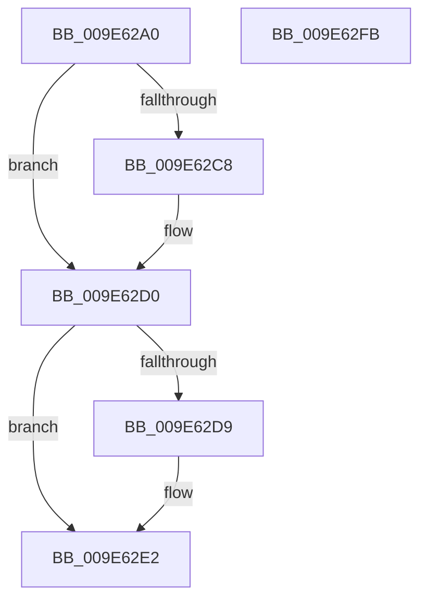

# AlpciDestroyDeferredMessageContext

- RVA: `0x009E62A0`–`0x009E62FC` (길이 `92` bytes)
- VA: `0x00000001409E62A0`
- 실행 섹션: `PAGE`
- PDB 이름 있음: `예`; PDB Function 태그: `아니요`
- unwind 정보 RVA: `0x0005CAAC`
- 디코드: `25`개 명령, `92/92` bytes 표시
- 미해석 바이트: `0` (있으면 어셈블리에 `.byte`로 보존)

> 이 문서는 커널 이미지의 기계어와 PDB 기호를 분석해 생성했습니다. 4번과 5번은 함수 원형과 자료형을 바이너리 사용 방식에서 추정한 C 해석이며 원본 소스 복구 결과는 아닙니다.

## 1. Dependencies

- 직접 호출 지점: **3**; 고유 호출 대상: **2**
- 직접 호출자로 확인된 함수: **1**
- RIP 상대 이미지 참조: **0**

### Outgoing calls
- `0x009E62C8` → [ObfDereferenceObject](../../text/2F/ObfDereferenceObject_function_002F9350.md) (function, `0x002F9350`)
- `0x009E62D9` → [ObfDereferenceObject](../../text/2F/ObfDereferenceObject_function_002F9350.md) (function, `0x002F9350`)
- `0x009E62EB` → [KeLeaveCriticalRegionThread](../../text/25/KeLeaveCriticalRegionThread_function_0025EFF0.md) (function, `0x0025EFF0`)

### Direct callers
- [ExpWorkerFactoryFinishDeferredWork](../../text/39/ExpWorkerFactoryFinishDeferredWork_function_00395000.md) at `0x00395015`

### Static image references
- 디코드된 RIP-relative 메모리 참조가 없습니다.

## 2. Other-region calls and transfers

- 다른 실행 섹션으로 향하는 call: **3**
  - `0x009E62C8` → [ObfDereferenceObject](../../text/2F/ObfDereferenceObject_function_002F9350.md) (`PAGE` → `.text`)
  - `0x009E62D9` → [ObfDereferenceObject](../../text/2F/ObfDereferenceObject_function_002F9350.md) (`PAGE` → `.text`)
  - `0x009E62EB` → [KeLeaveCriticalRegionThread](../../text/25/KeLeaveCriticalRegionThread_function_0025EFF0.md) (`PAGE` → `.text`)
- 별도 외부 분기/꼬리 이동을 확인하지 못했습니다.

## 3. Assembly (complete function range)

```asm
009E62A0  48 89 5C 24 08                  mov qword ptr [rsp + 8], rbx
009E62A5  57                              push rdi
009E62A6  48 83 EC 20                     sub rsp, 0x20
009E62AA  65 48 8B 04 25 88 01 00 00      mov rax, qword ptr gs:[0x188]
009E62B3  48 8B D9                        mov rbx, rcx
009E62B6  33 FF                           xor edi, edi
009E62B8  66 FF 88 E4 01 00 00            dec word ptr [rax + 0x1e4]
009E62BF  90                              nop
009E62C0  48 8B 09                        mov rcx, qword ptr [rcx]
009E62C3  48 85 C9                        test rcx, rcx
009E62C6  74 08                           je 0x1409e62d0
009E62C8  E8 83 30 91 FF                  call 0x1402f9350
009E62CD  48 89 3B                        mov qword ptr [rbx], rdi
009E62D0  48 8B 4B 08                     mov rcx, qword ptr [rbx + 8]
009E62D4  48 85 C9                        test rcx, rcx
009E62D7  74 09                           je 0x1409e62e2
009E62D9  E8 72 30 91 FF                  call 0x1402f9350
009E62DE  48 89 7B 08                     mov qword ptr [rbx + 8], rdi
009E62E2  65 48 8B 0C 25 88 01 00 00      mov rcx, qword ptr gs:[0x188]
009E62EB  E8 00 8D 87 FF                  call 0x14025eff0
009E62F0  48 8B 5C 24 30                  mov rbx, qword ptr [rsp + 0x30]
009E62F5  48 83 C4 20                     add rsp, 0x20
009E62F9  5F                              pop rdi
009E62FA  C3                              ret
009E62FB  CC                              int3
```

## 4. C-style interpretation (structured pseudocode)

```c
__int64 __fastcall AlpciDestroyDeferredMessageContext(__int64 a1)
{
    __int64 result;
    __int64 v_rdi;
    __int64 v_rsp;
    unsigned __int64 v_stack_p8;

    v_stack_p8 = v_rbx;
    v_rsp = (v_rsp) - (32);
    v_rdi = 0;
    result = *(unsigned __int64 *)(gs_base + (0 + 392));
    if (*(unsigned __int64 *)(a1) != 0) {
        result = ObfDereferenceObject(*(unsigned __int64 *)(a1), a2, a3, a4);
        *(unsigned __int64 *)(a1) = 0;
    }
    if (*(unsigned __int64 *)(a1 + 8) != 0) {
        result = ObfDereferenceObject(*(unsigned __int64 *)(a1 + 8), a2, a3, a4);
        *(unsigned __int64 *)(a1 + 8) = 0;
    }
    result = KeLeaveCriticalRegionThread(*(unsigned __int64 *)(gs_base + (0 + 392)), a2, a3, a4);
    v_rsp = (v_rsp) + (32);
    return result;
}
```

## 5. (Beta) C Style

```c
int64_t AlpciDestroyDeferredMessageContext(void *Arg1)
{
    uint8_t *arg1 = (uint8_t *)Arg1;

    int64_t result;
    int64_t local_rdi;
    int64_t local_rsp;
    uint64_t v_stack_p8;

    v_stack_p8 = local_rbx;
    local_rsp = (local_rsp) - (32);
    local_rdi = 0;
    result = *(uint64_t *)(gs_base + (0 + 0x188));
    if (*(uint64_t *)(arg1) != 0) {
        result = ObfDereferenceObject(*(uint64_t *)(arg1), a2, a3, a4);
        *(uint64_t *)(arg1) = 0;
    }
    if (*(uint64_t *)(arg1 + 0x8) != 0) {
        result = ObfDereferenceObject(*(uint64_t *)(arg1 + 0x8), a2, a3, a4);
        *(uint64_t *)(arg1 + 0x8) = 0;
    }
    result = KeLeaveCriticalRegionThread(*(uint64_t *)(gs_base + (0 + 0x188)), a2, a3, a4);
    local_rsp = (local_rsp) + (32);
    return result;
}
```

### 관측된 메모리 오프셋

구조체 형식이 확인되지 않은 접근은 인자 기준의 오프셋으로만 기록했습니다.

| 기준 인자 | 오프셋 표현 | 폭 (bit) | 접근 |
|---|---:|---:|---|
| `Arg1` | `+ 0x0` | `64` | `R` |
| `Arg1` | `+ 0x0` | `64` | `W` |
| `Arg1` | `+ 0x8` | `64` | `R` |
| `Arg1` | `+ 0x8` | `64` | `W` |

## 6. Execution-region graph

[열기: 2D/3D 그래프와 함수 탐색 컨트롤 패널](../../../control-panel.html?section=page&rva=0x009E62A0&view=graph)

- 2D 그래프는 위에서 아래로 흐르고, 3D 그래프는 빈 공간을 드래그해 회전합니다. Shift+드래그는 이동, 휠은 확대·축소, 함수 노드 선택은 대상 보고서 이동입니다.

### Static fallback


