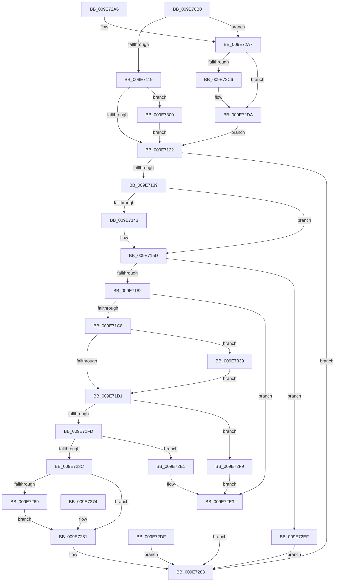

# AlpcpCreateConnectionPort

- RVA: `0x009E70B0`–`0x009E7352` (길이 `674` bytes)
- VA: `0x00000001409E70B0`
- 실행 섹션: `PAGE`
- PDB 이름 있음: `예`; PDB Function 태그: `아니요`
- unwind 정보 RVA: `0x000A49A4`
- 디코드: `169`개 명령, `674/674` bytes 표시
- 미해석 바이트: `0` (있으면 어셈블리에 `.byte`로 보존)

> 이 문서는 커널 이미지의 기계어와 PDB 기호를 분석해 생성했습니다. 4번과 5번은 함수 원형과 자료형을 바이너리 사용 방식에서 추정한 C 해석이며 원본 소스 복구 결과는 아닙니다.

## 1. Dependencies

- 직접 호출 지점: **13**; 고유 호출 대상: **12**
- 직접 호출자로 확인된 함수: **3**
- RIP 상대 이미지 참조: **2**

### Outgoing calls
- `0x009E70F1` → [memset](../../text/6C/memset_function_006C6C40.md) (function, `0x006C6C40`)
- `0x009E712C` → [AlpcpCreatePort](AlpcpCreatePort_function_009E7358.md) (function, `0x009E7358`)
- `0x009E716F` → [AlpcpInitializePort](../92/AlpcpInitializePort_function_00925DC4.md) (function, `0x00925DC4`)
- `0x009E71B6` → [AlpcpValidateAndSetPortAttributes](AlpcpValidateAndSetPortAttributes_function_009E73BC.md) (function, `0x009E73BC`)
- `0x009E71D7` → [AlpcpSetOwnerProcessPort](AlpcpSetOwnerProcessPort_function_009E761C.md) (function, `0x009E761C`)
- `0x009E71EB` → [AlpcpAllocateBlob](../89/AlpcpAllocateBlob_function_008925B0.md) (function, `0x008925B0`)
- `0x009E722F` → [AlpcInitializeHandleTable](../92/AlpcInitializeHandleTable_function_00925D70.md) (function, `0x00925D70`)
- `0x009E725E` → [ObInsertObjectEx](../8B/ObInsertObjectEx_function_008B97A0.md) (function, `0x008B97A0`)
- `0x009E727B` → [NtClose](../86/NtClose_function_00868870.md) (function, `0x00868870`)
- `0x009E728E` → [_security_check_cookie](../../text/6A/_security_check_cookie_function_006AC640.md) (function, `0x006AC640`)
- `0x009E72D5` → [RtlCopyVolatileMemory](../../text/6B/RtlCopyVolatileMemory_function_006BC9D0.md) (function, `0x006BC9D0`)
- `0x009E72E6` → [ObfDereferenceObject](../../text/2F/ObfDereferenceObject_function_002F9350.md) (function, `0x002F9350`)
- `0x009E72EF` → [ObfDereferenceObject](../../text/2F/ObfDereferenceObject_function_002F9350.md) (function, `0x002F9350`)

### Direct callers
- [NtCreatePort](../74/NtCreatePort_function_0074BDD0.md) at `0x0074BDF4`
- [NtCreateWaitablePort](../74/NtCreateWaitablePort_function_0074BE10.md) at `0x0074BE34`
- [NtAlpcCreatePort](NtAlpcCreatePort_function_009E7070.md) at `0x009E7094`

### Static image references
- `0x009E70C3` → RVA `0x00E0A740` (`.data`; read)
- `0x009E71E4` → RVA `0x000020A8` (`.rdata`; read)

## 2. Other-region calls and transfers

- 다른 실행 섹션으로 향하는 call: **5**
  - `0x009E70F1` → [memset](../../text/6C/memset_function_006C6C40.md) (`PAGE` → `.text`)
  - `0x009E728E` → [_security_check_cookie](../../text/6A/_security_check_cookie_function_006AC640.md) (`PAGE` → `.text`)
  - `0x009E72D5` → [RtlCopyVolatileMemory](../../text/6B/RtlCopyVolatileMemory_function_006BC9D0.md) (`PAGE` → `.text`)
  - `0x009E72E6` → [ObfDereferenceObject](../../text/2F/ObfDereferenceObject_function_002F9350.md) (`PAGE` → `.text`)
  - `0x009E72EF` → [ObfDereferenceObject](../../text/2F/ObfDereferenceObject_function_002F9350.md) (`PAGE` → `.text`)
- 별도 외부 분기/꼬리 이동을 확인하지 못했습니다.

## 3. Assembly (complete function range)

```asm
009E70B0  40 53                           push rbx
009E70B2  56                              push rsi
009E70B3  57                              push rdi
009E70B4  41 54                           push r12
009E70B6  41 55                           push r13
009E70B8  41 56                           push r14
009E70BA  41 57                           push r15
009E70BC  48 81 EC B0 00 00 00            sub rsp, 0xb0
009E70C3  48 8B 05 76 36 42 00            mov rax, qword ptr [rip + 0x423676]
009E70CA  48 33 C4                        xor rax, rsp
009E70CD  48 89 84 24 A0 00 00 00         mov qword ptr [rsp + 0xa0], rax
009E70D5  45 8B E9                        mov r13d, r9d
009E70D8  49 8B F8                        mov rdi, r8
009E70DB  48 8B F2                        mov rsi, rdx
009E70DE  4C 8B E1                        mov r12, rcx
009E70E1  41 BE 48 00 00 00               mov r14d, 0x48
009E70E7  45 8B C6                        mov r8d, r14d
009E70EA  33 D2                           xor edx, edx
009E70EC  48 8D 4C 24 50                  lea rcx, [rsp + 0x50]
009E70F1  E8 4A FB CD FF                  call 0x1406c6c40
009E70F6  48 83 64 24 48 00               and qword ptr [rsp + 0x48], 0
009E70FC  48 83 64 24 40 00               and qword ptr [rsp + 0x40], 0
009E7102  65 48 8B 04 25 88 01 00 00      mov rax, qword ptr gs:[0x188]
009E710B  8A 98 32 02 00 00               mov bl, byte ptr [rax + 0x232]
009E7111  84 DB                           test bl, bl
009E7113  0F 85 8E 01 00 00               jne 0x1409e72a7
009E7119  48 85 FF                        test rdi, rdi
009E711C  0F 85 DE 01 00 00               jne 0x1409e7300
009E7122  4C 8D 44 24 48                  lea r8, [rsp + 0x48]
009E7127  48 8B D6                        mov rdx, rsi
009E712A  8A CB                           mov cl, bl
009E712C  E8 27 02 00 00                  call 0x1409e7358
009E7131  85 C0                           test eax, eax
009E7133  0F 88 4A 01 00 00               js 0x1409e7283
009E7139  BE 01 00 00 00                  mov esi, 1
009E713E  48 85 FF                        test rdi, rdi
009E7141  74 1A                           je 0x1409e715d
009E7143  F7 44 24 50 00 00 04 00         test dword ptr [rsp + 0x50], 0x40000
009E714B  0F B6 84 24 10 01 00 00         movzx eax, byte ptr [rsp + 0x110]
009E7153  0F 45 C6                        cmovne eax, esi
009E7156  88 84 24 10 01 00 00            mov byte ptr [rsp + 0x110], al
009E715D  44 8A 84 24 10 01 00 00         mov r8b, byte ptr [rsp + 0x110]
009E7165  8B D6                           mov edx, esi
009E7167  48 8B 5C 24 48                  mov rbx, qword ptr [rsp + 0x48]
009E716C  48 8B CB                        mov rcx, rbx
009E716F  E8 50 EC F3 FF                  call 0x140925dc4
009E7174  44 8B F0                        mov r14d, eax
009E7177  48 8B CB                        mov rcx, rbx
009E717A  85 C0                           test eax, eax
009E717C  0F 88 6D 01 00 00               js 0x1409e72ef
009E7182  48 F7 DF                        neg rdi
009E7185  4D 1B F6                        sbb r14, r14
009E7188  48 8D 44 24 50                  lea rax, [rsp + 0x50]
009E718D  4C 23 F0                        and r14, rax
009E7190  44 8A BC 24 18 01 00 00         mov r15b, byte ptr [rsp + 0x118]
009E7198  44 88 7C 24 30                  mov byte ptr [rsp + 0x30], r15b
009E719D  8A 84 24 10 01 00 00            mov al, byte ptr [rsp + 0x110]
009E71A4  88 44 24 28                     mov byte ptr [rsp + 0x28], al
009E71A8  44 89 6C 24 20                  mov dword ptr [rsp + 0x20], r13d
009E71AD  45 33 C9                        xor r9d, r9d
009E71B0  4C 8B C3                        mov r8, rbx
009E71B3  49 8B D6                        mov rdx, r14
009E71B6  E8 01 02 00 00                  call 0x1409e73bc
009E71BB  8B F8                           mov edi, eax
009E71BD  45 33 ED                        xor r13d, r13d
009E71C0  85 C0                           test eax, eax
009E71C2  0F 88 1B 01 00 00               js 0x1409e72e3
009E71C8  45 84 FF                        test r15b, r15b
009E71CB  0F 85 68 01 00 00               jne 0x1409e7339
009E71D1  49 8B D6                        mov rdx, r14
009E71D4  48 8B CB                        mov rcx, rbx
009E71D7  E8 40 04 00 00                  call 0x1409e761c
009E71DC  44 8B C6                        mov r8d, esi
009E71DF  BA 50 00 00 00                  mov edx, 0x50
009E71E4  48 8D 0D BD AE 61 FF            lea rcx, [rip - 0x9e5143]
009E71EB  E8 C0 B3 EA FF                  call 0x1408925b0
009E71F0  48 89 43 10                     mov qword ptr [rbx + 0x10], rax
009E71F4  48 85 C0                        test rax, rax
009E71F7  0F 84 FC 00 00 00               je 0x1409e72f9
009E71FD  4C 89 68 10                     mov qword ptr [rax + 0x10], r13
009E7201  48 8B 43 10                     mov rax, qword ptr [rbx + 0x10]
009E7205  48 89 18                        mov qword ptr [rax], rbx
009E7208  48 8B 43 10                     mov rax, qword ptr [rbx + 0x10]
009E720C  4C 89 68 08                     mov qword ptr [rax + 8], r13
009E7210  48 8B 43 10                     mov rax, qword ptr [rbx + 0x10]
009E7214  4C 89 68 48                     mov qword ptr [rax + 0x48], r13
009E7218  48 8B 43 10                     mov rax, qword ptr [rbx + 0x10]
009E721C  48 83 C0 18                     add rax, 0x18
009E7220  48 89 40 08                     mov qword ptr [rax + 8], rax
009E7224  48 89 00                        mov qword ptr [rax], rax
009E7227  48 8B 4B 10                     mov rcx, qword ptr [rbx + 0x10]
009E722B  48 83 C1 28                     add rcx, 0x28
009E722F  E8 3C EB F3 FF                  call 0x140925d70
009E7234  85 C0                           test eax, eax
009E7236  0F 88 A5 00 00 00               js 0x1409e72e1
009E723C  48 8D 44 24 40                  lea rax, [rsp + 0x40]
009E7241  48 89 44 24 30                  mov qword ptr [rsp + 0x30], rax
009E7246  4C 89 6C 24 28                  mov qword ptr [rsp + 0x28], r13
009E724B  44 89 6C 24 20                  mov dword ptr [rsp + 0x20], r13d
009E7250  45 33 C9                        xor r9d, r9d
009E7253  33 D2                           xor edx, edx
009E7255  41 B8 01 00 1F 00               mov r8d, 0x1f0001
009E725B  48 8B CB                        mov rcx, rbx
009E725E  E8 3D 25 ED FF                  call 0x1408b97a0
009E7263  8B D8                           mov ebx, eax
009E7265  85 C0                           test eax, eax
009E7267  78 18                           js 0x1409e7281
009E7269  48 8B 4C 24 40                  mov rcx, qword ptr [rsp + 0x40]
009E726E  49 89 0C 24                     mov qword ptr [r12], rcx
009E7272  EB 0D                           jmp 0x1409e7281
009E7274  8B D8                           mov ebx, eax
009E7276  48 8B 4C 24 40                  mov rcx, qword ptr [rsp + 0x40]
009E727B  E8 F0 15 E8 FF                  call 0x140868870
009E7280  90                              nop
009E7281  8B C3                           mov eax, ebx
009E7283  48 8B 8C 24 A0 00 00 00         mov rcx, qword ptr [rsp + 0xa0]
009E728B  48 33 CC                        xor rcx, rsp
009E728E  E8 AD 53 CC FF                  call 0x1406ac640
009E7293  48 81 C4 B0 00 00 00            add rsp, 0xb0
009E729A  41 5F                           pop r15
009E729C  41 5E                           pop r14
009E729E  41 5D                           pop r13
009E72A0  41 5C                           pop r12
009E72A2  5F                              pop rdi
009E72A3  5E                              pop rsi
009E72A4  5B                              pop rbx
009E72A5  C3                              ret
009E72A6  CC                              int3
009E72A7  48 BA 00 00 FF FF FF 7F 00 00   movabs rdx, 0x7fffffff0000
009E72B1  48 8B CA                        mov rcx, rdx
009E72B4  4C 3B E2                        cmp r12, rdx
009E72B7  49 0F 42 CC                     cmovb rcx, r12
009E72BB  48 8B 01                        mov rax, qword ptr [rcx]
009E72BE  48 89 01                        mov qword ptr [rcx], rax
009E72C1  48 85 FF                        test rdi, rdi
009E72C4  74 14                           je 0x1409e72da
009E72C6  48 3B FA                        cmp rdi, rdx
009E72C9  48 0F 42 D7                     cmovb rdx, rdi
009E72CD  4D 8B C6                        mov r8, r14
009E72D0  48 8D 4C 24 50                  lea rcx, [rsp + 0x50]
009E72D5  E8 F6 56 CD FF                  call 0x1406bc9d0
009E72DA  E9 43 FE FF FF                  jmp 0x1409e7122
009E72DF  EB A2                           jmp 0x1409e7283
009E72E1  8B F8                           mov edi, eax
009E72E3  48 8B CB                        mov rcx, rbx
009E72E6  E8 65 20 91 FF                  call 0x1402f9350
009E72EB  8B C7                           mov eax, edi
009E72ED  EB 94                           jmp 0x1409e7283
009E72EF  E8 5C 20 91 FF                  call 0x1402f9350
009E72F4  41 8B C6                        mov eax, r14d
009E72F7  EB 8A                           jmp 0x1409e7283
009E72F9  BF 17 00 00 C0                  mov edi, 0xc0000017
009E72FE  EB E3                           jmp 0x1409e72e3
009E7300  0F 10 07                        movups xmm0, xmmword ptr [rdi]
009E7303  0F 29 44 24 50                  movaps xmmword ptr [rsp + 0x50], xmm0
009E7308  0F 10 4F 10                     movups xmm1, xmmword ptr [rdi + 0x10]
009E730C  0F 29 4C 24 60                  movaps xmmword ptr [rsp + 0x60], xmm1
009E7311  0F 10 47 20                     movups xmm0, xmmword ptr [rdi + 0x20]
009E7315  0F 29 44 24 70                  movaps xmmword ptr [rsp + 0x70], xmm0
009E731A  0F 10 4F 30                     movups xmm1, xmmword ptr [rdi + 0x30]
009E731E  0F 29 8C 24 80 00 00 00         movaps xmmword ptr [rsp + 0x80], xmm1
009E7326  F2 0F 10 47 40                  movsd xmm0, qword ptr [rdi + 0x40]
009E732B  F2 0F 11 84 24 90 00 00 00      movsd qword ptr [rsp + 0x90], xmm0
009E7334  E9 E9 FD FF FF                  jmp 0x1409e7122
009E7339  8B 83 A0 01 00 00               mov eax, dword ptr [rbx + 0x1a0]
009E733F  0F BA E8 0C                     bts eax, 0xc
009E7343  0F BA E8 0D                     bts eax, 0xd
009E7347  89 83 A0 01 00 00               mov dword ptr [rbx + 0x1a0], eax
009E734D  E9 7F FE FF FF                  jmp 0x1409e71d1
```

## 4. C-style interpretation (structured pseudocode)

```c
__int64 __fastcall AlpcpCreateConnectionPort(__int64 a1, __int64 a2, __int64 a3, int a4, unsigned __int8 a5, unsigned __int8 a6)
{
    __int64 result;
    __int64 v_r13;
    __int64 v_r14;
    __int64 v_rdi;
    __int64 v_rsp;
    unsigned __int64 v_stack_m48;
    unsigned __int64 v_stack_m98;
    unsigned __int64 v_stack_mA0;
    unsigned __int64 v_stack_mA8;
    unsigned __int8 v_stack_mB8;
    unsigned __int8 v_stack_mC0;
    unsigned int v_stack_mC8;
    unsigned __int8 v_stack_p28;
    unsigned __int64 v_stack_p50;
    unsigned __int64 v_stack_p60;
    unsigned __int64 v_stack_p70;
    unsigned __int64 v_stack_p80;
    unsigned __int64 v_stack_p90;

    v_rsp = (v_rsp) - (176);
    result = (*(unsigned __int64 *)(v_rip + 4339318)) ^ (v_rsp);
    v_stack_m48 = result;
    a2 = 0;
    result = memset(v_stack_m98, a2, 72, a4);
    if ((unsigned __int8)(*(unsigned __int8 *)(*(unsigned __int64 *)(gs_base + (0 + 392)) + 562)) != 0) goto loc_009E72A7;
    if (a3 != 0) goto loc_009E7300;
loc_009E7122:
    result = AlpcpCreatePort((unsigned __int8)(*(unsigned __int8 *)(*(unsigned __int64 *)(gs_base + (0 + 392)) + 562)), 0, v_stack_mA0, a4);
    if (sign_flag) goto loc_009E7283;
    if (a3 != 0) {
        result = a5;
        if (((v_stack_m98) & (0x40000ULL)) != 0) { result = 1; }
        v_stack_p28 = (unsigned __int8)(result);
    }
    result = AlpcpInitializePort(v_stack_mA0, 1, a5, a4);
    if (sign_flag) goto loc_009E72EF;
    v_rdi = -(a3);
    v_r14 = ((unsigned int)((unsigned int)(result))) & (v_stack_m98);
    v_stack_mB8 = a6;
    v_stack_mC0 = a5;
    v_stack_mC8 = (unsigned int)((unsigned int)(a4));
    a4 = 0;
    result = AlpcpValidateAndSetPortAttributes(v_stack_mA0, v_r14, v_stack_mA0, a4);
    v_r13 = 0;
    if (sign_flag) goto loc_009E72E3;
    if (a6 != 0) goto loc_009E7339;
loc_009E71D1:
    result = AlpcpSetOwnerProcessPort(v_stack_mA0, v_r14, v_stack_mA0, a4);
    result = AlpcpAllocateBlob(v_rip - 10375491, 80, 1, a4);
    *(unsigned __int64 *)(v_stack_mA0 + 16) = result;
    if (result == 0) goto loc_009E72F9;
    *(unsigned __int64 *)(result + 16) = 0;
    *(unsigned __int64 *)(*(unsigned __int64 *)(v_stack_mA0 + 16)) = v_stack_mA0;
    *(unsigned __int64 *)(*(unsigned __int64 *)(v_stack_mA0 + 16) + 8) = 0;
    *(unsigned __int64 *)(*(unsigned __int64 *)(v_stack_mA0 + 16) + 72) = 0;
    result = (*(unsigned __int64 *)(v_stack_mA0 + 16)) + (24);
    *(unsigned __int64 *)(result + 8) = result;
    *(unsigned __int64 *)(result) = result;
    a1 = (*(unsigned __int64 *)(v_stack_mA0 + 16)) + (40);
    result = AlpcInitializeHandleTable(a1, 80, 1, a4);
    if (sign_flag) goto loc_009E72E1;
    v_stack_mB8 = v_stack_mA8;
    v_stack_mC0 = 0;
    v_stack_mC8 = 0;
    a4 = 0;
    a2 = 0;
    result = ObInsertObjectEx(v_stack_mA0, a2, (unsigned int)(0x1F0001ULL), a4);
    if (sign_flag) goto loc_009E7281;
    *(unsigned __int64 *)(a1) = v_stack_mA8;
    goto loc_009E7281;
loc_009E7281:
loc_009E7283:
    a1 = (v_stack_m48) ^ (v_rsp);
    result = _security_check_cookie(a1, a2, (unsigned int)(0x1F0001ULL), a4);
    v_rsp = (v_rsp) + (176);
    return result;
loc_009E72A7:
    a1 = 0;
    if (a1 < 0) { a1 = a1; }
    *(unsigned __int64 *)(a1) = *(unsigned __int64 *)(a1);
    result = *(unsigned __int64 *)(a1);
    if ((unsigned int)((unsigned int)(result)) != 0) {
        if (((unsigned int)((unsigned int)(result))) < 0) { a2 = (unsigned int)((unsigned int)(result)); }
        a3 = v_r14;
        a1 = v_stack_p50;
        result = RtlCopyVolatileMemory(a1, a2, a3, a4);
    }
    goto loc_009E7122;
loc_009E72E1:
loc_009E72E3:
    result = ObfDereferenceObject((unsigned int)((unsigned int)(result)), a2, a3, a4);
    goto loc_009E7283;
loc_009E72EF:
    result = ObfDereferenceObject((unsigned int)((unsigned int)(result)), a2, a3, a4);
    goto loc_009E7283;
loc_009E72F9:
    goto loc_009E72E3;
loc_009E7300:
    v_stack_p50 = v_xmm0;
    v_stack_p60 = v_xmm1;
    v_stack_p70 = v_xmm0;
    v_stack_p80 = v_xmm1;
    v_stack_p90 = v_xmm0;
    goto loc_009E7122;
loc_009E7339:
    *(unsigned int *)((unsigned int)((unsigned int)(result)) + 416) = (unsigned int)((unsigned int)(*(unsigned int *)((unsigned int)((unsigned int)(result)) + 416)));
    goto loc_009E71D1;
}
```

## 5. (Beta) C Style

```c
int64_t AlpcpCreateConnectionPort(int64_t Arg1, int64_t Arg2, int64_t Arg3, int32_t Arg4, uint8_t Arg5, uint8_t Arg6)
{
    int64_t result;
    int64_t local_r13;
    int64_t local_r14;
    int64_t local_rdi;
    int64_t local_rsp;
    uint64_t v_stack_m48;
    uint64_t v_stack_m98;
    uint64_t v_stack_mA0;
    uint64_t v_stack_mA8;
    uint8_t v_stack_mB8;
    uint8_t v_stack_mC0;
    uint32_t v_stack_mC8;
    uint8_t v_stack_p28;
    uint64_t v_stack_p50;
    uint64_t v_stack_p60;
    uint64_t v_stack_p70;
    uint64_t v_stack_p80;
    uint64_t v_stack_p90;

    local_rsp = (local_rsp) - (176);
    result = (*(uint64_t *)(v_rip + 0x423676)) ^ (local_rsp);
    v_stack_m48 = result;
    Arg2 = 0;
    result = memset(v_stack_m98, Arg2, 72, Arg4);
    if ((uint8_t)(*(uint8_t *)(*(uint64_t *)(gs_base + (0 + 0x188)) + 0x232)) != 0) goto loc_009E72A7;
    if (Arg3 != 0) goto loc_009E7300;
loc_009E7122:
    result = AlpcpCreatePort((uint8_t)(*(uint8_t *)(*(uint64_t *)(gs_base + (0 + 0x188)) + 0x232)), 0, v_stack_mA0, Arg4);
    if (sign_flag) goto loc_009E7283;
    if (Arg3 != 0) {
        result = Arg5;
        if (((v_stack_m98) & (0x40000ULL)) != 0) { result = 1; }
        v_stack_p28 = (uint8_t)(result);
    }
    result = AlpcpInitializePort(v_stack_mA0, 1, Arg5, Arg4);
    if (sign_flag) goto loc_009E72EF;
    local_rdi = -(Arg3);
    local_r14 = ((uint32_t)((uint32_t)(result))) & (v_stack_m98);
    v_stack_mB8 = Arg6;
    v_stack_mC0 = Arg5;
    v_stack_mC8 = (uint32_t)((uint32_t)(Arg4));
    Arg4 = 0;
    result = AlpcpValidateAndSetPortAttributes(v_stack_mA0, local_r14, v_stack_mA0, Arg4);
    local_r13 = 0;
    if (sign_flag) goto loc_009E72E3;
    if (Arg6 != 0) goto loc_009E7339;
loc_009E71D1:
    result = AlpcpSetOwnerProcessPort(v_stack_mA0, local_r14, v_stack_mA0, Arg4);
    result = AlpcpAllocateBlob(v_rip - 10375491, 80, 1, Arg4);
    *(uint64_t *)(v_stack_mA0 + 0x10) = result;
    if (result == 0) goto loc_009E72F9;
    *(uint64_t *)(result + 0x10) = 0;
    *(uint64_t *)(*(uint64_t *)(v_stack_mA0 + 0x10)) = v_stack_mA0;
    *(uint64_t *)(*(uint64_t *)(v_stack_mA0 + 0x10) + 0x8) = 0;
    *(uint64_t *)(*(uint64_t *)(v_stack_mA0 + 0x10) + 0x48) = 0;
    result = (*(uint64_t *)(v_stack_mA0 + 0x10)) + (24);
    *(uint64_t *)(result + 0x8) = result;
    *(uint64_t *)(result) = result;
    Arg1 = (*(uint64_t *)(v_stack_mA0 + 0x10)) + (40);
    result = AlpcInitializeHandleTable(Arg1, 80, 1, Arg4);
    if (sign_flag) goto loc_009E72E1;
    v_stack_mB8 = v_stack_mA8;
    v_stack_mC0 = 0;
    v_stack_mC8 = 0;
    Arg4 = 0;
    Arg2 = 0;
    result = ObInsertObjectEx(v_stack_mA0, Arg2, (uint32_t)(0x1F0001ULL), Arg4);
    if (sign_flag) goto loc_009E7281;
    *(uint64_t *)(Arg1) = v_stack_mA8;
    goto loc_009E7281;
loc_009E7281:
loc_009E7283:
    Arg1 = (v_stack_m48) ^ (local_rsp);
    result = _security_check_cookie(Arg1, Arg2, (uint32_t)(0x1F0001ULL), Arg4);
    local_rsp = (local_rsp) + (176);
    return result;
loc_009E72A7:
    Arg1 = 0;
    if (Arg1 < 0) { Arg1 = Arg1; }
    *(uint64_t *)(Arg1) = *(uint64_t *)(Arg1);
    result = *(uint64_t *)(Arg1);
    if ((uint32_t)((uint32_t)(result)) != 0) {
        if (((uint32_t)((uint32_t)(result))) < 0) { Arg2 = (uint32_t)((uint32_t)(result)); }
        Arg3 = local_r14;
        Arg1 = v_stack_p50;
        result = RtlCopyVolatileMemory(Arg1, Arg2, Arg3, Arg4);
    }
    goto loc_009E7122;
loc_009E72E1:
loc_009E72E3:
    result = ObfDereferenceObject((uint32_t)((uint32_t)(result)), Arg2, Arg3, Arg4);
    goto loc_009E7283;
loc_009E72EF:
    result = ObfDereferenceObject((uint32_t)((uint32_t)(result)), Arg2, Arg3, Arg4);
    goto loc_009E7283;
loc_009E72F9:
    goto loc_009E72E3;
loc_009E7300:
    v_stack_p50 = v_xmm0;
    v_stack_p60 = v_xmm1;
    v_stack_p70 = v_xmm0;
    v_stack_p80 = v_xmm1;
    v_stack_p90 = v_xmm0;
    goto loc_009E7122;
loc_009E7339:
    *(uint32_t *)((uint32_t)((uint32_t)(result)) + 0x1A0) = (uint32_t)((uint32_t)(*(uint32_t *)((uint32_t)((uint32_t)(result)) + 0x1A0)));
    goto loc_009E71D1;
}
```

## 6. Execution-region graph

[열기: 2D/3D 그래프와 함수 탐색 컨트롤 패널](../../../control-panel.html?section=page&rva=0x009E70B0&view=graph)

- 2D 그래프는 위에서 아래로 흐르고, 3D 그래프는 빈 공간을 드래그해 회전합니다. Shift+드래그는 이동, 휠은 확대·축소, 함수 노드 선택은 대상 보고서 이동입니다.

### Static fallback


