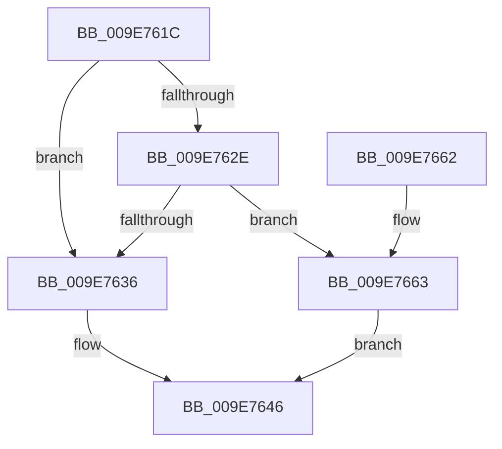

# AlpcpSetOwnerProcessPort

- RVA: `0x009E761C`–`0x009E766C` (길이 `80` bytes)
- VA: `0x00000001409E761C`
- 실행 섹션: `PAGE`
- PDB 이름 있음: `예`; PDB Function 태그: `아니요`
- unwind 정보 RVA: `0x00060BE4`
- 디코드: `21`개 명령, `80/80` bytes 표시
- 미해석 바이트: `0` (있으면 어셈블리에 `.byte`로 보존)

> 이 문서는 커널 이미지의 기계어와 PDB 기호를 분석해 생성했습니다. 4번과 5번은 함수 원형과 자료형을 바이너리 사용 방식에서 추정한 C 해석이며 원본 소스 복구 결과는 아닙니다.

## 1. Dependencies

- 직접 호출 지점: **1**; 고유 호출 대상: **1**
- 직접 호출자로 확인된 함수: **3**
- RIP 상대 이미지 참조: **1**

### Outgoing calls
- `0x009E764E` → [ObfReferenceObjectWithTag](../../text/21/ObfReferenceObjectWithTag_function_00210710.md) (function, `0x00210710`)

### Direct callers
- [AlpcpCreateClientPort](../92/AlpcpCreateClientPort_function_009270AC.md) at `0x0092744C`
- [AlpcpCreateConnectionPort](AlpcpCreateConnectionPort_function_009E70B0.md) at `0x009E71D7`
- [AlpcpAcceptConnectPort](../A3/AlpcpAcceptConnectPort_function_00A34290.md) at `0x00A3498B`

### Static image references
- `0x009E7663` → RVA `0x00FC6AB0` (`ALMOSTRO`; read)

## 2. Other-region calls and transfers

- 다른 실행 섹션으로 향하는 call: **1**
  - `0x009E764E` → [ObfReferenceObjectWithTag](../../text/21/ObfReferenceObjectWithTag_function_00210710.md) (`PAGE` → `.text`)
- 별도 외부 분기/꼬리 이동을 확인하지 못했습니다.

## 3. Assembly (complete function range)

```asm
009E761C  48 89 5C 24 08                  mov qword ptr [rsp + 8], rbx
009E7621  57                              push rdi
009E7622  48 83 EC 20                     sub rsp, 0x20
009E7626  48 8B F9                        mov rdi, rcx
009E7629  48 85 D2                        test rdx, rdx
009E762C  74 08                           je 0x1409e7636
009E762E  F7 02 00 00 10 00               test dword ptr [rdx], 0x100000
009E7634  75 2D                           jne 0x1409e7663
009E7636  65 48 8B 04 25 88 01 00 00      mov rax, qword ptr gs:[0x188]
009E763F  48 8B 98 B8 00 00 00            mov rbx, qword ptr [rax + 0xb8]
009E7646  BA 41 6C 70 63                  mov edx, 0x63706c41
009E764B  48 8B CB                        mov rcx, rbx
009E764E  E8 BD 90 82 FF                  call 0x140210710
009E7653  48 89 5F 18                     mov qword ptr [rdi + 0x18], rbx
009E7657  48 8B 5C 24 30                  mov rbx, qword ptr [rsp + 0x30]
009E765C  48 83 C4 20                     add rsp, 0x20
009E7660  5F                              pop rdi
009E7661  C3                              ret
009E7662  CC                              int3
009E7663  48 8B 1D 46 F4 5D 00            mov rbx, qword ptr [rip + 0x5df446]
009E766A  EB DA                           jmp 0x1409e7646
```

## 4. C-style interpretation (structured pseudocode)

```c
__int64 __fastcall AlpcpSetOwnerProcessPort(__int64 a1, __int64 a2)
{
    __int64 result;
    __int64 v_rsp;
    unsigned __int64 v_stack_p8;

    v_stack_p8 = v_rbx;
    v_rsp = (v_rsp) - (32);
    if (a2 == 0) goto loc_009E7636;
    if (((*(unsigned int *)(a2)) & (0x100000ULL)) != 0) goto loc_009E7663;
loc_009E7636:
loc_009E7646:
    result = ObfReferenceObjectWithTag(*(unsigned __int64 *)(*(unsigned __int64 *)(gs_base + (0 + 392)) + 184), (unsigned int)(0x63706C41ULL), a3, a4);
    *(unsigned __int64 *)(a1 + 24) = *(unsigned __int64 *)(*(unsigned __int64 *)(gs_base + (0 + 392)) + 184);
    v_rsp = (v_rsp) + (32);
    return result;
loc_009E7663:
    goto loc_009E7646;
}
```

## 5. (Beta) C Style

```c
int64_t AlpcpSetOwnerProcessPort(void *Arg1, int64_t Arg2)
{
    uint8_t *arg1 = (uint8_t *)Arg1;

    int64_t result;
    int64_t local_rsp;
    uint64_t v_stack_p8;

    v_stack_p8 = local_rbx;
    local_rsp = (local_rsp) - (32);
    if (Arg2 == 0) goto loc_009E7636;
    if (((*(uint32_t *)(Arg2)) & (0x100000ULL)) != 0) goto loc_009E7663;
loc_009E7636:
loc_009E7646:
    result = ObfReferenceObjectWithTag(*(uint64_t *)(*(uint64_t *)(gs_base + (0 + 0x188)) + 0xB8), (uint32_t)(0x63706C41ULL), a3, a4);
    *(uint64_t *)(arg1 + 0x18) = *(uint64_t *)(*(uint64_t *)(gs_base + (0 + 0x188)) + 0xB8);
    local_rsp = (local_rsp) + (32);
    return result;
loc_009E7663:
    goto loc_009E7646;
}
```

### 관측된 메모리 오프셋

구조체 형식이 확인되지 않은 접근은 인자 기준의 오프셋으로만 기록했습니다.

| 기준 인자 | 오프셋 표현 | 폭 (bit) | 접근 |
|---|---:|---:|---|
| `Arg1` | `+ 0x18` | `64` | `W` |

## 6. Execution-region graph

[열기: 2D/3D 그래프와 함수 탐색 컨트롤 패널](../../../control-panel.html?section=page&rva=0x009E761C&view=graph)

- 2D 그래프는 위에서 아래로 흐르고, 3D 그래프는 빈 공간을 드래그해 회전합니다. Shift+드래그는 이동, 휠은 확대·축소, 함수 노드 선택은 대상 보고서 이동입니다.

### Static fallback


