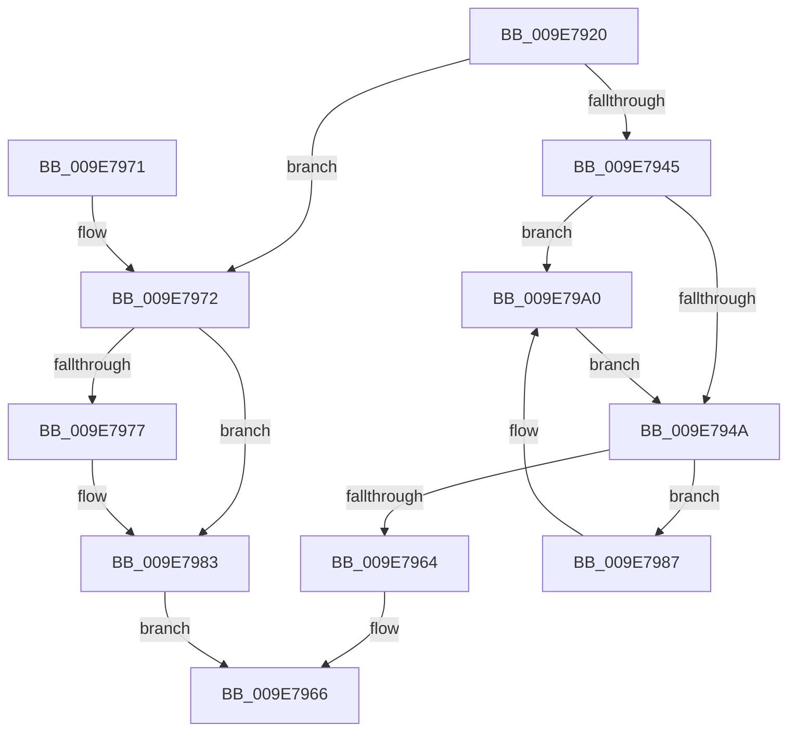

# AlpcpTryLockForCachedReferenceBlob

- RVA: `0x009E7920`–`0x009E79A6` (길이 `134` bytes)
- VA: `0x00000001409E7920`
- 실행 섹션: `PAGE`
- PDB 이름 있음: `예`; PDB Function 태그: `아니요`
- unwind 정보 RVA: `0x0006E1DC`
- 디코드: `40`개 명령, `134/134` bytes 표시
- 미해석 바이트: `0` (있으면 어셈블리에 `.byte`로 보존)

> 이 문서는 커널 이미지의 기계어와 PDB 기호를 분석해 생성했습니다. 4번과 5번은 함수 원형과 자료형을 바이너리 사용 방식에서 추정한 C 해석이며 원본 소스 복구 결과는 아닙니다.

## 1. Dependencies

- 직접 호출 지점: **3**; 고유 호출 대상: **3**
- 직접 호출자로 확인된 함수: **2**
- RIP 상대 이미지 참조: **0**

### Outgoing calls
- `0x009E7937` → [KeAbPreAcquire](../../text/21/KeAbPreAcquire_function_00210230.md) (function, `0x00210230`)
- `0x009E797E` → [KeAbPostReleaseEx](../../text/26/KeAbPostReleaseEx_function_00262210.md) (function, `0x00262210`)
- `0x009E799A` → [KeBugCheckEx](../../text/4F/KeBugCheckEx_function_004FD660.md) (function, `0x004FD660`)

### Direct callers
- [AlpcpReceiveMessagePort](../89/AlpcpReceiveMessagePort_function_00896B40.md) at `0x00897018`
- [AlpcpReceiveMessagePort](../89/AlpcpReceiveMessagePort_function_00896B40.md) at `0x00897376`
- [AlpcpCancelMessagesByRequestor](../92/AlpcpCancelMessagesByRequestor_function_00924170.md) at `0x009242A3`

### Static image references
- 디코드된 RIP-relative 메모리 참조가 없습니다.

## 2. Other-region calls and transfers

- 다른 실행 섹션으로 향하는 call: **3**
  - `0x009E7937` → [KeAbPreAcquire](../../text/21/KeAbPreAcquire_function_00210230.md) (`PAGE` → `.text`)
  - `0x009E797E` → [KeAbPostReleaseEx](../../text/26/KeAbPostReleaseEx_function_00262210.md) (`PAGE` → `.text`)
  - `0x009E799A` → [KeBugCheckEx](../../text/4F/KeBugCheckEx_function_004FD660.md) (`PAGE` → `.text`)
- 별도 외부 분기/꼬리 이동을 확인하지 못했습니다.

## 3. Assembly (complete function range)

```asm
009E7920  48 89 5C 24 08                  mov qword ptr [rsp + 8], rbx
009E7925  57                              push rdi
009E7926  48 83 EC 30                     sub rsp, 0x30
009E792A  33 D2                           xor edx, edx
009E792C  48 8B D9                        mov rbx, rcx
009E792F  48 83 C1 F0                     add rcx, -0x10
009E7933  44 8D 42 01                     lea r8d, [rdx + 1]
009E7937  E8 F4 88 82 FF                  call 0x140210230
009E793C  F0 48 0F BA 6B F0 00            lock bts qword ptr [rbx - 0x10], 0
009E7943  72 2D                           jb 0x1409e7972
009E7945  48 85 C0                        test rax, rax
009E7948  75 56                           jne 0x1409e79a0
009E794A  80 4B E0 01                     or byte ptr [rbx - 0x20], 1
009E794E  B8 00 00 01 00                  mov eax, 0x10000
009E7953  F0 48 0F C1 43 E8               lock xadd qword ptr [rbx - 0x18], rax
009E7959  48 05 00 00 01 00               add rax, 0x10000
009E795F  48 85 C0                        test rax, rax
009E7962  7E 23                           jle 0x1409e7987
009E7964  B0 01                           mov al, 1
009E7966  48 8B 5C 24 40                  mov rbx, qword ptr [rsp + 0x40]
009E796B  48 83 C4 30                     add rsp, 0x30
009E796F  5F                              pop rdi
009E7970  C3                              ret
009E7971  CC                              int3
009E7972  48 85 C0                        test rax, rax
009E7975  74 0C                           je 0x1409e7983
009E7977  48 8B D0                        mov rdx, rax
009E797A  48 8D 4B F0                     lea rcx, [rbx - 0x10]
009E797E  E8 8D A8 87 FF                  call 0x140262210
009E7983  32 C0                           xor al, al
009E7985  EB DF                           jmp 0x1409e7966
009E7987  33 D2                           xor edx, edx
009E7989  48 89 44 24 20                  mov qword ptr [rsp + 0x20], rax
009E798E  41 B9 27 00 00 00               mov r9d, 0x27
009E7994  4C 8B C3                        mov r8, rbx
009E7997  8D 4A 18                        lea ecx, [rdx + 0x18]
009E799A  E8 C1 5C B1 FF                  call 0x1404fd660
009E799F  CC                              int3
009E79A0  C6 40 0A 01                     mov byte ptr [rax + 0xa], 1
009E79A4  EB A4                           jmp 0x1409e794a
```

## 4. C-style interpretation (structured pseudocode)

```c
__int64 __fastcall AlpcpTryLockForCachedReferenceBlob(__int64 a1, int a2)
{
    __int64 result;
    __int64 v_rsp;
    unsigned __int64 v_stack_p20;
    unsigned __int64 v_stack_p8;

    v_stack_p8 = v_rbx;
    v_rsp = (v_rsp) - (48);
    a2 = 0;
    a1 = (a1) + (-16);
    result = KeAbPreAcquire(a1, a2, a2 + 1, a4);
    if (condition_is_below) goto loc_009E7972;
    if (result != 0) goto loc_009E79A0;
loc_009E794A:
    result = ((unsigned int)(0x10000ULL)) + (0x10000ULL);
    if (condition_is_less_or_equal) goto loc_009E7987;
loc_009E7966:
    v_rsp = (v_rsp) + (48);
    return 1;
loc_009E7972:
    result = 1;
    if (1 != 0) {
        a2 = 1;
        a1 = v_stack_p8 - 16;
        result = KeAbPostReleaseEx(a1, a2, a2 + 1, a4);
    }
    result = 0;
    goto loc_009E7966;
loc_009E7987:
    a2 = 0;
    v_stack_p20 = 0;
    result = KeBugCheckEx(a2 + 24, a2, v_stack_p8, 39);
loc_009E79A0:
    *(unsigned __int8 *)(result + 10) = 1;
    goto loc_009E794A;
}
```

## 5. (Beta) C Style

```c
int64_t AlpcpTryLockForCachedReferenceBlob(void *Arg1, int32_t Arg2)
{
    uint8_t *arg1 = (uint8_t *)Arg1;

    int64_t result;
    int64_t local_rsp;
    uint64_t v_stack_p20;
    uint64_t v_stack_p8;

    v_stack_p8 = local_rbx;
    local_rsp = (local_rsp) - (48);
    Arg2 = 0;
    Arg1 = (Arg1) + (-16);
    result = KeAbPreAcquire(Arg1, Arg2, Arg2 + 1, a4);
    if (condition_is_below) goto loc_009E7972;
    if (result != 0) goto loc_009E79A0;
loc_009E794A:
    result = ((uint32_t)(0x10000ULL)) + (0x10000ULL);
    if (condition_is_less_or_equal) goto loc_009E7987;
loc_009E7966:
    local_rsp = (local_rsp) + (48);
    return 1;
loc_009E7972:
    result = 1;
    if (1 != 0) {
        Arg2 = 1;
        Arg1 = v_stack_p8 - 16;
        result = KeAbPostReleaseEx(Arg1, Arg2, Arg2 + 1, a4);
    }
    result = 0;
    goto loc_009E7966;
loc_009E7987:
    Arg2 = 0;
    v_stack_p20 = 0;
    result = KeBugCheckEx(Arg2 + 24, Arg2, v_stack_p8, 39);
loc_009E79A0:
    *(uint8_t *)(result + 0xA) = 1;
    goto loc_009E794A;
}
```

### 관측된 메모리 오프셋

구조체 형식이 확인되지 않은 접근은 인자 기준의 오프셋으로만 기록했습니다.

| 기준 인자 | 오프셋 표현 | 폭 (bit) | 접근 |
|---|---:|---:|---|
| `Arg1` | `- 0x20` | `8` | `R/W` |
| `Arg1` | `- 0x18` | `64` | `R/W` |
| `Arg1` | `- 0x10` | `64` | `R` |
| `Arg1` | `- 0x10` | `64` | `R/W` |

## 6. Execution-region graph

[열기: 2D/3D 그래프와 함수 탐색 컨트롤 패널](../../../control-panel.html?section=page&rva=0x009E7920&view=graph)

- 2D 그래프는 위에서 아래로 흐르고, 3D 그래프는 빈 공간을 드래그해 회전합니다. Shift+드래그는 이동, 휠은 확대·축소, 함수 노드 선택은 대상 보고서 이동입니다.

### Static fallback


