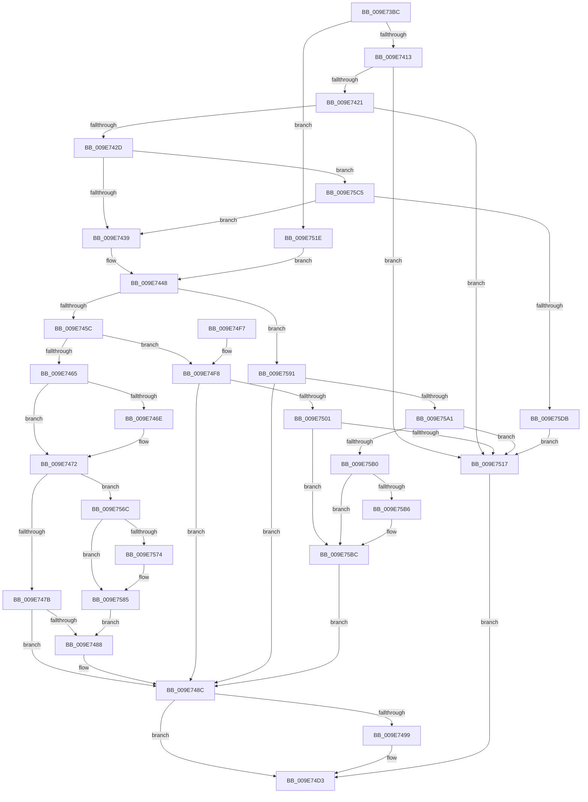

# AlpcpValidateAndSetPortAttributes

- RVA: `0x009E73BC`–`0x009E75E0` (길이 `548` bytes)
- VA: `0x00000001409E73BC`
- 실행 섹션: `PAGE`
- PDB 이름 있음: `예`; PDB Function 태그: `아니요`
- unwind 정보 RVA: `0x000A49EC`
- 디코드: `131`개 명령, `548/548` bytes 표시
- 미해석 바이트: `0` (있으면 어셈블리에 `.byte`로 보존)

> 이 문서는 커널 이미지의 기계어와 PDB 기호를 분석해 생성했습니다. 4번과 5번은 함수 원형과 자료형을 바이너리 사용 방식에서 추정한 C 해석이며 원본 소스 복구 결과는 아닙니다.

## 1. Dependencies

- 직접 호출 지점: **3**; 고유 호출 대상: **3**
- 직접 호출자로 확인된 함수: **3**
- RIP 상대 이미지 참조: **2**

### Outgoing calls
- `0x009E73F8` → [memset](../../text/6C/memset_function_006C6C40.md) (function, `0x006C6C40`)
- `0x009E7490` → [SeValidateSecurityQos](SeValidateSecurityQos_function_009E75F0.md) (function, `0x009E75F0`)
- `0x009E74DA` → [_security_check_cookie](../../text/6A/_security_check_cookie_function_006AC640.md) (function, `0x006AC640`)

### Direct callers
- [AlpcpCreateClientPort](../92/AlpcpCreateClientPort_function_009270AC.md) at `0x009273CD`
- [AlpcpCreateConnectionPort](AlpcpCreateConnectionPort_function_009E70B0.md) at `0x009E71B6`
- [AlpcpAcceptConnectPort](../A3/AlpcpAcceptConnectPort_function_00A34290.md) at `0x00A34966`

### Static image references
- `0x009E73D4` → RVA `0x00E0A740` (`.data`; read)
- `0x009E7508` → RVA `0x00FC6E50` (`ALMOSTRO`; read)

## 2. Other-region calls and transfers

- 다른 실행 섹션으로 향하는 call: **2**
  - `0x009E73F8` → [memset](../../text/6C/memset_function_006C6C40.md) (`PAGE` → `.text`)
  - `0x009E74DA` → [_security_check_cookie](../../text/6A/_security_check_cookie_function_006AC640.md) (`PAGE` → `.text`)
- 별도 외부 분기/꼬리 이동을 확인하지 못했습니다.

## 3. Assembly (complete function range)

```asm
009E73BC  48 89 5C 24 18                  mov qword ptr [rsp + 0x18], rbx
009E73C1  48 89 74 24 20                  mov qword ptr [rsp + 0x20], rsi
009E73C6  55                              push rbp
009E73C7  57                              push rdi
009E73C8  41 56                           push r14
009E73CA  48 8B EC                        mov rbp, rsp
009E73CD  48 81 EC 80 00 00 00            sub rsp, 0x80
009E73D4  48 8B 05 65 33 42 00            mov rax, qword ptr [rip + 0x423365]
009E73DB  48 33 C4                        xor rax, rsp
009E73DE  48 89 45 F0                     mov qword ptr [rbp - 0x10], rax
009E73E2  48 8B DA                        mov rbx, rdx
009E73E5  49 8B F0                        mov rsi, r8
009E73E8  33 D2                           xor edx, edx
009E73EA  48 8B F9                        mov rdi, rcx
009E73ED  48 8D 4D A0                     lea rcx, [rbp - 0x60]
009E73F1  4D 8B F1                        mov r14, r9
009E73F4  44 8D 42 48                     lea r8d, [rdx + 0x48]
009E73F8  E8 43 F8 CD FF                  call 0x1406c6c40
009E73FD  44 8A 4D 50                     mov r9b, byte ptr [rbp + 0x50]
009E7401  45 33 C0                        xor r8d, r8d
009E7404  41 BA 00 00 02 00               mov r10d, 0x20000
009E740A  48 85 DB                        test rbx, rbx
009E740D  0F 84 0B 01 00 00               je 0x1409e751e
009E7413  48 8B 43 10                     mov rax, qword ptr [rbx + 0x10]
009E7417  48 83 F8 28                     cmp rax, 0x28
009E741B  0F 82 F6 00 00 00               jb 0x1409e7517
009E7421  48 3D FF FF 00 00               cmp rax, 0xffff
009E7427  0F 87 EA 00 00 00               ja 0x1409e7517
009E742D  8B 13                           mov edx, dword ptr [rbx]
009E742F  0F BA E2 14                     bt edx, 0x14
009E7433  0F 82 8C 01 00 00               jb 0x1409e75c5
009E7439  81 E2 00 00 FF 03               and edx, 0x3ff0000
009E743F  81 63 40 FD 0F 00 00            and dword ptr [rbx + 0x40], 0xffd
009E7446  89 13                           mov dword ptr [rbx], edx
009E7448  8B 87 A0 01 00 00               mov eax, dword ptr [rdi + 0x1a0]
009E744E  D1 E8                           shr eax, 1
009E7450  83 E0 03                        and eax, 3
009E7453  83 E8 01                        sub eax, 1
009E7456  0F 84 35 01 00 00               je 0x1409e7591
009E745C  83 F8 01                        cmp eax, 1
009E745F  0F 85 93 00 00 00               jne 0x1409e74f8
009E7465  48 8D 45 A0                     lea rax, [rbp - 0x60]
009E7469  48 3B D8                        cmp rbx, rax
009E746C  75 04                           jne 0x1409e7472
009E746E  0F BA 2B 10                     bts dword ptr [rbx], 0x10
009E7472  45 84 C9                        test r9b, r9b
009E7475  0F 85 F1 00 00 00               jne 0x1409e756c
009E747B  48 8B 86 10 01 00 00            mov rax, qword ptr [rsi + 0x110]
009E7482  48 39 43 10                     cmp qword ptr [rbx + 0x10], rax
009E7486  76 04                           jbe 0x1409e748c
009E7488  48 89 43 10                     mov qword ptr [rbx + 0x10], rax
009E748C  48 8D 4B 04                     lea rcx, [rbx + 4]
009E7490  E8 5B 01 00 00                  call 0x1409e75f0
009E7495  85 C0                           test eax, eax
009E7497  78 3A                           js 0x1409e74d3
009E7499  0F 28 03                        movaps xmm0, xmmword ptr [rbx]
009E749C  33 C0                           xor eax, eax
009E749E  0F 11 87 00 01 00 00            movups xmmword ptr [rdi + 0x100], xmm0
009E74A5  0F 28 4B 10                     movaps xmm1, xmmword ptr [rbx + 0x10]
009E74A9  0F 11 8F 10 01 00 00            movups xmmword ptr [rdi + 0x110], xmm1
009E74B0  0F 28 43 20                     movaps xmm0, xmmword ptr [rbx + 0x20]
009E74B4  0F 11 87 20 01 00 00            movups xmmword ptr [rdi + 0x120], xmm0
009E74BB  0F 28 4B 30                     movaps xmm1, xmmword ptr [rbx + 0x30]
009E74BF  0F 11 8F 30 01 00 00            movups xmmword ptr [rdi + 0x130], xmm1
009E74C6  F2 0F 10 43 40                  movsd xmm0, qword ptr [rbx + 0x40]
009E74CB  F2 0F 11 87 40 01 00 00         movsd qword ptr [rdi + 0x140], xmm0
009E74D3  48 8B 4D F0                     mov rcx, qword ptr [rbp - 0x10]
009E74D7  48 33 CC                        xor rcx, rsp
009E74DA  E8 61 51 CC FF                  call 0x1406ac640
009E74DF  4C 8D 9C 24 80 00 00 00         lea r11, [rsp + 0x80]
009E74E7  49 8B 5B 30                     mov rbx, qword ptr [r11 + 0x30]
009E74EB  49 8B 73 38                     mov rsi, qword ptr [r11 + 0x38]
009E74EF  49 8B E3                        mov rsp, r11
009E74F2  41 5E                           pop r14
009E74F4  5F                              pop rdi
009E74F5  5D                              pop rbp
009E74F6  C3                              ret
009E74F7  CC                              int3
009E74F8  0F BA 33 11                     btr dword ptr [rbx], 0x11
009E74FC  45 84 C9                        test r9b, r9b
009E74FF  74 8B                           je 0x1409e748c
009E7501  48 8B 8E 10 01 00 00            mov rcx, qword ptr [rsi + 0x110]
009E7508  8B 05 42 F9 5D 00               mov eax, dword ptr [rip + 0x5df942]
009E750E  48 3B C8                        cmp rcx, rax
009E7511  0F 86 A5 00 00 00               jbe 0x1409e75bc
009E7517  B8 0D 00 00 C0                  mov eax, 0xc000000d
009E751C  EB B5                           jmp 0x1409e74d3
009E751E  B8 00 40 00 00                  mov eax, 0x4000
009E7523  48 C7 45 B0 00 02 00 00         mov qword ptr [rbp - 0x50], 0x200
009E752B  48 89 45 C0                     mov qword ptr [rbp - 0x40], rax
009E752F  48 8D 5D A0                     lea rbx, [rbp - 0x60]
009E7533  48 89 45 C8                     mov qword ptr [rbp - 0x38], rax
009E7537  45 84 C9                        test r9b, r9b
009E753A  8B 45 A0                        mov eax, dword ptr [rbp - 0x60]
009E753D  B9 00 10 00 00                  mov ecx, 0x1000
009E7542  0F 45 C1                        cmovne eax, ecx
009E7545  4C 89 55 D8                     mov qword ptr [rbp - 0x28], r10
009E7549  89 45 A0                        mov dword ptr [rbp - 0x60], eax
009E754C  4C 89 45 D0                     mov qword ptr [rbp - 0x30], r8
009E7550  4C 89 45 B8                     mov qword ptr [rbp - 0x48], r8
009E7554  48 C7 45 A4 0C 00 00 00         mov qword ptr [rbp - 0x5c], 0xc
009E755C  C7 45 AC 01 01 00 00            mov dword ptr [rbp - 0x54], 0x101
009E7563  44 89 45 E0                     mov dword ptr [rbp - 0x20], r8d
009E7567  E9 DC FE FF FF                  jmp 0x1409e7448
009E756C  44 09 13                        or dword ptr [rbx], r10d
009E756F  4D 85 F6                        test r14, r14
009E7572  74 11                           je 0x1409e7585
009E7574  F2 41 0F 10 06                  movsd xmm0, qword ptr [r14]
009E7579  F2 0F 11 43 04                  movsd qword ptr [rbx + 4], xmm0
009E757E  41 8B 46 08                     mov eax, dword ptr [r14 + 8]
009E7582  89 43 0C                        mov dword ptr [rbx + 0xc], eax
009E7585  48 8B 86 10 01 00 00            mov rax, qword ptr [rsi + 0x110]
009E758C  E9 F7 FE FF FF                  jmp 0x1409e7488
009E7591  8B 03                           mov eax, dword ptr [rbx]
009E7593  41 0B C2                        or eax, r10d
009E7596  89 03                           mov dword ptr [rbx], eax
009E7598  45 84 C9                        test r9b, r9b
009E759B  0F 84 EB FE FF FF               je 0x1409e748c
009E75A1  8B 4D 40                        mov ecx, dword ptr [rbp + 0x40]
009E75A4  3B 0D A6 F8 5D 00               cmp ecx, dword ptr [rip + 0x5df8a6]
009E75AA  0F 87 67 FF FF FF               ja 0x1409e7517
009E75B0  44 38 45 48                     cmp byte ptr [rbp + 0x48], r8b
009E75B4  74 06                           je 0x1409e75bc
009E75B6  0F BA E8 12                     bts eax, 0x12
009E75BA  89 03                           mov dword ptr [rbx], eax
009E75BC  48 89 4B 10                     mov qword ptr [rbx + 0x10], rcx
009E75C0  E9 C7 FE FF FF                  jmp 0x1409e748c
009E75C5  65 48 8B 04 25 88 01 00 00      mov rax, qword ptr gs:[0x188]
009E75CE  44 38 80 32 02 00 00            cmp byte ptr [rax + 0x232], r8b
009E75D5  0F 84 5E FE FF FF               je 0x1409e7439
009E75DB  E9 37 FF FF FF                  jmp 0x1409e7517
```

## 4. C-style interpretation (structured pseudocode)

```c
__int64 __fastcall AlpcpValidateAndSetPortAttributes(__int64 a1, __int64 a2, __int64 a3, __int64 a4, unsigned int a5, unsigned __int8 a6, unsigned __int8 a7)
{
    __int64 result;
    __int64 v_rsp;
    unsigned __int64 v_stack_m18;
    unsigned __int64 v_stack_m28;
    unsigned int v_stack_m38;
    unsigned __int64 v_stack_m40;
    unsigned __int64 v_stack_m48;
    unsigned __int64 v_stack_m50;
    unsigned __int64 v_stack_m58;
    unsigned __int64 v_stack_m60;
    unsigned __int64 v_stack_m68;
    unsigned int v_stack_m6C;
    unsigned __int64 v_stack_m74;
    unsigned __int64 v_stack_m78;
    unsigned __int64 v_stack_p18;
    unsigned __int64 v_stack_p20;

    v_stack_p18 = v_rbx;
    v_stack_p20 = v_rsi;
    v_rsp = (v_rsp) - (128);
    result = (*(unsigned __int64 *)(v_rip + 4338533)) ^ (v_rsp);
    v_stack_m28 = result;
    a2 = 0;
    result = memset(v_stack_m78, a2, a2 + 72, a4);
    a3 = 0;
    if (0 == 0) goto loc_009E751E;
    if ((*(unsigned __int64 *)(a2 + 16)) < 40) goto loc_009E7517;
    if ((*(unsigned __int64 *)(a2 + 16)) > 0xFFFFULL) goto loc_009E7517;
    if ((*(unsigned __int64 *)(a2 + 16)) < 0xFFFFULL) goto loc_009E75C5;
loc_009E7439:
    a2 = (unsigned int)(((unsigned int)(*(unsigned int *)(a2))) & (0x3FF0000ULL));
    *(unsigned int *)(a2) = (unsigned int)(a2);
loc_009E7448:
    result = (unsigned int)(((unsigned int)(*(unsigned int *)(a1 + 416))) >> (1));
    result = (unsigned int)((result) & (3));
    result = (unsigned int)((result) - (1));
    if (condition_is_equal) goto loc_009E7591;
    if (((unsigned int)(result)) != 1) goto loc_009E74F8;
    if (a2 == v_stack_m78) {
    }
    if (a7 != 0) goto loc_009E756C;
    if ((*(unsigned __int64 *)(a2 + 16)) >= = (*(unsigned __int64 *)(a3 + 272))) {
        *(unsigned __int64 *)(a2 + 16) = *(unsigned __int64 *)(a3 + 272);
    }
    result = SeValidateSecurityQos(a2 + 4, a2, a3, a7);
    if (!(sign_flag)) {
        result = 0;
        *(unsigned __int64 *)(a1 + 256) = v_xmm0;
        *(unsigned __int64 *)(a1 + 272) = v_xmm1;
        *(unsigned __int64 *)(a1 + 288) = v_xmm0;
        *(unsigned __int64 *)(a1 + 304) = v_xmm1;
        *(unsigned __int64 *)(a1 + 320) = v_xmm0;
    }
    a1 = (v_stack_m28) ^ (v_rsp);
    result = _security_check_cookie(a1, a2, a3, a7);
    return result;
loc_009E74F8:
    if (a7 == 0) goto loc_009E748C;
    if ((*(unsigned __int64 *)(*(unsigned __int64 *)(v_stack_m18 + 56) + 272)) <= ((unsigned int)(*(unsigned int *)(v_rip + 6158658)))) goto loc_009E75BC;
loc_009E7517:
    goto loc_009E74D3;
loc_009E751E:
    v_stack_m68 = 512;
    v_stack_m58 = (unsigned int)(0x4000ULL);
    v_stack_m50 = (unsigned int)(0x4000ULL);
    result = (unsigned int)(v_stack_m78);
    if (a7 != 0) { result = (unsigned int)((unsigned int)(0x1000ULL)); }
    v_stack_m40 = (unsigned int)(0x20000ULL);
    v_stack_m78 = (unsigned int)(result);
    v_stack_m48 = 0;
    v_stack_m60 = 0;
    v_stack_m74 = 12;
    v_stack_m6C = 257;
    v_stack_m38 = 0;
    goto loc_009E7448;
loc_009E756C:
    if (a4 != 0) {
        *(unsigned __int64 *)(v_stack_m78 + 4) = v_xmm0;
        result = *(unsigned int *)(a4 + 8);
        *(unsigned int *)(v_stack_m78 + 12) = (unsigned int)(result);
    }
    goto loc_009E7488;
loc_009E7591:
    result = (unsigned int)(((unsigned int)(*(unsigned int *)(v_stack_m78))) | ((unsigned int)((unsigned int)(0x20000ULL))));
    *(unsigned int *)(v_stack_m78) = (unsigned int)(result);
    if (a7 == 0) goto loc_009E748C;
    if (((unsigned int)((unsigned int)(a5))) > (*(unsigned int *)(v_rip + 6158502))) goto loc_009E7517;
    if (a6 != 0) {
        *(unsigned int *)(v_stack_m78) = (unsigned int)(result);
    }
    *(unsigned __int64 *)(v_stack_m78 + 16) = (unsigned int)(a5);
    goto loc_009E748C;
loc_009E75C5:
    if ((*(unsigned __int8 *)(*(unsigned __int64 *)(gs_base + (0 + 392)) + 562)) == 0) goto loc_009E7439;
    goto loc_009E7517;
}
```

## 5. (Beta) C Style

```c
int64_t AlpcpValidateAndSetPortAttributes(void *Arg1, int64_t Arg2, void *Arg3, int64_t Arg4, uint32_t Arg5, uint8_t Arg6, uint8_t Arg7)
{
    uint8_t *arg1 = (uint8_t *)Arg1;
    uint8_t *arg3 = (uint8_t *)Arg3;

    int64_t result;
    int64_t local_rsp;
    uint64_t v_stack_m18;
    uint64_t v_stack_m28;
    uint32_t v_stack_m38;
    uint64_t v_stack_m40;
    uint64_t v_stack_m48;
    uint64_t v_stack_m50;
    uint64_t v_stack_m58;
    uint64_t v_stack_m60;
    uint64_t v_stack_m68;
    uint32_t v_stack_m6C;
    uint64_t v_stack_m74;
    uint64_t v_stack_m78;
    uint64_t v_stack_p18;
    uint64_t v_stack_p20;

    v_stack_p18 = local_rbx;
    v_stack_p20 = local_rsi;
    local_rsp = (local_rsp) - (128);
    result = (*(uint64_t *)(v_rip + 0x423365)) ^ (local_rsp);
    v_stack_m28 = result;
    Arg2 = 0;
    result = memset(v_stack_m78, Arg2, Arg2 + 72, Arg4);
    Arg3 = 0;
    if (0 == 0) goto loc_009E751E;
    if ((*(uint64_t *)(Arg2 + 0x10)) < 40) goto loc_009E7517;
    if ((*(uint64_t *)(Arg2 + 0x10)) > 0xFFFFULL) goto loc_009E7517;
    if ((*(uint64_t *)(Arg2 + 0x10)) < 0xFFFFULL) goto loc_009E75C5;
loc_009E7439:
    Arg2 = (uint32_t)(((uint32_t)(*(uint32_t *)(Arg2))) & (0x3FF0000ULL));
    *(uint32_t *)(Arg2) = (uint32_t)(Arg2);
loc_009E7448:
    result = (uint32_t)(((uint32_t)(*(uint32_t *)(arg1 + 0x1A0))) >> (1));
    result = (uint32_t)((result) & (3));
    result = (uint32_t)((result) - (1));
    if (condition_is_equal) goto loc_009E7591;
    if (((uint32_t)(result)) != 1) goto loc_009E74F8;
    if (Arg2 == v_stack_m78) {
    }
    if (Arg7 != 0) goto loc_009E756C;
    if ((*(uint64_t *)(Arg2 + 0x10)) >= = (*(uint64_t *)(arg3 + 0x110))) {
        *(uint64_t *)(Arg2 + 0x10) = *(uint64_t *)(arg3 + 0x110);
    }
    result = SeValidateSecurityQos(Arg2 + 4, Arg2, Arg3, Arg7);
    if (!(sign_flag)) {
        result = 0;
        *(uint64_t *)(arg1 + 0x100) = v_xmm0;
        *(uint64_t *)(arg1 + 0x110) = v_xmm1;
        *(uint64_t *)(arg1 + 0x120) = v_xmm0;
        *(uint64_t *)(arg1 + 0x130) = v_xmm1;
        *(uint64_t *)(arg1 + 0x140) = v_xmm0;
    }
    Arg1 = (v_stack_m28) ^ (local_rsp);
    result = _security_check_cookie(Arg1, Arg2, Arg3, Arg7);
    return result;
loc_009E74F8:
    if (Arg7 == 0) goto loc_009E748C;
    if ((*(uint64_t *)(*(uint64_t *)(v_stack_m18 + 0x38) + 0x110)) <= ((uint32_t)(*(uint32_t *)(v_rip + 0x5DF942)))) goto loc_009E75BC;
loc_009E7517:
    goto loc_009E74D3;
loc_009E751E:
    v_stack_m68 = 512;
    v_stack_m58 = (uint32_t)(0x4000ULL);
    v_stack_m50 = (uint32_t)(0x4000ULL);
    result = (uint32_t)(v_stack_m78);
    if (Arg7 != 0) { result = (uint32_t)((uint32_t)(0x1000ULL)); }
    v_stack_m40 = (uint32_t)(0x20000ULL);
    v_stack_m78 = (uint32_t)(result);
    v_stack_m48 = 0;
    v_stack_m60 = 0;
    v_stack_m74 = 12;
    v_stack_m6C = 257;
    v_stack_m38 = 0;
    goto loc_009E7448;
loc_009E756C:
    if (Arg4 != 0) {
        *(uint64_t *)(v_stack_m78 + 0x4) = v_xmm0;
        result = *(uint32_t *)(Arg4 + 0x8);
        *(uint32_t *)(v_stack_m78 + 0xC) = (uint32_t)(result);
    }
    goto loc_009E7488;
loc_009E7591:
    result = (uint32_t)(((uint32_t)(*(uint32_t *)(v_stack_m78))) | ((uint32_t)((uint32_t)(0x20000ULL))));
    *(uint32_t *)(v_stack_m78) = (uint32_t)(result);
    if (Arg7 == 0) goto loc_009E748C;
    if (((uint32_t)((uint32_t)(Arg5))) > (*(uint32_t *)(v_rip + 0x5DF8A6))) goto loc_009E7517;
    if (Arg6 != 0) {
        *(uint32_t *)(v_stack_m78) = (uint32_t)(result);
    }
    *(uint64_t *)(v_stack_m78 + 0x10) = (uint32_t)(Arg5);
    goto loc_009E748C;
loc_009E75C5:
    if ((*(uint8_t *)(*(uint64_t *)(gs_base + (0 + 0x188)) + 0x232)) == 0) goto loc_009E7439;
    goto loc_009E7517;
}
```

### 관측된 메모리 오프셋

구조체 형식이 확인되지 않은 접근은 인자 기준의 오프셋으로만 기록했습니다.

| 기준 인자 | 오프셋 표현 | 폭 (bit) | 접근 |
|---|---:|---:|---|
| `Arg1` | `+ 0x100` | `128` | `R` |
| `Arg1` | `+ 0x110` | `128` | `R` |
| `Arg1` | `+ 0x120` | `128` | `R` |
| `Arg1` | `+ 0x130` | `128` | `R` |
| `Arg1` | `+ 0x140` | `64` | `W` |
| `Arg1` | `+ 0x1A0` | `32` | `R` |
| `Arg3` | `+ 0x110` | `64` | `R` |

## 6. Execution-region graph

[열기: 2D/3D 그래프와 함수 탐색 컨트롤 패널](../../../control-panel.html?section=page&rva=0x009E73BC&view=graph)

- 2D 그래프는 위에서 아래로 흐르고, 3D 그래프는 빈 공간을 드래그해 회전합니다. Shift+드래그는 이동, 휠은 확대·축소, 함수 노드 선택은 대상 보고서 이동입니다.

### Static fallback


