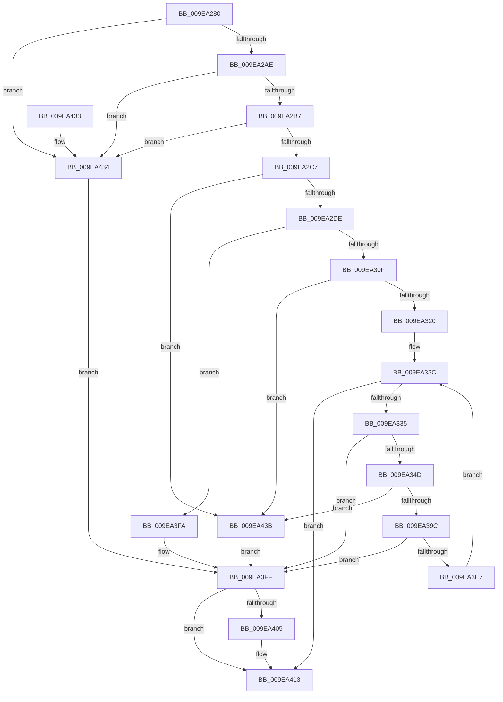

# AuthzBasepCopyoutInternalSecurityAttributes

- RVA: `0x009EA280`–`0x009EA442` (길이 `450` bytes)
- VA: `0x00000001409EA280`
- 실행 섹션: `PAGE`
- PDB 이름 있음: `예`; PDB Function 태그: `아니요`
- unwind 정보 RVA: `0x000A52CC`
- 디코드: `126`개 명령, `450/450` bytes 표시
- 미해석 바이트: `0` (있으면 어셈블리에 `.byte`로 보존)

> 이 문서는 커널 이미지의 기계어와 PDB 기호를 분석해 생성했습니다. 4번과 5번은 함수 원형과 자료형을 바이너리 사용 방식에서 추정한 C 해석이며 원본 소스 복구 결과는 아닙니다.

## 1. Dependencies

- 직접 호출 지점: **4**; 고유 호출 대상: **4**
- 직접 호출자로 확인된 함수: **2**
- RIP 상대 이미지 참조: **0**

### Outgoing calls
- `0x009EA2CC` → [memset](../../text/6C/memset_function_006C6C40.md) (function, `0x006C6C40`)
- `0x009EA33C` → [AuthzBasepProbeAndInsertTailList](AuthzBasepProbeAndInsertTailList_function_009EA448.md) (function, `0x009EA448`)
- `0x009EA3B3` → [RtlCopyUnicodeString](../../text/3F/RtlCopyUnicodeString_function_003FEF30.md) (function, `0x003FEF30`)
- `0x009EA3DC` → [AuthzBasepCopyoutInternalSecurityAttributeValues](../../text/3F/AuthzBasepCopyoutInternalSecurityAttributeValues_function_003FEC10.md) (function, `0x003FEC10`)

### Direct callers
- [SepGetTokenAccessInformationBufferSize](SepGetTokenAccessInformationBufferSize_function_009E995C.md) at `0x009E9BCB`
- [SepCopyTokenAccessInformation](SepCopyTokenAccessInformation_function_009E9C0C.md) at `0x009EA269`

### Static image references
- 디코드된 RIP-relative 메모리 참조가 없습니다.

## 2. Other-region calls and transfers

- 다른 실행 섹션으로 향하는 call: **3**
  - `0x009EA2CC` → [memset](../../text/6C/memset_function_006C6C40.md) (`PAGE` → `.text`)
  - `0x009EA3B3` → [RtlCopyUnicodeString](../../text/3F/RtlCopyUnicodeString_function_003FEF30.md) (`PAGE` → `.text`)
  - `0x009EA3DC` → [AuthzBasepCopyoutInternalSecurityAttributeValues](../../text/3F/AuthzBasepCopyoutInternalSecurityAttributeValues_function_003FEC10.md) (`PAGE` → `.text`)
- 별도 외부 분기/꼬리 이동을 확인하지 못했습니다.

## 3. Assembly (complete function range)

```asm
009EA280  48 89 5C 24 08                  mov qword ptr [rsp + 8], rbx
009EA285  48 89 6C 24 18                  mov qword ptr [rsp + 0x18], rbp
009EA28A  48 89 74 24 20                  mov qword ptr [rsp + 0x20], rsi
009EA28F  57                              push rdi
009EA290  41 54                           push r12
009EA292  41 55                           push r13
009EA294  41 56                           push r14
009EA296  41 57                           push r15
009EA298  48 83 EC 40                     sub rsp, 0x40
009EA29C  45 8B E0                        mov r12d, r8d
009EA29F  48 8B DA                        mov rbx, rdx
009EA2A2  48 8B F1                        mov rsi, rcx
009EA2A5  48 85 D2                        test rdx, rdx
009EA2A8  0F 84 86 01 00 00               je 0x1409ea434
009EA2AE  45 85 C0                        test r8d, r8d
009EA2B1  0F 84 7D 01 00 00               je 0x1409ea434
009EA2B7  49 8D 2C 14                     lea rbp, [r12 + rdx]
009EA2BB  45 8B C4                        mov r8d, r12d
009EA2BE  48 3B EA                        cmp rbp, rdx
009EA2C1  0F 82 6D 01 00 00               jb 0x1409ea434
009EA2C7  33 D2                           xor edx, edx
009EA2C9  48 8B CB                        mov rcx, rbx
009EA2CC  E8 6F C9 CD FF                  call 0x1406c6c40
009EA2D1  48 8D 7B 30                     lea rdi, [rbx + 0x30]
009EA2D5  48 3B FD                        cmp rdi, rbp
009EA2D8  0F 87 5D 01 00 00               ja 0x1409ea43b
009EA2DE  83 23 00                        and dword ptr [rbx], 0
009EA2E1  48 8D 43 20                     lea rax, [rbx + 0x20]
009EA2E5  4C 8D 7B 08                     lea r15, [rbx + 8]
009EA2E9  4D 89 7F 08                     mov qword ptr [r15 + 8], r15
009EA2ED  4D 89 3F                        mov qword ptr [r15], r15
009EA2F0  83 63 18 00                     and dword ptr [rbx + 0x18], 0
009EA2F4  48 89 40 08                     mov qword ptr [rax + 8], rax
009EA2F8  48 89 00                        mov qword ptr [rax], rax
009EA2FB  8B 06                           mov eax, dword ptr [rsi]
009EA2FD  48 6B D0 70                     imul rdx, rax, 0x70
009EA301  B8 FF FF FF FF                  mov eax, 0xffffffff
009EA306  48 3B D0                        cmp rdx, rax
009EA309  0F 87 EB 00 00 00               ja 0x1409ea3fa
009EA30F  44 8B F2                        mov r14d, edx
009EA312  33 C9                           xor ecx, ecx
009EA314  4C 03 F7                        add r14, rdi
009EA317  4C 3B F5                        cmp r14, rbp
009EA31A  0F 87 1B 01 00 00               ja 0x1409ea43b
009EA320  4C 8D 6E 08                     lea r13, [rsi + 8]
009EA324  48 83 C7 68                     add rdi, 0x68
009EA328  49 8B 75 00                     mov rsi, qword ptr [r13]
009EA32C  49 3B F5                        cmp rsi, r13
009EA32F  0F 84 DE 00 00 00               je 0x1409ea413
009EA335  48 8D 57 98                     lea rdx, [rdi - 0x68]
009EA339  49 8B CF                        mov rcx, r15
009EA33C  E8 07 01 00 00                  call 0x1409ea448
009EA341  33 D2                           xor edx, edx
009EA343  8B C8                           mov ecx, eax
009EA345  85 C0                           test eax, eax
009EA347  0F 88 B2 00 00 00               js 0x1409ea3ff
009EA34D  FF 03                           inc dword ptr [rbx]
009EA34F  0F B7 46 30                     movzx eax, word ptr [rsi + 0x30]
009EA353  66 89 47 C8                     mov word ptr [rdi - 0x38], ax
009EA357  8B 46 34                        mov eax, dword ptr [rsi + 0x34]
009EA35A  89 47 CC                        mov dword ptr [rdi - 0x34], eax
009EA35D  48 8D 47 E0                     lea rax, [rdi - 0x20]
009EA361  48 89 57 D0                     mov qword ptr [rdi - 0x30], rdx
009EA365  89 57 D8                        mov dword ptr [rdi - 0x28], edx
009EA368  48 89 47 E8                     mov qword ptr [rdi - 0x18], rax
009EA36C  48 89 00                        mov qword ptr [rax], rax
009EA36F  48 8D 47 F8                     lea rax, [rdi - 8]
009EA373  89 57 F0                        mov dword ptr [rdi - 0x10], edx
009EA376  48 8D 56 20                     lea rdx, [rsi + 0x20]
009EA37A  48 89 07                        mov qword ptr [rdi], rax
009EA37D  48 89 00                        mov qword ptr [rax], rax
009EA380  49 8D 46 01                     lea rax, [r14 + 1]
009EA384  0F B7 0A                        movzx ecx, word ptr [rdx]
009EA387  48 83 E0 FE                     and rax, 0xfffffffffffffffe
009EA38B  89 4C 24 78                     mov dword ptr [rsp + 0x78], ecx
009EA38F  4C 8D 34 01                     lea r14, [rcx + rax]
009EA393  4C 3B F5                        cmp r14, rbp
009EA396  0F 87 9F 00 00 00               ja 0x1409ea43b
009EA39C  0F 57 C0                        xorps xmm0, xmm0
009EA39F  0F 11 44 24 30                  movups xmmword ptr [rsp + 0x30], xmm0
009EA3A4  66 89 4C 24 32                  mov word ptr [rsp + 0x32], cx
009EA3A9  48 8D 4C 24 30                  lea rcx, [rsp + 0x30]
009EA3AE  48 89 44 24 38                  mov qword ptr [rsp + 0x38], rax
009EA3B3  E8 78 4B A1 FF                  call 0x1403fef30
009EA3B8  0F 10 44 24 30                  movups xmm0, xmmword ptr [rsp + 0x30]
009EA3BD  44 8B CD                        mov r9d, ebp
009EA3C0  48 8D 44 24 78                  lea rax, [rsp + 0x78]
009EA3C5  45 2B CE                        sub r9d, r14d
009EA3C8  48 89 44 24 20                  mov qword ptr [rsp + 0x20], rax
009EA3CD  4D 8B C6                        mov r8, r14
009EA3D0  48 8D 57 98                     lea rdx, [rdi - 0x68]
009EA3D4  48 8B CE                        mov rcx, rsi
009EA3D7  F3 0F 7F 47 B8                  movdqu xmmword ptr [rdi - 0x48], xmm0
009EA3DC  E8 2F 48 A1 FF                  call 0x1403fec10
009EA3E1  8B C8                           mov ecx, eax
009EA3E3  85 C0                           test eax, eax
009EA3E5  78 18                           js 0x1409ea3ff
009EA3E7  8B 44 24 78                     mov eax, dword ptr [rsp + 0x78]
009EA3EB  48 8B 36                        mov rsi, qword ptr [rsi]
009EA3EE  4C 03 F0                        add r14, rax
009EA3F1  48 83 C7 70                     add rdi, 0x70
009EA3F5  E9 32 FF FF FF                  jmp 0x1409ea32c
009EA3FA  B9 95 00 00 C0                  mov ecx, 0xc0000095
009EA3FF  41 83 FC 30                     cmp r12d, 0x30
009EA403  72 0E                           jb 0x1409ea413
009EA405  0F 57 C0                        xorps xmm0, xmm0
009EA408  0F 11 03                        movups xmmword ptr [rbx], xmm0
009EA40B  0F 11 43 10                     movups xmmword ptr [rbx + 0x10], xmm0
009EA40F  0F 11 43 20                     movups xmmword ptr [rbx + 0x20], xmm0
009EA413  4C 8D 5C 24 40                  lea r11, [rsp + 0x40]
009EA418  8B C1                           mov eax, ecx
009EA41A  49 8B 5B 30                     mov rbx, qword ptr [r11 + 0x30]
009EA41E  49 8B 6B 40                     mov rbp, qword ptr [r11 + 0x40]
009EA422  49 8B 73 48                     mov rsi, qword ptr [r11 + 0x48]
009EA426  49 8B E3                        mov rsp, r11
009EA429  41 5F                           pop r15
009EA42B  41 5E                           pop r14
009EA42D  41 5D                           pop r13
009EA42F  41 5C                           pop r12
009EA431  5F                              pop rdi
009EA432  C3                              ret
009EA433  CC                              int3
009EA434  B9 0D 00 00 C0                  mov ecx, 0xc000000d
009EA439  EB C4                           jmp 0x1409ea3ff
009EA43B  B9 05 00 00 80                  mov ecx, 0x80000005
009EA440  EB BD                           jmp 0x1409ea3ff
```

## 4. C-style interpretation (structured pseudocode)

```c
__int64 __fastcall AuthzBasepCopyoutInternalSecurityAttributes(__int64 a1, __int64 a2, int a3)
{
    __int64 result;
    __int64 v_r14;
    __int64 v_rdi;
    __int64 v_rsp;
    unsigned __int64 v_stack_m28;
    unsigned __int64 v_stack_m30;
    unsigned __int16 v_stack_m36;
    unsigned __int64 v_stack_m38;
    unsigned __int64 v_stack_m48;
    unsigned int v_stack_p10;
    unsigned __int64 v_stack_p18;
    unsigned __int64 v_stack_p20;
    unsigned __int64 v_stack_p8;

    v_stack_p8 = v_rbx;
    v_stack_p18 = v_rbp;
    v_stack_p20 = v_rsi;
    v_rsp = (v_rsp) - (64);
    if (a2 == 0) goto loc_009EA434;
    if (a3 == 0) goto loc_009EA434;
    if (((unsigned int)(a3) + a2 * 1) < a2) goto loc_009EA434;
    a2 = 0;
    result = memset(0, a2, (unsigned int)((unsigned int)((unsigned int)(a3))), a4);
    if ((a2 + 48) > ((unsigned int)(a3) + a2 * 1)) goto loc_009EA43B;
    *(unsigned __int64 *)(a2 + 8 + 8) = a2 + 8;
    *(unsigned __int64 *)(a2 + 8) = a2 + 8;
    *(unsigned __int64 *)(a2 + 32 + 8) = a2 + 32;
    *(unsigned __int64 *)(a2 + 32) = a2 + 32;
    a2 = (a2) * ((unsigned int)(*(unsigned int *)(a1)));
    if (a2 > ((unsigned int)(0xFFFFFFFFULL))) goto loc_009EA3FA;
    a1 = 0;
    v_r14 = ((unsigned int)((unsigned int)(a2))) + (a2 + 48);
    if (v_r14 > ((unsigned int)(a3) + a2 * 1)) goto loc_009EA43B;
    v_rdi = (a2 + 48) + (104);
loc_009EA32C:
    if ((*(unsigned __int64 *)(a1 + 8)) == (a1 + 8)) goto loc_009EA413;
    result = AuthzBasepProbeAndInsertTailList(a2 + 8, v_rdi - 104, (unsigned int)((unsigned int)((unsigned int)(a3))), a4);
    a2 = 0;
    if (sign_flag) goto loc_009EA3FF;
    *(unsigned __int16 *)(v_rdi - 56) = (unsigned __int16)(*(unsigned __int16 *)(*(unsigned __int64 *)(a1 + 8) + 48));
    *(unsigned int *)(v_rdi - 52) = (unsigned int)((unsigned int)(*(unsigned int *)(*(unsigned __int64 *)(a1 + 8) + 52)));
    *(unsigned __int64 *)(v_rdi - 48) = 0;
    *(unsigned int *)(v_rdi - 40) = 0;
    *(unsigned __int64 *)(v_rdi - 24) = v_rdi - 32;
    *(unsigned __int64 *)(v_rdi - 32) = v_rdi - 32;
    *(unsigned int *)(v_rdi - 16) = 0;
    *(unsigned __int64 *)(v_rdi) = v_rdi - 8;
    *(unsigned __int64 *)(v_rdi - 8) = v_rdi - 8;
    result = (v_r14 + 1) & (-2);
    v_stack_p10 = (unsigned int)(*(unsigned __int16 *)(*(unsigned __int64 *)(a1 + 8) + 32));
    if ((*(unsigned __int16 *)(*(unsigned __int64 *)(a1 + 8) + 32) + result * 1) > ((unsigned int)(a3) + a2 * 1)) goto loc_009EA43B;
    v_stack_m38 = v_xmm0;
    v_stack_m36 = (unsigned __int16)(*(unsigned __int16 *)(*(unsigned __int64 *)(a1 + 8) + 32));
    v_stack_m30 = result;
    result = RtlCopyUnicodeString(v_stack_m38, *(unsigned __int64 *)(a1 + 8) + 32, (unsigned int)((unsigned int)((unsigned int)(a3))), a4);
    a4 = (unsigned int)(((unsigned int)((unsigned int)((unsigned int)(a3) + a2 * 1))) - ((unsigned int)(*(unsigned __int16 *)(*(unsigned __int64 *)(a1 + 8) + 32) + result * 1)));
    v_stack_m48 = v_stack_p10;
    *(unsigned __int64 *)(v_rdi - 72) = v_xmm0;
    result = AuthzBasepCopyoutInternalSecurityAttributeValues(*(unsigned __int64 *)(a1 + 8), v_rdi - 104, *(unsigned __int16 *)(*(unsigned __int64 *)(a1 + 8) + 32) + result * 1, a4);
    if (sign_flag) goto loc_009EA3FF;
    v_r14 = (*(unsigned __int16 *)(*(unsigned __int64 *)(a1 + 8) + 32) + result * 1) + ((unsigned int)(v_stack_p10));
    v_rdi = (v_rdi) + (112);
    goto loc_009EA32C;
loc_009EA3FA:
loc_009EA3FF:
    if (((unsigned int)((unsigned int)(a3))) >= 48) {
        *(unsigned __int64 *)(a2) = v_xmm0;
        *(unsigned __int64 *)(a2 + 16) = v_xmm0;
        *(unsigned __int64 *)(a2 + 32) = v_xmm0;
    }
    return (unsigned int)((unsigned int)((unsigned int)(0xC0000095ULL)));
loc_009EA434:
    goto loc_009EA3FF;
loc_009EA43B:
    goto loc_009EA3FF;
}
```

## 5. (Beta) C Style

```c
int64_t AuthzBasepCopyoutInternalSecurityAttributes(void *Arg1, void *Arg2, void *Arg3)
{
    uint8_t *arg1 = (uint8_t *)Arg1;
    uint8_t *arg2 = (uint8_t *)Arg2;
    uint8_t *arg3 = (uint8_t *)Arg3;

    int64_t result;
    int64_t local_r14;
    int64_t local_rdi;
    int64_t local_rsp;
    uint64_t v_stack_m28;
    uint64_t v_stack_m30;
    uint16_t v_stack_m36;
    uint64_t v_stack_m38;
    uint64_t v_stack_m48;
    uint32_t v_stack_p10;
    uint64_t v_stack_p18;
    uint64_t v_stack_p20;
    uint64_t v_stack_p8;

    v_stack_p8 = local_rbx;
    v_stack_p18 = local_rbp;
    v_stack_p20 = local_rsi;
    local_rsp = (local_rsp) - (64);
    if (Arg2 == NULL) goto loc_009EA434;
    if (Arg3 == NULL) goto loc_009EA434;
    if (((uint32_t)(Arg3) + Arg2 * 1) < Arg2) goto loc_009EA434;
    Arg2 = 0;
    result = memset(0, Arg2, (uint32_t)((uint32_t)((uint32_t)(Arg3))), a4);
    if ((Arg2 + 48) > ((uint32_t)(Arg3) + Arg2 * 1)) goto loc_009EA43B;
    *(void **)(arg2 + 0x8 + 0x8) = Arg2 + 8;
    *(void **)(arg2 + 0x8) = Arg2 + 8;
    *(void **)(arg2 + 0x20 + 0x8) = Arg2 + 32;
    *(void **)(arg2 + 0x20) = Arg2 + 32;
    Arg2 = (Arg2) * ((uint32_t)(*(uint32_t *)(arg1)));
    if (Arg2 > ((uint32_t)(0xFFFFFFFFULL))) goto loc_009EA3FA;
    Arg1 = 0;
    local_r14 = ((uint32_t)((uint32_t)(Arg2))) + (Arg2 + 48);
    if (local_r14 > ((uint32_t)(Arg3) + Arg2 * 1)) goto loc_009EA43B;
    local_rdi = (Arg2 + 48) + (104);
loc_009EA32C:
    if ((*(uint64_t *)(arg1 + 0x8)) == (Arg1 + 8)) goto loc_009EA413;
    result = AuthzBasepProbeAndInsertTailList(Arg2 + 8, local_rdi - 104, (uint32_t)((uint32_t)((uint32_t)(Arg3))), a4);
    Arg2 = 0;
    if (sign_flag) goto loc_009EA3FF;
    *(uint16_t *)(local_rdi - 0x38) = (uint16_t)(*(uint16_t *)(*(uint64_t *)(arg1 + 0x8) + 0x30));
    *(uint32_t *)(local_rdi - 0x34) = (uint32_t)((uint32_t)(*(uint32_t *)(*(uint64_t *)(arg1 + 0x8) + 0x34)));
    *(uint64_t *)(local_rdi - 0x30) = 0;
    *(uint32_t *)(local_rdi - 0x28) = 0;
    *(uint64_t *)(local_rdi - 0x18) = local_rdi - 32;
    *(uint64_t *)(local_rdi - 0x20) = local_rdi - 32;
    *(uint32_t *)(local_rdi - 0x10) = 0;
    *(uint64_t *)(local_rdi) = local_rdi - 8;
    *(uint64_t *)(local_rdi - 0x8) = local_rdi - 8;
    result = (local_r14 + 1) & (-2);
    v_stack_p10 = (uint32_t)(*(uint16_t *)(*(uint64_t *)(arg1 + 0x8) + 0x20));
    if ((*(uint16_t *)(*(uint64_t *)(arg1 + 0x8) + 0x20) + result * 1) > ((uint32_t)(Arg3) + Arg2 * 1)) goto loc_009EA43B;
    v_stack_m38 = v_xmm0;
    v_stack_m36 = (uint16_t)(*(uint16_t *)(*(uint64_t *)(arg1 + 0x8) + 0x20));
    v_stack_m30 = result;
    result = RtlCopyUnicodeString(v_stack_m38, *(uint64_t *)(arg1 + 0x8) + 32, (uint32_t)((uint32_t)((uint32_t)(Arg3))), a4);
    a4 = (uint32_t)(((uint32_t)((uint32_t)((uint32_t)(Arg3) + Arg2 * 1))) - ((uint32_t)(*(uint16_t *)(*(uint64_t *)(arg1 + 0x8) + 0x20) + result * 1)));
    v_stack_m48 = v_stack_p10;
    *(uint64_t *)(local_rdi - 0x48) = v_xmm0;
    result = AuthzBasepCopyoutInternalSecurityAttributeValues(*(uint64_t *)(arg1 + 0x8), local_rdi - 104, *(uint16_t *)(*(uint64_t *)(arg1 + 0x8) + 0x20) + result * 1, a4);
    if (sign_flag) goto loc_009EA3FF;
    local_r14 = (*(uint16_t *)(*(uint64_t *)(arg1 + 0x8) + 0x20) + result * 1) + ((uint32_t)(v_stack_p10));
    local_rdi = (local_rdi) + (112);
    goto loc_009EA32C;
loc_009EA3FA:
loc_009EA3FF:
    if (((uint32_t)((uint32_t)(Arg3))) >= 48) {
        *(uint64_t *)(arg2) = v_xmm0;
        *(uint64_t *)(arg2 + 0x10) = v_xmm0;
        *(uint64_t *)(arg2 + 0x20) = v_xmm0;
    }
    return (uint32_t)((uint32_t)((uint32_t)(0xC0000095ULL)));
loc_009EA434:
    goto loc_009EA3FF;
loc_009EA43B:
    goto loc_009EA3FF;
}
```

### 관측된 메모리 오프셋

구조체 형식이 확인되지 않은 접근은 인자 기준의 오프셋으로만 기록했습니다.

| 기준 인자 | 오프셋 표현 | 폭 (bit) | 접근 |
|---|---:|---:|---|
| `Arg1` | `+ 0x0` | `32` | `R` |
| `Arg1` | `+ 0x0` | `64` | `R` |
| `Arg1` | `+ 0x8` | `64` | `R` |
| `Arg2` | `+ 0x0` | `32` | `R/W` |
| `Arg2` | `+ 0x0` | `64` | `W` |
| `Arg2` | `+ 0x0` | `128` | `R` |
| `Arg2` | `+ 0x8` | `64` | `R` |
| `Arg2` | `+ 0x8` | `64` | `W` |
| `Arg2` | `+ 0x10` | `128` | `R` |
| `Arg2` | `+ 0x18` | `32` | `R/W` |
| `Arg2` | `+ 0x20` | `64` | `R` |
| `Arg2` | `+ 0x20` | `128` | `R` |
| `Arg2` | `+ 0x30` | `64` | `R` |
| `Arg3` | `+ 0x0 + rdx*1` | `64` | `R` |

## 6. Execution-region graph

[열기: 2D/3D 그래프와 함수 탐색 컨트롤 패널](../../../control-panel.html?section=page&rva=0x009EA280&view=graph)

- 2D 그래프는 위에서 아래로 흐르고, 3D 그래프는 빈 공간을 드래그해 회전합니다. Shift+드래그는 이동, 휠은 확대·축소, 함수 노드 선택은 대상 보고서 이동입니다.

### Static fallback


