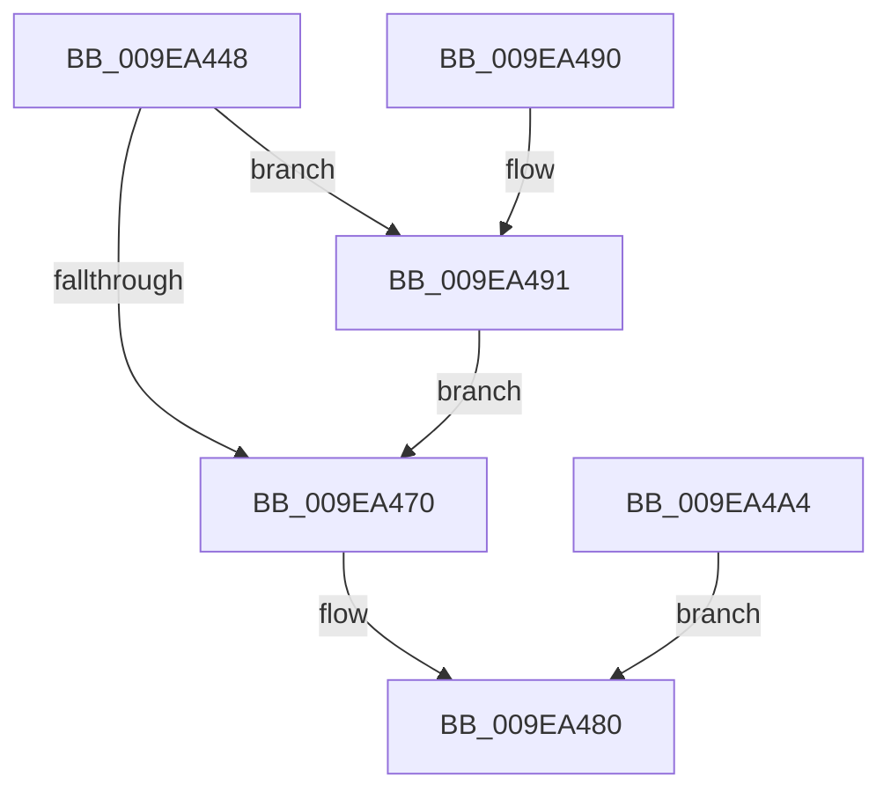

# AuthzBasepProbeAndInsertTailList

- RVA: `0x009EA448`–`0x009EA4A6` (길이 `94` bytes)
- VA: `0x00000001409EA448`
- 실행 섹션: `PAGE`
- PDB 이름 있음: `예`; PDB Function 태그: `아니요`
- unwind 정보 RVA: `0x000A52EC`
- 디코드: `27`개 명령, `94/94` bytes 표시
- 미해석 바이트: `0` (있으면 어셈블리에 `.byte`로 보존)

> 이 문서는 커널 이미지의 기계어와 PDB 기호를 분석해 생성했습니다. 4번과 5번은 함수 원형과 자료형을 바이너리 사용 방식에서 추정한 C 해석이며 원본 소스 복구 결과는 아닙니다.

## 1. Dependencies

- 직접 호출 지점: **1**; 고유 호출 대상: **1**
- 직접 호출자로 확인된 함수: **2**
- RIP 상대 이미지 참조: **0**

### Outgoing calls
- `0x009EA49D` → [ProbeForWrite](../8E/ProbeForWrite_function_008E91C0.md) (function, `0x008E91C0`)

### Direct callers
- [AuthzBasepCopyoutInternalSecurityAttributeValues](../../text/3F/AuthzBasepCopyoutInternalSecurityAttributeValues_function_003FEC10.md) at `0x003FECD0`
- [AuthzBasepCopyoutInternalSecurityAttributes](AuthzBasepCopyoutInternalSecurityAttributes_function_009EA280.md) at `0x009EA33C`

### Static image references
- 디코드된 RIP-relative 메모리 참조가 없습니다.

## 2. Other-region calls and transfers

- 다른 실행 섹션으로 향하는 call: **0**
- 별도 외부 분기/꼬리 이동을 확인하지 못했습니다.

## 3. Assembly (complete function range)

```asm
009EA448  48 89 5C 24 08                  mov qword ptr [rsp + 8], rbx
009EA44D  48 89 74 24 10                  mov qword ptr [rsp + 0x10], rsi
009EA452  57                              push rdi
009EA453  48 83 EC 20                     sub rsp, 0x20
009EA457  48 8B DA                        mov rbx, rdx
009EA45A  48 8B F9                        mov rdi, rcx
009EA45D  48 8B 71 08                     mov rsi, qword ptr [rcx + 8]
009EA461  48 B8 FF FF FE FF FF 7F 00 00   movabs rax, 0x7ffffffeffff
009EA46B  48 3B C8                        cmp rcx, rax
009EA46E  76 21                           jbe 0x1409ea491
009EA470  48 89 3B                        mov qword ptr [rbx], rdi
009EA473  48 89 73 08                     mov qword ptr [rbx + 8], rsi
009EA477  48 89 1E                        mov qword ptr [rsi], rbx
009EA47A  48 89 5F 08                     mov qword ptr [rdi + 8], rbx
009EA47E  33 C0                           xor eax, eax
009EA480  48 8B 5C 24 30                  mov rbx, qword ptr [rsp + 0x30]
009EA485  48 8B 74 24 38                  mov rsi, qword ptr [rsp + 0x38]
009EA48A  48 83 C4 20                     add rsp, 0x20
009EA48E  5F                              pop rdi
009EA48F  C3                              ret
009EA490  CC                              int3
009EA491  BA 10 00 00 00                  mov edx, 0x10
009EA496  44 8D 42 F4                     lea r8d, [rdx - 0xc]
009EA49A  48 8B CE                        mov rcx, rsi
009EA49D  E8 1E ED EF FF                  call 0x1408e91c0
009EA4A2  EB CC                           jmp 0x1409ea470
009EA4A4  EB DA                           jmp 0x1409ea480
```

## 4. C-style interpretation (structured pseudocode)

```c
__int64 __fastcall AuthzBasepProbeAndInsertTailList(__int64 a1, __int64 a2)
{
    __int64 result;
    __int64 v_rsp;
    unsigned __int64 v_stack_p10;
    unsigned __int64 v_stack_p8;

    v_stack_p8 = v_rbx;
    v_stack_p10 = v_rsi;
    v_rsp = (v_rsp) - (32);
    if (a1 <= result) goto loc_009EA491;
loc_009EA470:
    *(unsigned __int64 *)(a2) = a1;
    *(unsigned __int64 *)(a2 + 8) = *(unsigned __int64 *)(a1 + 8);
    *(unsigned __int64 *)(*(unsigned __int64 *)(a1 + 8)) = a2;
    *(unsigned __int64 *)(a1 + 8) = a2;
    result = 0;
loc_009EA480:
    v_rsp = (v_rsp) + (32);
    return result;
loc_009EA491:
    result = ProbeForWrite(v_stack_p10, 16, 16 - 12, a4);
    goto loc_009EA470;
}
```

## 5. (Beta) C Style

```c
int64_t AuthzBasepProbeAndInsertTailList(void *Arg1, void *Arg2)
{
    uint8_t *arg1 = (uint8_t *)Arg1;
    uint8_t *arg2 = (uint8_t *)Arg2;

    int64_t result;
    int64_t local_rsp;
    uint64_t v_stack_p10;
    uint64_t v_stack_p8;

    v_stack_p8 = local_rbx;
    v_stack_p10 = local_rsi;
    local_rsp = (local_rsp) - (32);
    if (Arg1 <= result) goto loc_009EA491;
loc_009EA470:
    *(void **)(arg2) = Arg1;
    *(uint64_t *)(arg2 + 0x8) = *(uint64_t *)(arg1 + 0x8);
    *(void **)(*(uint64_t *)(arg1 + 0x8)) = Arg2;
    *(void **)(arg1 + 0x8) = Arg2;
    result = 0;
loc_009EA480:
    local_rsp = (local_rsp) + (32);
    return result;
loc_009EA491:
    result = ProbeForWrite(v_stack_p10, 16, 16 - 12, a4);
    goto loc_009EA470;
}
```

### 관측된 메모리 오프셋

구조체 형식이 확인되지 않은 접근은 인자 기준의 오프셋으로만 기록했습니다.

| 기준 인자 | 오프셋 표현 | 폭 (bit) | 접근 |
|---|---:|---:|---|
| `Arg1` | `+ 0x8` | `64` | `R` |
| `Arg1` | `+ 0x8` | `64` | `W` |
| `Arg2` | `+ 0x0` | `64` | `W` |
| `Arg2` | `+ 0x8` | `64` | `W` |

## 6. Execution-region graph

[열기: 2D/3D 그래프와 함수 탐색 컨트롤 패널](../../../control-panel.html?section=page&rva=0x009EA448&view=graph)

- 2D 그래프는 위에서 아래로 흐르고, 3D 그래프는 빈 공간을 드래그해 회전합니다. Shift+드래그는 이동, 휠은 확대·축소, 함수 노드 선택은 대상 보고서 이동입니다.

### Static fallback


