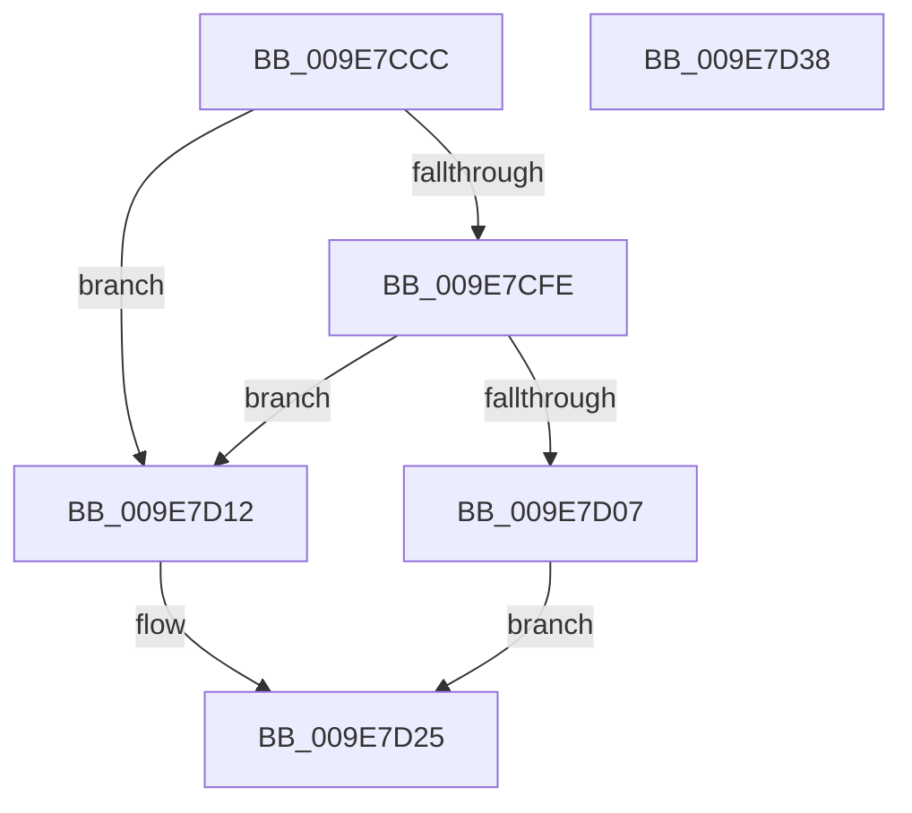

# CmGetRootKeyObjectForSilo

- RVA: `0x009E7CCC`–`0x009E7D39` (길이 `109` bytes)
- VA: `0x00000001409E7CCC`
- 실행 섹션: `PAGE`
- PDB 이름 있음: `예`; PDB Function 태그: `아니요`
- unwind 정보 RVA: `0x000697A4`
- 디코드: `30`개 명령, `109/109` bytes 표시
- 미해석 바이트: `0` (있으면 어셈블리에 `.byte`로 보존)

> 이 문서는 커널 이미지의 기계어와 PDB 기호를 분석해 생성했습니다. 4번과 5번은 함수 원형과 자료형을 바이너리 사용 방식에서 추정한 C 해석이며 원본 소스 복구 결과는 아닙니다.

## 1. Dependencies

- 직접 호출 지점: **5**; 고유 호출 대상: **4**
- 직접 호출자로 확인된 함수: **1**
- RIP 상대 이미지 참조: **1**

### Outgoing calls
- `0x009E7CE9` → [CmpInitializeThreadInfo](../../text/3F/CmpInitializeThreadInfo_function_003FBE70.md) (function, `0x003FBE70`)
- `0x009E7CF1` → [CmpGetContextForSiloNoRef](CmpGetContextForSiloNoRef_function_009E8020.md) (function, `0x009E8020`)
- `0x009E7D07` → [ObfReferenceObject](../../text/20/ObfReferenceObject_function_0020FA20.md) (function, `0x0020FA20`)
- `0x009E7D19` → [ObfReferenceObject](../../text/20/ObfReferenceObject_function_0020FA20.md) (function, `0x0020FA20`)
- `0x009E7D2A` → [CmCleanupThreadInfo](../../text/41/CmCleanupThreadInfo_function_0041FD50.md) (function, `0x0041FD50`)

### Direct callers
- [sub_00B24EA0](../B2/Unknown_function_00B24EA0.md) at `0x00B24EF9`

### Static image references
- `0x009E7D12` → RVA `0x00FD9B68` (`PAGEDATA`; read)

## 2. Other-region calls and transfers

- 다른 실행 섹션으로 향하는 call: **4**
  - `0x009E7CE9` → [CmpInitializeThreadInfo](../../text/3F/CmpInitializeThreadInfo_function_003FBE70.md) (`PAGE` → `.text`)
  - `0x009E7D07` → [ObfReferenceObject](../../text/20/ObfReferenceObject_function_0020FA20.md) (`PAGE` → `.text`)
  - `0x009E7D19` → [ObfReferenceObject](../../text/20/ObfReferenceObject_function_0020FA20.md) (`PAGE` → `.text`)
  - `0x009E7D2A` → [CmCleanupThreadInfo](../../text/41/CmCleanupThreadInfo_function_0041FD50.md) (`PAGE` → `.text`)
- 별도 외부 분기/꼬리 이동을 확인하지 못했습니다.

## 3. Assembly (complete function range)

```asm
009E7CCC  40 53                           push rbx
009E7CCE  48 83 EC 40                     sub rsp, 0x40
009E7CD2  0F 57 C0                        xorps xmm0, xmm0
009E7CD5  33 C0                           xor eax, eax
009E7CD7  4C 8B C9                        mov r9, rcx
009E7CDA  48 89 44 24 30                  mov qword ptr [rsp + 0x30], rax
009E7CDF  48 8D 4C 24 20                  lea rcx, [rsp + 0x20]
009E7CE4  0F 11 44 24 20                  movups xmmword ptr [rsp + 0x20], xmm0
009E7CE9  E8 82 41 A1 FF                  call 0x1403fbe70
009E7CEE  49 8B C9                        mov rcx, r9
009E7CF1  E8 2A 03 00 00                  call 0x1409e8020
009E7CF6  48 8B D8                        mov rbx, rax
009E7CF9  48 85 C0                        test rax, rax
009E7CFC  74 14                           je 0x1409e7d12
009E7CFE  48 8B 48 20                     mov rcx, qword ptr [rax + 0x20]
009E7D02  48 85 C9                        test rcx, rcx
009E7D05  74 0B                           je 0x1409e7d12
009E7D07  E8 14 7D 82 FF                  call 0x14020fa20
009E7D0C  4C 8B 43 20                     mov r8, qword ptr [rbx + 0x20]
009E7D10  EB 13                           jmp 0x1409e7d25
009E7D12  48 8B 0D 4F 1E 5F 00            mov rcx, qword ptr [rip + 0x5f1e4f]
009E7D19  E8 02 7D 82 FF                  call 0x14020fa20
009E7D1E  4C 8B 05 43 1E 5F 00            mov r8, qword ptr [rip + 0x5f1e43]
009E7D25  48 8D 4C 24 20                  lea rcx, [rsp + 0x20]
009E7D2A  E8 21 80 A3 FF                  call 0x14041fd50
009E7D2F  49 8B C0                        mov rax, r8
009E7D32  48 83 C4 40                     add rsp, 0x40
009E7D36  5B                              pop rbx
009E7D37  C3                              ret
009E7D38  CC                              int3
```

## 4. C-style interpretation (structured pseudocode)

```c
__int64 __fastcall CmGetRootKeyObjectForSilo(__int64 a1)
{
    __int64 result;
    __int64 v_rsp;
    unsigned __int64 v_stack_m18;
    unsigned __int64 v_stack_m28;

    v_rsp = (v_rsp) - (64);
    result = 0;
    v_stack_m18 = 0;
    v_stack_m28 = v_xmm0;
    result = CmpInitializeThreadInfo(v_stack_m28, a2, a3, a1);
    result = CmpGetContextForSiloNoRef(a1, a2, a3, a1);
    if (result == 0) goto loc_009E7D12;
    if (*(unsigned __int64 *)(result + 32) == 0) goto loc_009E7D12;
    result = ObfReferenceObject(*(unsigned __int64 *)(result + 32), a2, a3, a1);
    goto loc_009E7D25;
loc_009E7D12:
    result = ObfReferenceObject(*(unsigned __int64 *)(v_rip + 6233679), a2, *(unsigned __int64 *)(result + 32), a1);
loc_009E7D25:
    result = CmCleanupThreadInfo(v_stack_m28, a2, *(unsigned __int64 *)(v_rip + 6233667), a1);
    v_rsp = (v_rsp) + (64);
    return *(unsigned __int64 *)(v_rip + 6233667);
}
```

## 5. (Beta) C Style

```c
int64_t CmGetRootKeyObjectForSilo(int64_t Arg1)
{
    int64_t result;
    int64_t local_rsp;
    uint64_t v_stack_m18;
    uint64_t v_stack_m28;

    local_rsp = (local_rsp) - (64);
    result = 0;
    v_stack_m18 = 0;
    v_stack_m28 = v_xmm0;
    result = CmpInitializeThreadInfo(v_stack_m28, a2, a3, Arg1);
    result = CmpGetContextForSiloNoRef(Arg1, a2, a3, Arg1);
    if (result == 0) goto loc_009E7D12;
    if (*(uint64_t *)(result + 0x20) == 0) goto loc_009E7D12;
    result = ObfReferenceObject(*(uint64_t *)(result + 0x20), a2, a3, Arg1);
    goto loc_009E7D25;
loc_009E7D12:
    result = ObfReferenceObject(*(uint64_t *)(v_rip + 0x5F1E4F), a2, *(uint64_t *)(result + 0x20), Arg1);
loc_009E7D25:
    result = CmCleanupThreadInfo(v_stack_m28, a2, *(uint64_t *)(v_rip + 0x5F1E43), Arg1);
    local_rsp = (local_rsp) + (64);
    return *(uint64_t *)(v_rip + 0x5F1E43);
}
```

## 6. Execution-region graph

[열기: 2D/3D 그래프와 함수 탐색 컨트롤 패널](../../../control-panel.html?section=page&rva=0x009E7CCC&view=graph)

- 2D 그래프는 위에서 아래로 흐르고, 3D 그래프는 빈 공간을 드래그해 회전합니다. Shift+드래그는 이동, 휠은 확대·축소, 함수 노드 선택은 대상 보고서 이동입니다.

### Static fallback


