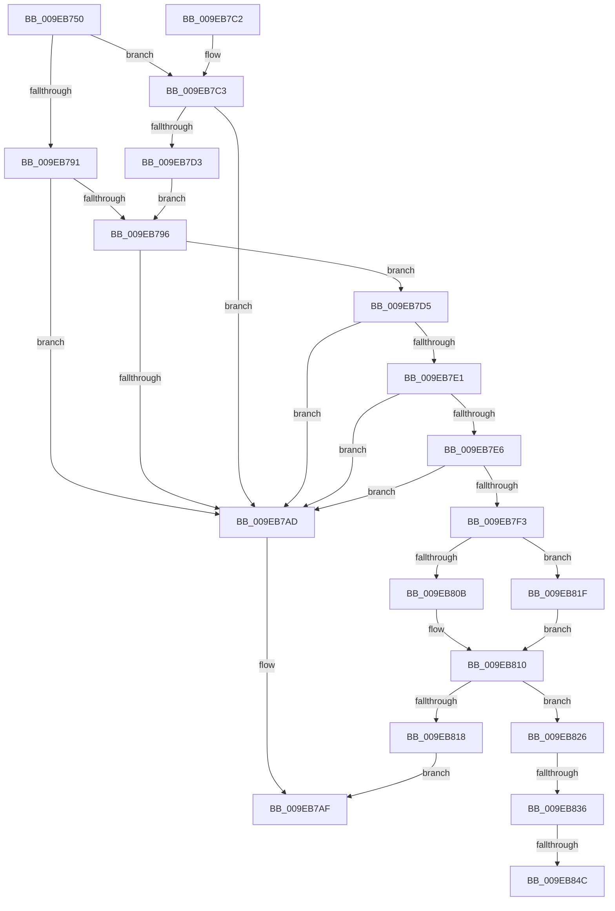

# CmGetVisibleMaxValueNameLenAndDataLen

- RVA: `0x009EB750`–`0x009EB857` (길이 `263` bytes)
- VA: `0x00000001409EB750`
- 실행 섹션: `PAGE`
- PDB 이름 있음: `예`; PDB Function 태그: `예`
- unwind 정보 RVA: `0x000A55C4`
- 디코드: `74`개 명령, `263/263` bytes 표시
- 미해석 바이트: `0` (있으면 어셈블리에 `.byte`로 보존)

> 이 문서는 커널 이미지의 기계어와 PDB 기호를 분석해 생성했습니다. 4번과 5번은 함수 원형과 자료형을 바이너리 사용 방식에서 추정한 C 해석이며 원본 소스 복구 결과는 아닙니다.

## 1. Dependencies

- 직접 호출 지점: **3**; 고유 호출 대상: **2**
- 직접 호출자로 확인된 함수: **1**
- RIP 상대 이미지 참조: **0**

### Outgoing calls
- `0x009EB80B` → [HvpGetCellFlat](../85/HvpGetCellFlat_function_00854C60.md) (function, `0x00854C60`)
- `0x009EB81F` → [HvpGetCellPaged](../85/HvpGetCellPaged_function_00854CB0.md) (function, `0x00854CB0`)
- `0x009EB84C` → [HvpGetCellFlat](../85/HvpGetCellFlat_function_00854C60.md) (function, `0x00854C60`)

### Direct callers
- [CmpQueryKeyDataFromNode](../84/CmpQueryKeyDataFromNode_function_0084EAE0.md) at `0x0084ED05`

### Static image references
- 디코드된 RIP-relative 메모리 참조가 없습니다.

## 2. Other-region calls and transfers

- 다른 실행 섹션으로 향하는 call: **0**
- call이 아닌 외부 분기/꼬리 이동: **3**
  - `0x009EB830` → [sub_00B309F4 + 0x8D](../B3/Unknown_function_00B309F4.md) (`tail-transfer`)
  - `0x009EB846` → [sub_00B309F4](../B3/Unknown_function_00B309F4.md) (`tail-transfer`)
  - `0x009EB852` → [sub_00B309F4 + 0x5](../B3/Unknown_function_00B309F4.md) (`tail-transfer`)

## 3. Assembly (complete function range)

```asm
009EB750  48 89 5C 24 08                  mov qword ptr [rsp + 8], rbx
009EB755  48 89 6C 24 18                  mov qword ptr [rsp + 0x18], rbp
009EB75A  56                              push rsi
009EB75B  57                              push rdi
009EB75C  41 56                           push r14
009EB75E  48 83 EC 20                     sub rsp, 0x20
009EB762  48 8B 7C 24 60                  mov rdi, qword ptr [rsp + 0x60]
009EB767  33 ED                           xor ebp, ebp
009EB769  41 89 29                        mov dword ptr [r9], ebp
009EB76C  49 8B F1                        mov rsi, r9
009EB76F  C7 44 24 48 FF FF FF FF         mov dword ptr [rsp + 0x48], 0xffffffff
009EB777  48 8B D9                        mov rbx, rcx
009EB77A  89 6C 24 4C                     mov dword ptr [rsp + 0x4c], ebp
009EB77E  89 2F                           mov dword ptr [rdi], ebp
009EB780  C7 44 24 58 FF FF FF FF         mov dword ptr [rsp + 0x58], 0xffffffff
009EB788  89 6C 24 5C                     mov dword ptr [rsp + 0x5c], ebp
009EB78C  48 85 D2                        test rdx, rdx
009EB78F  75 32                           jne 0x1409eb7c3
009EB791  48 85 C9                        test rcx, rcx
009EB794  74 17                           je 0x1409eb7ad
009EB796  0F B7 81 B2 00 00 00            movzx eax, word ptr [rcx + 0xb2]
009EB79D  41 89 01                        mov dword ptr [r9], eax
009EB7A0  8B 81 B4 00 00 00               mov eax, dword ptr [rcx + 0xb4]
009EB7A6  89 07                           mov dword ptr [rdi], eax
009EB7A8  4D 85 C0                        test r8, r8
009EB7AB  75 28                           jne 0x1409eb7d5
009EB7AD  33 C0                           xor eax, eax
009EB7AF  48 8B 5C 24 40                  mov rbx, qword ptr [rsp + 0x40]
009EB7B4  48 8B 6C 24 50                  mov rbp, qword ptr [rsp + 0x50]
009EB7B9  48 83 C4 20                     add rsp, 0x20
009EB7BD  41 5E                           pop r14
009EB7BF  5F                              pop rdi
009EB7C0  5E                              pop rsi
009EB7C1  C3                              ret
009EB7C2  CC                              int3
009EB7C3  8B 42 3C                        mov eax, dword ptr [rdx + 0x3c]
009EB7C6  41 89 01                        mov dword ptr [r9], eax
009EB7C9  8B 42 40                        mov eax, dword ptr [rdx + 0x40]
009EB7CC  89 07                           mov dword ptr [rdi], eax
009EB7CE  48 85 DB                        test rbx, rbx
009EB7D1  74 DA                           je 0x1409eb7ad
009EB7D3  EB C1                           jmp 0x1409eb796
009EB7D5  48 8B 81 20 01 00 00            mov rax, qword ptr [rcx + 0x120]
009EB7DC  48 85 C0                        test rax, rax
009EB7DF  74 CC                           je 0x1409eb7ad
009EB7E1  49 3B C0                        cmp rax, r8
009EB7E4  75 C7                           jne 0x1409eb7ad
009EB7E6  41 89 29                        mov dword ptr [r9], ebp
009EB7E9  89 2F                           mov dword ptr [rdi], ebp
009EB7EB  39 A9 18 01 00 00               cmp dword ptr [rcx + 0x118], ebp
009EB7F1  74 BA                           je 0x1409eb7ad
009EB7F3  8B 91 1C 01 00 00               mov edx, dword ptr [rcx + 0x11c]
009EB7F9  4C 8D 44 24 48                  lea r8, [rsp + 0x48]
009EB7FE  48 8B 49 20                     mov rcx, qword ptr [rcx + 0x20]
009EB802  F6 81 8C 00 00 00 01            test byte ptr [rcx + 0x8c], 1
009EB809  74 14                           je 0x1409eb81f
009EB80B  E8 50 94 E6 FF                  call 0x140854c60
009EB810  4C 8B F0                        mov r14, rax
009EB813  48 85 C0                        test rax, rax
009EB816  75 0E                           jne 0x1409eb826
009EB818  B8 9A 00 00 C0                  mov eax, 0xc000009a
009EB81D  EB 90                           jmp 0x1409eb7af
009EB81F  E8 8C 94 E6 FF                  call 0x140854cb0
009EB824  EB EA                           jmp 0x1409eb810
009EB826  48 8B 4B 20                     mov rcx, qword ptr [rbx + 0x20]
009EB82A  3B AB 18 01 00 00               cmp ebp, dword ptr [rbx + 0x118]
009EB830  0F 83 4B 52 14 00               jae 0x140b30a81
009EB836  F6 81 8C 00 00 00 01            test byte ptr [rcx + 0x8c], 1
009EB83D  4C 8D 44 24 58                  lea r8, [rsp + 0x58]
009EB842  41 8B 14 AE                     mov edx, dword ptr [r14 + rbp*4]
009EB846  0F 84 A8 51 14 00               je 0x140b309f4
009EB84C  E8 0F 94 E6 FF                  call 0x140854c60
009EB851  90                              nop
009EB852  E9 A2 51 14 00                  jmp 0x140b309f9
```

## 4. C-style interpretation (structured pseudocode)

```c
__int64 __fastcall CmGetVisibleMaxValueNameLenAndDataLen(__int64 a1, __int64 a2, __int64 a3, __int64 a4, __int64 a5)
{
    __int64 result;
    __int64 v_rbp;
    __int64 v_rsp;
    unsigned int v_stack_p10;
    unsigned int v_stack_p14;
    unsigned __int64 v_stack_p18;
    unsigned int v_stack_p20;
    unsigned int v_stack_p24;
    unsigned __int64 v_stack_p48;
    unsigned __int64 v_stack_p58;
    unsigned __int64 v_stack_p8;

    v_stack_p8 = v_rbx;
    v_stack_p18 = v_rbp;
    v_rsp = (v_rsp) - (32);
    v_rbp = 0;
    *(unsigned int *)(a4) = 0;
    v_stack_p10 = 0xFFFFFFFFULL;
    v_stack_p14 = 0;
    *(unsigned int *)(a5) = 0;
    v_stack_p20 = 0xFFFFFFFFULL;
    v_stack_p24 = 0;
    if (a2 != 0) goto loc_009EB7C3;
    if (a1 == 0) goto loc_009EB7AD;
loc_009EB796:
    *(unsigned int *)(a4) = (unsigned int)(*(unsigned __int16 *)(a1 + 178));
    *(unsigned int *)(a5) = (unsigned int)((unsigned int)(*(unsigned int *)(a1 + 180)));
    if (a3 != 0) goto loc_009EB7D5;
loc_009EB7AD:
    result = 0;
loc_009EB7AF:
    v_rsp = (v_rsp) + (32);
    return result;
loc_009EB7C3:
    *(unsigned int *)(a4) = (unsigned int)((unsigned int)(*(unsigned int *)(a2 + 60)));
    *(unsigned int *)(a5) = (unsigned int)((unsigned int)(*(unsigned int *)(a2 + 64)));
    if (v_stack_p8 == 0) goto loc_009EB7AD;
    goto loc_009EB796;
loc_009EB7D5:
    if (*(unsigned __int64 *)(a1 + 288) == 0) goto loc_009EB7AD;
    if ((*(unsigned __int64 *)(a1 + 288)) != a3) goto loc_009EB7AD;
    *(unsigned int *)(a4) = (unsigned int)(v_stack_p18);
    *(unsigned int *)(a5) = (unsigned int)(v_stack_p18);
    if ((*(unsigned int *)(a1 + 280)) == ((unsigned int)(v_stack_p18))) goto loc_009EB7AD;
    if (((*(unsigned __int8 *)(*(unsigned __int64 *)(a1 + 32) + 140)) & (1)) == 0) goto loc_009EB81F;
    result = HvpGetCellFlat(*(unsigned __int64 *)(a1 + 32), (unsigned int)(*(unsigned int *)(a1 + 284)), v_stack_p48, a4);
loc_009EB810:
    if (result != 0) goto loc_009EB826;
    goto loc_009EB7AF;
loc_009EB81F:
    result = HvpGetCellPaged(*(unsigned __int64 *)(a1 + 32), (unsigned int)(*(unsigned int *)(a1 + 284)), v_stack_p48, a4);
    goto loc_009EB810;
loc_009EB826:
    result = HvpGetCellFlat(*(unsigned __int64 *)(v_stack_p8 + 32), (unsigned int)(*(unsigned int *)(result + v_stack_p18 * 4)), v_stack_p58, a4);
}
```

## 5. (Beta) C Style

```c
int64_t CmGetVisibleMaxValueNameLenAndDataLen(int64_t Arg1, int64_t Arg2, int64_t Arg3, void *Arg4, void *Arg5)
{
    uint8_t *arg4 = (uint8_t *)Arg4;
    uint8_t *arg5 = (uint8_t *)Arg5;

    int64_t result;
    int64_t local_rbp;
    int64_t local_rsp;
    uint32_t v_stack_p10;
    uint32_t v_stack_p14;
    uint64_t v_stack_p18;
    uint32_t v_stack_p20;
    uint32_t v_stack_p24;
    uint64_t v_stack_p48;
    uint64_t v_stack_p58;
    uint64_t v_stack_p8;

    v_stack_p8 = local_rbx;
    v_stack_p18 = local_rbp;
    local_rsp = (local_rsp) - (32);
    local_rbp = 0;
    *(uint32_t *)(arg4) = 0;
    v_stack_p10 = 0xFFFFFFFFULL;
    v_stack_p14 = 0;
    *(uint32_t *)(arg5) = 0;
    v_stack_p20 = 0xFFFFFFFFULL;
    v_stack_p24 = 0;
    if (Arg2 != 0) goto loc_009EB7C3;
    if (Arg1 == 0) goto loc_009EB7AD;
loc_009EB796:
    *(uint32_t *)(arg4) = (uint32_t)(*(uint16_t *)(Arg1 + 0xB2));
    *(uint32_t *)(arg5) = (uint32_t)((uint32_t)(*(uint32_t *)(Arg1 + 0xB4)));
    if (Arg3 != 0) goto loc_009EB7D5;
loc_009EB7AD:
    result = 0;
loc_009EB7AF:
    local_rsp = (local_rsp) + (32);
    return result;
loc_009EB7C3:
    *(uint32_t *)(arg4) = (uint32_t)((uint32_t)(*(uint32_t *)(Arg2 + 0x3C)));
    *(uint32_t *)(arg5) = (uint32_t)((uint32_t)(*(uint32_t *)(Arg2 + 0x40)));
    if (v_stack_p8 == 0) goto loc_009EB7AD;
    goto loc_009EB796;
loc_009EB7D5:
    if (*(uint64_t *)(Arg1 + 0x120) == 0) goto loc_009EB7AD;
    if ((*(uint64_t *)(Arg1 + 0x120)) != Arg3) goto loc_009EB7AD;
    *(uint32_t *)(arg4) = (uint32_t)(v_stack_p18);
    *(uint32_t *)(arg5) = (uint32_t)(v_stack_p18);
    if ((*(uint32_t *)(Arg1 + 0x118)) == ((uint32_t)(v_stack_p18))) goto loc_009EB7AD;
    if (((*(uint8_t *)(*(uint64_t *)(Arg1 + 0x20) + 0x8C)) & (1)) == 0) goto loc_009EB81F;
    result = HvpGetCellFlat(*(uint64_t *)(Arg1 + 0x20), (uint32_t)(*(uint32_t *)(Arg1 + 0x11C)), v_stack_p48, Arg4);
loc_009EB810:
    if (result != 0) goto loc_009EB826;
    goto loc_009EB7AF;
loc_009EB81F:
    result = HvpGetCellPaged(*(uint64_t *)(Arg1 + 0x20), (uint32_t)(*(uint32_t *)(Arg1 + 0x11C)), v_stack_p48, Arg4);
    goto loc_009EB810;
loc_009EB826:
    result = HvpGetCellFlat(*(uint64_t *)(v_stack_p8 + 0x20), (uint32_t)(*(uint32_t *)(result + v_stack_p18 * 4)), v_stack_p58, Arg4);
}
```

### 관측된 메모리 오프셋

구조체 형식이 확인되지 않은 접근은 인자 기준의 오프셋으로만 기록했습니다.

| 기준 인자 | 오프셋 표현 | 폭 (bit) | 접근 |
|---|---:|---:|---|
| `Arg4` | `+ 0x0` | `32` | `W` |
| `Arg5` | `+ 0x0` | `32` | `W` |

## 6. Execution-region graph

[열기: 2D/3D 그래프와 함수 탐색 컨트롤 패널](../../../control-panel.html?section=page&rva=0x009EB750&view=graph)

- 2D 그래프는 위에서 아래로 흐르고, 3D 그래프는 빈 공간을 드래그해 회전합니다. Shift+드래그는 이동, 휠은 확대·축소, 함수 노드 선택은 대상 보고서 이동입니다.

### Static fallback


