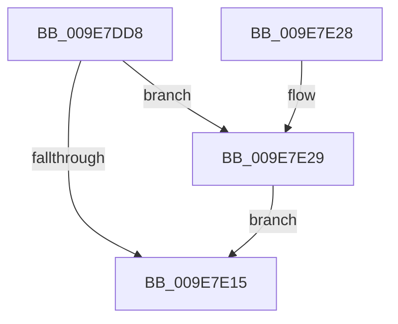

# CmInitSiloNamespace

- RVA: `0x009E7DD8`–`0x009E7E3E` (길이 `102` bytes)
- VA: `0x00000001409E7DD8`
- 실행 섹션: `PAGE`
- PDB 이름 있음: `예`; PDB Function 태그: `아니요`
- unwind 정보 RVA: `0x000A4C90`
- 디코드: `30`개 명령, `102/102` bytes 표시
- 미해석 바이트: `0` (있으면 어셈블리에 `.byte`로 보존)

> 이 문서는 커널 이미지의 기계어와 PDB 기호를 분석해 생성했습니다. 4번과 5번은 함수 원형과 자료형을 바이너리 사용 방식에서 추정한 C 해석이며 원본 소스 복구 결과는 아닙니다.

## 1. Dependencies

- 직접 호출 지점: **4**; 고유 호출 대상: **4**
- 직접 호출자로 확인된 함수: **1**
- RIP 상대 이미지 참조: **0**

### Outgoing calls
- `0x009E7DFC` → [CmpInitializeThreadInfo](../../text/3F/CmpInitializeThreadInfo_function_003FBE70.md) (function, `0x003FBE70`)
- `0x009E7E09` → [CmpGetOrCreateContextForSiloNoRef](CmpGetOrCreateContextForSiloNoRef_function_009E7E44.md) (function, `0x009E7E44`)
- `0x009E7E1A` → [CmCleanupThreadInfo](../../text/41/CmCleanupThreadInfo_function_0041FD50.md) (function, `0x0041FD50`)
- `0x009E7E2E` → [CmpStartSiloRegistryNamespace](CmpStartSiloRegistryNamespace_function_009E85D0.md) (function, `0x009E85D0`)

### Direct callers
- [sub_00B24EA0](../B2/Unknown_function_00B24EA0.md) at `0x00B24EC2`

### Static image references
- 디코드된 RIP-relative 메모리 참조가 없습니다.

## 2. Other-region calls and transfers

- 다른 실행 섹션으로 향하는 call: **2**
  - `0x009E7DFC` → [CmpInitializeThreadInfo](../../text/3F/CmpInitializeThreadInfo_function_003FBE70.md) (`PAGE` → `.text`)
  - `0x009E7E1A` → [CmCleanupThreadInfo](../../text/41/CmCleanupThreadInfo_function_0041FD50.md) (`PAGE` → `.text`)
- 별도 외부 분기/꼬리 이동을 확인하지 못했습니다.

## 3. Assembly (complete function range)

```asm
009E7DD8  40 53                           push rbx
009E7DDA  48 83 EC 40                     sub rsp, 0x40
009E7DDE  0F 57 C0                        xorps xmm0, xmm0
009E7DE1  33 C0                           xor eax, eax
009E7DE3  4C 8B C9                        mov r9, rcx
009E7DE6  48 89 44 24 30                  mov qword ptr [rsp + 0x30], rax
009E7DEB  33 DB                           xor ebx, ebx
009E7DED  48 8D 4C 24 20                  lea rcx, [rsp + 0x20]
009E7DF2  0F 11 44 24 20                  movups xmmword ptr [rsp + 0x20], xmm0
009E7DF7  48 89 5C 24 58                  mov qword ptr [rsp + 0x58], rbx
009E7DFC  E8 6F 40 A1 FF                  call 0x1403fbe70
009E7E01  48 8D 54 24 58                  lea rdx, [rsp + 0x58]
009E7E06  49 8B C9                        mov rcx, r9
009E7E09  E8 36 00 00 00                  call 0x1409e7e44
009E7E0E  44 8B C0                        mov r8d, eax
009E7E11  85 C0                           test eax, eax
009E7E13  79 14                           jns 0x1409e7e29
009E7E15  48 8D 4C 24 20                  lea rcx, [rsp + 0x20]
009E7E1A  E8 31 7F A3 FF                  call 0x14041fd50
009E7E1F  41 8B C0                        mov eax, r8d
009E7E22  48 83 C4 40                     add rsp, 0x40
009E7E26  5B                              pop rbx
009E7E27  C3                              ret
009E7E28  CC                              int3
009E7E29  48 8B 4C 24 58                  mov rcx, qword ptr [rsp + 0x58]
009E7E2E  E8 9D 07 00 00                  call 0x1409e85d0
009E7E33  85 C0                           test eax, eax
009E7E35  44 8B C0                        mov r8d, eax
009E7E38  44 0F 49 C3                     cmovns r8d, ebx
009E7E3C  EB D7                           jmp 0x1409e7e15
```

## 4. C-style interpretation (structured pseudocode)

```c
__int64 __fastcall CmInitSiloNamespace(__int64 a1)
{
    __int64 result;
    __int64 v_rbx;
    __int64 v_rsp;
    unsigned __int64 v_stack_m18;
    unsigned __int64 v_stack_m28;
    unsigned __int64 v_stack_p10;
    unsigned __int64 v_stack_p58;

    v_rsp = (v_rsp) - (64);
    result = 0;
    v_stack_m18 = 0;
    v_rbx = 0;
    v_stack_m28 = v_xmm0;
    v_stack_p10 = 0;
    result = CmpInitializeThreadInfo(v_stack_m28, a2, a3, a1);
    result = CmpGetOrCreateContextForSiloNoRef(a1, v_stack_p10, a3, a1);
    if (!sign_flag) goto loc_009E7E29;
loc_009E7E15:
    result = CmCleanupThreadInfo(v_stack_m28, v_stack_p10, (unsigned int)((unsigned int)(result)), a1);
    v_rsp = (v_rsp) + (64);
    return (unsigned int)((unsigned int)((unsigned int)((unsigned int)(result))));
loc_009E7E29:
    result = CmpStartSiloRegistryNamespace(v_stack_p58, v_stack_p10, (unsigned int)((unsigned int)(result)), a1);
    a3 = (unsigned int)((unsigned int)(result));
    if (!sign_flag) { a3 = 0; }
    goto loc_009E7E15;
}
```

## 5. (Beta) C Style

```c
int64_t CmInitSiloNamespace(int64_t Arg1)
{
    int64_t result;
    int64_t local_rbx;
    int64_t local_rsp;
    uint64_t v_stack_m18;
    uint64_t v_stack_m28;
    uint64_t v_stack_p10;
    uint64_t v_stack_p58;

    local_rsp = (local_rsp) - (64);
    result = 0;
    v_stack_m18 = 0;
    local_rbx = 0;
    v_stack_m28 = v_xmm0;
    v_stack_p10 = 0;
    result = CmpInitializeThreadInfo(v_stack_m28, a2, a3, Arg1);
    result = CmpGetOrCreateContextForSiloNoRef(Arg1, v_stack_p10, a3, Arg1);
    if (!sign_flag) goto loc_009E7E29;
loc_009E7E15:
    result = CmCleanupThreadInfo(v_stack_m28, v_stack_p10, (uint32_t)((uint32_t)(result)), Arg1);
    local_rsp = (local_rsp) + (64);
    return (uint32_t)((uint32_t)((uint32_t)((uint32_t)(result))));
loc_009E7E29:
    result = CmpStartSiloRegistryNamespace(v_stack_p58, v_stack_p10, (uint32_t)((uint32_t)(result)), Arg1);
    a3 = (uint32_t)((uint32_t)(result));
    if (!sign_flag) { a3 = 0; }
    goto loc_009E7E15;
}
```

## 6. Execution-region graph

[열기: 2D/3D 그래프와 함수 탐색 컨트롤 패널](../../../control-panel.html?section=page&rva=0x009E7DD8&view=graph)

- 2D 그래프는 위에서 아래로 흐르고, 3D 그래프는 빈 공간을 드래그해 회전합니다. Shift+드래그는 이동, 휠은 확대·축소, 함수 노드 선택은 대상 보고서 이동입니다.

### Static fallback


