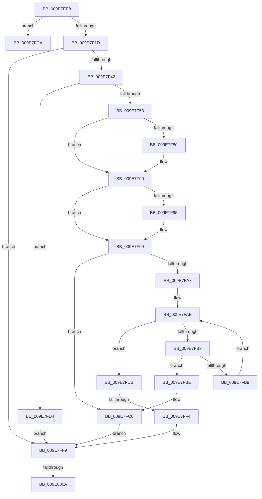

# CmLockKeyForWrite

- RVA: `0x009E7EE8`–`0x009E8018` (길이 `304` bytes)
- VA: `0x00000001409E7EE8`
- 실행 섹션: `PAGE`
- PDB 이름 있음: `예`; PDB Function 태그: `예`
- unwind 정보 RVA: `0x000A4CB4`
- 디코드: `84`개 명령, `304/304` bytes 표시
- 미해석 바이트: `0` (있으면 어셈블리에 `.byte`로 보존)

> 이 문서는 커널 이미지의 기계어와 PDB 기호를 분석해 생성했습니다. 4번과 5번은 함수 원형과 자료형을 바이너리 사용 방식에서 추정한 C 해석이며 원본 소스 복구 결과는 아닙니다.

## 1. Dependencies

- 직접 호출 지점: **13**; 고유 호출 대상: **12**
- 직접 호출자로 확인된 함수: **1**
- RIP 상대 이미지 참조: **1**

### Outgoing calls
- `0x009E7F04` → [PsGetCurrentSilo](../../text/40/PsGetCurrentSilo_function_004094A0.md) (function, `0x004094A0`)
- `0x009E7F0C` → [CmpGetContextForSiloNoRef](CmpGetContextForSiloNoRef_function_009E8020.md) (function, `0x009E8020`)
- `0x009E7F1D` → [CmpLockRegistry](../../pagecmrc/BC/CmpLockRegistry_function_00BC9B34.md) (function, `0x00BC9B34`)
- `0x009E7F29` → [CmpLockKcbExclusive](../86/CmpLockKcbExclusive_function_00861EB0.md) (function, `0x00861EB0`)
- `0x009E7F33` → [CmpPerformKeyBodyDeletionCheck](../../pagecmrc/BC/CmpPerformKeyBodyDeletionCheck_function_00BC97D0.md) (function, `0x00BC97D0`)
- `0x009E7F6C` → [KeAbPreAcquire](../../text/21/KeAbPreAcquire_function_00210230.md) (function, `0x00210230`)
- `0x009E7F8B` → [ExfAcquirePushLockSharedEx](../../text/21/ExfAcquirePushLockSharedEx_function_0021044C.md) (function, `0x0021044C`)
- `0x009E7F9C` → [CmpPerformSiloKeyLockTrackerEnabledCheck](../70/CmpPerformSiloKeyLockTrackerEnabledCheck_function_00704AAC.md) (function, `0x00704AAC`)
- `0x009E7FC3` → [CmpUnlockSiloKeyLockTracker](CmpUnlockSiloKeyLockTracker_function_009E8050.md) (function, `0x009E8050`)
- `0x009E7FDB` → [CmpUnlockSiloKeyLockTracker](CmpUnlockSiloKeyLockTracker_function_009E8050.md) (function, `0x009E8050`)
- `0x009E7FE3` → [CmpCreateSiloKeyLockEntry](../7E/CmpCreateSiloKeyLockEntry_function_007EDCE4.md) (function, `0x007EDCE4`)
- `0x009E7FFC` → [CmpUnlockKcb](../../pagecmrc/BC/CmpUnlockKcb_function_00BC92C0.md) (function, `0x00BC92C0`)
- `0x009E800D` → [CmpFreeSiloKeyLockEntry](../7E/CmpFreeSiloKeyLockEntry_function_007EDD38.md) (function, `0x007EDD38`)

### Direct callers
- [NtLockRegistryKey](../7D/NtLockRegistryKey_function_007DFD60.md) at `0x007DFDE0`

### Static image references
- `0x009E7F42` → RVA `0x00FD9A90` (`PAGEDATA`; read)

## 2. Other-region calls and transfers

- 다른 실행 섹션으로 향하는 call: **6**
  - `0x009E7F04` → [PsGetCurrentSilo](../../text/40/PsGetCurrentSilo_function_004094A0.md) (`PAGE` → `.text`)
  - `0x009E7F1D` → [CmpLockRegistry](../../pagecmrc/BC/CmpLockRegistry_function_00BC9B34.md) (`PAGE` → `PAGECMRC`)
  - `0x009E7F33` → [CmpPerformKeyBodyDeletionCheck](../../pagecmrc/BC/CmpPerformKeyBodyDeletionCheck_function_00BC97D0.md) (`PAGE` → `PAGECMRC`)
  - `0x009E7F6C` → [KeAbPreAcquire](../../text/21/KeAbPreAcquire_function_00210230.md) (`PAGE` → `.text`)
  - `0x009E7F8B` → [ExfAcquirePushLockSharedEx](../../text/21/ExfAcquirePushLockSharedEx_function_0021044C.md) (`PAGE` → `.text`)
  - `0x009E7FFC` → [CmpUnlockKcb](../../pagecmrc/BC/CmpUnlockKcb_function_00BC92C0.md) (`PAGE` → `PAGECMRC`)
- call이 아닌 외부 분기/꼬리 이동: **4**
  - `0x009E7FCF` → [sub_00B3073E + 0x9C](../B3/Unknown_function_00B3073E.md) (`tail-transfer`)
  - `0x009E7FEE` → [sub_00B3073E](../B3/Unknown_function_00B3073E.md) (`tail-transfer`)
  - `0x009E8004` → [sub_00B3073E + 0x97](../B3/Unknown_function_00B3073E.md) (`tail-transfer`)
  - `0x009E8013` → [sub_00B3073E + 0x97](../B3/Unknown_function_00B3073E.md) (`tail-transfer`)

## 3. Assembly (complete function range)

```asm
009E7EE8  48 89 5C 24 08                  mov qword ptr [rsp + 8], rbx
009E7EED  48 89 6C 24 20                  mov qword ptr [rsp + 0x20], rbp
009E7EF2  56                              push rsi
009E7EF3  57                              push rdi
009E7EF4  41 56                           push r14
009E7EF6  48 83 EC 20                     sub rsp, 0x20
009E7EFA  33 F6                           xor esi, esi
009E7EFC  48 8B D9                        mov rbx, rcx
009E7EFF  48 21 74 24 48                  and qword ptr [rsp + 0x48], rsi
009E7F04  E8 97 15 A2 FF                  call 0x1404094a0
009E7F09  48 8B C8                        mov rcx, rax
009E7F0C  E8 0F 01 00 00                  call 0x1409e8020
009E7F11  48 8B F8                        mov rdi, rax
009E7F14  48 85 C0                        test rax, rax
009E7F17  0F 84 AD 00 00 00               je 0x1409e7fca
009E7F1D  E8 12 1C 1E 00                  call 0x140bc9b34
009E7F22  48 8B 6B 08                     mov rbp, qword ptr [rbx + 8]
009E7F26  48 8B CD                        mov rcx, rbp
009E7F29  E8 82 9F E7 FF                  call 0x140861eb0
009E7F2E  33 D2                           xor edx, edx
009E7F30  48 8B CB                        mov rcx, rbx
009E7F33  E8 98 18 1E 00                  call 0x140bc97d0
009E7F38  8B D8                           mov ebx, eax
009E7F3A  85 C0                           test eax, eax
009E7F3C  0F 88 B7 00 00 00               js 0x1409e7ff9
009E7F42  48 8B 05 47 1B 5F 00            mov rax, qword ptr [rip + 0x5f1b47]
009E7F49  48 39 45 20                     cmp qword ptr [rbp + 0x20], rax
009E7F4D  0F 84 81 00 00 00               je 0x1409e7fd4
009E7F53  65 48 8B 04 25 88 01 00 00      mov rax, qword ptr gs:[0x188]
009E7F5C  45 33 C0                        xor r8d, r8d
009E7F5F  33 D2                           xor edx, edx
009E7F61  48 8B CF                        mov rcx, rdi
009E7F64  66 FF 88 E4 01 00 00            dec word ptr [rax + 0x1e4]
009E7F6B  90                              nop
009E7F6C  E8 BF 82 82 FF                  call 0x140210230
009E7F71  48 8B D8                        mov rbx, rax
009E7F74  8D 4E 11                        lea ecx, [rsi + 0x11]
009E7F77  33 C0                           xor eax, eax
009E7F79  F0 48 0F B1 0F                  lock cmpxchg qword ptr [rdi], rcx
009E7F7E  74 10                           je 0x1409e7f90
009E7F80  4C 8B CF                        mov r9, rdi
009E7F83  4C 8B C3                        mov r8, rbx
009E7F86  33 D2                           xor edx, edx
009E7F88  48 8B CF                        mov rcx, rdi
009E7F8B  E8 BC 84 82 FF                  call 0x14021044c
009E7F90  48 85 DB                        test rbx, rbx
009E7F93  74 04                           je 0x1409e7f99
009E7F95  C6 43 0A 01                     mov byte ptr [rbx + 0xa], 1
009E7F99  48 8B CF                        mov rcx, rdi
009E7F9C  E8 0B CB D1 FF                  call 0x140704aac
009E7FA1  8B D8                           mov ebx, eax
009E7FA3  85 C0                           test eax, eax
009E7FA5  78 19                           js 0x1409e7fc0
009E7FA7  4C 8D 77 10                     lea r14, [rdi + 0x10]
009E7FAB  49 8B 06                        mov rax, qword ptr [r14]
009E7FAE  49 3B C6                        cmp rax, r14
009E7FB1  74 28                           je 0x1409e7fdb
009E7FB3  48 39 68 10                     cmp qword ptr [rax + 0x10], rbp
009E7FB7  74 05                           je 0x1409e7fbe
009E7FB9  48 8B 00                        mov rax, qword ptr [rax]
009E7FBC  EB F0                           jmp 0x1409e7fae
009E7FBE  33 DB                           xor ebx, ebx
009E7FC0  48 8B CF                        mov rcx, rdi
009E7FC3  E8 88 00 00 00                  call 0x1409e8050
009E7FC8  EB 2F                           jmp 0x1409e7ff9
009E7FCA  BB BB 00 00 C0                  mov ebx, 0xc00000bb
009E7FCF  E9 06 88 14 00                  jmp 0x140b307da
009E7FD4  BB 0D 00 00 C0                  mov ebx, 0xc000000d
009E7FD9  EB 1E                           jmp 0x1409e7ff9
009E7FDB  E8 70 00 00 00                  call 0x1409e8050
009E7FE0  48 8B CD                        mov rcx, rbp
009E7FE3  E8 FC 5C E0 FF                  call 0x1407edce4
009E7FE8  48 8B F0                        mov rsi, rax
009E7FEB  48 85 C0                        test rax, rax
009E7FEE  0F 85 4A 87 14 00               jne 0x140b3073e
009E7FF4  BB 9A 00 00 C0                  mov ebx, 0xc000009a
009E7FF9  48 8B CD                        mov rcx, rbp
009E7FFC  E8 BF 12 1E 00                  call 0x140bc92c0
009E8001  48 85 F6                        test rsi, rsi
009E8004  0F 84 CB 87 14 00               je 0x140b307d5
009E800A  48 8B CE                        mov rcx, rsi
009E800D  E8 26 5D E0 FF                  call 0x1407edd38
009E8012  90                              nop
009E8013  E9 BD 87 14 00                  jmp 0x140b307d5
```

## 4. C-style interpretation (structured pseudocode)

```c
__int64 __fastcall CmLockKeyForWrite(__int64 a1, int a2, int a3)
{
    __int64 result;
    __int64 v_rbx;
    __int64 v_rsi;
    __int64 v_rsp;
    unsigned __int64 v_stack_p10;
    unsigned __int64 v_stack_p20;
    unsigned __int64 v_stack_p8;

    v_stack_p8 = v_rbx;
    v_stack_p20 = v_rbp;
    v_rsp = (v_rsp) - (32);
    v_rsi = 0;
    result = PsGetCurrentSilo(a1, a2, a3, a4);
    result = CmpGetContextForSiloNoRef(result, a2, a3, a4);
    if (result == 0) goto loc_009E7FCA;
    result = CmpLockRegistry(result, a2, a3, a4);
    result = CmpLockKcbExclusive(*(unsigned __int64 *)(a1 + 8), a2, a3, a4);
    a2 = 0;
    result = CmpPerformKeyBodyDeletionCheck(a1, a2, a3, a4);
    if (sign_flag) goto loc_009E7FF9;
    if ((*(unsigned __int64 *)(*(unsigned __int64 *)(a1 + 8) + 32)) == (*(unsigned __int64 *)(v_rip + 6232903))) goto loc_009E7FD4;
    a3 = 0;
    a2 = 0;
    result = KeAbPreAcquire(result, a2, a3, a4);
    result = 0;
    if (!(condition_is_equal)) {
        a4 = 0;
        a3 = 0;
        a2 = 0;
        a1 = 0;
        result = ExfAcquirePushLockSharedEx(a1, a2, a3, a4);
    }
    if (result != 0) {
        *(unsigned __int8 *)(result + 10) = 1;
    }
    result = CmpPerformSiloKeyLockTrackerEnabledCheck(result, a2, a3, a4);
    if (sign_flag) goto loc_009E7FC0;
loc_009E7FAE:
    if ((*(unsigned __int64 *)(result + 16)) == (result + 16)) goto loc_009E7FDB;
    if ((*(unsigned __int64 *)(*(unsigned __int64 *)(result + 16) + 16)) == (*(unsigned __int64 *)(a1 + 8))) goto loc_009E7FBE;
    goto loc_009E7FAE;
loc_009E7FBE:
    v_rbx = 0;
loc_009E7FC0:
    result = CmpUnlockSiloKeyLockTracker(result, a2, a3, a4);
    goto loc_009E7FF9;
loc_009E7FCA:
loc_009E7FD4:
    goto loc_009E7FF9;
loc_009E7FDB:
    result = CmpUnlockSiloKeyLockTracker(result, a2, a3, a4);
    result = CmpCreateSiloKeyLockEntry(*(unsigned __int64 *)(a1 + 8), a2, a3, a4);
loc_009E7FF9:
    result = CmpUnlockKcb(*(unsigned __int64 *)(a1 + 8), a2, a3, a4);
    result = CmpFreeSiloKeyLockEntry(result, a2, a3, a4);
}
```

## 5. (Beta) C Style

```c
int64_t CmLockKeyForWrite(void *Arg1, int32_t Arg2, int32_t Arg3)
{
    uint8_t *arg1 = (uint8_t *)Arg1;

    int64_t result;
    int64_t local_rbx;
    int64_t local_rsi;
    int64_t local_rsp;
    uint64_t v_stack_p10;
    uint64_t v_stack_p20;
    uint64_t v_stack_p8;

    v_stack_p8 = local_rbx;
    v_stack_p20 = local_rbp;
    local_rsp = (local_rsp) - (32);
    local_rsi = 0;
    result = PsGetCurrentSilo(Arg1, Arg2, Arg3, a4);
    result = CmpGetContextForSiloNoRef(result, Arg2, Arg3, a4);
    if (result == 0) goto loc_009E7FCA;
    result = CmpLockRegistry(result, Arg2, Arg3, a4);
    result = CmpLockKcbExclusive(*(uint64_t *)(arg1 + 0x8), Arg2, Arg3, a4);
    Arg2 = 0;
    result = CmpPerformKeyBodyDeletionCheck(Arg1, Arg2, Arg3, a4);
    if (sign_flag) goto loc_009E7FF9;
    if ((*(uint64_t *)(*(uint64_t *)(arg1 + 0x8) + 0x20)) == (*(uint64_t *)(v_rip + 0x5F1B47))) goto loc_009E7FD4;
    Arg3 = 0;
    Arg2 = 0;
    result = KeAbPreAcquire(result, Arg2, Arg3, a4);
    result = 0;
    if (!(condition_is_equal)) {
        a4 = 0;
        Arg3 = 0;
        Arg2 = 0;
        Arg1 = 0;
        result = ExfAcquirePushLockSharedEx(Arg1, Arg2, Arg3, a4);
    }
    if (result != 0) {
        *(uint8_t *)(result + 0xA) = 1;
    }
    result = CmpPerformSiloKeyLockTrackerEnabledCheck(result, Arg2, Arg3, a4);
    if (sign_flag) goto loc_009E7FC0;
loc_009E7FAE:
    if ((*(uint64_t *)(result + 0x10)) == (result + 16)) goto loc_009E7FDB;
    if ((*(uint64_t *)(*(uint64_t *)(result + 0x10) + 0x10)) == (*(uint64_t *)(arg1 + 0x8))) goto loc_009E7FBE;
    goto loc_009E7FAE;
loc_009E7FBE:
    local_rbx = 0;
loc_009E7FC0:
    result = CmpUnlockSiloKeyLockTracker(result, Arg2, Arg3, a4);
    goto loc_009E7FF9;
loc_009E7FCA:
loc_009E7FD4:
    goto loc_009E7FF9;
loc_009E7FDB:
    result = CmpUnlockSiloKeyLockTracker(result, Arg2, Arg3, a4);
    result = CmpCreateSiloKeyLockEntry(*(uint64_t *)(arg1 + 0x8), Arg2, Arg3, a4);
loc_009E7FF9:
    result = CmpUnlockKcb(*(uint64_t *)(arg1 + 0x8), Arg2, Arg3, a4);
    result = CmpFreeSiloKeyLockEntry(result, Arg2, Arg3, a4);
}
```

### 관측된 메모리 오프셋

구조체 형식이 확인되지 않은 접근은 인자 기준의 오프셋으로만 기록했습니다.

| 기준 인자 | 오프셋 표현 | 폭 (bit) | 접근 |
|---|---:|---:|---|
| `Arg1` | `+ 0x8` | `64` | `R` |

## 6. Execution-region graph

[열기: 2D/3D 그래프와 함수 탐색 컨트롤 패널](../../../control-panel.html?section=page&rva=0x009E7EE8&view=graph)

- 2D 그래프는 위에서 아래로 흐르고, 3D 그래프는 빈 공간을 드래그해 회전합니다. Shift+드래그는 이동, 휠은 확대·축소, 함수 노드 선택은 대상 보고서 이동입니다.

### Static fallback


