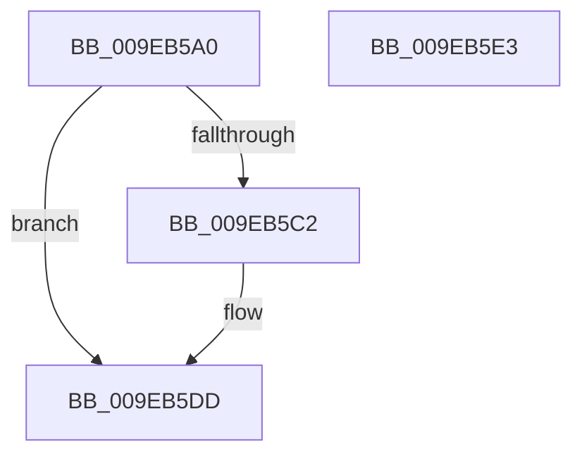

# CmpAllocateKeyControlBlock

- RVA: `0x009EB5A0`–`0x009EB5E4` (길이 `68` bytes)
- VA: `0x00000001409EB5A0`
- 실행 섹션: `PAGE`
- PDB 이름 있음: `예`; PDB Function 태그: `아니요`
- unwind 정보 RVA: `0x0005CF00`
- 디코드: `18`개 명령, `68/68` bytes 표시
- 미해석 바이트: `0` (있으면 어셈블리에 `.byte`로 보존)

> 이 문서는 커널 이미지의 기계어와 PDB 기호를 분석해 생성했습니다. 4번과 5번은 함수 원형과 자료형을 바이너리 사용 방식에서 추정한 C 해석이며 원본 소스 복구 결과는 아닙니다.

## 1. Dependencies

- 직접 호출 지점: **2**; 고유 호출 대상: **2**
- 직접 호출자로 확인된 함수: **1**
- RIP 상대 이미지 참조: **3**

### Outgoing calls
- `0x009EB5B5` → [ExAllocateFromLookasideListEx](../../text/3C/ExAllocateFromLookasideListEx_function_003CD390.md) (function, `0x003CD390`)
- `0x009EB5D5` → [memset](../../text/6C/memset_function_006C6C40.md) (function, `0x006C6C40`)

### Direct callers
- [CmpCloneToUnbackedKcb](../7E/CmpCloneToUnbackedKcb_function_007EA9A8.md) at `0x007EA9BD`

### Static image references
- `0x009EB5A6` → RVA `0x00FDA430` (`PAGEDATA`; read/write)
- `0x009EB5AE` → RVA `0x00E2CAC0` (`.data`; read)
- `0x009EB5C2` → RVA `0x00FDA450` (`PAGEDATA`; read/write)

## 2. Other-region calls and transfers

- 다른 실행 섹션으로 향하는 call: **2**
  - `0x009EB5B5` → [ExAllocateFromLookasideListEx](../../text/3C/ExAllocateFromLookasideListEx_function_003CD390.md) (`PAGE` → `.text`)
  - `0x009EB5D5` → [memset](../../text/6C/memset_function_006C6C40.md) (`PAGE` → `.text`)
- 별도 외부 분기/꼬리 이동을 확인하지 못했습니다.

## 3. Assembly (complete function range)

```asm
009EB5A0  40 53                           push rbx
009EB5A2  48 83 EC 20                     sub rsp, 0x20
009EB5A6  F0 48 FF 05 82 EE 5E 00         lock inc qword ptr [rip + 0x5eee82]
009EB5AE  48 8D 0D 0B 15 44 00            lea rcx, [rip + 0x44150b]
009EB5B5  E8 D6 1D 9E FF                  call 0x1403cd390
009EB5BA  48 8B D8                        mov rbx, rax
009EB5BD  48 85 C0                        test rax, rax
009EB5C0  74 1B                           je 0x1409eb5dd
009EB5C2  F0 48 FF 05 86 EE 5E 00         lock inc qword ptr [rip + 0x5eee86]
009EB5CA  33 D2                           xor edx, edx
009EB5CC  41 B8 38 01 00 00               mov r8d, 0x138
009EB5D2  48 8B C8                        mov rcx, rax
009EB5D5  E8 66 B6 CD FF                  call 0x1406c6c40
009EB5DA  48 8B C3                        mov rax, rbx
009EB5DD  48 83 C4 20                     add rsp, 0x20
009EB5E1  5B                              pop rbx
009EB5E2  C3                              ret
009EB5E3  CC                              int3
```

## 4. C-style interpretation (structured pseudocode)

```c
__int64 __fastcall CmpAllocateKeyControlBlock(__int64 a1, int a2)
{
    __int64 result;
    __int64 v_rsp;

    v_rsp = (v_rsp) - (32);
    result = ExAllocateFromLookasideListEx(v_rip + 4461835, a2, a3, a4);
    if (result != 0) {
        a2 = 0;
        a3 = 312;
        a1 = result;
        result = memset(a1, a2, a3, a4);
        result = result;
    }
    v_rsp = (v_rsp) + (32);
    return result;
}
```

## 5. (Beta) C Style

```c
int64_t CmpAllocateKeyControlBlock(int64_t Arg1, int32_t Arg2)
{
    int64_t result;
    int64_t local_rsp;

    local_rsp = (local_rsp) - (32);
    result = ExAllocateFromLookasideListEx(v_rip + 4461835, Arg2, a3, a4);
    if (result != 0) {
        Arg2 = 0;
        a3 = 312;
        Arg1 = result;
        result = memset(Arg1, Arg2, a3, a4);
        result = result;
    }
    local_rsp = (local_rsp) + (32);
    return result;
}
```

## 6. Execution-region graph

[열기: 2D/3D 그래프와 함수 탐색 컨트롤 패널](../../../control-panel.html?section=page&rva=0x009EB5A0&view=graph)

- 2D 그래프는 위에서 아래로 흐르고, 3D 그래프는 빈 공간을 드래그해 회전합니다. Shift+드래그는 이동, 휠은 확대·축소, 함수 노드 선택은 대상 보고서 이동입니다.

### Static fallback


