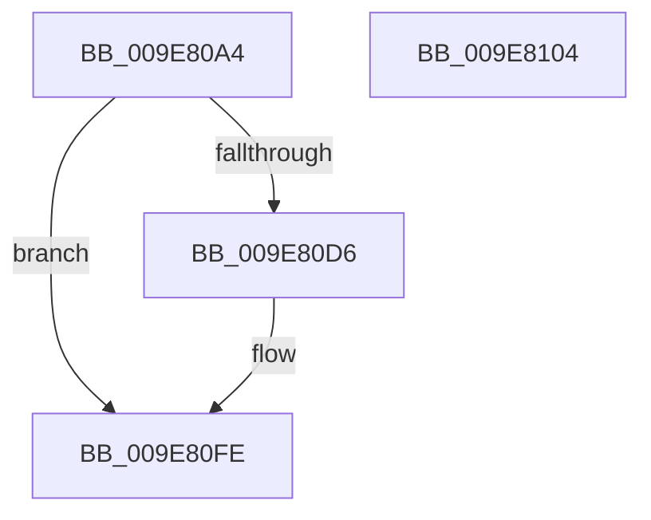

# CmpAllocateSiloContext

- RVA: `0x009E80A4`–`0x009E8105` (길이 `97` bytes)
- VA: `0x00000001409E80A4`
- 실행 섹션: `PAGE`
- PDB 이름 있음: `예`; PDB Function 태그: `아니요`
- unwind 정보 RVA: `0x00064C80`
- 디코드: `28`개 명령, `97/97` bytes 표시
- 미해석 바이트: `0` (있으면 어셈블리에 `.byte`로 보존)

> 이 문서는 커널 이미지의 기계어와 PDB 기호를 분석해 생성했습니다. 4번과 5번은 함수 원형과 자료형을 바이너리 사용 방식에서 추정한 C 해석이며 원본 소스 복구 결과는 아닙니다.

## 1. Dependencies

- 직접 호출 지점: **1**; 고유 호출 대상: **1**
- 직접 호출자로 확인된 함수: **1**
- RIP 상대 이미지 참조: **1**

### Outgoing calls
- `0x009E80CD` → [PsCreateSiloContext](PsCreateSiloContext_function_009E8110.md) (function, `0x009E8110`)

### Direct callers
- [CmpGetOrCreateContextForSiloNoRef](CmpGetOrCreateContextForSiloNoRef_function_009E7E44.md) at `0x009E7E75`

### Static image references
- `0x009E80C2` → RVA `0x009E7BA0` (`CmpFreeSiloContextCallback`; read)

## 2. Other-region calls and transfers

- 다른 실행 섹션으로 향하는 call: **0**
- 별도 외부 분기/꼬리 이동을 확인하지 못했습니다.

## 3. Assembly (complete function range)

```asm
009E80A4  40 53                           push rbx
009E80A6  48 83 EC 30                     sub rsp, 0x30
009E80AA  48 83 64 24 50 00               and qword ptr [rsp + 0x50], 0
009E80B0  48 8D 44 24 50                  lea rax, [rsp + 0x50]
009E80B5  48 8B DA                        mov rbx, rdx
009E80B8  48 89 44 24 20                  mov qword ptr [rsp + 0x20], rax
009E80BD  BA 28 00 00 00                  mov edx, 0x28
009E80C2  4C 8D 0D D7 FA FF FF            lea r9, [rip - 0x529]
009E80C9  44 8D 42 D9                     lea r8d, [rdx - 0x27]
009E80CD  E8 3E 00 00 00                  call 0x1409e8110
009E80D2  85 C0                           test eax, eax
009E80D4  78 28                           js 0x1409e80fe
009E80D6  48 8B 4C 24 50                  mov rcx, qword ptr [rsp + 0x50]
009E80DB  33 C0                           xor eax, eax
009E80DD  0F 57 C0                        xorps xmm0, xmm0
009E80E0  48 89 0B                        mov qword ptr [rbx], rcx
009E80E3  48 89 41 20                     mov qword ptr [rcx + 0x20], rax
009E80E7  0F 11 01                        movups xmmword ptr [rcx], xmm0
009E80EA  0F 11 41 10                     movups xmmword ptr [rcx + 0x10], xmm0
009E80EE  48 21 01                        and qword ptr [rcx], rax
009E80F1  48 8D 41 10                     lea rax, [rcx + 0x10]
009E80F5  48 89 40 08                     mov qword ptr [rax + 8], rax
009E80F9  48 89 00                        mov qword ptr [rax], rax
009E80FC  33 C0                           xor eax, eax
009E80FE  48 83 C4 30                     add rsp, 0x30
009E8102  5B                              pop rbx
009E8103  C3                              ret
009E8104  CC                              int3
```

## 4. C-style interpretation (structured pseudocode)

```c
__int64 __fastcall CmpAllocateSiloContext(__int64 a1, __int64 a2)
{
    __int64 result;
    __int64 v_rsp;
    unsigned __int64 v_stack_m18;
    unsigned __int64 v_stack_p18;

    v_rsp = (v_rsp) - (48);
    v_stack_m18 = v_stack_p18;
    result = PsCreateSiloContext(a1, 40, 40 - 39, v_rip - 1321);
    if (!(sign_flag)) {
        a1 = v_stack_p18;
        result = 0;
        *(unsigned __int64 *)(a2) = a1;
        *(unsigned __int64 *)(a1 + 32) = 0;
        *(unsigned __int64 *)(a1) = v_xmm0;
        *(unsigned __int64 *)(a1 + 16) = v_xmm0;
        result = a1 + 16;
        *(unsigned __int64 *)(result + 8) = result;
        *(unsigned __int64 *)(result) = result;
        result = 0;
    }
    v_rsp = (v_rsp) + (48);
    return result;
}
```

## 5. (Beta) C Style

```c
int64_t CmpAllocateSiloContext(int64_t Arg1, void *Arg2)
{
    uint8_t *arg2 = (uint8_t *)Arg2;

    int64_t result;
    int64_t local_rsp;
    uint64_t v_stack_m18;
    uint64_t v_stack_p18;

    local_rsp = (local_rsp) - (48);
    v_stack_m18 = v_stack_p18;
    result = PsCreateSiloContext(Arg1, 40, 40 - 39, v_rip - 1321);
    if (!(sign_flag)) {
        Arg1 = v_stack_p18;
        result = 0;
        *(uint64_t *)(arg2) = Arg1;
        *(uint64_t *)(Arg1 + 0x20) = 0;
        *(uint64_t *)(Arg1) = v_xmm0;
        *(uint64_t *)(Arg1 + 0x10) = v_xmm0;
        result = Arg1 + 16;
        *(uint64_t *)(result + 0x8) = result;
        *(uint64_t *)(result) = result;
        result = 0;
    }
    local_rsp = (local_rsp) + (48);
    return result;
}
```

### 관측된 메모리 오프셋

구조체 형식이 확인되지 않은 접근은 인자 기준의 오프셋으로만 기록했습니다.

| 기준 인자 | 오프셋 표현 | 폭 (bit) | 접근 |
|---|---:|---:|---|
| `Arg2` | `+ 0x0` | `64` | `W` |

## 6. Execution-region graph

[열기: 2D/3D 그래프와 함수 탐색 컨트롤 패널](../../../control-panel.html?section=page&rva=0x009E80A4&view=graph)

- 2D 그래프는 위에서 아래로 흐르고, 3D 그래프는 빈 공간을 드래그해 회전합니다. Shift+드래그는 이동, 휠은 확대·축소, 함수 노드 선택은 대상 보고서 이동입니다.

### Static fallback


