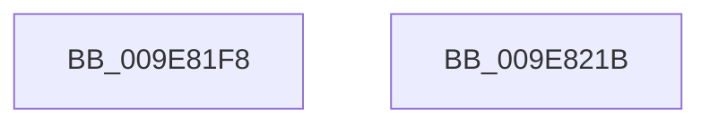

# CmpAttachContextToSilo

- RVA: `0x009E81F8`–`0x009E821C` (길이 `36` bytes)
- VA: `0x00000001409E81F8`
- 실행 섹션: `PAGE`
- PDB 이름 있음: `예`; PDB Function 태그: `아니요`
- unwind 정보 RVA: `0x0005C788`
- 디코드: `12`개 명령, `36/36` bytes 표시
- 미해석 바이트: `0` (있으면 어셈블리에 `.byte`로 보존)

> 이 문서는 커널 이미지의 기계어와 PDB 기호를 분석해 생성했습니다. 4번과 5번은 함수 원형과 자료형을 바이너리 사용 방식에서 추정한 C 해석이며 원본 소스 복구 결과는 아닙니다.

## 1. Dependencies

- 직접 호출 지점: **1**; 고유 호출 대상: **1**
- 직접 호출자로 확인된 함수: **1**
- RIP 상대 이미지 참조: **1**

### Outgoing calls
- `0x009E8208` → [PsInsertPermanentSiloContextEx](PsInsertPermanentSiloContextEx_function_009E8224.md) (function, `0x009E8224`)

### Direct callers
- [CmpGetOrCreateContextForSiloNoRef](CmpGetOrCreateContextForSiloNoRef_function_009E7E44.md) at `0x009E7E8B`

### Static image references
- `0x009E8202` → RVA `0x00EF7A50` (`.data`; read)

## 2. Other-region calls and transfers

- 다른 실행 섹션으로 향하는 call: **0**
- 별도 외부 분기/꼬리 이동을 확인하지 못했습니다.

## 3. Assembly (complete function range)

```asm
009E81F8  48 83 EC 28                     sub rsp, 0x28
009E81FC  4C 8B C2                        mov r8, rdx
009E81FF  45 33 C9                        xor r9d, r9d
009E8202  8B 15 48 F8 50 00               mov edx, dword ptr [rip + 0x50f848]
009E8208  E8 17 00 00 00                  call 0x1409e8224
009E820D  8B C8                           mov ecx, eax
009E820F  33 C0                           xor eax, eax
009E8211  85 C9                           test ecx, ecx
009E8213  0F 48 C1                        cmovs eax, ecx
009E8216  48 83 C4 28                     add rsp, 0x28
009E821A  C3                              ret
009E821B  CC                              int3
```

## 4. C-style interpretation (structured pseudocode)

```c
__int64 __fastcall CmpAttachContextToSilo(__int64 a1, __int64 a2, __int64 a3, int a4)
{
    __int64 result;
    __int64 v_rsp;

    v_rsp = (v_rsp) - (40);
    a4 = 0;
    result = PsInsertPermanentSiloContextEx(a1, (unsigned int)(*(unsigned int *)(v_rip + 5306440)), a2, a4);
    result = 0;
    if (sign_flag) { result = (unsigned int)((unsigned int)((unsigned int)(result))); }
    v_rsp = (v_rsp) + (40);
    return result;
}
```

## 5. (Beta) C Style

```c
int64_t CmpAttachContextToSilo(int64_t Arg1, int64_t Arg2, int64_t Arg3, int32_t Arg4)
{
    int64_t result;
    int64_t local_rsp;

    local_rsp = (local_rsp) - (40);
    Arg4 = 0;
    result = PsInsertPermanentSiloContextEx(Arg1, (uint32_t)(*(uint32_t *)(v_rip + 0x50F848)), Arg2, Arg4);
    result = 0;
    if (sign_flag) { result = (uint32_t)((uint32_t)((uint32_t)(result))); }
    local_rsp = (local_rsp) + (40);
    return result;
}
```

## 6. Execution-region graph

[열기: 2D/3D 그래프와 함수 탐색 컨트롤 패널](../../../control-panel.html?section=page&rva=0x009E81F8&view=graph)

- 2D 그래프는 위에서 아래로 흐르고, 3D 그래프는 빈 공간을 드래그해 회전합니다. Shift+드래그는 이동, 휠은 확대·축소, 함수 노드 선택은 대상 보고서 이동입니다.

### Static fallback


