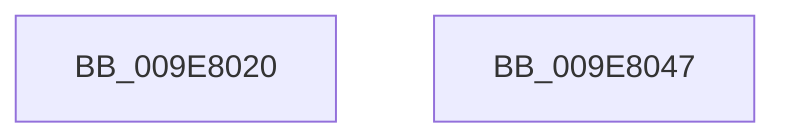

# CmpGetContextForSiloNoRef

- RVA: `0x009E8020`–`0x009E8048` (길이 `40` bytes)
- VA: `0x00000001409E8020`
- 실행 섹션: `PAGE`
- PDB 이름 있음: `예`; PDB Function 태그: `아니요`
- unwind 정보 RVA: `0x0005C788`
- 디코드: `9`개 명령, `40/40` bytes 표시
- 미해석 바이트: `0` (있으면 어셈블리에 `.byte`로 보존)

> 이 문서는 커널 이미지의 기계어와 PDB 기호를 분석해 생성했습니다. 4번과 5번은 함수 원형과 자료형을 바이너리 사용 방식에서 추정한 C 해석이며 원본 소스 복구 결과는 아닙니다.

## 1. Dependencies

- 직접 호출 지점: **1**; 고유 호출 대상: **1**
- 직접 호출자로 확인된 함수: **4**
- RIP 상대 이미지 참조: **1**

### Outgoing calls
- `0x009E8038` → [PsGetPermanentSiloContext](../../text/3E/PsGetPermanentSiloContext_function_003EE100.md) (function, `0x003EE100`)

### Direct callers
- [PspDeleteExternalServerSiloState](../77/PspDeleteExternalServerSiloState_function_0077FB88.md) at `0x0077FBEE`
- [CmGetRootKeyObjectForSilo](CmGetRootKeyObjectForSilo_function_009E7CCC.md) at `0x009E7CF1`
- [CmpGetOrCreateContextForSiloNoRef](CmpGetOrCreateContextForSiloNoRef_function_009E7E44.md) at `0x009E7E63`
- [CmpGetOrCreateContextForSiloNoRef](CmpGetOrCreateContextForSiloNoRef_function_009E7E44.md) at `0x009E7ED8`
- [CmLockKeyForWrite](CmLockKeyForWrite_function_009E7EE8.md) at `0x009E7F0C`

### Static image references
- `0x009E8024` → RVA `0x00EF7A50` (`.data`; read)

## 2. Other-region calls and transfers

- 다른 실행 섹션으로 향하는 call: **1**
  - `0x009E8038` → [PsGetPermanentSiloContext](../../text/3E/PsGetPermanentSiloContext_function_003EE100.md) (`PAGE` → `.text`)
- 별도 외부 분기/꼬리 이동을 확인하지 못했습니다.

## 3. Assembly (complete function range)

```asm
009E8020  48 83 EC 28                     sub rsp, 0x28
009E8024  8B 15 26 FA 50 00               mov edx, dword ptr [rip + 0x50fa26]
009E802A  4C 8D 44 24 38                  lea r8, [rsp + 0x38]
009E802F  48 C7 44 24 38 00 00 00 00      mov qword ptr [rsp + 0x38], 0
009E8038  E8 C3 60 A0 FF                  call 0x1403ee100
009E803D  48 8B 44 24 38                  mov rax, qword ptr [rsp + 0x38]
009E8042  48 83 C4 28                     add rsp, 0x28
009E8046  C3                              ret
009E8047  CC                              int3
```

## 4. C-style interpretation (structured pseudocode)

```c
__int64 __fastcall CmpGetContextForSiloNoRef(void)
{
    __int64 result;
    __int64 v_rsp;
    unsigned __int64 v_stack_p10;

    v_rsp = (v_rsp) - (40);
    v_stack_p10 = 0;
    result = PsGetPermanentSiloContext(a1, (unsigned int)(*(unsigned int *)(v_rip + 5306918)), v_stack_p10, a4);
    v_rsp = (v_rsp) + (40);
    return v_stack_p10;
}
```

## 5. (Beta) C Style

```c
void CmpGetContextForSiloNoRef(void)
{
    int64_t result;
    int64_t local_rsp;
    uint64_t v_stack_p10;

    local_rsp = (local_rsp) - (40);
    v_stack_p10 = 0;
    result = PsGetPermanentSiloContext(a1, (uint32_t)(*(uint32_t *)(v_rip + 0x50FA26)), v_stack_p10, a4);
    local_rsp = (local_rsp) + (40);
    return v_stack_p10;
}
```

## 6. Execution-region graph

[열기: 2D/3D 그래프와 함수 탐색 컨트롤 패널](../../../control-panel.html?section=page&rva=0x009E8020&view=graph)

- 2D 그래프는 위에서 아래로 흐르고, 3D 그래프는 빈 공간을 드래그해 회전합니다. Shift+드래그는 이동, 휠은 확대·축소, 함수 노드 선택은 대상 보고서 이동입니다.

### Static fallback


