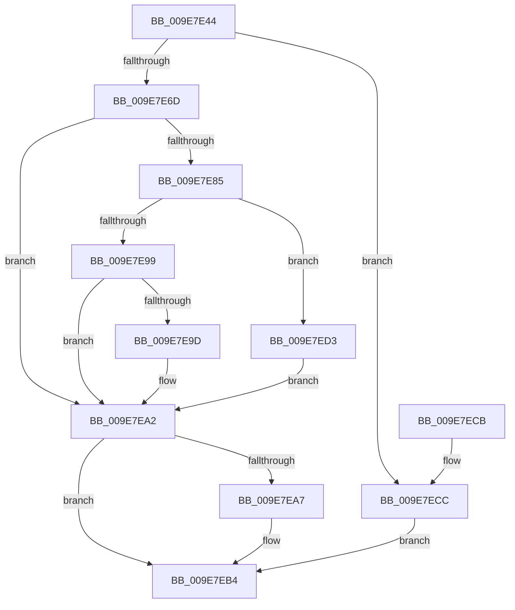

# CmpGetOrCreateContextForSiloNoRef

- RVA: `0x009E7E44`–`0x009E7EE2` (길이 `158` bytes)
- VA: `0x00000001409E7E44`
- 실행 섹션: `PAGE`
- PDB 이름 있음: `예`; PDB Function 태그: `아니요`
- unwind 정보 RVA: `0x000A4C9C`
- 디코드: `50`개 명령, `158/158` bytes 표시
- 미해석 바이트: `0` (있으면 어셈블리에 `.byte`로 보존)

> 이 문서는 커널 이미지의 기계어와 PDB 기호를 분석해 생성했습니다. 4번과 5번은 함수 원형과 자료형을 바이너리 사용 방식에서 추정한 C 해석이며 원본 소스 복구 결과는 아닙니다.

## 1. Dependencies

- 직접 호출 지점: **5**; 고유 호출 대상: **4**
- 직접 호출자로 확인된 함수: **2**
- RIP 상대 이미지 참조: **0**

### Outgoing calls
- `0x009E7E63` → [CmpGetContextForSiloNoRef](CmpGetContextForSiloNoRef_function_009E8020.md) (function, `0x009E8020`)
- `0x009E7E75` → [CmpAllocateSiloContext](CmpAllocateSiloContext_function_009E80A4.md) (function, `0x009E80A4`)
- `0x009E7E8B` → [CmpAttachContextToSilo](CmpAttachContextToSilo_function_009E81F8.md) (function, `0x009E81F8`)
- `0x009E7EAF` → [ObfDereferenceObjectWithTag](../../text/2F/ObfDereferenceObjectWithTag_function_002F78E0.md) (function, `0x002F78E0`)
- `0x009E7ED8` → [CmpGetContextForSiloNoRef](CmpGetContextForSiloNoRef_function_009E8020.md) (function, `0x009E8020`)

### Direct callers
- [CmInitServerSiloState](../7E/CmInitServerSiloState_function_007E5B14.md) at `0x007E5B43`
- [CmInitSiloNamespace](CmInitSiloNamespace_function_009E7DD8.md) at `0x009E7E09`

### Static image references
- 디코드된 RIP-relative 메모리 참조가 없습니다.

## 2. Other-region calls and transfers

- 다른 실행 섹션으로 향하는 call: **1**
  - `0x009E7EAF` → [ObfDereferenceObjectWithTag](../../text/2F/ObfDereferenceObjectWithTag_function_002F78E0.md) (`PAGE` → `.text`)
- 별도 외부 분기/꼬리 이동을 확인하지 못했습니다.

## 3. Assembly (complete function range)

```asm
009E7E44  48 8B C4                        mov rax, rsp
009E7E47  48 89 58 08                     mov qword ptr [rax + 8], rbx
009E7E4B  48 89 68 10                     mov qword ptr [rax + 0x10], rbp
009E7E4F  48 89 70 20                     mov qword ptr [rax + 0x20], rsi
009E7E53  57                              push rdi
009E7E54  48 83 EC 20                     sub rsp, 0x20
009E7E58  48 83 60 18 00                  and qword ptr [rax + 0x18], 0
009E7E5D  48 8B F2                        mov rsi, rdx
009E7E60  48 8B E9                        mov rbp, rcx
009E7E63  E8 B8 01 00 00                  call 0x1409e8020
009E7E68  48 85 C0                        test rax, rax
009E7E6B  75 5F                           jne 0x1409e7ecc
009E7E6D  48 8D 54 24 40                  lea rdx, [rsp + 0x40]
009E7E72  48 8B CD                        mov rcx, rbp
009E7E75  E8 2A 02 00 00                  call 0x1409e80a4
009E7E7A  48 8B 7C 24 40                  mov rdi, qword ptr [rsp + 0x40]
009E7E7F  8B D8                           mov ebx, eax
009E7E81  85 C0                           test eax, eax
009E7E83  78 1D                           js 0x1409e7ea2
009E7E85  48 8B D7                        mov rdx, rdi
009E7E88  48 8B CD                        mov rcx, rbp
009E7E8B  E8 68 03 00 00                  call 0x1409e81f8
009E7E90  8B D8                           mov ebx, eax
009E7E92  3D BB 00 00 C0                  cmp eax, 0xc00000bb
009E7E97  74 3A                           je 0x1409e7ed3
009E7E99  85 C0                           test eax, eax
009E7E9B  78 05                           js 0x1409e7ea2
009E7E9D  33 DB                           xor ebx, ebx
009E7E9F  48 89 3E                        mov qword ptr [rsi], rdi
009E7EA2  48 85 FF                        test rdi, rdi
009E7EA5  74 0D                           je 0x1409e7eb4
009E7EA7  BA 43 4D 31 20                  mov edx, 0x20314d43
009E7EAC  48 8B CF                        mov rcx, rdi
009E7EAF  E8 2C FA 90 FF                  call 0x1402f78e0
009E7EB4  48 8B 6C 24 38                  mov rbp, qword ptr [rsp + 0x38]
009E7EB9  8B C3                           mov eax, ebx
009E7EBB  48 8B 5C 24 30                  mov rbx, qword ptr [rsp + 0x30]
009E7EC0  48 8B 74 24 48                  mov rsi, qword ptr [rsp + 0x48]
009E7EC5  48 83 C4 20                     add rsp, 0x20
009E7EC9  5F                              pop rdi
009E7ECA  C3                              ret
009E7ECB  CC                              int3
009E7ECC  33 DB                           xor ebx, ebx
009E7ECE  48 89 06                        mov qword ptr [rsi], rax
009E7ED1  EB E1                           jmp 0x1409e7eb4
009E7ED3  33 DB                           xor ebx, ebx
009E7ED5  48 8B CD                        mov rcx, rbp
009E7ED8  E8 43 01 00 00                  call 0x1409e8020
009E7EDD  48 89 06                        mov qword ptr [rsi], rax
009E7EE0  EB C0                           jmp 0x1409e7ea2
```

## 4. C-style interpretation (structured pseudocode)

```c
__int64 __fastcall CmpGetOrCreateContextForSiloNoRef(__int64 a1, __int64 a2)
{
    __int64 result;
    __int64 v_rbx;
    __int64 v_rsp;
    unsigned __int64 v_stack_p10;
    unsigned __int64 v_stack_p18;
    unsigned __int64 v_stack_p20;
    unsigned __int64 v_stack_p8;

    *(unsigned __int64 *)(v_rsp + 8) = v_rbx;
    *(unsigned __int64 *)(v_rsp + 16) = v_rbp;
    *(unsigned __int64 *)(v_rsp + 32) = v_rsi;
    v_rsp = (v_rsp) - (32);
    result = CmpGetContextForSiloNoRef(a1, a2, a3, a4);
    if (result != 0) goto loc_009E7ECC;
    result = CmpAllocateSiloContext(a1, v_stack_p18, a3, a4);
    if (sign_flag) goto loc_009E7EA2;
    result = CmpAttachContextToSilo(a1, v_stack_p18, a3, a4);
    if (((unsigned int)(result)) == 0xC00000BBULL) goto loc_009E7ED3;
    v_rbx = (unsigned int)((unsigned int)(result));
    if (!(sign_flag)) {
        v_rbx = 0;
        *(unsigned __int64 *)(a2) = v_stack_p18;
    }
    if (v_stack_p18 != 0) {
        a2 = 0x20314D43ULL;
        a1 = v_stack_p18;
        result = ObfDereferenceObjectWithTag(a1, a2, a3, a4);
    }
    v_rsp = (v_rsp) + (32);
    return 0;
loc_009E7ECC:
    v_rbx = 0;
    *(unsigned __int64 *)(v_stack_p20) = 0;
    goto loc_009E7EB4;
loc_009E7ED3:
    v_rbx = 0;
    result = CmpGetContextForSiloNoRef(v_stack_p10, a2, a3, a4);
    *(unsigned __int64 *)(v_stack_p20) = result;
    goto loc_009E7EA2;
}
```

## 5. (Beta) C Style

```c
int64_t CmpGetOrCreateContextForSiloNoRef(int64_t Arg1, void *Arg2)
{
    uint8_t *arg2 = (uint8_t *)Arg2;

    int64_t result;
    int64_t local_rbx;
    int64_t local_rsp;
    uint64_t v_stack_p10;
    uint64_t v_stack_p18;
    uint64_t v_stack_p20;
    uint64_t v_stack_p8;

    *(uint64_t *)(local_rsp + 0x8) = local_rbx;
    *(uint64_t *)(local_rsp + 0x10) = local_rbp;
    *(uint64_t *)(local_rsp + 0x20) = local_rsi;
    local_rsp = (local_rsp) - (32);
    result = CmpGetContextForSiloNoRef(Arg1, Arg2, a3, a4);
    if (result != 0) goto loc_009E7ECC;
    result = CmpAllocateSiloContext(Arg1, v_stack_p18, a3, a4);
    if (sign_flag) goto loc_009E7EA2;
    result = CmpAttachContextToSilo(Arg1, v_stack_p18, a3, a4);
    if (((uint32_t)(result)) == 0xC00000BBULL) goto loc_009E7ED3;
    local_rbx = (uint32_t)((uint32_t)(result));
    if (!(sign_flag)) {
        local_rbx = 0;
        *(uint64_t *)(arg2) = v_stack_p18;
    }
    if (v_stack_p18 != 0) {
        Arg2 = 0x20314D43ULL;
        Arg1 = v_stack_p18;
        result = ObfDereferenceObjectWithTag(Arg1, Arg2, a3, a4);
    }
    local_rsp = (local_rsp) + (32);
    return 0;
loc_009E7ECC:
    local_rbx = 0;
    *(uint64_t *)(v_stack_p20) = 0;
    goto loc_009E7EB4;
loc_009E7ED3:
    local_rbx = 0;
    result = CmpGetContextForSiloNoRef(v_stack_p10, Arg2, a3, a4);
    *(uint64_t *)(v_stack_p20) = result;
    goto loc_009E7EA2;
}
```

### 관측된 메모리 오프셋

구조체 형식이 확인되지 않은 접근은 인자 기준의 오프셋으로만 기록했습니다.

| 기준 인자 | 오프셋 표현 | 폭 (bit) | 접근 |
|---|---:|---:|---|
| `Arg2` | `+ 0x0` | `64` | `W` |

## 6. Execution-region graph

[열기: 2D/3D 그래프와 함수 탐색 컨트롤 패널](../../../control-panel.html?section=page&rva=0x009E7E44&view=graph)

- 2D 그래프는 위에서 아래로 흐르고, 3D 그래프는 빈 공간을 드래그해 회전합니다. Shift+드래그는 이동, 휠은 확대·축소, 함수 노드 선택은 대상 보고서 이동입니다.

### Static fallback


