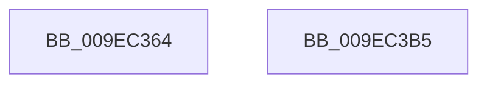

# CmpRemoveKeyHashFromDeletedKcbTable

- RVA: `0x009EC364`–`0x009EC3B6` (길이 `82` bytes)
- VA: `0x00000001409EC364`
- 실행 섹션: `PAGE`
- PDB 이름 있음: `예`; PDB Function 태그: `아니요`
- unwind 정보 RVA: `0x0005C788`
- 디코드: `23`개 명령, `82/82` bytes 표시
- 미해석 바이트: `0` (있으면 어셈블리에 `.byte`로 보존)

> 이 문서는 커널 이미지의 기계어와 PDB 기호를 분석해 생성했습니다. 4번과 5번은 함수 원형과 자료형을 바이너리 사용 방식에서 추정한 C 해석이며 원본 소스 복구 결과는 아닙니다.

## 1. Dependencies

- 직접 호출 지점: **1**; 고유 호출 대상: **1**
- 직접 호출자로 확인된 함수: **3**
- RIP 상대 이미지 참조: **0**

### Outgoing calls
- `0x009EC3AB` → [CmpRemoveKeyHashFromTableEntry](CmpRemoveKeyHashFromTableEntry_function_009EC3C0.md) (function, `0x009EC3C0`)

### Direct callers
- [sub_00851B91](../85/Unknown_function_00851B91.md) at `0x00851C87`
- [sub_008622EA](../86/Unknown_function_008622EA.md) at `0x008622F9`
- [sub_00863192](../86/Unknown_function_00863192.md) at `0x008631A1`

### Static image references
- 디코드된 RIP-relative 메모리 참조가 없습니다.

## 2. Other-region calls and transfers

- 다른 실행 섹션으로 향하는 call: **0**
- 별도 외부 분기/꼬리 이동을 확인하지 못했습니다.

## 3. Assembly (complete function range)

```asm
009EC364  48 83 EC 28                     sub rsp, 0x28
009EC368  8B 02                           mov eax, dword ptr [rdx]
009EC36A  4C 8B D1                        mov r10, rcx
009EC36D  8B 89 88 06 00 00               mov ecx, dword ptr [rcx + 0x688]
009EC373  44 8B C0                        mov r8d, eax
009EC376  FF C9                           dec ecx
009EC378  41 C1 E8 09                     shr r8d, 9
009EC37C  44 33 C0                        xor r8d, eax
009EC37F  4C 8B DA                        mov r11, rdx
009EC382  41 69 C0 A3 8A 01 00            imul eax, r8d, 0x18aa3
009EC389  44 8B C8                        mov r9d, eax
009EC38C  49 C1 E9 09                     shr r9, 9
009EC390  44 8B C0                        mov r8d, eax
009EC393  49 8B 82 80 06 00 00            mov rax, qword ptr [r10 + 0x680]
009EC39A  4D 33 C8                        xor r9, r8
009EC39D  4C 23 C9                        and r9, rcx
009EC3A0  4B 8D 0C 49                     lea rcx, [r9 + r9*2]
009EC3A4  48 8D 14 C8                     lea rdx, [rax + rcx*8]
009EC3A8  49 8B CB                        mov rcx, r11
009EC3AB  E8 10 00 00 00                  call 0x1409ec3c0
009EC3B0  48 83 C4 28                     add rsp, 0x28
009EC3B4  C3                              ret
009EC3B5  CC                              int3
```

## 4. C-style interpretation (structured pseudocode)

```c
__int64 __fastcall CmpRemoveKeyHashFromDeletedKcbTable(__int64 a1, __int64 a2)
{
    __int64 result;
    __int64 v_rsp;

    v_rsp = (v_rsp) - (40);
    a1 = (unsigned int)(((unsigned int)(*(unsigned int *)(a1 + 1672))) - 1);
    a3 = (unsigned int)(((unsigned int)((unsigned int)((unsigned int)(*(unsigned int *)(a2))))) >> (9));
    a3 = (unsigned int)((a3) ^ ((unsigned int)((unsigned int)(*(unsigned int *)(a2)))));
    result = (unsigned int)(((unsigned int)(*(unsigned int *)(a2))) * ((unsigned int)(a3)));
    a4 = ((unsigned int)((unsigned int)(result))) >> (9);
    a4 = (a4) ^ ((unsigned int)((unsigned int)(result)));
    a4 = (a4) & (a1);
    result = CmpRemoveKeyHashFromTableEntry(a2, *(unsigned __int64 *)(a1 + 1664) + a4 + a4 * 2 * 8, (unsigned int)((unsigned int)(result)), a4);
    v_rsp = (v_rsp) + (40);
    return result;
}
```

## 5. (Beta) C Style

```c
int64_t CmpRemoveKeyHashFromDeletedKcbTable(void *Arg1, void *Arg2)
{
    uint8_t *arg1 = (uint8_t *)Arg1;
    uint8_t *arg2 = (uint8_t *)Arg2;

    int64_t result;
    int64_t local_rsp;

    local_rsp = (local_rsp) - (40);
    Arg1 = (uint32_t)(((uint32_t)(*(uint32_t *)(arg1 + 0x688))) - 1);
    a3 = (uint32_t)(((uint32_t)((uint32_t)((uint32_t)(*(uint32_t *)(arg2))))) >> (9));
    a3 = (uint32_t)((a3) ^ ((uint32_t)((uint32_t)(*(uint32_t *)(arg2)))));
    result = (uint32_t)(((uint32_t)(*(uint32_t *)(arg2))) * ((uint32_t)(a3)));
    a4 = ((uint32_t)((uint32_t)(result))) >> (9);
    a4 = (a4) ^ ((uint32_t)((uint32_t)(result)));
    a4 = (a4) & (Arg1);
    result = CmpRemoveKeyHashFromTableEntry(Arg2, *(uint64_t *)(arg1 + 0x680) + a4 + a4 * 2 * 8, (uint32_t)((uint32_t)(result)), a4);
    local_rsp = (local_rsp) + (40);
    return result;
}
```

### 관측된 메모리 오프셋

구조체 형식이 확인되지 않은 접근은 인자 기준의 오프셋으로만 기록했습니다.

| 기준 인자 | 오프셋 표현 | 폭 (bit) | 접근 |
|---|---:|---:|---|
| `Arg1` | `+ 0x680` | `64` | `R` |
| `Arg1` | `+ 0x688` | `32` | `R` |
| `Arg2` | `+ 0x0` | `32` | `R` |

## 6. Execution-region graph

[열기: 2D/3D 그래프와 함수 탐색 컨트롤 패널](../../../control-panel.html?section=page&rva=0x009EC364&view=graph)

- 2D 그래프는 위에서 아래로 흐르고, 3D 그래프는 빈 공간을 드래그해 회전합니다. Shift+드래그는 이동, 휠은 확대·축소, 함수 노드 선택은 대상 보고서 이동입니다.

### Static fallback


