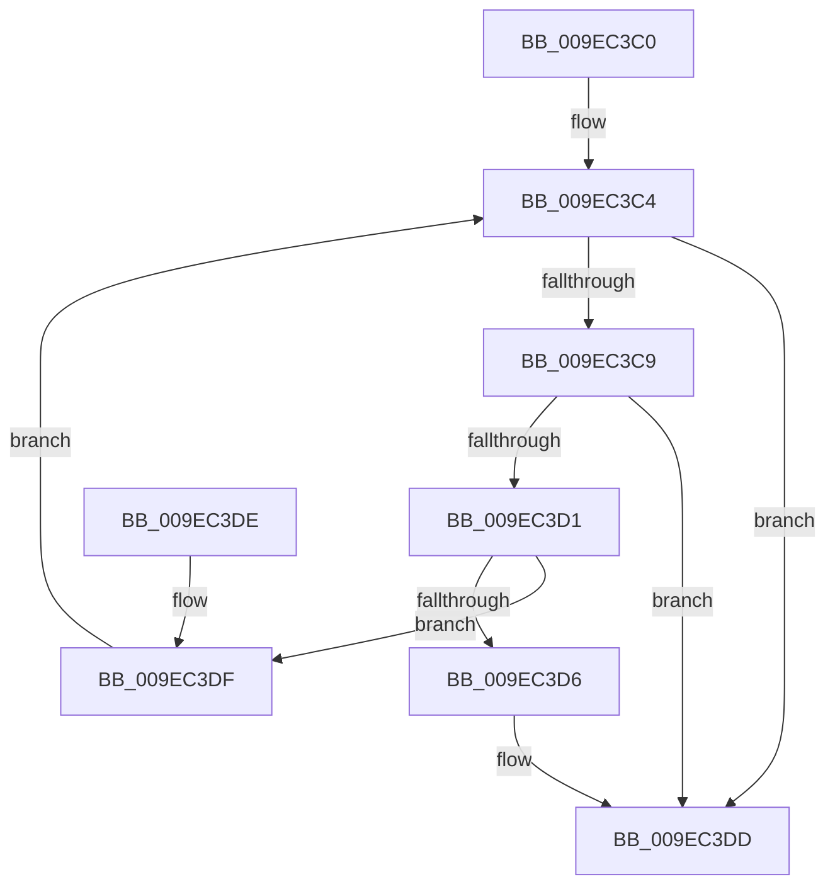

# CmpRemoveKeyHashFromTableEntry

- RVA: `0x009EC3C0`–`0x009EC3E5` (길이 `37` bytes)
- VA: `0x00000001409EC3C0`
- 실행 섹션: `PAGE`
- PDB 이름 있음: `예`; PDB Function 태그: `아니요`
- unwind 정보 RVA: `0x000DB714`
- 디코드: `14`개 명령, `37/37` bytes 표시
- 미해석 바이트: `0` (있으면 어셈블리에 `.byte`로 보존)

> 이 문서는 커널 이미지의 기계어와 PDB 기호를 분석해 생성했습니다. 4번과 5번은 함수 원형과 자료형을 바이너리 사용 방식에서 추정한 C 해석이며 원본 소스 복구 결과는 아닙니다.

## 1. Dependencies

- 직접 호출 지점: **0**; 고유 호출 대상: **0**
- 직접 호출자로 확인된 함수: **1**
- RIP 상대 이미지 참조: **0**

### Outgoing calls
- 직접 디코드된 call 명령이 없습니다.

### Direct callers
- [CmpRemoveKeyHashFromDeletedKcbTable](CmpRemoveKeyHashFromDeletedKcbTable_function_009EC364.md) at `0x009EC3AB`

### Static image references
- 디코드된 RIP-relative 메모리 참조가 없습니다.

## 2. Other-region calls and transfers

- 다른 실행 섹션으로 향하는 call: **0**
- 별도 외부 분기/꼬리 이동을 확인하지 못했습니다.

## 3. Assembly (complete function range)

```asm
009EC3C0  48 83 C2 10                     add rdx, 0x10
009EC3C4  48 85 D2                        test rdx, rdx
009EC3C7  74 14                           je 0x1409ec3dd
009EC3C9  48 8B 02                        mov rax, qword ptr [rdx]
009EC3CC  48 85 C0                        test rax, rax
009EC3CF  74 0C                           je 0x1409ec3dd
009EC3D1  48 3B C1                        cmp rax, rcx
009EC3D4  75 09                           jne 0x1409ec3df
009EC3D6  48 8B 40 08                     mov rax, qword ptr [rax + 8]
009EC3DA  48 89 02                        mov qword ptr [rdx], rax
009EC3DD  C3                              ret
009EC3DE  CC                              int3
009EC3DF  48 8D 50 08                     lea rdx, [rax + 8]
009EC3E3  EB DF                           jmp 0x1409ec3c4
```

## 4. C-style interpretation (structured pseudocode)

```c
__int64 __fastcall CmpRemoveKeyHashFromTableEntry(__int64 a1, __int64 a2)
{
    a2 = (a2) + (16);
loc_009EC3C4:
    if (a2 == 0) goto loc_009EC3DD;
    if (*(unsigned __int64 *)(a2) == 0) goto loc_009EC3DD;
    if ((*(unsigned __int64 *)(a2)) != a1) goto loc_009EC3DF;
    *(unsigned __int64 *)(a2) = *(unsigned __int64 *)(*(unsigned __int64 *)(a2) + 8);
loc_009EC3DD:
    return *(unsigned __int64 *)(*(unsigned __int64 *)(a2) + 8);
loc_009EC3DF:
    goto loc_009EC3C4;
}
```

## 5. (Beta) C Style

```c
int64_t CmpRemoveKeyHashFromTableEntry(int64_t Arg1, int64_t Arg2)
{
    Arg2 = (Arg2) + (16);
loc_009EC3C4:
    if (Arg2 == 0) goto loc_009EC3DD;
    if (*(uint64_t *)(Arg2) == 0) goto loc_009EC3DD;
    if ((*(uint64_t *)(Arg2)) != Arg1) goto loc_009EC3DF;
    *(uint64_t *)(Arg2) = *(uint64_t *)(*(uint64_t *)(Arg2) + 0x8);
loc_009EC3DD:
    return *(uint64_t *)(*(uint64_t *)(Arg2) + 0x8);
loc_009EC3DF:
    goto loc_009EC3C4;
}
```

## 6. Execution-region graph

[열기: 2D/3D 그래프와 함수 탐색 컨트롤 패널](../../../control-panel.html?section=page&rva=0x009EC3C0&view=graph)

- 2D 그래프는 위에서 아래로 흐르고, 3D 그래프는 빈 공간을 드래그해 회전합니다. Shift+드래그는 이동, 휠은 확대·축소, 함수 노드 선택은 대상 보고서 이동입니다.

### Static fallback


